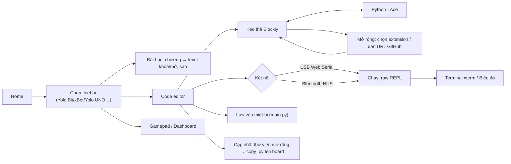
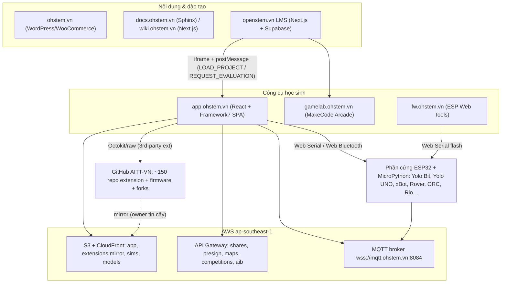
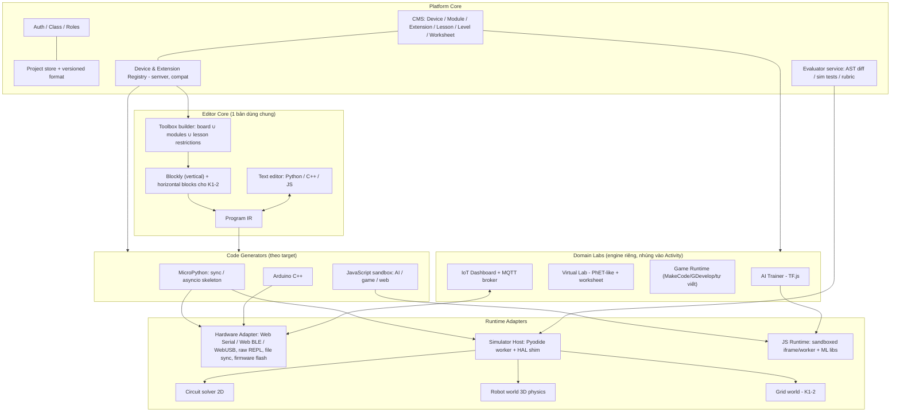

# OhStem Platform Investigation

> Ngày điều tra: 2026-10-02 · Build app được quan sát: `js/app.48bdaa95.js`, static `?v=20260924205808` (index.html Last-Modified 2026-09-24).
> Phương pháp: Playwright + Chrome thật (render SPA, điều hướng bằng router nội bộ), tải static bundle/chunk công khai mà browser cũng tải, đọc GitHub public của `AITT-VN`, docs.ohstem.vn, wiki.ohstem.vn, ohstem.vn, openstem.vn.
> Không đăng nhập, không gọi endpoint private, không brute-force. Các endpoint backend chỉ được **quan sát trong bundle**, không bị gọi trực tiếp.

**Quy ước độ tin cậy**

| Nhãn | Ý nghĩa |
|---|---|
| **VERIFIED** | Nhìn thấy trực tiếp: UI render, network request, code trong bundle/static, hoặc source GitHub |
| **LIKELY** | Có bằng chứng gián tiếp mạnh nhưng chưa thấy toàn bộ luồng chạy |
| **UNKNOWN** | Chưa đủ dữ kiện |

---

## 1. Executive Summary

### OhStem thực sự là loại platform gì?

OhStem không phải một editor đơn lẻ. Đây là một **hệ sinh thái nhiều sản phẩm web**, xoay quanh phần cứng do họ tự sản xuất (Yolo:Bit, Yolo UNO, xBot, Rover, ORC, Rio…):

| Thành phần | Vai trò | Công nghệ (evidence) |
|---|---|---|
| `app.ohstem.vn` (OhStem App) | IDE + nhiều “phòng lab” trong một SPA | React 18.3.1 + Framework7, webpack, S3 + CloudFront — **VERIFIED** |
| `openstem.vn` (OpenSTEM LMS) | LMS: lộ trình, khóa học, lớp học, chấm điểm | Next.js (RSC) + Supabase — **VERIFIED** |
| `gamelab.ohstem.vn` (GameLab) | Lập trình game cho GameKit | Microsoft MakeCode Arcade tự host (`pxtVersion 12.2.21`, `targetId: arcade`) — **VERIFIED** |
| `docs.ohstem.vn` / `wiki.ohstem.vn` | Giáo trình và tài liệu từng kit | Sphinx/ReadTheDocs (repo `AITT-VN/documents`) / Next.js — **VERIFIED** |
| `fw.ohstem.vn` | Cập nhật firmware MicroPython qua trình duyệt | ESP Web Tools + `bin/list.json` trên S3 — **VERIFIED** |
| `ohstem.vn` | Bán hàng, marketing, danh mục sách/giáo trình | WordPress + WooCommerce + Elementor — **VERIFIED** |

Riêng OhStem App gồm **khoảng 10 module** chạy trên **nhiều engine khác nhau**. Chúng **không** dùng chung một editor duy nhất.

### OhStem có phải Wokwi-like circuit simulator không?

**Một phần có. Nhưng khác Wokwi về bản chất** (**VERIFIED**):

- Trong *Thiết bị ảo → Mạch điện* (`#!/vr/circuit-builder`) có trình mô phỏng mạch 2D thật. Người dùng kéo linh kiện, nối dây, bấm **Chạy**. Solver là kiểu **MNA/SPICE tự viết**: các element có `stamp()`, `extraVarCount()`, `isNonlinear()`, `isConverged()`, `_pnjlim` (giới hạn bước Newton cho diode). Có cả mô phỏng lỗi `burnt`/`overload`, đồng hồ đo, pin chanh/khoai tây, vật liệu dẫn điện (bút chì, kẹp giấy…). Mục tiêu là dạy **điện học/vật lý**.
- Board **Yolo UNO** có thể đặt vào mạch và lập trình bằng Blockly/Python. Code Python chạy trong **Pyodide (WebAssembly) trong Web Worker**. Một shim `machine.py` chuyển `Pin/PWM/ADC` thành trạng thái chân trong mô phỏng. Như vậy đây **không phải giả lập vi điều khiển ở mức tập lệnh** như Wokwi (AVR/ESP32/RP2040 emulation), mà là **giả lập ở mức HAL Python**.
- Riêng mô phỏng **robot 3D** (`#!/vr/project-builder`, map builder, contest) là một fork của **GEARS** (Generic Educational Robotics Simulator), chạy trên Babylon.js 8.51.2 + Havok Physics (WASM), Skulpt + Pyodide.

Lõi sản phẩm vẫn là **Blockly → MicroPython → nạp/chạy trên phần cứng thật** qua Web Serial hoặc Web Bluetooth. Simulator là lớp bổ sung.

### Có những loại STEM/lập trình nào?

Đã xác minh: **lập trình khối (Blockly)**, **MicroPython**, **JavaScript** (sinh từ khối cho AI), **C/Arduino** (mode C trong simulator, Arduino IDE/PlatformIO bên ngoài app), **khối ngang kiểu ScratchJr** (Rio, Spark), **Scratch 3**, **MakeCode Arcade** (game), **AI** (huấn luyện ảnh/âm thanh + lập trình AI), **IoT** (MQTT dashboard), **Robotics** (robot thật + 3D sim + thi đấu ORC), **Electronics** (Phys:Bit + circuit sim), **Science** (58 mô phỏng PhET/OhStem kèm phiếu học tập), **3D design** (có khóa trên OpenSTEM, công cụ chưa xác minh).

### Một core chung phục vụ được bao nhiêu loại?

Trong chính OhStem App, **cùng một Blockly 8.0.1 core + hệ extension + Python generator** đang phục vụ:

1. lập trình thiết bị thật (16 thiết bị)
2. bài học tương tác trong app
3. tab Lập trình của robot 3D ảo
4. tab Lập trình của board trong mạch ảo
5. Lập trình AI (generator JavaScript)

Tức là core này phủ **Coding + Physical computing + Electronics (phần lập trình) + Robotics + IoT + AI programming**.

### Những module thực sự khác kiến trúc

| Module | Vì sao cần engine riêng |
|---|---|
| Rio / Spark (khối ngang kiểu ScratchJr) | Dùng một Blockly fork khác (`Blockly2`, horizontal) + game 2D PixiJS |
| GameLab | Ứng dụng MakeCode riêng |
| Science Lab | Iframe PhET + engine phiếu học tập |
| AI trainer | TensorFlow.js trên webcam/mic, không phải viết code |
| Circuit solver | Solver mạch MNA |
| Robot 3D | Engine vật lý (Babylon + Havok) |
| IoT dashboard | Widget builder (react-grid-layout + MQTT) |
| Hướng dẫn lắp ráp 3D | Trình soạn hướng dẫn 3D dạng GLB |

### Top phát hiện (chi tiết ở các mục sau)

1. **Extension = một GitHub repo cho mỗi cặp (board × module).** Mỗi repo có `config.json` + `definition.js` (Blockly block + generator Python) + `toolbox.xml` + `languages/*.js` + driver `.py`. App `eval()` file JS này. Driver `.py` được nạp vào board. **VERIFIED**
2. **Danh mục extension chính thức bị hardcode trong bundle.** Extension của owner tin cậy (`AITT-VN`, `thienuittc`, `vanminh0910`) được mirror lên S3. Extension bên thứ ba lấy thẳng từ `raw.githubusercontent.com`. **VERIFIED**
3. **Generator Python tổ chức code theo prefix key** (`import_`, `init_`, `setup_`, `task_`, `loop_`, `deinit_`). Với Yolo UNO/Spark, generator sinh khung chương trình `asyncio`. **VERIFIED**
4. **Simulator chạy lại đúng các thư viện firmware Python của board** (`/static/gears/firmware/<board>/*.py`) với shim HAL (`platform/esp32/machine.py`). Đây là mô hình “digital twin ở tầng HAL”. **VERIFIED**
5. **Kết nối phần cứng**: Web Serial 115200 + MicroPython raw REPL (Ctrl-C, Ctrl-A, ghi file, Ctrl-D). Web Bluetooth dùng Nordic UART Service. App mobile đóng gói bằng Cordova (**LIKELY**). **VERIFIED** cho phần Web Serial/Web Bluetooth
6. **Lộ trình K12 chính thức trên OpenSTEM** đi từ lớp 1 đến lớp 11: Rio → ScratchJr → Code City/Scratch/STEM Starter Kit → Rover → Yolo:Bit/điện tử → Smart Home/GameLab → ORC K2 → Robotics Engineer/Yolo UNO Python → game Python/nhà kính. Có thêm lộ trình **AI K12** theo QĐ 2422. **VERIFIED**
7. **Bài học trong app được hardcode** trong JS bundle. Mỗi bài có toolbox giới hạn + workspace ban đầu + code đáp án + video/quiz. **VERIFIED**
8. **App nhúng được vào LMS qua iframe + postMessage** (`LOAD_PROJECT`, `REQUEST_EVALUATION`, `TAKE_SCREENSHOT`). Chấm bài bằng so sánh cấu trúc Blockly XML hoặc so Python đã chuẩn hóa. **VERIFIED**
9. **Rủi ro bảo mật quan sát được**: bundle public chứa một GitHub token (`github_pat_…`, cố ý không chép giá trị). Extension được `eval()` không sandbox. CSP cho phép `unsafe-eval` và `default-src *`. Đây là các pattern **không nên lặp lại**.

---

## 2. STEM Curriculum Inventory

### 2.1 Lộ trình chính thức trên OpenSTEM LMS (`openstem.vn/explore`, render bằng Chrome)

Nhóm tuổi được dùng: **4–7 (Mầm non & lớp 1–2), 8–10 (lớp 3–5), 11–13 (lớp 6–8), 14+ (lớp 9+)**. **VERIFIED**

| Lộ trình | Số khóa | Tuổi | Nội dung (tên khóa thật) |
|---|---:|---|---|
| **AI K12 theo QĐ 2422** | 13 | 4+ | AI K1 “Máy thông minh quanh em” → … → AI K12 “Làm ra một hệ thống…”, “6 nghề của thời đại AI” |
| **Mầm non** | 4 | 4–10 | Lập trình Robot Rio bằng nút nhấn; Rio bằng khối lệnh; ScratchJr; Code City (ký hiệu) |
| **Học STEM K12** | 23 | 4+ | Xếp theo lớp, xem bảng 2.2 |
| **Robotics Engineer** | 5 | 8+ | RE1 Robot đầu tiên; RE2 Giác quan của robot; RE3 Lập trình thi đấu Robocon; RE4 Robot tích hợp AI và IoT; Đấu trường ORC |
| **Học lập trình qua trò chơi** | 3 | 4–13 | Code City (ký hiệu) → CodeQuest (khối lệnh) → CodeQuest (Python) |
| **Scratch Creator** | 7 | 8–13 | Hoạt hình & kể chuyện; Trò chơi; Nghệ thuật & âm nhạc; Đố vui; Mô phỏng; Lập trình AI; Tác phẩm lớn |
| **Game Designer** | 6 | 8+ | Nhặt & né; Nhân vật; Thế giới/bản đồ; Luật chơi (biến, điều kiện); Chơi hai người; Dự án game |
| **Lập trình máy tính với Scratch** | 2 | 8–13 | Trò chơi Scratch cơ bản; Ứng dụng AI bằng Scratch |

### 2.2 “Học STEM K12” theo lớp (VERIFIED)

| Lớp | Khóa | Chủ đề (tag của OpenSTEM) | Tool / phần cứng (suy ra từ tên + app) |
|---|---|---|---|
| 1 | Lập trình Robot Rio bằng nút nhấn; Rio bằng khối lệnh | Tư duy lập trình | Rio thật + Rio ảo (`#!/rio/virtual`) |
| 2 | Lập trình ScratchJr; Thiết kế 3D cơ bản | Tư duy lập trình; Thiết kế 3D | ScratchJr; công cụ 3D: **UNKNOWN** |
| 3 | Code City (P1); Trò chơi Scratch cơ bản; Sáng tạo dự án với STEM Starter Kit | Tư duy lập trình | Scratch; STEM Starter Kit |
| 4 | Lập trình Robotics với Rover | Robotics | Rover + Yolo:Bit (Blockly) |
| 5 | Thí nghiệm khoa học sáng tạo | Thí nghiệm khoa học | InnoLab / Science Lab (**LIKELY**) |
| 6 | Tư duy lập trình máy tính với Yolo:Bit; Điện tử vui sáng tạo – Cơ bản | Tư duy lập trình; AI/IoT | Yolo:Bit |
| 7 | Dự án lớn: Nhà thông minh; Lập trình game cơ bản với GameLab | Tư duy lập trình; Game Design | Home:Bit / Yolo UNO; GameLab |
| 8 | Lập trình Robotics với ORC K2 | Robotics | ORC K2 |
| 9 | Thí nghiệm Khoa học | Thí nghiệm khoa học | – |
| 10 | Robotics Engineer 1–4, Đấu trường ORC; Lập trình Yolo UNO với Python | Robotics; Tư duy lập trình | ORC / 3D sim; Yolo UNO |
| 11 | Lập trình game nâng cao với Python; Dự án lớn: Nông nghiệp nhà kính | Game Design; Tư duy lập trình | Python; Yolo UNO greenhouse kit |

### 2.3 Giáo trình theo kit trên docs.ohstem.vn / wiki.ohstem.vn (VERIFIED, số bài đếm từ mục lục)

| Giáo trình | Đối tượng | Lập trình | Hardware | Domain | Số bài / tiến trình |
|---|---|---|---|---|---|
| Làm quen Yolo:Bit | Không ghi | Blockly (OhStem App) | Yolo:Bit | Physical computing | 11 mục: giới thiệu → firmware → driver → hiển thị → nút → loa → cảm biến tích hợp → chân cắm → servo → thư viện → Arduino |
| Phys:Bit – Kit học điện tử | Không ghi | Blockly | Yolo:Bit + Phys:Bit | **Electronics** | Khái niệm + 9 bài: LED, nút nhấn, nhấn giữ, RGB, biến trở, cảm biến ánh sáng, còi, động cơ DC, điốt |
| Home:Bit (nhà thông minh) | Không ghi | Blockly | Yolo:Bit + Home:Bit V3 | Smart Home / IoT | 9 bài: remote IR → độ sáng → nhiệt độ → quạt → chống trộm → đèn cổng → khóa cửa → cháy → động đất |
| Plant:Bit (nông nghiệp) | Không ghi | Blockly | Yolo:Bit + Plant:Bit V2 | Smart Agriculture | 10 bài: độ ẩm đất → cảnh báo → bơm → tưới tự động → … → mực nước |
| City:Bit (thành phố) | THCS–THPT (danh mục shop) | Blockly | Yolo:Bit + City:Bit + LEGO | Smart City | 8 bài: đèn công cộng → bãi đỗ xe → rác → tiếng ồn → tốc độ → đèn giao thông → thời tiết/không khí → ngập |
| STEM Starter Kit | Tiểu học (“25+ dự án… Tiểu học”) | Blockly | Yolo:Bit/Shield + module | Engineering projects | 23 chủ đề: đèn giao thông, gậy cho người khiếm thị, máy bắn đá, cáp treo, robot sâu đo, thuyền điện… |
| AIoT Kit | Không ghi | Blockly | Yolo:Bit + AIoT shield | AIoT | 16 bài: trái tim → nút → đèn thông minh → điều khiển từ xa → LCD → … → relay |
| Yolo UNO – khối lệnh | Không ghi | Blockly/Python | Yolo UNO (ESP32-S3) | Physical computing / AI-IoT | 8 mục, có “AI & IoT” |
| Lập trình Arduino với Yolo UNO | Không ghi | **Arduino C++ (Arduino IDE)** | Yolo UNO | Physical computing | 14 bài: cài đặt → upload → thư viện → cảm biến → PWM → RGB → LCD1602 → … → IoT |
| Smart Home / Green House / Trash-AI / City / Monitoring station (Yolo UNO) | Không ghi | Blockly | Yolo UNO + kit | Smart Home / Agriculture / AI / Env. | 6–10 bài mỗi kit (thùng rác dùng Camera AI) |
| Rover | Lớp 3–5 (bài viết lộ trình) | Blockly | Rover + Yolo:Bit | **Robotics** | 18 bài: di chuyển → đèn → siêu âm → né vật → dò line → điều khiển từ xa → giao tiếp → **AI giọng nói, AI cử chỉ** → **IoT** |
| Servo Pack (Rover) | Không ghi | Blockly | Rover + servo | Robotics / cơ khí | 5 robot: mèo, chó, nhảy múa, xe ủi, trực thăng |
| xBot | Không ghi | Blockly | xBot | Robotics | 7 bài + “lập trình thi đấu” |
| xBot Inventor | Không ghi | Blockly | xBot + cơ cấu | Engineering | 10 mô hình: ếch, bọ ngựa, nhện, xe xúc… |
| Robot Arm | Không ghi | Blockly | Yolo:Bit + arm | Robotics / tự động hóa | 4 bài: di chuyển khớp → tọa độ → tự động hóa → dây chuyền |
| ORC Control Hub / K1/K2/K3 | THCS–THPT (bài lộ trình) | Blockly/Python; **PlatformIO/Arduino** | ORC Hub | Robotics thi đấu | 7 bài hub + lắp ráp/lập trình/nâng cấp từng kit + 8 bài PlatformIO |
| xBuild Creator Kit | Không ghi | **MicroPython và Arduino song song** | xController | Physical computing | 13 bài MicroPython ↔ 13 bài Arduino (cùng nội dung: Hello world → Blink → nút → PWM → RGB → âm thanh → còi → gia tốc → LCD → IR → BLE/Servo) + dự án nhà thông minh |
| GameKit | Không ghi | **MakeCode Arcade (Blocks/JS)** trên GameLab | GameKit (LCD 1.8″) | Game programming | ~19 bài: nhân vật → vị trí → điều khiển → va chạm → hiệu ứng → 7 game |
| AI Vision Camera | Không ghi | Blockly | Camera AI | Computer vision | Khuôn mặt, theo dõi đối tượng, nhận dạng, line, màu, AprilTag, QR |
| Sa bàn thi đấu ORC | Junior: Tiểu học; Explorer: THCS–THPT; Master: THPT + SV | Blockly/Python | Rover/ORC | Robot competition | Nhiệm vụ giảng dạy (dò line, đỗ xe…), 5 bài thi, đối kháng |

### 2.4 Sách/giáo trình PDF (`ohstem.vn/giao-trinh-stem/`, VERIFIED, ~32 đầu sách)

Các nhóm chủ đề: Scratch (PDF, 15 dự án, Battle City, trắc nghiệm), 100+ dự án Yolo:Bit, AIoT với Yolo:Bit, AI & IoT nhà thông minh, nông nghiệp thông minh, Robotics với ORC Starter Kit (THCS–THPT), xBot, Rover, Home:Bit, City:Bit, vườn thông minh, Phys:Bit (mạch điện), Arduino cơ bản/Advance/AIoT, MicroPython và Arduino với xBuild, **“Sáng chế và lập trình robot với Python”**, **IoT với Python**, **IoT zero-code với Tasmota**, **40 thí nghiệm khoa học với InnoLab**, **40 hoạt động STEM mầm non với Rio**, “Robotics mầm non – giải mê cung với Rio”.

### 2.5 Science Lab trong app (`#!/science`, VERIFIED từ UI và `science-catalog.json`)

- 58 mô phỏng: Vật lý 30, Hóa 14, Toán 10, Sinh 4. Nguồn: **54 PhET** (CC-BY 4.0, file `_all.html` tự host trên S3) + **4 sim do OhStem tự viết** (gương phẳng, sự nở vì nhiệt, chuẩn độ acid–base, quang hợp).
- Mỗi sim gắn **lớp 4–12** và có **phiếu học tập theo mức** (`worksheets/<sim>.<level>.json`) gồm block `instructions`, `question` (choice), `table` (thu số liệu tự động/thủ công), `note`. Xuất được CSV/PDF.
- Mục “Phòng Lab dữ liệu” đang hiển thị “Sắp ra mắt”.

---

## 3. Programming Models

### Blockly (VERIFIED)

- **Core**: Blockly **8.0.1** (`Blockly.VERSION` đọc runtime), nạp dạng script global (`static/blocks/blockly/blockly_compressed.js`, `python_compressed.js`, `javascript_compressed.js`). Chưa diff với upstream nên **UNKNOWN** core có bị sửa hay không. Block, field và generator custom nằm ở `static/blocks/coding_blocks/*` (`field_pitch.js`, `field_matrix_image.js`, `blocks.js` cho Yolo:Bit, `uno_blocks.js`, `spark_blocks.js`, `ai_blocks.js`, `generators/*.js`).
- **Toolbox theo thiết bị** (DOM của editor):
  - Yolo:Bit: Cơ bản, Ngõ vào, Âm nhạc, LED, Bluetooth, Vòng lặp, Logic, Biến, Tính toán, Chữ viết, Nâng cao(Hàm, Serial, Danh sách, Game, Chân cắm, Thiết bị), **Mở rộng**
  - Yolo UNO: Cơ bản, Hiển thị, Cảm biến, Truyền động, **Lập lịch**, …, **IoT**, WiFi, Bluetooth, …, Mở rộng
  - xBot: Di chuyển, Đầu vào, Hiệu ứng, …, Thư viện
- **Toggle Block ⇄ Python** ở thanh trên editor. Bản ghi hằng số chế độ trong bundle: `"block"`, `"python"`, `"javascript"`, `"c"`.
- Tab lập trình của thiết bị ảo dùng renderer `zelos` và có ô tìm kiếm block (chunk `124`).

### Python / MicroPython (VERIFIED)

- Sinh từ Blockly (`Blockly.Python`). Editor text là **Ace** (`react-ace`, `ace/mode/python`). REPL/terminal dùng **xterm.js**. Biểu đồ serial dùng **ApexCharts 3.54.1**.
- Chạy trên **MicroPython của board ESP32** (Yolo:Bit, Yolo UNO, xBot…). Firmware được flash qua `fw.ohstem.vn`.
- Trong simulator, cùng code Python chạy bằng **Pyodide 0.29.3** (CDN jsdelivr) hoặc **Skulpt 1.2.0**.

### JavaScript (VERIFIED)

- Chỉ dùng cho **Lập trình AI** (`#!/ai-programs/new`): Blockly → `Blockly.JavaScript` → chạy trong iframe `js-runner-iframe`, dùng **ml5.js** (`imageClassifier`, `soundClassifier`), Web Speech, MQTT.

### Arduino / C / C++

- **Trong app**: chế độ **C** chỉ có trong tab lập trình của thiết bị ảo, chỉ cho Yolo UNO và ORC Control Hub. Tooltip: “Chế độ C (chạy trên giả lập)”. Template mặc định: `#include "ohstem.h"` + `setup()/loop()`, có thư mục bài `static/gears/c/lessons`. **VERIFIED**. **Cách thực thi C trong simulator: UNKNOWN** (không tìm thấy trình biên dịch/thông dịch C trong các chunk đã tải).
- **Ngoài app**: Arduino IDE (board package `AITT-VN/ohstem_arduino_board`, `package_xcon_index.json`) và PlatformIO cho ORC Hub. Có giáo trình riêng (Yolo UNO Arduino 14 bài, xBuild Arduino 13 bài, ORC PlatformIO 8 bài). **VERIFIED** qua docs và repo.

### Scratch / ScratchJr-style (VERIFIED)

- **Khối ngang kiểu ScratchJr**: `static/blocks/scratch/blockly2_compressed_horizontal.js`. Đây là một Blockly-derivative bản horizontal với namespace đổi tên `Blockly2`; generator `Blockly2.ScratchJR` sinh ra Python. Fingerprint cho thấy **LIKELY là scratch-blocks** (bản horizontal).
  - Dùng cho **Rio ảo** (iframe `static/scratch_jr_iframe.html`) và **Spark** (`#!/scratch/spark`, khối `drive_*`, `light_sound_*`, `control_wait_*`, chạy qua Bluetooth).
- **Scratch 3**: GitHub có `scratch_app` (“Repo for scratch web app”) và extension kiểu Scratch-3 (`yolobit_extension_robocon_scratch`, `arduino_extension_scratchtest` “Open Scratch”). Không thấy Scratch 3 GUI trong app.ohstem.vn → **nơi triển khai: UNKNOWN**.
- **ScratchJr**: org có fork `robotical/scratchjr`, cập nhật 2026-05. OpenSTEM có khóa “Lập trình ScratchJr”. Nơi chạy cụ thể: **UNKNOWN**.

### Game programming

- **GameLab** = MakeCode Arcade tự host (`gamelab.ohstem.vn`, `<title>GameLab`, `pxtweb.js`, `pxtVersion 12.2.21`, `targetId "arcade"`). Org có fork `pxt`, `pxt-arcade`, `pxt-common-packages`. **VERIFIED**
- Game trên Yolo:Bit: category **GAME** với block sprite (`xbot_game_create_sprite`, `…_move_by`, `…_bounce_if_on_edge`) chạy trên LED matrix 5×5. **VERIFIED**
- Org vừa fork **GDevelop** (push 2026-10-01). OpenSTEM có lộ trình “Game Designer” (“xuất bản thành link”). **Có dùng GDevelop hay không: UNKNOWN**.

### AI programming (VERIFIED)

- **Mô hình AI** (`#!/ai`): huấn luyện phân loại **ảnh** (webcam/upload, nhiều nhóm, “giữ để chụp”, FPS/delay) và **âm thanh** (microphone). Dùng TensorFlow.js 3.21.0 + MobileNet + `speech-commands` 0.5.4. Lưu mẫu ở IndexedDB `ohstem-ai-samples`, model ở `indexeddb://…`. Xuất `model.json`/`metadata.json` (định dạng Teachable Machine).
- **Lập trình AI** (`#!/ai-programs/new`): category Hiển thị, Giọng nói, **M-Learning**, Sự kiện, **Giao tiếp**. Block: `ai_ml_load_model_local/url`, `ai_ml_image_classify_event`, `ai_ml_sound_classify_event`, `ai_ml_classify_result_compare_label/confidence`, `ai_speech_speak/rec_*`, `ai_mqtt_publish`, `ai_device_send_string`. Kết quả nhận dạng được gửi tới thiết bị qua MQTT/BLE/USB (các nút bluetooth/usb/cast trên thanh editor).
- AI trên phần cứng: **Camera AI / AI Vision Camera** (module ngoài) qua extension `*_ai_camera`, `*_ai_vision_camera`.

---

## 4. STEM Domains

Mỗi domain trình bày theo A–E như yêu cầu. Kiểu tương tác ở mục E dùng đúng phân loại: *block programming / device configuration / circuit designer / robot-world simulator / AI trainer / hardware programming*.

### Physical Computing
- **A** Physical computing với Yolo:Bit, Yolo UNO
- **B** Lớp 6 (Yolo:Bit, OpenSTEM); lớp 10+ (Yolo UNO Python)
- **C** Hiển thị, nút nhấn, cảm biến tích hợp, chân I/O, servo, sự kiện, biến, vòng lặp, hàm (bài học trong app: Khối lệnh cơ bản → Sprite → Sự kiện → Vòng lặp → Điều kiện → Hàm → Biến → Vòng lặp nâng cao)
- **D** Blockly ⇄ MicroPython. Arduino C++ bên ngoài app.
- **E** *Hardware programming*: chọn thiết bị → editor → kéo khối → (bật Python để xem/sửa) → kết nối USB (Web Serial) hoặc Bluetooth → **Chạy** (gửi code qua raw REPL) hoặc **Lưu vào thiết bị** (`main.py`) → xem terminal/biểu đồ.

### Electronics
- **A** Electronics (Phys:Bit, circuit sim)
- **B** Lớp 6 “Điện tử vui sáng tạo – Cơ bản”. Phys:Bit: **Không xác minh được** tuổi.
- **C** LED, nút, RGB, biến trở, cảm biến ánh sáng, còi, động cơ DC, điốt. Trong mô phỏng thêm: định luật Ohm, mạch nối tiếp/song song, transistor NPN/PNP, tụ, relay, đo V/A/Ω, quá dòng/cháy linh kiện.
- **D** Blockly/Python (Phys:Bit). Không cần code với mạch thuần trong circuit builder.
- **E** *Circuit designer*: chọn linh kiện ở thư viện bên phải → bấm lên canvas → kéo dây giữa các chân (có điểm uốn, màu dây) → chỉnh tham số trong Inspector → **Chạy** → thấy LED sáng theo dòng, số đo, cảnh báo cháy. Tab **Lập trình** dùng khi trong mạch có Yolo UNO.

### Robotics
- **A** Robotics (Rover, xBot, ORC K1/K2/K3, Robot Arm, các mô hình xBuild/TankBot/SpiderBot…)
- **B** Rover lớp 3–5; ORC K2 THCS–THPT (bài lộ trình chính thức). Robotics Engineer 8+.
- **C** Di chuyển, động cơ, servo, siêu âm, dò line (2/4 mắt), PID, cảm biến góc, gamepad/remote IR, gắp/nâng, nhiệm vụ trên sa bàn, AI giọng nói/cử chỉ, IoT.
- **D** Blockly/MicroPython. ORC thêm PlatformIO/Arduino.
- **E** Ba kiểu tương tác:
  1. *Hardware programming*: Blockly → MicroPython → robot thật.
  2. *Device control* không cần code: “xBot chơi” (`/xbot/plays-run|music|voice|control`), Gamepad/dashboard.
  3. *Robot/world simulator*: Project Builder (thiết kế robot 3D bằng part có snap, chọn kit Rover/ORC) → tab Lập trình (Blockly/Python/C) → tab **Giả lập** (world/sa bàn, vật lý Havok, chấm điểm) → Map Builder (giáo viên dựng sa bàn) → Contest (tạo cuộc thi từ sa bàn, học sinh vào bằng link, replay).

### Robot competition / Robocon
- **A** Robocon ORC (Open Robotics Challenge)
- **B** Junior: Tiểu học; Explorer: THCS–THPT; Master: THPT + sinh viên (wiki)
- **C** Nhiệm vụ trên sa bàn, thuật toán dò line, đối kháng, chương trình mẫu
- **D** Blockly/Python (extension `*_robocon*`)
- **E** Robot thật trên sa bàn in A0. Phiên bản ảo: `/vr/contest` (API `…/competitions`), chấm điểm bằng `scoringEngine.js`.

### IoT / AIoT / Smart Home / Smart Agriculture / Smart City
- **A** IoT/AIoT
- **B** Smart Home lớp 7; Greenhouse lớp 11; còn lại **Không xác minh được**
- **C** WiFi, MQTT publish/subscribe, dashboard, cảm biến môi trường, điều khiển từ xa, tích hợp nền tảng (OhStem MQTT, Adafruit IO, Blynk, E-RA/EoH, Core IoT)
- **D** Blockly (category IoT/WiFi) → MicroPython. Extension `*_mqtt`, `*_blynk`, `*_era_iot`, `*_core_iot`, `*_https`.
- **E** Block programming trên thiết bị + **Bảng điều khiển IoT** (`#!/iot-panels`): tạo panel, kéo widget (button, switch, slider, knob, joystick, dpad, gauge, chart, value-display, color-picker, led-panel…, theo hằng số trong bundle) vào lưới `react-grid-layout`, gắn topic MQTT. Broker: `wss://mqtt.ohstem.vn:8084/mqtt`.

### Artificial Intelligence / ML / Computer Vision / Voice
- **A** AI
- **B** AI K1–K12 theo QĐ 2422 (4+). Rover bài 16–17 (AI giọng nói/cử chỉ).
- **C** Phân loại ảnh/âm thanh, dữ liệu huấn luyện, độ tin cậy, đạo đức/trách nhiệm (theo tên khóa AI K5, K7, K8), thị giác máy trên Camera AI (khuôn mặt, màu, QR, AprilTag).
- **D** Không code (trainer), Blockly → JavaScript (AI programs), Blockly → MicroPython (Camera AI).
- **E** *AI trainer*: thêm nhóm → thu mẫu (webcam giữ nút / upload) → **Huấn luyện** → **Thử nhận diện** → lưu/xuất model → dùng model trong Lập trình AI (Blockly) → gửi kết quả cho robot qua MQTT/BLE.

### Game Development
- **A** Game programming
- **B** GameLab lớp 7; Python game lớp 11; Game Designer 8+
- **C** Sprite, vị trí, điều khiển, va chạm, hiệu ứng, biến/điểm, độ khó, chơi hai người
- **D** MakeCode Blocks/JavaScript (GameLab); Blockly game block trên Yolo:Bit; Python (khóa nâng cao)
- **E** Editor MakeCode có simulator Arcade bên trái → tải code xuống GameKit. Ngoài ra “xBot chơi”/game LED trên Yolo:Bit.

### Science / Engineering
- **A** Thí nghiệm khoa học / dự án kỹ thuật
- **B** Lớp 4–12 (catalog); OpenSTEM lớp 5 và 9
- **C** Con lắc, lực, mạch DC/AC, Ohm, quang học, sóng, áp suất, Ác-si-mét, pH, chuẩn độ, phân tử, chọn lọc tự nhiên, quang hợp, đồ thị hàm, xác suất…
- **D** Không lập trình
- **E** Chọn môn/lớp → mở sim (iframe blob của PhET hoặc sim OhStem trên canvas) → panel **Nhiệm vụ / Số liệu / Bài làm** → ghi mẫu → lưu/CSV/PDF. Thiết bị đo thật: **InnoLab** (cảm biến khoa học, có sách 40 thí nghiệm). Tích hợp InnoLab vào app: **UNKNOWN**.

### Other
- **Mầm non / tư duy lập trình không màn hình**: Robot Rio bấm nút (thật) + Rio ảo. Rio ảo có 12 chủ đề cơ bản (sở thú, rau củ, vũ trụ, đại dương, chữ cái, số đếm, nghề nghiệp, hình học, mê cung…) và 6 chủ đề nâng cao (tuần tự, **Debug**, vòng lặp, cảm biến vật cản, dò line, sự kiện).
- **Hướng dẫn lắp ráp 3D** (`#!/aib`): công cụ soạn hướng dẫn từng bước từ file GLB (explode, annotation, step). Chủ yếu cho người soạn nội dung.
- **3D Design**: có khóa “Thiết kế 3D cơ bản” (lớp 2) trên OpenSTEM. Công cụ: **UNKNOWN**.

---

## 5. OhStem App UI and User Flows

### 5.1 Menu và thiết bị (render thật trên Chrome, VERIFIED)

Menu chính: **Lập trình thiết bị · Thiết bị ảo · Cuộc thi · Thí nghiệm khoa học · Bảng điều khiển IoT · Mô hình AI · Lập trình AI · Khóa học online (→ openstem.vn) · Về OhStem App**. Có thêm mục “Hướng dẫn lắp ráp” (`#!/aib`) không hiện trên menu chính.

Thiết bị (sau “Hiện thêm”): Yolo:Bit, xBot, Yolo UNO, Rio, Tay cầm điều khiển, Camera AI, Spark, xBuild, BatmanBot, TankBot, ArmBot, PetBot, TransformBot, SpiderBot, Robot Wall-E, My Robot.

Routing kiểu hash `#!/…` (Framework7 router). Deep link `/devices/x` không chạy vì script dùng path tương đối trên S3; phải dùng `https://app.ohstem.vn/#!/devices/x`.

### 5.2 Route map đầy đủ (từ bảng routes trong `app.48bdaa95.js`, VERIFIED)

```text
/                         Home (menu + lưới thiết bị)
/devices/:device          Hub thiết bị (Bài học / Lập trình / Gamepad…)
/codes/:device            Code editor (Blockly + Ace + xterm + chart)
/share/:device/:id        Mở project chia sẻ
/build/:device/:kit       Hướng dẫn lắp ráp kit (ảnh từng bước, có tải offline trên Cordova)
/dashboards/:device[/:id] Bảng điều khiển/gamepad cho thiết bị
/custom-dashboards/:device
/yolobit/lessons[/:id[/:order]]   Bài học Yolo:Bit (8 chương)
/xbot/lessons[/:id[/:order]]      Bài học xBot (10 chương)
/xbot/plays, plays-run|music|control|voice, /xbot/build, /xbot/expand
/pin-io/yolobit, /draw-run/:device, /record-play
/scratch/spark            Editor khối ngang cho Spark (BLE)
/rio/landing, /rio/virtual, /rio/virtual/play/:themeId/:mapId[/:levelNum], /rio/virtual/map-builder[/:id]
/vr                       Thiết bị ảo (Project Builder / Map Builder / Mạch điện)
/vr/project-builder, /vr/map-builder, /vr/part-builder, /vr/circuit-builder, /vr/all-projects
/vr/contest, /vr/contest/join, /vr/contest/manage/:id, /vr/contest/workspace, /vr/replay, /contest
/iot-panels[/:id]
/ai, /ai/new/image, /ai/new/audio, /ai/:id[/edit]
/ai-programs/new, /ai-programs/:id
/aib, /aib/view|edit/...  Hướng dẫn lắp ráp (Assembly Instructions Builder)
/science, /science/sim/:simId
```

### 5.3 Flow chính



**Bài học trong app** (VERIFIED, `5965.*.js` cho Yolo:Bit, `1380.*.js` cho xBot): mỗi task có `intro[]` (lời thoại nhân vật Robo:Bit), `video` (YouTube), `description`, `toolbox` (**XML toolbox giới hạn**), `workspace` (XML ban đầu), `code` (Python đáp án), hoặc `question/answers/correctIndex` (trắc nghiệm). Yolo:Bit có 8 chương. xBot có 10 chương (Bắt đầu, Di chuyển, Vòng lặp, Dừng, Chờ, Điều kiện, Điều kiện nâng cao, So sánh, Tính toán, Cảm biến dò đường).

**Rio ảo** (VERIFIED): mỗi level là JSON `{level_id, difficulty, instruction_text, initial_state.robot{col,row,direction}, goal, obstacles, collectibles, allowed_blocks[], success_condition{type: REACH_TARGET | REACH_WAYPOINTS | REACH_TARGET_AND_ACT | REACH_TARGET_AND_RETREAT | MUST_MOVE_AND_RETURN | …}, feedback{success_text, fail_text}}`. Level debug có `correct_commands` và `debug_bug_types` (`wrong_direction`, `extra_command`, `missing_command`).

**Science**: catalog → sim → worksheet 3 mức → lưu/CSV/PDF.

**Mạch điện / Project Builder / Map Builder / Contest / AI / IoT**: đã mô tả ở mục 4.

**Nhúng vào LMS** (`nexyIframeBridge.*.js`, VERIFIED): khi chạy trong iframe, app nhận lệnh postMessage `{protocol, version:1, role:"command", type}`:

| Lệnh | Ý nghĩa |
|---|---|
| `LOAD_PROJECT` (format `json`/`ovp`) | Nạp project vào editor |
| `REQUEST_EVALUATION` (`criteriaJson`) | Chấm bài, trả kết quả |
| `TAKE_SCREENSHOT` | Chụp màn hình bằng html2canvas |

Thông điệp lỗi chấm bài trong i18n cho thấy cơ chế chấm: so **chuỗi block** (type, field, số block) hoặc so **Python sau khi chuẩn hóa khoảng trắng**.

---

## 6. Device and Extension System

### 6.1 Ba tầng “thiết bị” trong OhStem

```text
Board profile (hardcode trong app)                Extension (GitHub repo / S3 mirror)
├── id: yolobit | yolouno | xbot | spark | rio …   ├── config.json (manifest)
├── toolbox XML mặc định (chunk 7784…)            ├── definition.js  → Blockly.Blocks[...] + Blockly.Python[...]
├── block core: static/blocks/coding_blocks/*      ├── toolbox.xml    → 1 category
├── generator skeleton (Blockly.Python.finish)     ├── languages/en.js, vi.js → Blockly.Msg.*
├── transport: Web Serial / BLE NUS                ├── *.py           → driver MicroPython copy lên board
├── firmware: fw.ohstem.vn (ESP Web Tools)         ├── images/, poster.png
└── sim firmware: static/gears/firmware/<board>/   └── (không có metadata version/compat)
```

### 6.2 Manifest extension thật (VERIFIED)

**Repository:** `AITT-VN/yolouno_extension_dht` (S3 mirror `ohstem-public/extensions/AITT-VN/yolouno_extension_dht/`)
**File:** `config.json`

```json
{ "name": "DHTxx", "description": "Thư viện cho các cảm biến nhiệt độ DHT11/DHT22",
  "libs": [], "blocks": ["definition.js"], "toolbox": "toolbox.xml",
  "languages": { "en": "languages/en.js", "vi": "languages/vi.js" }, "poster": "poster.png" }
```

**File:** `definition.js`. Block khai báo bằng JSON (`this.jsonInit`), generator Python viết tay:

```js
Blockly.Blocks["uno_dhtxx_temp"] = { init: function () { this.jsonInit({
  message0: "nhiệt độ %1 chân %2",
  args0: [ {type:"field_dropdown", name:"TYPE", options:[["DHT11","DHT11"],["DHT22","DHT22"]]},
           {type:"field_dropdown", name:"PIN", options: digitalPins} ],   // ← global do board core cung cấp
  output: null, colour: "#d400d4" }); } };
Blockly.Python["uno_dhtxx_temp"] = function (block) {
  var type = block.getFieldValue('TYPE'), pin = block.getFieldValue('PIN');
  Blockly.Python.definitions_['import_machine_pin'] = 'from machine import Pin';
  Blockly.Python.definitions_['import_dht'] = 'import dht';
  Blockly.Python.definitions_['init_dht_' + pin] = 'dht_' + pin + ' = dht.' + type + '(Pin(' + pin + '_PIN))';
  return ['dht_' + pin + ".temperature()", Blockly.Python.ORDER_NONE]; };
```

**Kết luận:** extension này không có driver riêng (`libs: []`, dùng module `dht` có sẵn trong firmware). Tên block có prefix theo board (`uno_…`). Danh sách chân lấy từ biến global `digitalPins` của board → **phụ thuộc ngầm vào board core**.

**Repository:** `AITT-VN/yolobit_extension_rover`
**Files:** `config.json` (`libs: rover.py, rover_hcsr04.py, rover_pcf8574.py, rover_ir.py, main.py`), `definition.js` (32 KB), `toolbox.xml` (có `<label>`, `<sep>`, shadow mặc định), `languages/en.js` (`Blockly.Msg.ROVER_MOVE_MESSAGE0 = "%1 move %2 speed %3 (0-100)"`), `rover.py` (class `Rover` dùng `PWM(Pin(pin12.pin))`, `SoftI2C`, `neopixel`), `main.py` (chương trình mặc định khi boot: chế độ né vật/dò line/remote).
**Relevant lines:** `definition.js` dòng 82–89:

```js
Blockly.Python["rover_move"] = function (block) {
  Blockly.Python.definitions_['import_rover'] = 'from rover import *';
  var dir = block.getFieldValue("direction");
  var speed = Blockly.Python.valueToCode(block, 'speed', Blockly.Python.ORDER_ATOMIC);
  return "rover." + dir + "(" + speed + ")\n"; };
```

**Kết luận:** block chỉ là “vỏ” gọi API Python cấp cao (`rover.forward(50)`). Logic phần cứng nằm trong driver `.py`. Extension có thể thay cả `main.py` của board.

**Repository:** `AITT-VN/yolouno_extension_robotics`. `libs` gồm 16 file (`drivebase.py` 73 KB, `pid.py`, `line_sensor.py`, `mpu6050.py`, `ps4_receiver.py`…). Repo còn có `tools/linesim/*.py` (mô phỏng dò line offline để tune thuật toán). Extension “nặng”: một thư viện robotics đầy đủ được đóng gói thành block.

**Repository:** `AITT-VN/yolobit_extension_robocon_scratch`. Định dạng **khác**, kiểu Scratch 3 (`getInfo()`):

```js
{ opcode: 'robocon_follow_line_until',
  rawCode: { imports: 'from rover import *\nfrom robocon import *\n',
             code: 'follow_line_until(/*{SPEED}*/, lambda:(/*{LAMBDA}*/), /*{TIME}*/*1000)\n' },
  arguments: { SPEED: {type: Scratch.ArgumentType.NUMBER, defaultValue: 30}, … } }
```

**Kết luận:** OhStem đã có **hai phong cách** định nghĩa extension:
1. Generator viết bằng JS imperative (Blockly).
2. **Template code khai báo** (`rawCode` với placeholder). Kiểu này dễ đưa vào CMS hơn nhiều.

### 6.3 Cách app nạp extension (VERIFIED, chunk `7784.039cb6ee.js` + `888.7a84027f.js`)

```mermaid
sequenceDiagram
  participant U as User (popup Mở rộng)
  participant App as OhStem App
  participant S3 as S3 ohstem-public/extensions
  participant GH as GitHub (raw + REST API)
  participant Board as Board (MicroPython)
  U->>App: chọn extension trong catalog / dán URL GitHub
  alt owner ∈ {AITT-VN, thienuittc, vanminh0910} và nằm trong getCoreExtensions()
    App->>S3: GET config.json, toolbox.xml, blocks, libs, languages (?updated=ts)
  else repo bên thứ ba
    App->>GH: Octokit GET /repos/{owner}/{repo} (lấy default_branch)
    App->>GH: GET raw.githubusercontent.com/{owner}/{repo}/{branch}/...
  end
  App->>App: lưu ext {id: device-owner-repo, deviceName, blocks[], libs[], languages{}, xmlToolbox}
  App->>App: eval(languages[lang]); eval(block.content) → block xuất hiện trong category MỞ RỘNG
  U->>App: "Cập nhật thư viện mở rộng"
  App->>Board: ghi từng lib .py qua raw REPL (sendFile)
```

- Catalog chính thức nằm trong mảng hardcode: `{name|nameKey, descriptionKey, deviceName, poster, src: "https://github.com/AITT-VN/<repo>", id: "<device>-AITT-VN-<repo>"}`.
  - Quan sát có ~80 extension: Yolo UNO (DHT, SHT30, MQx, MLX90614, MAX30102, GPS, RFID, HX711, Neopixel, OLED, LED7, servo 8 kênh, motor driver, motion kit, relay, IR, ERA IoT, Core IoT, HTTPS, AI camera, robotics…), Yolo:Bit (Rover, Robocon Rover, MQTT, Blynk, Events, Home:Bit, Plant:Bit, City:Bit, Car:Bit, Gamepad, Robot arm, AIoT, STEM Starter Kit…), xBot.
- Mỗi lần nạp đều kèm `?updated=<timestamp>` → luôn lấy **bản mới nhất**. **Không có version pinning** trong project.
- Code extension chạy bằng `eval()` trong window chính → **không sandbox**.

### 6.4 Quy ước generator (VERIFIED, `static/blocks/coding_blocks/generators/python.js`)

`Blockly.Python.finish` phân loại `definitions_` theo **prefix của key**:

| Prefix key | Đi vào phần |
|---|---|
| `import_*` | đầu file (dòng import) |
| `init_*` | khởi tạo biến/đối tượng toàn cục |
| `task_*` | định nghĩa task |
| `setup_*` | thân `async def setup()` |
| `add_task_*` | đăng ký task trong setup |
| `loop_*` | vòng lặp |
| `deinit_*` | `def deinit()` gán vào `yolo_uno.deinit` |
| `on_button_*`, `on_ble_*` | callback sự kiện |

Với `yolouno`/`spark`, generator sinh khung **asyncio**:

```python
from yolo_uno import *
...
async def setup(): ...
async def main():
    await setup()
    while True: await asleep_ms(100)
run_loop(main())
```

Mọi `def` của người dùng bị đổi thành `async def`, mọi lời gọi hàm thêm `await`. Với Yolo:Bit thì sinh code tuần tự kiểu `if True:` / `while True:`.

→ **Board profile quyết định khung chương trình. Extension chỉ đóng góp “mảnh” code theo prefix.** Đây là điểm tách lớp quan trọng nhất cho thiết kế của chúng ta.

### 6.5 Khi OhStem thêm một sensor mới, developer phải làm gì? (tổng hợp từ evidence)

```text
1. Viết/port driver MicroPython (.py)              — nếu firmware chưa có module
2. Tạo repo GitHub <board>_extension_<module>      — LẶP LẠI cho từng board (yolobit_, yolouno_, xbot_)
   ├── config.json, toolbox.xml, poster.png, images/
   ├── definition.js: Blockly.Blocks[...] (jsonInit) + Blockly.Python[...] (JS tay)
   └── languages/en.js, vi.js (Blockly.Msg)
3. Muốn có trong catalog chính thức: thêm entry vào mảng hardcode trong source app
   + mirror file lên S3 → BUILD & DEPLOY lại app
   (người dùng vẫn có thể import ngay bằng URL GitHub)
4. Muốn chạy trong simulator 3D/mạch: thêm driver vào static/gears/firmware/shared/modules,
   khai báo part trong parts-toolbox XML (GLB, entity_type), viết sensor JS (sensorSampling/components),
   hoặc class linh kiện có stamp() cho circuit solver → CODE trong app
5. Viết tài liệu trên docs.ohstem.vn (Sphinx, repo AITT-VN/documents) + wiki
```

Kiểu “**new GitHub extension → define block → define Python → import → block xuất hiện**” là **đúng** cho phần lập trình thiết bị thật. Nhưng kèm các hạn chế: lặp lại theo từng board, không có version, không có metadata tương thích, không có sim model đi kèm.

### 6.6 Part model của simulator 3D (VERIFIED, data-driven bằng XML)

`/static/gears/parts-toolbox/toolbox_parts.xml`:

```xml
<category id="electronics" name_en="Electronics" name_vi="Điện tử">
  <subcategory id="controlboard" ...>
    <group src="models/groups/rover.json" name_vi="Robot Rover" image_path="/static/kits/rover.png"/>
    <part type="ControlBoard" part_id="ORC-Hub" model_path="models/electronic/control_boards/orc_hub.glb"
          entity_type="yolouno" model_scale="100" ...>
      <config key="width" value="11.4"/> ...
      <option key="height" type="slider" min="0.1" max="10" step="0.1"/>
```

`catalog.xml`: các “pack” cài thêm, mỗi pack có `id, name_vi/en, icon, colour, poster, version, author, configUrl` (pack 3D KayKit, Kenney…). Người dùng có thể nhập **URL catalog tùy chỉnh**. `partTypes.js` khai báo metadata theo type (Motor: `motorType dc|dc_encoder|servo180|servo270|servo360`, `maxRPM`, `shaftType`, `feedbackType`…).

→ Phía simulator **đã dùng mô hình khai báo**, rất gần với “CMS device model”.

---

## 7. Simulation Capability

Bảng phân biệt 6 loại tương tác:

| # | Loại | OhStem có? | Ở đâu | Bản chất |
|---|---|---|---|---|
| 1 | Block programming | **Có** | `/codes/:device`, bài học, AI programs, Rio, Spark | Blockly 8 / scratch-blocks horizontal |
| 2 | Device selection/config | **Có** | Home grid, extension popup, Project Builder (chọn board/kit), Map Builder | Không phải simulator |
| 3 | Circuit simulator | **Có** | `/vr/circuit-builder` | 2D, solver MNA tự viết, có nonlinear Newton |
| 4 | Robot simulator | **Có** | `/vr/project-builder`, map-builder, contest; Rio ảo (2D lưới) | 3D Babylon + Havok physics; Rio là game lưới 2D PixiJS |
| 5 | AI simulator/trainer | **Có (trainer)** | `/ai/*` | TF.js trong browser |
| 6 | Hardware connection | **Có** | Code editor, dashboard, AI programs | Web Serial, Web Bluetooth (NUS), MQTT, Cordova BLE |

### 7.1 Circuit Builder chi tiết (VERIFIED)

| Thuộc tính | Giá trị |
|---|---|
| 2D/3D | 2D canvas. Render qua chunk PixiJS v7 dùng chung với Rio (**LIKELY**: chunk `3188` chứa PixiJS 7.x và được nạp cùng route) |
| Chạy trong browser | Có. Không iframe, không service ngoài. Lưu ở IndexedDB `CircuitProjectDB` |
| Solver | Element có `nodeIndices`, `stamp()`, `extraVarCount()` (biến dòng nhánh nguồn áp, chuẩn MNA), `isNonlinear()`, `isConverged()`, `resetNewtonState`, `_pnjlim`, `_diodeCompanion`, `gmin` |
| Linh kiện (UI) | Điện trở, LED, nút nhấn, công tắc, biến trở, còi, pin 9V/cell 3V/AA, động cơ, servo, LED RGB, breadboard, LDR, TMP36, NTC 10K, NPN/PNP, bóng đèn, relay SPDT, diode, tụ, tụ hóa, đồng hồ đo, **Yolo UNO** |
| Linh kiện (code) | Thêm: pin mặt trời, pin khoai tây/chanh, nguồn 220V, ampe kế, vôn kế, vật liệu (bút chì, kẹp giấy, tiền giấy, tẩy) |
| Fault | `vr_circuit.burnt`, `overload`, `currentLimit`, hiệu ứng `spawnFaultEffect` |
| GPIO simulation | Có ở mức chân: `pinStates`, `_applyPinPatch` nối trạng thái từ Python runner vào mạch |
| MCU | Yolo UNO chạy **Python qua Pyodide worker** (`/static/gears/js/pyodideWorker.js`), không giả lập ESP32 ở mức tập lệnh. Mode C: **UNKNOWN** cách chạy |
| Sensor simulation | Có cho phần tử analog (LDR, NTC, TMP36, biến trở có thanh trượt) |
| Mặc định khi mở | Pin AA + điện trở 220Ω + LED, **chưa nối dây** (ảnh chụp) |

### 7.2 Robot simulator 3D (VERIFIED)

| Thuộc tính | Giá trị |
|---|---|
| Nguồn gốc | Fork `QuirkyCort/gears` (repo `AITT-VN/gears`, push lần cuối 2022). Bản chạy trong app (`/static/gears/js/core_v2/*`, Havok, Pyodide) mới hơn nhiều → bản phát triển nội bộ (**LIKELY**) |
| Render / Physics | Babylon.js 8.51.2 + loaders; **Havok Physics WASM** (`HavokPhysics.wasm`); PEP 0.4.3; jQuery slim 3.5.1 |
| Runtime code | Skulpt 1.2.0 và Pyodide 0.29.3 (`pyodideEngine.js`, `pyodideWorker.js`). `simulationClock.js` + `SharedArrayBuffer`/`Atomics.wait` để `time.sleep()` đồng bộ trong worker. Đây là lý do header `Cross-Origin-Opener-Policy: same-origin` + `Cross-Origin-Embedder-Policy: credentialless` |
| HAL shim | `platform/esp32/{machine,neopixel,network,bluetooth,asyncio,urequests,usocket,…}.py`; `override/machine.py` (“Bridges standard Pin/PWM/ADC to simPython.PortIO → Robot.js port registry”) |
| Firmware chạy trong sim | `firmware/{yolobit,yolouno,xbot,rover,aiot,stem_kit,shared/modules}/*.py` (≈150 file). Đây chính là các thư viện của board/extension thật |
| Part | Motor/wheel/caster, sensor (distance, line, color, gyro, touch, GPS ảo, object tracker), gripper, hinge, catapult, pump, LED, LCD, pen; vật cản động (cổng xoay, patrol), vùng chấm điểm, đèn giao thông, checkpoint/finish |
| Chấm điểm | `scoringEngine.js`, `scoringHud.js`, replay, contest (API `…/competitions`) |
| Sa bàn | Map Builder: sa bàn mẫu, xuất bản cloud (API `…/maps`) |

### 7.3 Không có gì

- **Không** có giả lập MCU ở mức tập lệnh kiểu avr8js/QEMU/rp2040js (không tìm thấy fingerprint `avr8`, `rp2040`, `qemu`, `ESPLoader` trong bundle).
- **Không** có mô phỏng digital logic/giao thức bus kiểu logic analyzer. I2C chỉ là “stub bridges to simulator port states for supported I2C devices” (`override/machine.py`).
- Phần mô phỏng của **Science Lab** là PhET, không liên quan code.

---

## 8. Technology Stack

### 8.1 Frontend app.ohstem.vn

| Công nghệ | Evidence | Confidence |
|---|---|---|
| **React 18.3.1** | `version:"18.3.1"`, license `react-dom.production.min.js`; `#app` có `__react*` | High |
| **Framework7 (React)** | `f7params{id:"vn.ohstem.app", theme:"auto", routes…}`, CSS `--f7-*`, `.framework7-root`, LS `f7router-view_main-history`, hash routing `#!/` | High (dùng F7). Phiên bản: **LIKELY v5** (route `async(routeTo, routeFrom, resolve, reject)`, `this.$f7`) |
| Router | Framework7 router (bảng routes trong `app.*.js`, lazy chunk `n.e(...)`) | High |
| State | Component state React + `store.js` 2.0.12 (localStorage wrapper). Redux chỉ thấy trong chunk `679` (route record-play). MobX có reference trong chunk bài học | Medium |
| i18n | i18next + react-i18next + `i18next-browser-languagedetector` (vi/en) | High |
| CSS/UI | Framework7 CSS, Font Awesome, Material Icons, Framework7 Icons, Google Fonts Roboto/Lexend | High |
| Block editor | Blockly 8.0.1 (global script) + scratch-blocks horizontal (`Blockly2`) | High |
| Code editor | **Ace** (`react-ace`, `ace-builds`, Ace 1.11.2 trong gears; mode python/javascript/c_cpp). Không có Monaco/CodeMirror | High |
| Terminal | xterm.js | High |
| Chart | ApexCharts 3.54.1 | High |
| Canvas/WebGL | PixiJS 7.x (+ @pixi/filters 5.x) cho Rio/mạch; Babylon.js 8.51.2 cho 3D. Không có evidence của Three.js (match chuỗi “three” chỉ là false positive) | High / Medium |
| Physics | Havok (WASM) | High |
| Python in browser | Pyodide 0.29.3 (CDN), Skulpt 1.2.0 | High |
| ML | TensorFlow.js 3.21.0, MobileNet, speech-commands 0.5.4, ml5.js; Teachable Machine model URL | High |
| Khác | jQuery 3.7.1, lodash, JSZip 3.10.1, html2canvas 1.4.1, react-grid-layout, mobile-drag-drop 2.3.0-rc.1, classnames, QR generator, Octokit (`@octokit/request`, `@octokit/graphql`, `@octokit/auth-token`), mqtt.js 4.3.7 (cdnjs) | High |

### 8.2 Build / Runtime

| Hạng mục | Evidence | Confidence |
|---|---|---|
| **Webpack 5** | `__webpack_modules__`, `self.webpackChunkohstem_app`, `__webpack_require__.miniCssF`, chunk `js/<id>.<hash8>.js` | High |
| Babel | `regenerator-runtime`, helpers `asyncToGenerator`/`classCallCheck` | High |
| Source | JS/JSX (class component nhiều). TypeScript: **UNKNOWN** | – |
| WebAssembly | Havok, Pyodide; chuỗi `WebAssembly` trong chunk TF.js | High |
| Web Worker | `pyodideWorker.js`, Ace worker, các worker trong chunk `6013`/`9198` | High |
| Cross-origin isolation | Header COOP `same-origin` + COEP `credentialless` trên index.html | High |
| Packaging mobile | Code path `cordova`, `navigator.splashscreen`, `window.requestFileSystem`, `Keyboard.hideFormAccessoryBar`; org fork `cordova-plugin-ble-central`, `cordova-plugin-audioinput`, `cordova-plugin-qr-barcode-scanner`. `manifest.json` (PWA, landscape) | Medium (**LIKELY**: Cordova app) |
| Electron | Chỉ có `device.electron` của Framework7 | Low |

### 8.3 Backend / API (chỉ quan sát trong bundle/UI, không gọi trực tiếp)

| Host | Dùng cho | Kiểu |
|---|---|---|
| `app.ohstem.vn` | Static SPA trên **S3 + CloudFront** (`Server: AmazonS3`, `X-Cache … cloudfront`) | Static |
| `ohstem-public.s3.ap-southeast-1.amazonaws.com` | Mirror extension, science sims + worksheets, 3D models | Static |
| `…execute-api.ap-southeast-1.amazonaws.com/prod/shares` | Chia sẻ project | REST (API Gateway, **LIKELY** Lambda) |
| `…/vrb-shares/presign` | Upload project 3D/mạch qua S3 presigned URL | REST |
| `…/aib`, `…/maps`, `…/competitions` | Hướng dẫn lắp ráp, sa bàn cloud, cuộc thi | REST (header `X-Edit-Token` cho aib) |
| `wss://mqtt.ohstem.vn:8084/mqtt` | MQTT broker cho IoT/AI | WebSocket MQTT |
| `wss://io.adafruit.com:…/mqtt` | Adafruit IO | WebSocket MQTT |
| `api.github.com`, `raw.githubusercontent.com` | Extension bên thứ ba | REST (Octokit) |
| `fw.ohstem.vn`, `s3…/fw.ohstem.vn/bin/list.json` | Firmware | Static + ESP Web Tools |
| `openstem.vn` (`ohs-link.js`, `/api/attribution`) | Liên kết/attribution với LMS | – |
| Google Analytics `G-5MQN5J5T9Q` | Analytics | – |
| GraphQL | Chỉ có trong Octokit; app không dùng GraphQL backend | – |
| Đăng nhập | Có key `user`/`profile` trong code. Không quan sát được luồng auth vì không đăng nhập (**UNKNOWN**) | – |

**OpenSTEM LMS**: Next.js App Router (`?_rsc=`) + **Supabase** REST (bảng quan sát được từ request của chính trang: `topics`, `projects`, `project_topics`, `course_series`, `learning_path_items`, `learning_path_levels`, `project_lesson_counts`, `steps`, `global_settings`). **VERIFIED**

### 8.4 Storage phía client (VERIFIED)

- **localStorage**: `i18nextLng`, `f7router-view_main-history`, `selected-device`, `active-menu`, `<device>-current-project-id`, `ohstemappblocklyStash`, `terminal-visible`, `document-visible`, `*-panel-size`, `serial-connected`, `auto-connect-paired-device`, `noremind-upgrade-firmware`, `extensions`, `kit-*`, `ohstemai_projects`…
- **IndexedDB**: `CircuitProjectDB`, `ProjectBuilderDB`, `PartLibraryDB`, `SceneMapDB`, `RFIDStorageDB`, `ScienceSimsDB`, `ScienceWorkDB`, `ohstem-ai-samples`, `InstructionsBuilderDB`, `InstructionsProjectsDB`; model TF.js ở `indexeddb://`.
- **Định dạng project**:
  - Code thiết bị: Blockly XML text + Python.
  - 3D: `{"version":2,"format":"vrb-project","project":{design, scripts{<boardId>:{xmlText|python|c, boardType}}, activeBoard, simConfig{worldId}, extensions[]}, robot, models}`.
  - Xuất/nhập: `.json`/zip (JSZip). LMS nhận `json`/`ovp`.

### 8.5 Open-source component / framework được dùng hoặc fork

Blockly, scratch-blocks (horizontal), MakeCode/PXT (GameLab), GEARS, PhET (CC-BY 4.0), Pyodide, Skulpt, MicroPython (fork `AITT-VN/micropython`), arduino-esp32 (fork), Babylon.js, Havok, PixiJS, TensorFlow.js, ml5.js, Teachable Machine, Ace (fork `brace`), xterm.js, ApexCharts, Framework7, React, mqtt.js, ESP Web Tools, ScratchJr (fork `robotical/scratchjr`), GDevelop (fork, chưa rõ dùng), Open edX (fork 2022, LMS cũ), OpenCat (fork), Sphinx/ReadTheDocs.

---

## 9. Architecture Inference

### 9.1 Hệ sinh thái



### 9.2 Bên trong OhStem App

```mermaid
flowchart TD
  Shell["App shell: React 18 + Framework7 router (#!/), i18next, store.js"] --> Dev & VR & AI & Sci & IoT & Rio & AIB

  subgraph Dev["Lập trình thiết bị (VERIFIED)"]
    Editor["Blockly 8 workspace + toolbox theo board"] --> Gen["Blockly.Python (+ prefix sections, asyncio skeleton)"]
    Editor <--> Ace["Ace (Python)"]
    Ext["Extension loader: config.json → eval(definition.js, lang.js)"] --> Editor
    Gen --> Conn["Transport: Web Serial raw REPL / Web BLE NUS / (Cordova BLE)"]
    Conn --> Term["xterm REPL + ApexCharts"]
    Lessons["Bài học hardcode: toolbox giới hạn + workspace + code đáp án"] --> Editor
    Nexy["nexyIframeBridge: LOAD_PROJECT / REQUEST_EVALUATION / TAKE_SCREENSHOT"] --> Editor
  end

  subgraph VR["Thiết bị ảo (VERIFIED)"]
    CodeTab["CodeTab dùng chung: Blockly zelos + Python + C"] --> PyW["Pyodide worker + Skulpt"]
    PyW --> HAL["HAL shim machine.py → simPython.PortIO"]
    HAL --> Firm["firmware/<board>/*.py (cùng lib với board thật)"]
    HAL --> Phys3D["GEARS: Babylon 8.51 + Havok, part XML, scoring"]
    HAL --> Circ["Circuit solver MNA + Newton (2D, PixiJS)"]
    MapB["Map Builder / Contest / Replay"] --> Phys3D
  end

  subgraph AI["AI (VERIFIED)"]
    Trainer["Trainer: TF.js + MobileNet / speech-commands"] --> Model[("IndexedDB model")]
    AIProg["Blockly → JavaScript → iframe runner (ml5)"] --> Model
    AIProg --> MQTTc["MQTT / BLE → thiết bị"]
  end

  Sci["Science Lab: catalog JSON + PhET iframe + worksheet engine"]
  IoT["IoT panels: react-grid-layout widgets ↔ MQTT"]
  Rio["Rio ảo / Spark: scratch-blocks horizontal + PixiJS grid game + level JSON"]
  AIB["Assembly Instructions Builder: GLB, steps"]
```



**VERIFIED**: mọi node đều có evidence trong bundle/UI (mục 3–8).
**LIKELY**: giao tiếp giữa CodeTab và circuit solver qua `_applyPinPatch`/`pinStates`; mobile app dùng Cordova.
**UNKNOWN**: runtime của mode C; backend auth/project cloud; cách OpenSTEM lưu bài nộp.

### 9.3 Nhận xét kiến trúc

- **Blockly core dùng chung, nhưng mỗi “phòng lab” là một app con** với engine riêng, nạp lazy theo route (webpack chunk). Có 2–3 lớp code tồn tại song song: React chunk, script global trong `/static/blocks`, và gears thuần JS + jQuery trong `/static/gears`.
- **Phần cứng là trung tâm**: board profile và driver Python là nguồn sự thật. Simulator tái sử dụng chính driver đó qua shim HAL, không viết lại logic. Đây là quyết định kiến trúc hay nhất của OhStem.
- **Nội dung (bài học, catalog extension, level Rio, catalog science) chủ yếu hardcode hoặc ở JSON tĩnh trên S3**. Chỉ LMS OpenSTEM dùng DB (Supabase). App gần như **không có CMS**.

---

## 10. OhStem vs Wokwi

Nguồn Wokwi: `docs.wokwi.com` (Welcome, Supported Hardware, diagram.json, Chips API), render bằng Chrome ngày 2026-10-02.

| Capability | OhStem | Wokwi |
|---|---|---|
| Blockly | **Có**, là giao diện chính (Blockly 8 + scratch-blocks + MakeCode) | Không (code text) |
| Text code | MicroPython (Ace), JS (AI), C (sim Yolo UNO/ORC), Arduino IDE bên ngoài | Arduino C/C++, MicroPython, Rust, ESP-IDF… |
| Physical hardware | **Trọng tâm**: Web Serial/BLE tới board ESP32 của OhStem, firmware flasher | Không (simulator thuần) |
| Virtual MCU | Mức **HAL Python** (Pyodide/Skulpt + shim `machine.py`) | Mức **tập lệnh**: AVR, ESP32 (Xtensa/RISC-V), STM32, RP2040 |
| Circuit wiring | Có (circuit builder 2D: dây, breadboard, linh kiện analog) | Có (`diagram.json`: `parts` + `connections`) |
| Device simulation | Analog DC/nonlinear (MNA, diode, transistor, quá dòng/cháy) + sensor trong 3D | Part số/giao thức (I2C/SPI/UART), logic analyzer, WiFi sim |
| Robot | **Có**: 3D physics (Havok), sa bàn, chấm điểm, contest; Rio 2D | Không có robot world |
| AI | **Có**: trainer TF.js, Blockly AI → MQTT → thiết bị, Camera AI | Không |
| Extension system | GitHub repo per board×module (Blockly + Python driver), XML part catalog cho 3D | **Custom Chips API** (C/WASM/Verilog + chip.json) |
| Code generation | Blockly → MicroPython / JS / C (template) | Không (người dùng tự viết code) |
| Mục tiêu sư phạm | K12, đường dẫn từ kéo thả tới phần cứng thật, lớp học/thi đấu | Maker/kỹ sư, prototyping, CI (Wokwi CI) |

**Hai bài toán khác nhau:**

- **Wokwi** giải bài toán *“chạy firmware thật mà không cần phần cứng”*. Fidelity ở mức chip, vì người dùng đã biết code. Mở rộng bằng mô hình chip.
- **OhStem** giải bài toán *“đưa học sinh từ kéo thả đến điều khiển phần cứng thật trong lớp học”*. Fidelity ở mức API giáo dục (`rover.forward(50)`). Mở rộng bằng block + driver. Simulator chỉ là bổ trợ khi thiếu phần cứng, và tái dùng chính driver Python.

---

## 11. Implications for Our STEM Platform

1. **Tách “Program Core” khỏi “Runtime”.** OhStem chứng minh một Blockly core + extension phục vụ được thiết bị thật, robot ảo, mạch ảo và AI. Chỉ cần đổi **target generator** và **runtime adapter**. Nên thiết kế từ đầu theo hướng: `workspace → IR/AST → generator(target) → runtime adapter`.
2. **Board profile là first-class object.** Khung chương trình (sync hay asyncio), danh sách chân, transport, firmware và driver mặc định thuộc về board, không thuộc về extension. Extension chỉ đóng góp “mảnh” code vào các section (`imports/init/setup/loop/…`), giống prefix của OhStem nhưng nên tường minh hơn.
3. **Một module, nhiều board.** OhStem phải tạo repo riêng cho `yolobit_`/`yolouno_`/`xbot_` cùng một cảm biến. Nên tách:
   - **Module definition** (block, i18n, tham số): dùng chung.
   - **Binding theo board/connector** (chân hợp lệ, driver, code template): thay đổi theo board.
4. **Driver chung cho thiết bị thật và simulator.** Pattern HAL shim (`machine.py` → sim port registry) cho phép một driver chạy cả hai nơi. Nên định nghĩa sẵn **HAL contract** (GPIO/PWM/ADC/I2C/UART/time) và một **sim behavior model** cho mỗi module.
5. **Khai báo thay vì `eval`.** Block nên khai báo bằng JSON (Blockly `jsonInit` sẵn có). Codegen dùng **template** (OhStem đã có kiểu `rawCode` với placeholder ở extension Scratch). Code tùy biến thật sự (field đặc biệt, generator phức tạp) chỉ đi qua plugin do developer viết, được review và ký, chạy trong sandbox.
6. **Version và lockfile.** OhStem luôn lấy bản mới nhất (`?updated=`). Project cũ có thể vỡ khi extension đổi. Project của chúng ta nên lưu `extensionId@semver` + hash nội dung.
7. **Nội dung là dữ liệu.** OhStem hardcode bài học, level, catalog trong bundle (mỗi lần sửa phải deploy). Riêng LMS và catalog science (JSON trên S3) thì data-driven. Mọi thứ sau nên đi qua CMS/DB:
   - lesson task: toolbox giới hạn + workspace ban đầu + đáp án + rubric chấm
   - level game: grid, goal, `allowed_blocks`, `success_condition`
   - worksheet: block `instructions/question/table/note`
   - catalog extension/part
8. **Chấm bài tự động là một API riêng.** Mô hình `REQUEST_EVALUATION` (so cấu trúc block / so code chuẩn hóa) nên tổng quát hóa thành **evaluator plugin**: so AST, chạy test trên simulator, kiểm tra trạng thái world (scoring zone) như `scoringEngine` của OhStem.
9. **Bảo mật.**
   - Không nhúng token vào frontend. Nếu cần gọi GitHub thì đi qua backend proxy + cache.
   - Không `eval` code bên thứ ba trong window chính.
   - CSP chặt.
   - Nếu dùng `SharedArrayBuffer` thì bật COOP/COEP như OhStem.
10. **Đừng tự viết mọi engine.** OhStem dùng lại PhET, MakeCode Arcade, GEARS, Pyodide, TF.js/Teachable Machine. Chiến lược “tích hợp có kiểm soát” giúp phủ nhiều domain nhanh. Đổi lại phải chấp nhận nhiều stack và trải nghiệm không đồng nhất.

---

## 12. Proposed High-Level Architecture

Chỉ giữ các module thực sự cần. Mô hình 5 khối ban đầu (*Shared Blockly Editor, Device Registry, Extension System, Code Generator, Runtime adapters*) được đánh giá là **hợp lý**, với ba điều chỉnh:

1. Code Generator phải nhận **board profile** để chọn khung chương trình (sync hay asyncio).
2. Cần thêm **Simulator Host** và **Content/Activity engine** như hai khối riêng.
3. **Content/Activity engine** gồm lesson, level, worksheet và evaluator.



| Module | Có cần không? | Ghi chú |
|---|---|---|
| Platform Core | Cần | Auth, lớp học, project versioned, CMS, registry |
| Editor Core | Cần | **Một** Blockly core, toolbox build động |
| Blockly | Cần | Vertical cho lớp 3+. Horizontal (kiểu ScratchJr) cho lớp 1–2. Hai renderer, chung model nếu được |
| Device Registry | Cần | Board profile + module + binding, có semver |
| Extension Runtime | Cần | Nạp khai báo (JSON/template). Plugin code chạy sandbox |
| Code Generator | Cần | MicroPython trước, Arduino C++ sau, JS cho AI/web |
| Hardware Adapter | Cần | Web Serial/BLE, raw REPL, file sync, ESP Web Tools |
| Simulator | Nên có, theo giai đoạn | Pyodide + HAL shim trước. Grid world 2D rẻ nhất. Mạch 2D và 3D physics để sau |
| AI Runtime | Cần nếu dạy AI | TF.js trainer + runtime JS |
| Game Runtime | Tùy chọn | Ưu tiên nhúng MakeCode Arcade / engine sẵn có |

---

## 13. CMS Device Model Proposal

Ba entity tách biệt: **Board**, **Module** (sensor/actuator), **Binding** (Module × Board/Connector). Ví dụ YAML:

```yaml
# Board profile — do developer quản lý (ít thay đổi)
board:
  id: yolo-uno
  version: 2.1.0
  name: { vi: "Yolo UNO", en: "Yolo UNO" }
  mcu: esp32-s3
  firmware: { runtime: micropython, minVersion: "2.1", flasherManifest: "fw/yolo_uno_v2.1.json" }
  program_skeleton: micropython-asyncio      # → generator chọn khung (giống OhStem yolouno)
  transports: [web-serial, web-ble-nus]
  pins:                                       # thay cho global digitalPins
    - { id: D2, caps: [digital_in, digital_out, pwm] }
    - { id: A0, caps: [analog_in, digital_in] }
  connectors:
    - { id: I2C, type: i2c, pins: { sda: D21, scl: D22 } }
  core_toolbox: toolbox/yolo-uno-core.json   # category cơ bản
  sim: { hal: esp32, model: models/yolo_uno.glb, entity: yolouno }

# Module — admin có thể tạo/sửa phần lớn qua CMS
module:
  id: dht20
  version: 1.3.0
  category: sensor/environment
  name: { vi: "Cảm biến nhiệt độ – độ ẩm DHT20", en: "DHT20 Temp & Humidity" }
  icon: assets/dht20.svg
  description: { vi: "...", en: "..." }
  docs_url: https://docs.example/modules/dht20
  ports:                                       # cần gì để cắm
    - { role: bus, type: i2c, address: "0x38" }
  properties:                                  # tham số cấu hình (form CMS)
    - { key: unit, type: enum, options: [C, F], default: C }
  blocks:                                      # Blockly JSON thuần, không JS
    - type: dht20_temperature
      output: Number
      message: { vi: "nhiệt độ DHT20 (%1)", en: "DHT20 temperature (%1)" }
      args: [ { type: field_dropdown, name: UNIT, options_from: properties.unit } ]
      codegen: dht20_temperature               # tham chiếu template bên dưới
  codegen:                                     # template theo target, section tường minh
    micropython:
      dht20_temperature:
        sections:
          imports: ["from dht20 import DHT20"]
          init:    ["dht20 = DHT20(I2C_BUS)"]  # I2C_BUS do binding/board resolve
        expr: "dht20.temperature({{UNIT|quote}})"
    arduino_cpp:
      dht20_temperature:
        sections: { includes: ["#include <DHT20.h>"], globals: ["DHT20 dht20;"], setup: ["dht20.begin();"] }
        expr: "dht20.getTemperature()"
  runtime_libs:                                # driver copy lên board, có checksum
    micropython: [ { path: lib/dht20.py, sha256: "…" } ]
  sim_model:                                   # để simulator hiểu module
    behavior: env-sensor                       # chọn từ thư viện behavior có sẵn
    outputs: { temperature: { range: [-10, 60], default: 28 }, humidity: { range: [0, 100], default: 60 } }
  i18n: { vi: i18n/vi.json, en: i18n/en.json }
  review: { status: approved, by: "...", signed: true }

# Binding — compat module ↔ board (thay cho 3 repo yolobit_/yolouno_/xbot_)
binding:
  module: dht20@^1.3
  boards: [ "yolo-uno@>=2.0", "yolo-bit@>=5" ]
  overrides:
    yolo-bit: { codegen.micropython.dht20_temperature.sections.init: ["dht20 = DHT20(SoftI2C(scl=pin19.pin, sda=pin20.pin))"] }
```

**Quy tắc version / dependency**
- Semver cho board, module và plugin. Project lưu **lockfile** `{boardId@ver, modules: [id@ver#sha]}`. Không bao giờ nạp “latest” ngầm như `?updated=`.
- Module khai báo `requires` (module khác, firmware tối thiểu, HAL capability). Registry kiểm tra khi thêm vào project.
- Đổi block type hoặc field là **major**. Kèm migration (map block cũ → mới), giống cách Blockly hỗ trợ đổi block bằng JSON.

**Thêm device mới — quy trình đề xuất**
1. Developer viết/port driver và test trên board thật.
2. Admin tạo Module trong CMS: thông tin, ảnh, port, property, block JSON, template codegen, docs.
3. Gắn Binding với các board.
4. Chạy **auto-test**: generate code cho từng board, `py_compile`/`mpy-cross` cho Python, compile cho C++, chạy trong simulator với sim model.
5. Review và publish version.
6. Block xuất hiện cho các project mới. Project cũ vẫn giữ version đã lock.

---

## 14. What Can Be Generic vs What Must Be Custom

| Capability | Generic core | Configurable (CMS) | Requires code |
|---|:---:|:---:|:---:|
| Workspace, toolbox, undo, save/load, i18n | ✅ | | |
| Toolbox theo board + module + giới hạn của bài học | ✅ | ✅ | |
| Block đơn giản (field dropdown/number/text, input value/statement) | ✅ | ✅ (JSON) | |
| Field đặc biệt (ma trận LED, nốt nhạc, color picker, chọn chân thông minh) | | | ✅ (plugin field) |
| Codegen dạng template (imports/init/setup/loop/expr) | ✅ | ✅ | |
| Codegen có logic phức tạp (đệ quy, phân tích block con, sinh async) | | | ✅ (plugin generator, review) |
| Khung chương trình theo board (sync/asyncio, setup/loop) | ✅ | Chọn từ danh sách | ✅ khi thêm loại khung mới |
| Driver MicroPython / thư viện C++ | | Upload + checksum | ✅ (developer viết) |
| Board profile (pin, connector, transport, firmware) | | ✅ | ✅ cho transport/firmware mới |
| Kết nối Web Serial/BLE, raw REPL, file sync | ✅ | | ✅ khi có giao thức mới |
| Firmware flashing | ✅ (ESP Web Tools) | Manifest | |
| Sim: hành vi sensor/actuator chuẩn (giá trị, dải, nhiễu) | ✅ | ✅ (chọn behavior + tham số) | |
| Sim: hành vi mới (cảm biến khoảng cách ray-cast, camera AI) | | | ✅ |
| Circuit solver, linh kiện điện mới (stamp) | | Tham số linh kiện | ✅ (model mới) |
| Robot world: map, chướng ngại, vùng chấm điểm | ✅ | ✅ (map builder) | |
| Level game lưới (K1–2) | ✅ | ✅ (JSON level) | |
| Bài học: intro, video, toolbox, workspace mẫu, đáp án | ✅ | ✅ | |
| Chấm bài: so cấu trúc block / chuẩn hóa code / test trong sim | ✅ | ✅ (rubric) | ✅ evaluator mới |
| Worksheet (câu hỏi, bảng số liệu) | ✅ | ✅ | |
| AI trainer (image/audio) | ✅ (1 engine) | Loại task | ✅ khi thêm loại model |
| IoT dashboard widgets | ✅ | ✅ (layout, topic) | ✅ widget mới |
| Game runtime / Virtual lab mới | | Nhúng & cấu hình | ✅ (engine riêng hoặc tích hợp) |

**Không nên cho admin nhập arbitrary code** cho: generator JS, field JS, driver chạy trên board (chỉ upload sau review + checksum), sim behavior JS, HTML/JS nhúng trong bài học. Nếu cần mở cho cộng đồng, chạy plugin trong **iframe sandbox / Web Worker** với API hẹp, được ký bởi reviewer. OhStem `eval()` thẳng trong window chính là ví dụ không nên theo.

### Trả lời trực tiếp hai câu hỏi

**1. Một programming core chung cho Coding + Electronics + Robotics + IoT, mở rộng qua extension/device model như OhStem, có được không?**
**Có**, và OhStem là bằng chứng sống (mục 6). Điều kiện:
- Board profile quyết định khung chương trình.
- Module/binding tách khỏi board.
- Generator theo target.
- Runtime adapter cho phần cứng và simulator.

Phần “Electronics” chỉ dùng chung core khi học sinh **lập trình** mạch. Phần “xây mạch và quan sát dòng/áp” vẫn cần **circuit solver riêng** (vẫn có thể nằm trong cùng IDE như tab “Thiết kế” của OhStem).

**2. AI, Game, Virtual Lab có cần runtime/editor riêng không?**

| Domain | Editor | Runtime |
|---|---|---|
| **AI** | Trainer (thu mẫu → train → test) **cần UI/engine riêng**. *Lập trình AI* có thể dùng chung Blockly core với generator JS | Runtime riêng (JS sandbox + TF.js) |
| **Game** | Có thể dùng chung Blockly | **Runtime riêng** (game loop, sprite, physics, asset editor). OhStem chọn nhúng MakeCode Arcade. Đây là lựa chọn rẻ hơn tự viết |
| **Virtual Lab (khoa học)** | Không cần editor lập trình | Engine mô phỏng riêng cho mỗi thí nghiệm (PhET hoặc tự viết) + **worksheet engine dùng chung**. Chỉ có worksheet/evaluator và catalog là generic |

---

## 15. Open Questions

1. **Mode C trong simulator chạy thế nào** (transpile C → Python? interpreter JS? WASM compiler tải lazy?). Không tìm thấy trong các chunk đã tải. Cần quan sát network khi bấm Run ở mode C.
2. **Có tương tác thật giữa circuit solver và code Yolo UNO không** (ví dụ `digitalWrite` làm LED sáng theo dòng tính bởi solver; ADC đọc áp từ biến trở). Code có `_applyPinPatch`/`pinStates` nhưng chưa chạy thử kịch bản nối dây hoàn chỉnh.
3. **Backend auth / lưu project trên cloud**: không đăng nhập nên chưa thấy. Project code thiết bị có vẻ lưu local (store.js/IndexedDB) + share qua API Gateway.
4. **Nội dung bài trong OpenSTEM** (steps, cách nhúng app, rubric `criteriaJson`): cần tài khoản. Tên “Nexy” trong bridge **LIKELY** là LMS nội bộ/OpenSTEM.
5. **Scratch 3 (`scratch_app`, “Open Scratch”) đang chạy ở domain nào**; ScratchJr fork dùng ở đâu; **GDevelop** fork có phải công cụ “Game Designer” không.
6. **Công cụ “Thiết kế 3D cơ bản”** là gì.
7. Phiên bản Framework7 chính xác; mức độ sửa đổi Blockly 8 core so với upstream.
8. **Luồng BLE thật** (pairing, giới hạn MTU, nạp code qua BLE), **Spark**, **Camera AI** và **InnoLab**: cần phần cứng.
9. Nội dung giáo trình PDF trên ohstem.vn (số bài, mục tiêu chi tiết): chưa tải PDF.
10. Bảng giá / mô hình thương mại của OpenSTEM: ngoài phạm vi kỹ thuật.

---

## 16. Sources

### Trực tiếp app.ohstem.vn (render bằng Playwright + Chrome 155, 2026-10-02)

| Source | Observed | Confidence |
|---|---|---|
| `https://app.ohstem.vn/` (HTML + headers) | S3/CloudFront, COOP/COEP, script global Blockly/scratch, mqtt.js cdnjs, `nexyIframeBridge`, splash | High |
| `js/app.48bdaa95.js` (+ `.LICENSE.txt`) | Routes, constants (device ids, BLE NUS UUID, MQTT URL, modes block/python/javascript/c), Web Serial raw REPL `sendFile`, i18n, React 18.3.1, store.js 2.0.12, Octokit, token GitHub (không chép) | High |
| `js/7784.039cb6ee.js` | Catalog extension + loader (S3 vs GitHub), toolbox XML Yolo UNO | High |
| `js/888.7a84027f.js` | Code editor: `eval(block.content)`, projectService, `downloadLibsToDevice`, Nexy eval | High |
| `js/124.1fd998e6.js` | CodeTab dùng chung (Blockly zelos, Python, C, search, terminal), template C `ohstem.h` | High |
| `js/6013.cb9c5f0d.js` | Circuit builder: element MNA, Newton, parts, faults, Pyodide runner | High |
| `js/6134.5229a2cc.js`, `js/5770.0a1b0ebd.js` | Project Builder + danh sách file gears/firmware/platform shim | High |
| `js/3188.4d9850c0.js`, `js/5615.*` | PixiJS 7.x, pixi filters | High |
| `js/4430.*`, `js/5102.*` | Rio level schema, theme/map | High |
| `js/5965.*`, `js/1380.*` | Bài học Yolo:Bit / xBot | High |
| `js/7307.*`, `js/8996.*`, `js/7665.*`, `js/7081.*` | TF.js 3.21.0, speech-commands 0.5.4, AI trainer, AI programs (ml5) | High |
| `js/1654.*`, `js/4578.*`, `js/3329.*` | Assembly Instructions Builder, API aib | High |
| `js/9410.*` | Spark horizontal editor | High |
| `js/2307.*` (ApexCharts), `js/2672.*` (JSZip), `js/5367.*` (xterm), `js/9198.*` (Ace), `js/1460|3099|6189.*` (react-grid-layout) | Thư viện | High |
| `static/blocks/coding_blocks/generators/python.js` | `Blockly.Python.finish`: prefix section + asyncio skeleton | High |
| `static/blocks/coding_blocks/ai_blocks.js`, `generators/ai.js` | Block AI, `ml5.imageClassifier/soundClassifier` | High |
| `static/blocks/scratch/blockly2_compressed_horizontal.js`, `scratchjr_generator.js`, `static/scratch_jr_iframe.html` | `Blockly2` horizontal + generator ScratchJR | High |
| `static/gears/js/pyodideWorker.js` | Pyodide 0.29.3 CDN, SharedArrayBuffer/Atomics sleep | High |
| `static/gears/override/machine.py`, `platform/esp32/machine.py`, `ohstem/virtual.py` | HAL shim → `simPython` | High |
| `static/gears/parts-toolbox/toolbox_parts.xml`, `catalog.xml`, `js/partTypes.js`, `js/ohstemParts.js`, `templates/projects/project-blank.json`, `templates/code-list-yolouno.json` | Part model khai báo, pack catalog, project format | High |
| `ohstem-public…/science-sims/science-catalog.json`, `worksheets/*.json` | 58 sim, grade, worksheet schema | High |
| UI render: `#!/`, `/devices/*`, `/codes/{yolobit,yolouno,xbot}`, `/vr`, `/vr/circuit-builder`, `/vr/project-builder`, `/vr/map-builder`, `/vr/part-builder`, `/science`, `/science/sim/{pendulum-lab,titration}`, `/ai`, `/ai/new/image`, `/ai-programs/new`, `/aib`, `/iot-panels`, `/contest`, `/rio/virtual`, `/rio/virtual/play/advanced/loop_map`, `/scratch/spark`, `/dashboards/yolobit`, `/yolobit/lessons[/start]`, `/xbot/lessons[/move]`, `/xbot/plays` | Menu, toolbox, IndexedDB, localStorage, iframe, canvas, request | High |

### GitHub `AITT-VN` (REST API list + raw files)

| Repository | File | Kết luận |
|---|---|---|
| `AITT-VN` (org, 176 repo public) | – | ~150 repo extension, fork pxt/pxt-arcade/GDevelop/scratchjr/gears/micropython/arduino-esp32/Open edX |
| `yolouno_extension_dht` | `config.json`, `definition.js`, `toolbox.xml` | Manifest + block JSON + generator Python |
| `yolobit_extension_rover` | `config.json`, `definition.js` (L82–89), `toolbox.xml`, `languages/en.js`, `rover.py`, `main.py`, `README.md` | Block → API Python; driver PWM/I2C/neopixel |
| `yolouno_extension_robotics` | `config.json`, cây file (`tools/linesim`) | Thư viện robotics 16 file |
| `yolouno_extension_ai_camera` | `config.json` | `libs: camera_ai.py` |
| `yolobit_extension_robocon_scratch` | `config.json`, `main.js` | Extension kiểu Scratch 3 với `rawCode` template |
| `ohstem_arduino_board` | `README.md` | Board package Arduino (`package_xcon_index.json`) |
| `documents` | `README.md`, `.readthedocs.yaml` | Nguồn docs.ohstem.vn (Sphinx) |
| `gears`, `GDevelop`, `scratchjr` | metadata API | parent `QuirkyCort/gears`, `4ian/GDevelop`, `robotical/scratchjr` |

### Tài liệu & website chính thức

- `https://docs.ohstem.vn/en/latest/` (mục lục toàn bộ); `gamekit/gamekit/mo-dau.html`, `gamekit/gamekit/hdsd.html`
- `https://wiki.ohstem.vn/` (mục lục), `https://wiki.ohstem.vn/gamekit/gamekit/hdsd` (GameLab)
- `https://ohstem.vn/` ; `/giao-trinh-stem/` ; `/phan-mem-lap-trinh-cho-tre-em-ohstem-app/` ; `/lo-trinh-trien-khai-stem-robotics/` ; `/day-va-hoc-stem/` ; `/innolab/`
- `https://openstem.vn/`, `https://openstem.vn/explore`, `https://openstem.vn/projects/96d68f7c-…/steps/info`
- `https://gamelab.ohstem.vn/` (pxt config)
- `https://fw.ohstem.vn/`, `https://s3.ap-southeast-1.amazonaws.com/fw.ohstem.vn/bin/list.json`
- `https://learn.ohstem.vn/`: không kết nối được tại thời điểm điều tra

### Wokwi (để so sánh)

- `https://docs.wokwi.com/`, `/getting-started/supported-hardware`, `/diagram-format`, `/chips-api/getting-started`
