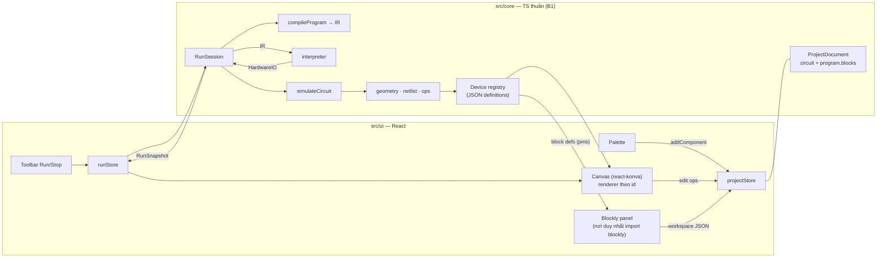
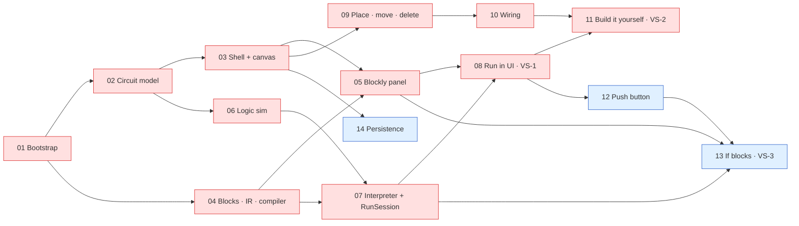

# STEM Demo — PoC Implementation Plan

> **Phiên bản:** 2.2 · **Cập nhật:** 2026-10-05 · **Trạng thái:** *current best implementation strategy*. Đây không phải spec bất biến (xem §15).
> **v2.1:** thêm checkpoint **MP** (minimum architecture proof) trước blink; Resistor không còn chặn MP; COOP/COEP chuyển thành tuỳ chọn; giảm robustness không cần thiết ở POC-02.
> **v2.2:** thêm task **S1 — embed launch** (§9.2): mở app như một lab nhúng qua `?embed=1&template=<key>`, theo yêu cầu D-21 của `docs/course-service-implementation-plan.md` §9.2.
> **Phạm vi:** Proof of Concept nhỏ cho một STEM programming/simulation editor chạy hoàn toàn trên trình duyệt, gồm editor mạch 2D, lập trình Blockly, runtime và mô phỏng thiết bị ảo.
> **Thay thế:** plan v1.0 (commit `9c34b73`: 61 task, 7 milestone, nhắm tới một demo gần hoàn chỉnh). Thiết kế chi tiết của v1 vẫn xem được bằng `git show 9c34b73:docs/stem-demo-implementation-plan.md`. §13 trỏ về đúng section v1 cho từng hạng mục bị hoãn.
> **Tài liệu tham khảo:** `docs/ohstem-platform-investigation.md`, `docs/ohstem-demo-reconstruction-spec.md`, `docs/ohstem-reconstruction-assets/`. Đây là **reference**, không phải spec để clone. Phần PoC cần đã được tóm tắt ở §16, nên coding agent **không cần** đọc lại research khi làm task.

## 0. Đọc nhanh

| | |
|---|---|
| **PoC chứng minh gì** | Kiến trúc đã chọn đủ tốt để xây một STEM editor thực tế. Kiến trúc đó gồm: document độc lập renderer, simulation là hàm thuần, Blockly chỉ là view và program được compile sang IR, runtime chỉ chạm phần cứng ảo qua `HardwareIO`, canvas chỉ render document và snapshot (§2) |
| **Vertical slice** | **Checkpoint MP** (bằng chứng đầu tiên): Board + LED, block "on start: digital write D13 HIGH", bấm Run thì LED sáng trên canvas. **VS-1:** mở rộng MP thành mạch Board + Resistor + LED chạy program blink (`forever` + `wait`), Stop hoạt động đúng. **VS-2:** người dùng tự dựng mạch bằng chuột rồi chạy (§3) |
| **Task tiếp theo** | Không còn task trong roadmap. `POC-01`…`POC-14` đã xong; M1–M4 đạt exit criteria kỹ thuật (§17, "Trạng thái PoC"; M4 chờ reviewer confirm final sau khi sửa F1–F4). **S1** (embed launch cho CourseService, §9.2) xong 2026-10-05, chờ review. Còn mở: L8 cần một người chạy thử demo script; các hạng mục P2 ở §13 |
| **Critical path** | `01 → 02 → 03 → 05 → 08 → 11`. Hai nhánh `02 → 06 → 07 → 08` và `03 → 09 → 10 → 11` dài bằng nhau (§10) |
| **PoC xong khi** | M1 và M2 (P0) đạt exit criteria, Learning log trả lời được L1–L4 (§8, §17). M3 và M4 (P1) làm PoC thuyết phục hơn |
| **Ràng buộc cứng** | Boundary B1–B8 (§5.1) và acceptance criteria của task. Mọi thứ còn lại (tên file, API helper, cấu trúc nội bộ, type chi tiết) là gợi ý |
| **Không làm trong PoC** | Python/Pyodide, Monaco, undo/redo, xoay, bendpoint, inspector, pan/zoom, multi-select, danh sách project, export/import, console, solver strong/weak, solver điện, backend (§2.6, §13) |
| **Trước mỗi task** | Đọc §0, §5.1, §15, task tương ứng ở §9.2 và các contract mà task trỏ tới (§6) |

### Thay đổi chính so với v1

1. **Mục tiêu.** v1 nhắm một demo hoàn chỉnh, gần như một OhStem thu nhỏ. v2 là PoC trả lời một câu hỏi kiến trúc, có hypothesis, learning questions và tín hiệu phản bác rõ ràng (§2).
2. **Cấu trúc.** 61 task / 7 milestone (51 task P0) được thay bằng **14 task theo outcome / 4 milestone theo learning progression** (11 P0, 3 P1), cộng một backlog P2 (§8, §9, §13).
3. **Runtime.** Giữ IR-first nhưng IR chỉ phủ đúng các block đang có. Toàn bộ track Python (Pyodide, protocol SAB, Monaco, differential test) chuyển sang backlog. Seam được giữ lại: runtime API, `HardwareIO` và IR (§6.3, §6.4).
4. **Simulation.** Solver switch-level hai pha (strong/weak) được thay bằng **logic mức net**: resistor coi như dẫn điện. Facade `simulateCircuit` giữ nguyên để nâng cấp sau (§6.5).
5. **Persistence.** Rời khỏi critical path, trở thành P1 sau slice, chỉ gồm autosave/restore qua Dexie. Pipeline migrate/normalize, contract suite, export/import và project browser vào backlog (§7).
6. **Editor.** Undo/redo, xoay, bendpoint, inspector, pan/zoom, multi-select và duplicate ra khỏi PoC (§3.4).
7. **Guardrails.** Ma trận import và `tsconfig.core.json` được thay bằng **một** lint rule. Header COOP/COEP là **tuỳ chọn**: chỉ giữ khi nó không gây friction, nếu có thì hoãn cùng track Pyodide. Bỏ network/console guard, `--repeat-each=3` và contract suite (§5.2, §11.5).
8. **Styling.** Bỏ Tailwind. Nó không nằm trong stack baseline mà là quyết định riêng của agent ở v1 (AD-02) (§4).
9. **Working agreement.** Plan là chiến lược tốt nhất hiện tại. Khi có evidence mới thì cập nhật plan, và ghi Learning log sau mỗi milestone (§15, §17).

---

## 1. Bối cảnh

### 1.1 Trạng thái repository (2026-10-02)

| Hạng mục | Trạng thái |
|---|---|
| Git | Branch `master`, 2 commit (`dd56bf0 initial`, `9c34b73 add plan docs`), working tree sạch |
| Source code | **Không có.** Không có `package.json`, `src/` hay file `.ts/.tsx`. Đây là dự án greenfield |
| Tài liệu | Plan này, cùng hai tài liệu nghiên cứu OhStem (tiếng Việt, giữ thuật ngữ tiếng Anh) |
| Tài sản nghiên cứu | `docs/ohstem-reconstruction-assets/`: ~164 ảnh PNG và `data/` gồm 18 file JSON đã sanitize |
| Cấu hình agent | `.claude/`, `.codex/`, `.agents/`: agent/skill dùng chung, không chứa convention riêng của dự án |
| Máy dev | Node **v20.20.2** (nvm-windows, `C:\nvm4w\nodejs`), npm 11.7.0, Corepack 0.34.6. Máy còn một bản Node v24.14.1 ở `C:\Program Files\nodejs`; `npm` và `corepack` trên PATH lấy từ bản này nhưng chạy bằng Node 20 đang active. Plan v1 ghi Node v24 là vì vậy. pnpm được bật ở POC-01 bằng `corepack enable pnpm --install-directory C:\nvm4w\nodejs`; `corepack enable` mặc định fail `EPERM` vì cố ghi vào `C:\Program Files\nodejs` |

### 1.2 Tài liệu đã review

| Tài liệu | PoC dùng gì |
|---|---|
| `ohstem-demo-reconstruction-spec.md` | Project model gọn với port suy ra từ catalog (§6.1); netlist union-find (§7.2); cấu hình Blockly zelos (§8); pipeline Blockly → Python → Pyodide → chân → mạch đã chạy end-to-end ở OhStem (§10), là bằng chứng track Python khả thi; cảnh báo runtime flag bị lẫn vào params (§20 #4) |
| `ohstem-platform-investigation.md` | Nguyên tắc dài hạn: `workspace → IR → generator → runtime adapter` (§11.1), board profile là first-class (§11.2), khai báo thay vì `eval` (§11.5). Các module robot/AI/IoT nằm ngoài phạm vi |
| `data/circuit-component-catalog.json` | Offset port của LED, resistor, button, board; ý tưởng `internalConnections` |
| Plan v1 | Toàn bộ quyết định và contract. Được đánh giá lại ở §1.3 và §5.2 |

### 1.3 Nguồn gốc của các assumption trong plan v1

Mỗi assumption quan trọng của v1 được truy về nguồn gốc rồi quyết định lại cho PoC. Nguồn gồm: **OhStem** (hành vi quan sát được), **Yêu cầu** (yêu cầu dự án cũ), **Agent** (quyết định kiến trúc của agent viết v1) và **Prod** (cân nhắc production).

| # | Assumption v1 | Nguồn | Quyết định v2 |
|---|---|---|---|
| A1 | Flow end-to-end: palette → nối dây → Blockly → Run → device phản ứng (G1) | Yêu cầu | **Giữ.** Đây là lõi của hypothesis |
| A2 | Core độc lập framework, **được máy enforce** bằng ma trận import `import-x` và `tsconfig.core.json` không có DOM (G2, AD-01) | Yêu cầu (nguyên tắc), Agent (cơ chế) | **Giữ nguyên tắc, đơn giản hoá cơ chế:** một lint rule (B1) |
| A3 | Registry data-driven, thay được bằng API/CMS: 3 registry, `DeviceCatalogSource`, `version`, `maxInstances`, `PropertySpec` (G3, AD-09) | Yêu cầu, investigation §11 | **Giữ data-driven** (B6). Bỏ phần khung chưa dùng tới |
| A4 | Project format có version, validate bằng Zod, đi qua `ProjectRepository`/Dexie, kèm pipeline migrate/normalize (G4, AD-08, AD-10) | Yêu cầu, Prod | **Thu nhỏ, chuyển sang P1** (§7) |
| A5 | IR → interpreter → Python printer → Pyodide, hai runtime cùng contract, có differential test (G5, AD-03) | Yêu cầu (Pyodide có trong stack), Agent (IR, differential) | **Giữ IR nhỏ và interpreter.** Python vào backlog (§6.3) |
| A6 | Không làm MNA; dùng solver switch-level strong/weak (AD-04) | Yêu cầu (tránh full solver), Agent (strength) | **Đơn giản hoá** thành logic mức net (§6.5) |
| A7 | Union-find trên `componentId/portId`; port suy ra từ catalog; dây tham chiếu port (F1, F3) | OhStem | **Giữ** |
| A8 | Canvas và code hiển thị cùng lúc (F6, AD-15) | Agent (chủ động khác OhStem) | **Giữ.** Chi phí 0 và rất quan trọng để thấy quan hệ nhân quả |
| A9 | Khoá thao tác thiết kế khi đang chạy (F7) | OhStem | **Giữ.** Nhờ vậy không phải định nghĩa ngữ nghĩa "sửa mạch khi đang chạy" |
| A10 | Chương trình kết thúc thì board vẫn được cấp nguồn (F13, AD-12) | Agent (khác OhStem) | **Giữ** (E6) |
| A11 | Dùng tên chân (`D13`) thay vì số GPIO (F16) | Agent | **Giữ** |
| A12 | COOP/COEP và self-host từ ngày đầu, có network guard (AD-17) | Prod, OhStem (SAB fallback, spec §20 #12) | **Header tuỳ chọn** (giữ nếu không gây friction; nếu có thì hoãn cùng track Pyodide). **Bỏ guard** |
| A13 | Tailwind v4 (AD-02) | Agent (skill có sẵn trong repo mặc định Tailwind) | **Bỏ** (§4) |
| A14 | Undo theo gesture, multi-select, duplicate, bendpoint, xoay theo độ (AD-06, AD-07, F8) | OhStem, phạm vi "editor đầy đủ" | **Hoãn** (§13) |
| A15 | Hằng số gesture: lưới 10, bán kính bắt port, giới hạn zoom (F8) | OhStem | **Giữ** lưới 10 và cách bắt port gần nhất ở dạng gợi ý. Zoom hoãn |
| A16 | Chỉ số đo: Pyodide cold start ≤ 5 s, 0 request ra ngoài, E2E xanh 3 lần liên tiếp (§3.3 v1) | Agent, Prod | **Chỉ giữ chỉ số độ trễ tương tác** (§2.5) |
| A17 | Persistence có contract test, export/import, project browser, dirty state, `beforeunload` (§12 v1) | Prod | **Backlog**, trừ autosave/restore (P1) |
| A18 | Pyodide: SAB control block, worker giữ ấm, protocol riêng (§10.9 v1) | Agent, dựa trên dữ liệu OhStem (F5, C3, C6) | **Backlog**, làm spike trước (BL-PY1) |
| A19 | 14 quy tắc thực thi tương thích Python (truthiness, `str()`, short-circuit) (E1–E14 v1) | Agent (phục vụ differential test) | **Rút còn E1–E7** (§6.4) |
| A20 | 6 device: board, R, LED, button, switch, ground (AD-18) | Agent, dựa trên MVP của spec §2 | **3 device + 1** (button ở M3) (§3.2) |

---

## 2. PoC hypothesis

### 2.1 Câu hỏi chính

> Liệu architecture mà chúng ta đang chọn có đủ tốt để xây một STEM programming/simulation editor thực tế hay không?

### 2.2 Hypothesis

**H.** Một kiến trúc chạy hoàn toàn trên trình duyệt, gồm:

1. **design document** độc lập renderer: component và dây, dây tham chiếu `{componentId, portId}`, vị trí port suy ra từ device definition dạng data;
2. **connection graph và logic simulation** là hàm TypeScript thuần, nhận document cùng runtime input;
3. **Blockly chỉ là view**: program lưu ở dạng Blockly JSON và được compile sang một IR nhỏ;
4. **runtime** chỉ chạm phần cứng ảo qua một interface mức chân (`HardwareIO`), không biết gì về mạch hay UI;
5. **canvas React-Konva** chỉ render document và run snapshot;

…là đủ để xây vòng lặp **dựng mạch → lập trình → Run → thiết bị phản ứng** sao cho vòng lặp đó **đúng**, **phản hồi nhanh tới mức cảm giác như thật**, và **mở rộng được**: thêm device, block hay runtime mà không phải viết lại core.

### 2.3 Learning questions

| ID | Câu hỏi | Kiểm chứng ở | Bằng chứng mong đợi |
|---|---|---|---|
| L1 | Mô hình editor/document (port từ data, dây tham chiếu port, operation thuần) có hỗ trợ tốt tương tác thật trên Konva không? | M2 | Dựng mạch bằng chuột mà renderer không giữ geometry hay state riêng |
| L2 | Connection graph (union-find) cộng với phần đóng góp của từng model có đủ để mô phỏng mạch do người dùng tự nối không? | M1, M2 | Scenario test xanh. Mạch tự dựng có netlist trùng với mạch mẫu |
| L3 | Blockly có tích hợp sạch dưới dạng view thuần không: JSON vào/ra, compile mà không cần Blockly? | M1, M3 | Test compiler chạy trên Node. Code Blockly chỉ nằm trong một thư mục. Block built-in có mutator (`controls_if`) compile được từ JSON |
| L4 | Runtime có điều khiển được phần cứng ảo qua `HardwareIO` không, trong khi Stop vẫn tức thì và UI vẫn mượt? | M1 | Đạt chỉ số ở §2.5. Không còn lệnh ghi chân nào sau Stop |
| L5 | Chiều ngược lại (device → program) và tương tác lúc đang chạy có vừa với các boundary hiện tại không? | M3 | Nút → `if` → LED. Không có runtime state nào lọt vào document |
| L6 | Thêm một device mới tốn bao nhiêu? (kiểm chứng claim data-driven) | M3 | Push button chỉ chạm tới definition, model và renderer (thêm block nếu cần). Ghi lại mọi file thay đổi ngoài các chỗ đó |
| L7 | Design document có tự đủ để persist/restore mà không kéo theo state của runtime hay UI không? | M4 | Save → reload cho ra document deep-equal. Không có field runtime |
| L8 | Flow có cảm giác giống một sản phẩm STEM thực tế không? | M2, M3 | Một người chạy thử demo script và ghi nhận xét vào Learning log |

### 2.4 Tiêu chí thành công và tín hiệu phản bác

**Thành công** khi M1 và M2 xong, cụ thể:
- E2E-1 và E2E-2 xanh;
- đạt các chỉ số ở §2.5;
- boundary B1–B8 được giữ mà không cần ngoại lệ (không có `eslint-disable` cho rule B1);
- Learning log ghi verdict cho L1–L4.

**Các tín hiệu làm yếu hoặc bác bỏ kiến trúc.** Gặp thì phải ghi vào Learning log, không được lặng lẽ lách qua:

| Tín hiệu | Nghĩa là |
|---|---|
| Canvas hoặc renderer cần biết chi tiết simulation/runtime ngoài snapshot (ví dụ tự tính LED sáng hay tắt) | Ranh giới render ↔ simulation sai |
| Compiler cần Blockly runtime, chứ không chỉ JSON, mới hiểu được program (ví dụ `extraState` không đủ thông tin) | Quyết định "Blockly là view" sai |
| Thêm push button phải sửa `RunSession`, canvas hoặc compiler theo kiểu đặc thù cho device | Abstraction của registry/model chưa đủ |
| Program đơn giản mà UI vẫn giật hoặc trễ quá chỉ số | Mô hình runtime chạy trên main thread không ổn, cần cân nhắc worker sớm hơn |
| Konva và core tính vị trí port lệch nhau, hoặc phải nhân đôi geometry | Phân công sở hữu geometry sai |
| UI chỉ chạy được nếu document chứa runtime state | Việc tách design state và runtime state sai |

### 2.5 Chỉ số đo (mục tiêu mềm, đo trên máy dev)

| Chỉ số | Mục tiêu |
|---|---|
| Run → LED sáng (program "on start: D13 HIGH") | ≤ 300 ms |
| Chân đổi giá trị → canvas cập nhật | ≤ 1 frame. Runtime gây ra tối đa 1 lần React commit mỗi frame |
| Nhấn nút → LED đổi (program `forever` + `if`) | ≤ 50 ms |
| Stop, kể cả khi đang `wait` | ≤ 100 ms; sau Stop không còn lệnh ghi chân nào |
| Blink 1 s | Chu kỳ sai lệch không quá ±50 ms |

### 2.6 Non-goals của PoC

- **Theo yêu cầu dự án:** backend, ASP.NET Core, MySQL/PostgreSQL, Redis, MinIO, auth, LMS, CMS, Kubernetes, HA, realtime collaboration.
- **Ngoài câu hỏi kiến trúc:** clone OhStem 1:1; Python/Pyodide; Monaco; mô phỏng điện (điện áp, dòng, độ sáng, linh kiện cháy); breadboard; nhiều board; robot/AI/IoT; i18n; mobile/touch; phần cứng thật.
- **Polish của editor:** undo/redo, xoay, lật, bendpoint, màu dây, inspector, pan/zoom, multi-select, duplicate, phím tắt ngoài Delete/Esc.
- **Hardening production:** CSP, telemetry, migration, đồng bộ offline, nhiều tab.

---

## 3. Vertical slice và scope

### 3.1 Slice được chọn

| Slice | Nội dung | Milestone |
|---|---|---|
| **MP — Minimum architecture proof** (checkpoint đầu tiên của M1) | Mạch mẫu chỉ có Board + LED (D13 → LED.anode, LED.cathode → GND), program "on start: digital write D13 HIGH" trong Blockly. Bấm **Run** → compile → runtime → simulation → **LED sáng trên canvas**. Bấm **Stop** → LED tắt | M1 |
| **VS-1 — Blink on canvas** (M1 hoàn chỉnh) | Mở rộng MP: mạch mẫu có thêm Resistor (D13 → R → LED → GND), program blink (`forever` + `wait`). Bấm **Run** thì LED nhấp nháy. Sửa block (HIGH/LOW, thời gian, chân) rồi Run lại thì hành vi đổi theo. Bấm **Stop**, kể cả khi đang `wait`, thì LED tắt và mọi thứ về trạng thái thiết kế | M1 |
| **VS-2 — Build it yourself** | Từ canvas trống: thêm Board, Resistor, LED từ palette, kéo sắp xếp, nối dây port → port, xoá chỗ nối sai, lập trình bằng Blockly, Run → LED phản ứng | M2 |
| **VS-3 — Closed loop** (P1) | Nút nhấn → program `if` đọc chân → LED. Giữ nút thì LED sáng, nhả thì tắt | M3 |

**Vì sao làm VS-1 trước, với mạch có sẵn:**
- VS-1 đi qua **mọi** subsystem: document, registry, geometry, render, Blockly, compiler, IR, interpreter, `HardwareIO`, netlist, simulation, snapshot, render lại. Nó không phải chờ phần tương tác editor, vốn chiếm phần lớn khối lượng UI.
- Có kết quả nhìn thấy được từ sớm.
- Hai tích hợp rủi ro nhất được thử đầu tiên: vòng đời Blockly trong React cùng contract Blockly JSON, và vòng lặp runtime ↔ React render.
- Editor (L1) là ẩn số lớn thứ hai và được làm ngay sau ở M2. **Hypothesis chỉ được coi là trả lời xong khi có VS-2.**

**Vì sao có MP trước blink:** MP là đường ngắn nhất đi qua mọi boundary (Blockly JSON → compiler → IR → interpreter → `HardwareIO` → simulation → snapshot → render). `wait`, `forever`, async sleep, Stop khi đang sleep và Resistor đều **không được chặn** việc chứng minh chuỗi cơ bản `Blockly → LED`. Vì vậy chúng là phần mở rộng sau MP, nằm trong cùng các task M1.

**Vì sao VS-1 vẫn là blink:** sau MP, blink kiểm tra thời gian (`wait`), vòng `forever`, Stop khi đang sleep và việc render lặp lại. "LED on" chỉ kiểm tra một lệnh ghi; nó vẫn được giữ làm sample và test case của MP.

**Các phương án bị loại:**

| Phương án | Lý do loại |
|---|---|
| Board + LED, bật/tắt chân bằng nút UI, không có Blockly | Không kiểm tra phần lập trình |
| Blockly → chỉ in chữ ra console | Không kiểm tra phần cứng ảo hay simulation |
| Làm "tự dựng mạch" trước | Phần tương tác editor rất lớn, làm trước sẽ làm chậm bằng chứng end-to-end đầu tiên |
| Nút + LED làm slice đầu | Thêm cả tương tác lúc chạy lẫn `if`/đọc chân trước khi chuỗi cơ bản được chứng minh |
| Python runtime ngay trong slice | Kéo theo rủi ro worker/SAB/COEP/hosting asset vốn không liên quan tới câu hỏi chính |

### 3.2 Device

| Device | Port (offset tính từ tâm, đơn vị world) | Model | Milestone | Vì sao cần |
|---|---|---|---|---|
| **Board** (Uno-like) | `d2`…`d13` (`gpio`, cùng một cạnh, cách nhau 20), `3v3` (`power`), `gnd` (`ground`) | `board` | M1 | Đích của program, đồng thời là nguồn |
| **LED** | `anode` (−10, 30), `cathode` (10, 30); thân khoảng 40×70 | `led` | M1 | Phản ứng nhìn thấy được. Có cực tính nên mạch thực tế |
| **Resistor** | `a` (−40, 0), `b` (40, 0) | `resistor` (dẫn điện) | M1, **sau MP** | Mạch STEM thật luôn có điện trở. Chứng minh một device passive nằm trong net graph. Chỉ là data, generic renderer và một model dẫn điện, nên rất rẻ. **Không phải dependency của MP** |
| **Push button** | `a` (−30, 0), `b` (30, 0); thân 60×40 *(POC-12)* | `contact` (dẫn khi đang nhấn) | M3 | Input, tương tác lúc chạy, và dùng để đo chi phí thêm device (L6) |

**Reference behavior:** offset của LED và resistor lấy từ catalog OhStem. OhStem dùng nút 4 chân có internal connection để cắm breadboard; PoC không có breadboard nên chỉ dùng 2 chân. Chân board OhStem cách nhau 15 px, dễ bấm nhầm, nên PoC dùng 20.

**Hoãn:** switch (cùng model `contact`, rất rẻ để thêm sau), device ground (GND của board là đủ), battery (nguồn floating sẽ phá mô hình tham chiếu chung), mọi thứ analog.

### 3.3 Block

| Block | Dạng | Milestone |
|---|---|---|
| `stem_on_start` | hat, statement `DO` | M1 (MP) |
| `stem_digital_write` | statement. Field `PIN` (dropdown sinh từ board definition), field `LEVEL` (HIGH/LOW) | M1 (MP) |
| `stem_forever` | hat, statement `DO` | M1, sau MP |
| `stem_wait` | statement. Field số `SECONDS` | M1, sau MP |
| `stem_digital_read` | value (Boolean). Field `PIN` | M3 |
| `controls_if` | built-in, if/else qua mutator | M3 |
| `logic_negate` | built-in, tuỳ chọn | M3 |

**Quyết định:** block của M1 **chỉ dùng field**, không có value input. Nhờ vậy compiler và IR ở M1 không phải xử lý expression. Expression xuất hiện ở M3, cùng với đọc chân và `if`. Toolbox chỉ cần vài category đơn giản. Không có biến, toán, vòng lặp đếm hay hàm.

### 3.4 UI tối thiểu

- **Layout:** toolbar (Run/Stop và status); canvas và Blockly **hiển thị cùng lúc** (ràng buộc); một palette nhỏ (M2). Kích thước và vị trí cụ thể do implementer quyết định.
- **Canvas (M2):**
  - click-to-add (kéo từ palette là tuỳ chọn);
  - kéo để di chuyển, snap lưới 10;
  - click port rồi click port để nối dây;
  - chọn một đối tượng và nhấn Delete để xoá; Esc để huỷ thao tác nối dây.
- **Khi đang chạy:** khoá palette, kéo, nối dây và xoá. Blockly vẫn sửa được, thay đổi áp dụng ở lần Run sau (program được compile lúc Run).
- **Không có trong PoC:** xoay, bendpoint, inspector, undo/redo, pan/zoom, multi-select.

---

## 4. Tech stack trong PoC

Stack baseline **không thay đổi**. Chỉ thay đổi *thời điểm* đưa vào.

| Công nghệ | Trong PoC | Ghi chú |
|---|---|---|
| TypeScript (strict), React 19, Vite, pnpm | Dùng ngay (POC-01) | pnpm qua Corepack. Pin version. Vite phải hỗ trợ Node 20.19+ |
| Konva + react-konva | Dùng ngay (POC-03) | Chỉ trong canvas. react-konva 19 tương ứng React 19 |
| Google Blockly | Dùng ngay (POC-04/05) | npm, bản ổn định mới nhất, renderer zelos, block định nghĩa bằng JSON, serialization JSON. **Không dùng generator của Blockly** |
| Zustand | Dùng ngay (POC-03) | Store mỏng; logic nằm ở core |
| Zod | Dùng ngay, nhưng ít | Validate device definition (POC-02) và project document khi load từ storage (POC-14). Không parse trong từng operation |
| Vitest | Dùng ngay | Unit test cho core và integration test headless |
| Playwright | Dùng ngay | Chỉ Chromium. Mỗi slice một spec |
| Dexie / IndexedDB | **P1** (POC-14) | Một bảng, đặt sau một interface nhỏ |
| Monaco | **Không dùng trong PoC** | Đưa vào khi có Python sửa được (backlog). Nếu cần preview Python read-only thì dùng `<pre>` |
| Pyodide + Web Worker | **Không dùng trong PoC** | Track Python trong backlog. Seam giữ sẵn: runtime API, `HardwareIO`, IR |
| ESLint | Dev tooling | Dùng cho rule boundary B1. Prettier tuỳ chọn |
| Styling | CSS thuần, không thêm CSS framework | Tailwind (AD-02 v1) không nằm trong stack baseline. Bỏ vì phần chrome rất nhỏ và vì preflight có thể xung đột với Blockly (R4 v1). Có thể thêm khi làm UI thật |

**Version đã pin ở POC-01** (2026-10-02, Node 20.20.2): pnpm 12.8.1, React 19.3.0, Vite 8.3.2 cùng `@vitejs/plugin-react` 6.1.1, TypeScript 6.0.3, Vitest 4.1.11, Playwright 1.63.0 (Chromium 153), ESLint 10.11.0 cùng `typescript-eslint` 8.71.0, `@types/node` 20.19.43. Có hai lựa chọn có chủ đích:
- **Vitest 4, không dùng 5:** Vitest 5 yêu cầu Node ≥ 22.12.
- **TypeScript 6, không dùng 7:** `typescript-eslint` 8.71 chỉ hỗ trợ TypeScript `<6.1`.

Chỉ nâng các version này khi đã nâng Node hoặc khi `typescript-eslint` hỗ trợ TypeScript 7.

*(POC-14)* Thêm hai package, đều pin version:
- `dexie@4.4.6` (dependency): adapter persistence duy nhất (§7);
- `fake-indexeddb@6.2.5` (devDependency): IndexedDB cho unit test của adapter trên Node.

---

## 5. Architecture

### 5.1 Boundary giữ ngay từ đầu (ràng buộc)

Đây là các ràng buộc cứng. Mỗi boundary có chi phí thấp, và để muộn thì khó sửa.

| ID | Boundary | Vì sao giữ ngay | Cách giữ |
|---|---|---|---|
| **B1** | **Core thuần.** `src/core/**` không import React, Konva, Blockly, Zustand, Dexie, Monaco, Pyodide, cũng không import `src/ui/**` hay `src/storage/**` | Đây là claim trung tâm của hypothesis, và agent rất dễ làm trôi nó | Một rule ESLint `no-restricted-imports` áp cho `src/core/**` (file test cũng không được import framework UI) |
| **B2** | **Document không chứa runtime state.** Mức chân, LED sáng, nút đang nhấn chỉ tồn tại trong `RunSession`/snapshot. Stop là huỷ hết | Tránh lỗi F2 của OhStem (`_broken`, `pinStates` nằm trong `params`) | Review; test "document không đổi sau một lần chạy" (POC-07) |
| **B3** | **Simulation là hàm thuần** `(circuit, registry, inputs) → result`. Nó không nằm trong component Konva hay trong store | Test được, và thay được bằng solver khác | Đặt trong `src/core`; canvas chỉ đọc kết quả |
| **B4** | **Blockly là view.** Program lưu ở dạng Blockly serialization JSON. Compiler chỉ đọc JSON, không import Blockly. Định nghĩa block là data nằm ở core. Code dùng Blockly chỉ nằm trong một thư mục UI | Test compiler không cần DOM; nâng Blockly chỉ ảnh hưởng adapter | B1 cộng review |
| **B5** | **Runtime chỉ nói chuyện với phần cứng ảo qua `HardwareIO`** (cộng status event), không biết gì về mạch, simulation hay UI. `RunSession` là nơi duy nhất nối program với simulation. *(N18 R2.1)* Với lab robot: xem sửa luật bên dưới | Đây là seam để sau này thêm Pyodide và phần cứng thật | Contract ở §6.4 |
| **B6** | **Device metadata là data.** Definition là file JSON, được validate bằng Zod khi tạo registry. Renderer và simulation model được tham chiếu bằng id dạng chuỗi; id lạ thì dùng generic renderer hoặc model inert, không crash. Không `eval`. Hàm core nhận registry qua tham số; chỉ bootstrap import catalog local | Đường lên API/CMS; tránh `eval` như OhStem | Definition để ở file `.json`; Zod schema |
| **B7** | **Geometry một nguồn.** Vị trí port trong toạ độ world do **một** hàm core tính. Renderer, wiring, hit-test và test hook đều dùng hàm đó. Mọi chuyển đổi pointer ↔ world đi qua một helper | Tránh Konva và core lệch nhau; thêm xoay/zoom sau chỉ là thay đổi cục bộ | Review; acceptance criteria của POC-03 và POC-10 |
| **B8** | **Persistence đặt sau interface** (P1). UI và store gọi interface; chỉ bootstrap biết tới Dexie | Đường lên API/backend mà không phải viết lại editor | POC-14: rule ESLint `no-restricted-imports` cho `src/ui/**` (không import `dexie` hay `src/storage`), có test trong `tests/core-boundary.test.ts` |

**Sửa luật N18 (R2.1, 2026-10-25; quyết định ở `docs/robot-3d-implementation-plan.md` §2):**
- **B5, lab robot:** với lab robot, `RobotRunSession` là nơi duy nhất nối program ↔ hardware ↔ world. `RunSession` không chạy
  project family `uno`: `start` trả `reason: 'unsupported-family'` trước mọi kiểm tra board (`src/core/run/run-session.ts`). Với
  project generic và Yolo:Bit, B5 giữ nguyên.
- **Amendment `io.ts`** (`src/core/capabilities/io.ts`, chỉ type): thêm `modules` (`ModuleIO`: `call(role, op, args)`,
  `read(role, op)`) vào `Capabilities` và `capabilityKeys`; thêm `WireIO` (I²C mức giao dịch) và `UnoPinIO` (plan robot §4.3).
  Cùng đợt, `services.ts` export `Timers`, thêm type `ProgramClock = Clock & { charge(us) }` và option `budget?` của
  `createRuntimeServices` (có thì dùng nguyên, không thì như cũ). Cài đặt do R1 (virtual UNO, driver) và R2.3 (đồng hồ ảo).
- **Lab → family:** lab mở project nào là một bảng, không còn là phép so boolean: `labFamilies` trong `src/ui/app/lab-host.ts`,
  `blockly→generic`, `yolobit→ybc`, `robot→uno` (`docs/lab-embed-contract.md` §2). R4.1 chỉ thêm `'robot'` vào `LabKind`.
- **Board family** (`BoardFamily`) là `generic` khi document không có profile, ngược lại là `profile.family` (`ybc` hoặc `uno`),
  không bao giờ suy từ board trên canvas (R-F1 giữ nguyên).

**Boundary không phải lý do để tạo thêm abstraction.** Giữ boundary chủ yếu bằng cách đặt code đúng chỗ (đúng thư mục, đúng hướng import). Chỉ thêm interface, registry hay layer mới khi đã có **consumer thực tế** thứ hai, hoặc khi task yêu cầu rõ ràng.

### 5.2 So với v1: giữ, đơn giản hoá, hoãn

| v1 | v2 | Lý do | Seam / khi nào xem lại |
|---|---|---|---|
| AD-01: ma trận import `import-x` và `tsconfig.core.json` không DOM | **Đơn giản hoá:** một lint rule (B1) | Bảo vệ đúng claim chính với ~15 dòng config. Ma trận giữa các tầng trong core và tsconfig thứ hai tốn công setup mà không làm PoC học thêm được gì | Thêm lại nếu Learning log ghi nhận kiến trúc bị trôi |
| AD-02: Tailwind v4 | **Bỏ:** dùng CSS thuần | Xem §4 | Khi làm UI thật |
| AD-03: IR, interpreter, printer Python, Pyodide, differential test | **Giữ IR nhỏ và interpreter.** Python vào backlog | §6.3 | Khi có runtime thứ hai |
| AD-04: solver switch-level hai pha strong/weak | **Đơn giản hoá:** logic mức net | §6.5 | Khi cần pull-up/pull-down hoặc gặp chập giả (BL-S1) |
| AD-05: renderer registry kèm fallback | **Giữ, ở mức tối thiểu:** viết **generic renderer trước**, chỉ device nào cần hiển thị state mới có renderer riêng | Generic renderer chính là bằng chứng cho B6 | — |
| AD-06: dây có bendpoint, vẽ polyline | **Hoãn:** dây thẳng | Không cần cho hypothesis | Thêm field tuỳ chọn có default (BL-E3) |
| AD-07: undo/redo bằng snapshot, API gesture | **Hoãn.** Mọi thay đổi document đi qua **một** action của store | Không phải ẩn số; operation thuần làm undo rẻ khi cần | BL-E1, cắm vào đúng action đó |
| AD-08: schema đầy đủ (`format`, rotation, properties, label, timestamp, `.strict()`) | **Thu nhỏ** (§6.1) | Field nào thêm sau dạng tuỳ chọn có default thì không cần migration | `schemaVersion` |
| AD-09: 3 registry, `DeviceCatalogSource`, `version`, `maxInstances`, `PropertySpec` → Zod | **Thu nhỏ:** definition dạng data cộng một bảng tra; registry truyền qua tham số | Chưa có consumer cho phần khung còn lại | CMS: chỉ cần đổi chỗ tạo registry |
| AD-10: port repository, 2 adapter, contract suite, pipeline parse → migrate → validate → normalize | **P1, thu nhỏ** (§7) | Dexie là công nghệ quen, ít giá trị học | Adapter API |
| AD-11: ranh giới Blockly | **Giữ** (B4) | Nằm trong hypothesis | — |
| AD-12: vòng đời runtime (mô hình cấp nguồn, khoá khi chạy, `runId`, worker giữ ấm) | **Giữ** mô hình cấp nguồn và khoá. **Bỏ** phần dành cho worker | Chưa có worker | Track Python |
| AD-13: ranh giới test (contract suite, differential) | **Test theo rủi ro** (§11) | Chỉ có một adapter và một runtime | — |
| AD-14: walking skeleton 7 milestone | **4 milestone theo learning** (§8) | — | — |
| AD-15: danh sách hành vi OhStem không clone | **Giữ** các mục liên quan (§16) | — | — |
| AD-16: vanilla store qua context, cấm singleton, batch theo rAF | **Đơn giản hoá:** store tạo bằng factory để test được; runtime gây ra tối đa 1 commit mỗi frame | Cách cung cấp store cho React do implementer quyết | — |
| AD-17: COOP/COEP, self-host mọi asset, network guard | **Header tuỳ chọn**, không phải acceptance của P0. **Bỏ guard** | Nếu header chỉ là vài dòng config và không gây vấn đề thì giữ, vì nó làm lộ sớm các phụ thuộc CDN vốn sẽ chặn SAB/Pyodide sau này. Nếu nó gây thêm việc (media Blockly, load asset, Playwright, dev server, package bên thứ ba, hành vi trình duyệt) thì **tắt và hoãn cùng track Pyodide**, không debug COEP trong PoC. Guard không cần vì PoC không có phụ thuộc ngoài. *(S1)* Header không chặn site khác nhúng app vào iframe (E2E và bản preview), nên vẫn giữ | Track Python (BL-PY1); hoặc khi trang nhúng tự bật COEP (§9.2, S1) |
| AD-18: 6 device | **3 device + button** (§3.2) | — | BL-S3 |
| AD-19: Python kiểu MicroPython đồng bộ | **Backlog** (BL-PY2). Giữ làm ghi chú | — | — |
| AD-20: UI tiếng Anh, `strings.ts` | UI tiếng Anh. Không bắt buộc file strings | — | — |

### 5.3 Luồng dữ liệu



### 5.4 Bố cục module (gợi ý)

```text
src/
├─ core/                 ← TS thuần (B1)
│  ├─ devices/           definitions/*.json, schema (Zod), registry
│  ├─ circuit/           document types/schema, geometry, netlist, ops
│  ├─ simulation/        simulateCircuit, models
│  ├─ program/           blocks (data), ir, compiler, interpreter
│  └─ run/               RunSession, HardwareIO
├─ ui/                   ← React
│  ├─ app/               bootstrap (composition root), layout, test hooks
│  ├─ state/             Zustand stores
│  ├─ canvas/            Konva stage, renderers, interactions
│  └─ blockly/           nơi duy nhất import blockly
├─ storage/              ← Dexie (P1); chỉ bootstrap import
└─ samples/              project mẫu (JSON) dùng chung cho app và test
e2e/                     Playwright specs + helper
```

Tên thư mục chỉ là gợi ý. Ràng buộc thật sự là B1–B8.

---

## 6. Core contracts (tối thiểu)

Các type dưới đây là **phác thảo**. Implementer được phép tinh chỉnh tên hoặc hình dạng nếu vẫn giữ được ngữ nghĩa và boundary. Nếu đổi **ngữ nghĩa** (invariant, quy tắc compile, quy tắc thực thi, thuật toán simulation) thì phải cập nhật section này trong cùng PR.

### 6.1 Project document

```ts
type ProjectDocument = {
  schemaVersion: 1;
  id: string;
  name: string;
  circuit: Circuit;
  program: { blocks: unknown };   // Blockly serialization JSON; chỉ compiler và Blockly panel đọc
};
type Circuit = { components: ComponentInstance[]; wires: Wire[] };
type ComponentInstance = {
  id: string;            // duy nhất trong document
  deviceType: string;    // = DeviceDefinition.id
  position: Point;       // TÂM thân device, đơn vị world (1 unit = 1 px ở scale 1)
};
type Wire = { id: string; from: PortRef; to: PortRef };   // vô hướng về điện
type PortRef = { componentId: string; portId: string };
type Point = { x: number; y: number };
```

**Invariant.** Mọi operation phải giữ các invariant này, và dữ liệu load vào phải được kiểm tra theo chúng:
- **I1.** `id` không trùng giữa các component, và không trùng giữa các wire.
- **I2.** Đầu dây trỏ tới một component có thật, và tới một port có trong definition của component đó. `deviceType` lạ chỉ có thể xuất hiện khi load dữ liệu từ ngoài (POC-14, CMS); cách xử lý được quyết định khi có nguồn dữ liệu đó. *(POC-14)* Document đọc từ storage được kiểm tra theo I1–I3 và theo registry; vi phạm thì không mở, xem §7.
- **I3.** Không có dây nối một port với chính nó. Không có hai dây trùng nhau (kể cả khi đảo chiều). Một port được phép có nhiều dây.
- **I4.** Xoá component thì xoá luôn các dây nối vào nó.
- **I5.** Không có runtime state (B2).

*(N18 R2.1)* Field tuỳ chọn `kit: { id: string; version: string }` (plan robot §4.0): kit của project lab robot; không có thì dùng
`ref-uno-rover@0`. Khai báo trong Zod vì `z.object` bỏ key lạ. Không tăng `schemaVersion`.

**Cố ý chưa có:** rotation, label, properties, bendpoint, màu dây, timestamp. Chúng sẽ được thêm dưới dạng **field tuỳ chọn có default**, nên không cần tăng `schemaVersion`. Chỉ thay đổi phá vỡ tương thích mới tăng version và cần migration (PoC không có migration).

**Zod:** schema cho document chỉ bắt buộc ở POC-14 (load từ storage). Định nghĩa sớm cùng type (`z.infer`) là tuỳ chọn. Chỉ parse ở boundary, không parse trong từng operation.

### 6.2 Device definition

```ts
type DeviceDefinition = {
  id: string;                         // "led"
  name: string;                       // "LED"
  body: { width: number; height: number };   // căn giữa tại position
  ports: {
    id: string; label: string;
    x: number; y: number;             // offset tính từ tâm
    kind: 'gpio' | 'power' | 'ground' | 'passive';
  }[];
  internalConnections?: string[][];   // các port nối liền nhau bên trong device
  renderer: string;                   // id renderer; id lạ → generic renderer
  simulation: { model: string; config?: Record<string, unknown> };   // id model; id lạ → inert
  board?: { pins: { name: string; portId: string }[] };   // chỉ board có: tên chân mà program nhìn thấy
};
```

Ví dụ `led.json`:

```json
{
  "id": "led",
  "name": "LED",
  "body": { "width": 40, "height": 70 },
  "ports": [
    { "id": "anode", "label": "Anode (+)", "x": -10, "y": 30, "kind": "passive" },
    { "id": "cathode", "label": "Cathode (−)", "x": 10, "y": 30, "kind": "passive" }
  ],
  "renderer": "led",
  "simulation": { "model": "led" }
}
```

**Quy tắc:**
- Definition là file JSON, được parse bằng Zod schema khi tạo registry. Definition sai thì fail rõ ràng lúc khởi động hoặc trong test; không cần cơ chế báo lỗi cầu kỳ.
- Quy ước khi viết definition (không cần code kiểm tra riêng): `id` của port không trùng trong một device; offset port là bội số của 10, để khi component nằm trên lưới thì port cũng nằm trên lưới; `board.pins[*].name` không trùng và trỏ tới port `gpio`.
- `board.pins` là **board profile** của PoC. Nó dùng cho dropdown trong Blockly, cho việc compiler kiểm tra tên chân, và cho tên chân trong `HardwareIO`.
- *(Evidence POC-02)* `internalConnections` và `simulation.config` **chưa được implement** vì chưa device nào trong PoC cần (board chỉ có một GND, nút nhấn có 2 chân). Thêm vào schema và netlist khi có consumer, ví dụ breadboard, nút 4 chân, board nhiều GND, hoặc model cần config.

### 6.3 Program: block, IR, compiler

**Đánh giá lại IR-first.** Các phương án đã cân nhắc:

| Phương án | Ưu | Nhược | PoC |
|---|---|---|---|
| Interpret thẳng Blockly JSON | Ít type hơn | Runtime bị gắn với format serialization của Blockly. Mọi consumer sau này (printer Python, evaluator) phải parse lại. Lỗi chỉ lộ ra giữa lúc chạy | ✗ |
| Generator Blockly → JS → `eval`/`Function` | Nhanh có kết quả | Vi phạm nguyên tắc không `eval`. Stop/sleep phải sinh code async. Phải load Blockly mới test được | ✗ |
| Generator Blockly → Python → Pyodide | Giống OhStem | Đưa Pyodide vào critical path | ✗ |
| **Blockly JSON → compiler → IR nhỏ → interpreter** | Compiler là hàm thuần (~100–200 dòng), báo lỗi kèm `blockId` **trước khi Run**, interpreter nhỏ, runtime không biết Blockly, sau này printer Python chỉ là IR → text | Thêm một bước | **✓** |

**Kết luận:** giữ IR-first. Phần code parse Blockly JSON đằng nào cũng phải viết; tách nó ra thành compiler gần như không tốn thêm, đổi lại được boundary B4 và diagnostics có trước khi chạy. Có ba điểm khác v1:
- IR chỉ có node cho **các block đang tồn tại**, không định nghĩa sẵn toàn bộ;
- không có ngữ nghĩa kiểu Python cho tới khi có runtime thứ hai;
- **IR không được persist**, nên đổi tự do mà không cần versioning.

Nếu thực tế cho thấy compiler chỉ là ánh xạ 1:1 và không có giá trị, ghi điều đó vào Learning log. Dự kiến giá trị của nó sẽ tăng khi có Python.

*(POC-13)* IR thật của M3 (`ir.ts`) khác phác thảo dưới đây ở hai chỗ:
- `if` giữ **danh sách nhánh** thay vì `then`/`else` lồng nhau: `{ kind: 'if'; branches: { condition; body }[]; else; blockId }`. Đây đúng là cấu trúc của `controls_if` (IF0/DO0, IF1/DO1…, ELSE). Interpreter thử các điều kiện theo thứ tự, mỗi điều kiện chỉ khi các điều kiện trước sai. Else-if không thành `if` lồng, nên không làm sâu thêm call stack.
- Không có expression `boolean`: không block nào sinh ra nó, và điều kiện bỏ trống là lỗi compile (C8), không mặc định `false`.

**IR v0 (phác thảo):**

```ts
type ProgramIR = { onStart: Statement[]; forever: Statement[] | null };
type Statement =
  | { kind: 'digitalWrite'; pin: string; level: 0 | 1; blockId: string }
  | { kind: 'wait'; ms: number; blockId: string }
  // M3 (POC-13):
  | { kind: 'if'; condition: Expression; then: Statement[]; else: Statement[]; blockId: string };
type Expression =    // M3
  | { kind: 'digitalRead'; pin: string; blockId: string }
  | { kind: 'boolean'; value: boolean }
  | { kind: 'not'; value: Expression; blockId: string };
```

`level` là literal vì block M1 chỉ dùng field. Khi có value input, `level` có thể đổi thành `Expression`. Đây là thay đổi IR có chủ đích và được phép.

**Quy tắc của compiler** — `compileProgram(blocksJson, boardPins) → { ok: true; ir; diagnostics } | { ok: false; diagnostics }`:
- **C1.** Input là Blockly serialization JSON (`blocks.blocks[]`, `next.block`, `fields`, `inputs.X.block`/`shadow`, `extraState`) cùng danh sách tên chân của board.
- **C2.** Block top-level `stem_on_start` (tối đa 1) và `stem_forever` (tối đa 1) tạo ra hai section. Các block top-level khác bị bỏ qua kèm warning (Blockly cũng làm mờ chúng qua `disableOrphans`).
- **C3.** Lỗi: block type lạ, chân không có trên board, hat bị trùng. Lỗi luôn kèm `blockId`.
- **C4.** **Không bao giờ throw.** JSON sai cấu trúc sinh diagnostic lỗi. *(POC-13)* Body và điều kiện lồng sâu quá 100 tầng được báo `malformed-program` thay vì đi tiếp, nên dữ liệu lưu không thể làm tràn stack. `elseIfCount` cũng chỉ được duyệt tới số input đang có, nên một con số khổng lồ không làm compiler lặp mãi. Cần phân biệt hai trường hợp:
  - phần **vắng mặt hợp lệ**: statement input không có, hay `next` không có, được hiểu là body rỗng hoặc hết chuỗi;
  - phần **có mặt nhưng sai shape**: input không phải object, hoặc field mà block bắt buộc phải có (`PIN`, `LEVEL`, `SECONDS`) bị thiếu hay sai kiểu. Trường hợp này là `malformed-program` trên block đó, không được âm thầm bỏ qua.
- **C5.** Mọi node IR mang `blockId`, để sau này highlight được block lỗi hoặc block đang chạy.
- **C6.** `wait` với giá trị âm hoặc không hữu hạn được coi là 0.
- **C7.** **Block disabled** (Blockly lưu là `disabledReasons` có ít nhất một reason; không cần phân biệt từng reason) là trạng thái hợp lệ, **không** sinh error hay warning:
  - statement disabled không sinh IR, nhưng chuỗi vẫn tiếp tục sang `next`;
  - hat disabled (`on start` / `forever`) bỏ cả stack bên dưới;
  - block rời rạc bị disabled (ví dụ do `disableOrphans`) được bỏ qua mà không có warning.
- **C8.** *(POC-13)* Input Boolean (điều kiện của `if`/`else if`, operand của `not`) mà vắng mặt, rỗng, hoặc chứa block bị disabled là lỗi `missing-condition` trên block sở hữu input đó. Lý do chọn lỗi thay vì `false` ngầm: program chạy phải đúng là program người dùng thấy, và lỗi được hiện trên toolbar ngay khi bấm Run. Shadow block được dùng làm giá trị cho tới khi có block thật che nó, như Blockly.

**Fixture:** compiler test phải dùng JSON có **đúng format Blockly thật**. Xem POC-04 và rủi ro R2.

### 6.4 Runtime và `RunSession`

**Runtime đơn giản nhất mà vẫn đủ dùng:** một interpreter async duyệt cây IR, chạy trên main thread, dùng hàm `sleep` được inject (có thể huỷ bằng `AbortSignal`). PoC chưa cần runtime registry hay cơ chế chọn runtime. Chỉ giữ hai seam:

```ts
interface HardwareIO {
  digitalWrite(pin: string, level: 0 | 1): void;   // chân trở thành output và drive mức này
  digitalRead(pin: string): 0 | 1;                 // mức hiện tại của net nối vào chân (floating → 0)
}
// API của interpreter: giữ nhỏ; một runtime Pyodide sau này sẽ implement cùng hình dạng
type RunOutcome =
  | { status: 'finished' | 'stopped' }
  | { status: 'error'; message: string; blockId?: string };
function runProgram(ir: ProgramIR, io: HardwareIO, opts: { sleep: (ms: number, signal: AbortSignal) => Promise<void> }):
  { done: Promise<RunOutcome>; stop(): void };
```

`HardwareIO` không có `configurePin`, vì chế độ của chân được suy ra ngầm (ghi thì là output; floating đọc ra 0). `configurePin` được thêm khi cần pull-up, PWM hoặc analog. Đó là thay đổi cộng thêm, không phá vỡ code cũ.

*(POC-07)* Đã implement:
- `HardwareIO` hiện **chỉ có `digitalWrite`**. `digitalRead` được thêm ở POC-13, cùng với expression `digitalRead` của IR, vì IR v0 chưa có lệnh nào đọc chân. Nó sẽ đọc `SimulationResult.pinReads` (§6.5). Đây là thay đổi cộng thêm. *(POC-13: đã thêm, xem bên dưới.)*
- Chương trình bắt đầu **sau khi** `runProgram` trả về (một microtask), nên caller luôn có `stop` trước lệnh ghi chân đầu tiên.
- `done` **luôn resolve**, không bao giờ reject:
  - là `stopped` nếu Stop xảy ra trước khi chương trình chạy xong, kể cả khi Stop xảy ra trong lệnh cuối hoặc với program rỗng; chỉ là `finished` khi chạy xong mà không bị Stop;
  - `message` của lỗi runtime lấy từ `Error.message` hoặc chính chuỗi bị throw, các giá trị khác dùng message chung. Không bao giờ convert giá trị bị throw sang chuỗi, vì việc đó cũng có thể throw.
- `sleep` (contract): resolve sau `ms`, reject ngay khi `signal` abort. Bản thật là `timerSleep` (`setTimeout` huỷ được) nằm trong core. Test dùng nó với fake timer của Vitest.

**Ngữ nghĩa thực thi:**

| # | Quy tắc |
|---|---|
| E1 | Run = **cấp nguồn** cho board: rail `power`/`ground` hoạt động; chân GPIO chưa drive cho tới khi được ghi |
| E2 | `onStart` chạy tuần tự một lần, sau đó `forever` lặp cho tới khi Stop |
| E3 | Cuối mỗi vòng `forever` luôn nhường ít nhất ~10 ms (bằng macrotask, không phải microtask), để UI không bị đóng băng và nhịp vòng lặp giống thật |
| E4 | `wait(ms)` sleep đúng `ms`, và bị ngắt ngay khi Stop |
| E5 | Stop ngắt **ngay lập tức**, kể cả khi đang `wait`. Sau Stop không còn lệnh ghi chân nào. Toàn bộ runtime state bị huỷ; design document không đổi |
| E6 | Chương trình kết thúc (không có `forever`) thì board **vẫn được cấp nguồn** và chân giữ nguyên trạng thái cho tới khi Stop. Đây là hành vi của MCU thật; OhStem thì reset chân |
| E7 | Lỗi runtime: program dừng, status `error` kèm `blockId`, trạng thái mạch giữ nguyên cho tới khi Stop |

**`RunSession` (core) — phác thảo:**

```ts
type RunStatus = 'idle' | 'running' | 'finished' | 'error';
type RunSnapshot = {
  status: RunStatus;
  diagnostics: Diagnostic[];
  error: { message: string; blockId?: string } | null;
  simulation: SimulationResult | null;      // null khi idle
};
interface RunSession {
  start(project: ProjectDocument): StartResult;   // { ok: true } | { ok: false; reason: 'no-board' | 'multiple-boards' | 'compile-error'; diagnostics }
  stop(): void;
  setContactInput(componentId: string, closed: boolean): void;   // POC-12
  getSnapshot(): RunSnapshot;
  subscribe(listener: (s: RunSnapshot) => void): () => void;
}
```

Luồng xử lý:
1. Kiểm tra có **đúng một** board.
2. Compile. Có lỗi thì không chạy.
3. Chụp snapshot của circuit (editor bị khoá trong lúc chạy).
4. Cấp nguồn và simulate lần đầu khi chưa có chân nào được drive, rồi phát snapshot.
5. Chạy interpreter với `HardwareIO`:
   - `digitalWrite` làm giá trị đổi → simulate lại → phát snapshot;
   - `digitalRead` → đọc từ kết quả simulate mới nhất.
6. Input của contact đổi → simulate lại → phát snapshot.
7. Stop → huỷ interpreter, huỷ state → `idle`.

Việc giới hạn tối đa một lần cập nhật UI mỗi frame thuộc về UI (run store), không thuộc về `RunSession`.

*(POC-07)* Chốt thêm khi implement:
- Tạo bằng `createRunSession(registry)`, dùng `timerSleep`.
- **Board** là component có board profile (`definition.board`). Pin của profile đó được dùng để compile.
- `start` khi đang chạy thì thay lần chạy hiện tại (abort nó, không phát snapshot `idle` ở giữa). `start` thất bại thì stop lần chạy hiện tại và session về `idle`; diagnostics chỉ nằm trong `StartResult`. `snapshot.diagnostics` là warning compile của lần chạy hiện tại.
- **Reentrancy:** listener được gọi `start`/`stop` đồng bộ, và **lời gọi mới nhất thắng**. Cách giữ:
  - mỗi thao tác chốt run đang sở hữu session (abort run bị thay) **trước khi** publish;
  - publish luôn là bước cuối của thao tác.

  Run mất ownership thì bị abort: timer bị huỷ, không ghi chân, không simulate và không publish nữa.
- Chỉ simulate lại và phát snapshot khi một chân **đổi** mức.
- Kết quả của một lần chạy đã bị stop hoặc bị thay thế không bao giờ ghi vào snapshot.
- Bước 5 (`digitalRead`) có từ POC-13 và bước 6 có từ POC-12, xem bên dưới.

*(POC-13)* `digitalRead(pin)`:
- Đọc `pinReads` của **lần simulate gần nhất của chính run đó** (`ActiveRun.simulation`). Mọi thay đổi input (ghi chân, nhấn nút) đều đi qua cùng một hàm simulate, nên lần đọc tiếp theo luôn thấy thay đổi mới nhất, kể cả lệnh ghi của chính program.
- Đồng bộ và không publish gì, nên không thêm đường reentrancy nào. Run đã mất ownership chỉ đọc ra 0 (nó cũng không còn chạy lệnh nào).
- **Ngữ nghĩa polling, như MCU thật không có interrupt:** program chỉ thấy input tại lúc nó đọc. Nhấn trong lúc `wait` thì được thấy sau khi `wait` xong. Nhấn rồi nhả giữa hai lần đọc thì program không thấy; không có latch.
- Với `forever` không có `wait`, mỗi vòng có pause 10 ms (E3), nên độ trễ từ lúc nhấn tới lúc program đọc tối đa khoảng một vòng.

*(POC-12)* `setContactInput(componentId, closed)`:
- `contacts` (component id → đang đóng) là runtime state của run, nằm cạnh `pinOutputs`. Nó mất cùng run: Stop, hay một `start` mới, mở lại mọi contact (B2).
- Bỏ qua khi `idle`, khi component không phải contact trong circuit của run (id lạ, LED, board…), và khi trạng thái không đổi. Nhờ vậy quy tắc "chỉ phát snapshot khi có thay đổi" vẫn đúng.
- Có tác dụng ở mọi status của run, kể cả `finished` và `error`: board vẫn được cấp nguồn tới khi Stop (E6, E7), giống nút trên mạch thật.
- Giữ quy tắc reentrancy: cập nhật `contacts` rồi mới publish, publish là bước cuối.

**Mở rộng sau này:** một runtime chạy ở thread khác (Pyodide) không đọc chân đồng bộ được. Khi đó `RunSession` sẽ phải đẩy các thay đổi giá trị đọc xuống runtime (v1 gọi là `notifyInputsChanged`). Đây là phần **cộng thêm** vào API, vì vậy cần giữ `RunSession` là nơi duy nhất biết khi nào giá trị đọc thay đổi.

### 6.5 Simulation

**Đánh giá các mức simulation:**

| Mức | Cho ra gì | Chi phí | PoC |
|---|---|---|---|
| Đặc thù từng device ("LED sáng nếu nối vào D13 đang HIGH") | Không có gì tổng quát | Rất nhỏ | ✗ Không kiểm chứng được connection model |
| **Logic mức net** | Net từ union-find; driver từ rail và chân; LED sáng/tắt; giá trị đọc của chân; phát hiện xung đột | ~100–150 dòng | **✓** Kiểm chứng connection graph và cách mỗi model đóng góp |
| Switch-level có strength (v1 §11.2) | Pull-up/pull-down; resistor là link yếu; không còn chập giả | Thêm ~150 dòng và các quy tắc tinh tế | Hoãn (BL-S1) |
| Electrical (MNA + Newton) | Điện áp, dòng, độ sáng, linh kiện cháy | Lớn (cỡ một dự án SPICE nhỏ) | Hoãn xa (BL-S4) |

**Thuật toán** — `simulateCircuit(circuit, registry, inputs) → SimulationResult`, hàm thuần. Giống `buildNetlist`, hàm giả định document hợp lệ (I1–I2); với document hợp lệ thì **không bao giờ throw**: chập, net floating, LED cắm ngược hay model lạ đều là kết quả, không phải lỗi.

Input: `inputs = { powered: boolean; pinOutputs: Record<pinName, 0 | 1> }`. Chân không có trong `pinOutputs` là chân chưa được drive. *(POC-06)* `contacts: Record<componentId, boolean>` được thêm ở POC-12, cùng lúc với model `contact` dùng nó. *(POC-12)* `contacts` là field tuỳ chọn: contact không có trong đó (hoặc không phải đúng `true`) là đang mở, nên các caller cũ không phải đổi.

1. **Dẫn điện:** mỗi model có thể khai báo các cặp port đang dẫn: `resistor` luôn dẫn `a`–`b`; `contact` dẫn khi đang đóng.
2. **Net:** union-find trên khoá `componentId/portId`, gộp theo dây, `internalConnections` và các cặp dẫn điện ở bước 1.
3. **Driver** (chỉ khi `powered`, và chỉ device có model `board`): port `kind: 'power'` drive HIGH; port `kind: 'ground'` drive LOW; chân GPIO có trong `pinOutputs` drive theo giá trị của nó.
4. **Mức của net:** không có driver → `floating`; chỉ có HIGH → `high`; chỉ có LOW → `low`; có cả hai → `conflict`.
5. **Đánh giá model:**
   - LED `lit` ⇔ `net(anode) ≠ net(cathode)` ∧ `level(anode) = high` ∧ `level(cathode) = low`;
   - chân board đọc ra `1` ⇔ net của nó là `high` (net `conflict` đọc ra 0);
   - contact trả về `{closed}` (POC-12). *(POC-12)* Renderer vẽ nút "đang nhấn" từ giá trị này trong snapshot, giống LED đọc `lit`; UI không tự giữ trạng thái nhấn để vẽ.
6. **Kết quả** (JSON-serializable): `{ nets, components, pinReads }`. Model lạ thì device inert. PoC không cần danh sách `issues`.
   - `nets`: port và mức của từng net. Net `conflict` là các net có `level: 'conflict'`, nên không cần danh sách riêng.
   - `components`: runtime state theo component id, dành cho renderer: LED có `{ lit }`, contact có `{ closed }` (type `ComponentState`, POC-12).
   - `pinReads`: giá trị `digitalRead` trả về, theo tên chân.
   - *(POC-06)* Chưa có `netOfPort` (`nets[].ports` đã đủ; thêm khi tô màu dây, BL-S2) và `driven` của chân (runtime đã biết chân nào nó ghi).

Mạch cỡ PoC đủ nhỏ để **mỗi lần có thay đổi thì tính lại toàn bộ**. Không cần tối ưu tăng dần.

**Giới hạn đã biết** (ghi trong code comment và trong Learning log nếu gây bối rối):
- Bỏ qua giá trị điện trở. Hệ quả: một chân HIGH nối qua resistor xuống GND sẽ bị báo `conflict`, trong khi mạch thật không có vấn đề gì.
- Không mô hình hoá pull-up/pull-down. Chân input floating đọc ra 0, tương đương có pull-down ngầm.
- Hai LED mắc nối tiếp: net ở giữa floating nên cả hai đều tắt.
- Không có điện áp, dòng, độ sáng, linh kiện cháy hay transient. Mọi rail dùng một tham chiếu chung.

**Extension point:** giữ facade `simulateCircuit` và phần đóng góp của model (`conducts`, `drives`, `evaluate`), có thể thêm `config` của model.
- Nâng lên mức strength: phần đóng góp của resistor đổi từ "dẫn điện" sang "resistive link", solver thêm pha weak (v1 §11.2). Code gọi solver không đổi.
- Nâng lên mức electrical: thêm `mode` vào facade, model có thêm `stamp()` (spec §7.3).

---

## 7. Persistence (P1)

**Có thuộc critical path không? Không.**
- Dexie/IndexedDB là công nghệ quen thuộc nên giá trị học thấp.
- Phần lớn claim "document tự đủ" (L7) đã được bảo đảm bởi B2 và kiểu dữ liệu.
- VS-1 và VS-2 demo được mà không cần giữ dữ liệu qua reload.

Tuy vậy persistence vẫn cần để flow "cảm giác như sản phẩm", và để kiểm chứng L7 và B8. Vì vậy nó là **P1, làm ngay sau các slice P0** (POC-14).

**Thiết kế tối thiểu:**
- **Interface** do UI/store gọi, chỉ có đúng những gì cần dùng: lưu project hiện tại và load project gần nhất (ví dụ `save(doc)`, `load(id)`, `loadLast()`). Bootstrap tạo implementation Dexie rồi truyền vào (B8).
- **Dexie:** một bảng `projects`, khoá `id`, mỗi record là `{ id, name, updatedAt, document }`. Document được lưu nguyên khối.
- **Validate khi load:** parse bằng Zod schema của `ProjectDocument`. Dữ liệu hỏng hoặc `schemaVersion` lạ thì **không crash**: tạo project mới và hiện một thông báo.
- **Autosave** (debounce) hoặc nút Save, tuỳ implementer. Khi khởi động thì khôi phục project gần nhất.

**Không làm:** migration framework, normalize kiểu "sửa và cảnh báo", contract suite, đồng bộ offline, danh sách project, export/import, dirty state, `beforeunload`, nhiều tab.

**Seam cho tương lai:** một `ApiProjectRepository` implement cùng interface (REST lưu document dạng JSON nguyên khối). Backend có thể validate bằng JSON Schema sinh từ Zod (`z.toJSONSchema`). Editor core không phải thay đổi gì.

*(POC-14)* **Đã implement:**
- **Interface** `ProjectRepository` (`src/core/persistence/project-repository.ts`) chỉ có `save(document)` và `loadLast()`. `loadLast` trả về `{ document: unknown } | null`, tức đúng thứ đã lưu, chưa kiểm tra. Không có `load(id)`, vì chưa có consumer (chưa có danh sách project).
- **Kiểm tra ở boundary** (`readStoredProject`): Zod schema (`schemaVersion` phải là 1), I1–I3 (dựng lại dây bằng `connectWire`), `deviceType` có trong registry, và program mà **chính editor** mở được.
  - **Vì sao Zod chưa đủ** (evidence: chạy Blockly 13 headless): Blockly **throw** khi load block type lạ, block thiếu `type`, `blocks` không phải mảng, hay workspace `null`. Với giá trị field sai thì nó load được, bằng giá trị mặc định.
  - **Program do Blockly phán** *(sửa sau review POC-14, F1)*. Bản đầu dùng một walker trong core, kiểm type, id và các kết nối. Reviewer tìm ra dữ liệu lọt qua walker nhưng vẫn làm Blockly throw: `controls_if` có `extraState: null` mà vẫn giữ input `ELSE` cho ra "missing a(n) ELSE connection", và app trắng trang. Các trường hợp cùng loại: input `IF1` mà `extraState` không tạo ra, value block nằm trong statement input, program lồng quá sâu.
    - Thay vì chép lại cấu trúc của Blockly, core nhận một `ProgramCheck` được inject vào. App truyền `canOpenProgram` (`src/ui/blockly/editor-blocks.ts`): load program vào một `Blockly.Workspace` headless với đúng các block của editor (tắt event, dispose ngay sau đó), và mọi exception đều nghĩa là không mở được.
    - Một program không phải object (null, số, chuỗi, mảng) cũng bị từ chối, vì panel sẽ mở nó thành workspace trống mà không báo gì.
    - Core vẫn không import Blockly (B1); code dùng Blockly vẫn chỉ nằm trong `src/ui/blockly` (B4). Walker cũ đã bị gỡ bỏ.
  - **Preflight trước Blockly** *(sửa sau review POC-14, F4)*. Để Blockly phán chỉ an toàn khi nó trả lời trong thời gian có hạn. Reviewer tìm ra một record làm main thread treo trước khi render: `controls_if` có `extraState.elseIfCount = 1_000_000_000`. Blockly tạo hai input cho mỗi else-if trước khi kiểm tra bất cứ gì, nên `try/catch` không giúp được.
    - Evidence (Blockly 13 headless, Node): 1.000 else-if mất khoảng 5 ms, 100.000 khoảng 190 ms, 1 tỷ thì sau 8 s vẫn chưa xong. Blockly coi `elseIfCount` dạng chuỗi hay mảng cũng là số, còn `Infinity` thì không bao giờ xong. Các mutator khác mà Blockly cũng load dù toolbox không có đều như vậy: `lists_create_with` và `text_join` theo `itemCount`, lời gọi procedure theo `params`.
    - Cùng loại, vì IndexedDB lưu structured clone chứ không phải JSON. Một object được tham chiếu hai lần thì bị load hai lần: một cây 2^16 block dựng từ khoảng 80 object đã mất 2,7 s. Mảng có lỗ thì bị duyệt tới hết `length`.
    - `canOpenProgram` giờ chạy preflight `isBoundedForBlockly` trước `Blockly.serialization.workspaces.load`. Program phải giống thứ editor lưu ra:
      - là một cây: không object nào xuất hiện hai lần, nên cũng không có vòng;
      - mảng không có lỗ;
      - mutator state chỉ có trên `controls_if`, với `elseIfCount` là số nguyên không âm;
      - tổng số else-if của cả program không quá `maxElseIfs` = 1.000.
    - **Vì sao đủ:** đó là những chỗ duy nhất mà vài byte dữ liệu bắt Blockly làm nhiều việc hơn kích thước của chính dữ liệu đó. Preflight không kiểm block, input hay field; mọi thứ khác Blockly vẫn tự phán bằng cách load (F1). Công việc tăng theo kích thước của record (ví dụ một danh sách biến dài) thì không bị giới hạn, vì record phải thật sự lớn như vậy.
    - Ở mức tối đa 1.000 else-if: check headless mất khoảng 5 ms; trên bản production, panel mở và render xong trong khoảng 150 ms.
  - Dây trỏ tới port không có, hay `deviceType` lạ, cũng làm canvas throw. Vì vậy dữ liệu như thế bị coi là hỏng.
  - Program lưu từ editor mà có lỗi compile (ví dụ điều kiện trống, C8) vẫn mở được bình thường.
- **Khi khởi động** (`openLastProject`):
  - có project đã lưu và mở được: mở nó;
  - chưa lưu gì: mở sample `blink`;
  - project đã lưu bị hỏng hoặc version lạ: mở project mới, kèm thông báo "The saved project could not be opened, so a new project was started.";
  - IndexedDB lỗi: mở sample, thông báo "Projects cannot be saved in this browser.", và phiên đó không autosave.
  - *(S1)* Bốn trường hợp trên chỉ áp dụng cho **standalone editor**. Lab nhúng (`?embed=1&template=<key>`) mở template của nó, không đọc và không ghi IndexedDB; URL launch hỏng thì hiện lỗi, không mở project nào (§9.2, S1).
  - **Phạm vi của thông báo** *(sửa sau review POC-14, F3)*. Thông báo "không mở được project đã lưu" nói về project lúc mở app, nên biến mất khi một project khác được mở (New). Thông báo "không lưu được" nói về cả phiên, nên còn tới khi người dùng bấm Dismiss, vì New không làm cho việc lưu chạy lại được. `Notice` có `about: 'opened-project' | 'session'`.

  `main.tsx` chờ bước này xong rồi mới tạo store và render, nên không thể có chỉnh sửa hay lần autosave nào chen vào trước khi project cũ được đọc.
- **Dexie** (`src/storage/dexie-project-repository.ts`): database `stem-studio`, bảng `projects` (`id, updatedAt`), record `{ id, name, updatedAt, document }`, project gần nhất là record có `updatedAt` lớn nhất. `updatedAt` tăng nghiêm ngặt trong một phiên và nối tiếp giá trị đã lưu sau mỗi lần load, nên lần save sau luôn là project gần nhất, kể cả khi hai lần save rơi vào cùng một millisecond hay đồng hồ máy bị lùi.
- **Autosave** (`src/ui/state/autosave.ts`):
  - Mỗi thay đổi `document` (sửa mạch, Blockly lưu program, load hay New) lên lịch một lần save sau 300 ms (debounce). Project vừa mở cũng được lưu một lần.
  - Mỗi lần save ghi **document hiện tại của store lúc bắt đầu save**, không bao giờ ghi một document đã giữ từ trước. Mỗi lúc chỉ có một lần save, và thay đổi đến trong lúc đang save sẽ được ghi tiếp ngay sau đó.
  - Hệ quả: một project đã bị New hay load thay thế không bao giờ được ghi sau project thay nó, nên không thể "quay lại" thành project gần nhất. Lần save cuối luôn là document mới nhất.
  - Save lỗi thì `console.warn`, và **không** thử lại cùng document đó. *(Sửa sau review POC-14, F2.)* Lỗi được bắt cho từng lần save bên trong vòng lặp, nên một thay đổi đến trong lúc save đang chạy rồi hỏng (một lần sửa, hay New) vẫn được ghi ngay sau đó. Trước khi sửa, lỗi kết thúc cả vòng lặp: document B (vừa New) chờ trong lúc save của A đang chạy sẽ không bao giờ được ghi nếu A hỏng, cho tới khi có thay đổi kế tiếp.
- **Kết hợp với chống stale-save của POC-08:** Blockly chỉ ghi được vào store khi `loadRevision` còn khớp, còn autosave chỉ đọc từ store. Vì vậy một lần save Blockly còn chờ của project cũ không thể tới được storage (có E2E).
- **Được lưu:** chỉ `ProjectDocument`.
- **Không được lưu:**
  - snapshot, `pinOutputs` và `contacts` (nằm trong `RunSession`);
  - IR (compile lúc Run);
  - selection, hover, preview kéo và dây đang nối (state cục bộ của canvas);
  - node Konva;
  - `loadRevision` và `startFailure`.
- **Giới hạn đã biết:**
  - Không có `beforeunload` (§7 "Không làm"), nên thay đổi trong khoảng 0,6 s cuối trước khi đóng tab hay reload có thể mất. Khoảng này gồm 300 ms debounce, cộng khoảng 270 ms Blockly cần để đưa một lần sửa vào store (POC-08).
  - Nhiều tab: tab ghi sau thắng.
  - Mỗi lần New để lại record của project cũ; chưa có cách mở lại nó (BL-D1).
  - Chưa có timeout khi IndexedDB không trả lời.

---

## 8. Milestones

| M | Tên | Câu hỏi kiểm chứng | Outcome nhìn thấy / kiểm chứng được | Validate | Cố ý hoãn | Prio | Task |
|---|---|---|---|---|---|---|---|
| **M1** | Blink on canvas (walking skeleton) | Chuỗi Blockly → IR → runtime → phần cứng ảo → simulation → canvas có nối được qua các boundary đã chọn và chạy mượt không? | **Checkpoint MP trước:** Board + LED, "on start: D13 HIGH" → Run → LED sáng trên canvas (E2E-1a). **Sau đó** mở rộng thành mạch có Resistor, program blink, Run → LED nhấp nháy, sửa block → Run lại thì hành vi đổi theo, Stop → về trạng thái thiết kế (E2E-1b). **E2E-1 xanh** | L2 (với mạch mẫu), L3, L4; B1–B7 | Tự dựng mạch, input, persistence, Python | P0 | 01–08 |
| **M2** | Build it yourself | Mô hình editor/document có cho phép dựng mạch thật bằng chuột không, và mạch tự dựng có chạy giống mạch mẫu không? | Canvas trống → palette → đặt → kéo → nối dây → xoá → lập trình → Run → LED phản ứng. **E2E-2 xanh** | L1, L2, L8 | Undo, xoay, bendpoint, inspector, pan/zoom | P0 | 09–11 |
| **M3** | Closed loop: input | Chiều device → program và tương tác lúc chạy có vừa với boundary không? Thêm một device tốn bao nhiêu? | Giữ nút trên canvas → LED sáng (qua `if`); nhả → tắt. **E2E-3 xanh.** Có số liệu về chi phí thêm device | L5, L6, L3 (block built-in) | Switch, pull-up, solver strength | P1 | 12–13 |
| **M4** | Persistence | Design document có tự đủ không, và persistence có thực sự nằm sau seam không? | Reload trình duyệt, mạch và program còn nguyên. **E2E-4 xanh** | L7, B8 | Danh sách project, export/import, migration | P1 | 14 |

**PoC hoàn tất khi xong M1 và M2.** Sau M2 có một **go/no-go review** ghi trong Learning log: tiếp tục làm M3/M4 như kế hoạch, hay điều chỉnh kiến trúc trước.

### 8.1 Checkpoint MP trong M1

MP không phải milestone hay task riêng. Nó là **điểm dừng kiểm tra đầu tiên**, đạt được bằng phần "MP" của các task M1:
- POC-02: chỉ Board + LED;
- POC-03: render mạch đó;
- POC-04: `on start` + `digital write`;
- POC-05: Blockly panel;
- POC-06: quy tắc của board và LED;
- POC-07: chạy `on start`;
- POC-08: Run → LED sáng.

Các phần "sau MP" của cùng các task (Resistor, `forever`, `wait`, async sleep, Stop khi đang sleep, blink) chỉ bắt đầu, hoặc chỉ được hoàn thiện, **sau khi** MP đã chạy được. Nếu một agent làm tuần tự theo số task, nó được phép làm phần MP của 04 và 07 trước, nhảy sang phần MP của 08, rồi quay lại phần sau MP. Mục đích: không để thời gian, vòng lặp hay Resistor chặn bằng chứng `Blockly → LED`.

### 8.2 Exit criteria và demo script

**M1.**
- *Checkpoint MP:* mở app → Board + LED và block "on start: digital write D13 HIGH" → Run → LED sáng → Stop → LED tắt. E2E-1a xanh.
- *Demo cuối M1:* mạch mẫu có Resistor và program blink → Run → LED nhấp nháy ~1 Hz → Stop khi đang `wait` → đổi `LEVEL` của lệnh ghi đầu tiên sang LOW → Run → LED không còn sáng → Stop.
- *Exit:* E2E-1 (1a + 1b) xanh; headless core-loop test xanh; chỉ số Run → LED ≤ 300 ms đã được đo; Learning log M1 đã điền.

**M2.** *Demo:* New → thêm Board, Resistor, LED → kéo sắp xếp → nối D13 → R.a, R.b → LED.anode, LED.cathode → GND → kéo `digital write D13 HIGH` vào `on start` → Run → LED sáng → Stop → xoá một dây → Run → LED không sáng. *Exit:* E2E-2 xanh; khi đang chạy thì mọi thao tác chỉnh sửa bị khoá; Learning log M2 và go/no-go đã điền.

**M3.** *Demo:* load sample `button-led` → Run → giữ nút → LED sáng → nhả → tắt. Không cần program, mạch 3V3 → nút → R → LED → GND cũng sáng khi nhấn. *Exit:* E2E-3 xanh; đã ghi chi phí thêm device (L6).

**M4.** *Demo:* dựng hoặc sửa mạch → reload → mọi thứ còn nguyên. *Exit:* E2E-4 xanh; dữ liệu hỏng không làm app crash.

---

## 9. Tasks

### 9.0 Quy ước

- **Mã task:** `POC-XX`. Đánh số theo **thứ tự khuyến nghị khi một agent làm tuần tự**. Bảng ánh xạ từ ID v1 nằm ở Appendix A.
- **Size:**
  - **S**: một concern, vài file;
  - **M**: nhiều file, hoặc tích hợp/logic khó.
  - Không có task L. Nếu task phình to, dừng lại và đề xuất cách tách (§15).
- **Priority:**
  - **P0**: không có thì PoC không chứng minh được hypothesis;
  - **P1**: làm PoC thuyết phục hoặc dùng được hơn, nhưng không phải điều kiện tồn tại;
  - **P2**: tuỳ chọn, mở rộng, polish, khám phá tương lai. Toàn bộ P2 nằm trong backlog (§13), không có task chi tiết.
- **Mỗi task gồm:** Goal · Validates (learning question/boundary) · Dependencies · Scope · Out of scope · Acceptance · Notes. Scope mô tả **outcome và ràng buộc**, không mô tả cách viết code. Đường dẫn file chỉ là gợi ý.

### 9.1 Danh sách task

| ID | Task | M | Size | Prio | Phụ thuộc | Validates |
|---|---|---|---|---|---|---|
| POC-01 | Bootstrap toolchain | M1 | S | P0 | — | B1 |
| POC-02 | Circuit model & device catalog | M1 | M | P0 | 01 | L2, B6, B7 |
| POC-03 | App shell & canvas rendering | M1 | M | P0 | 02 | B6, B7 |
| POC-04 | Blocks, IR & compiler | M1 | M | P0 | 01 | L3, B4 |
| POC-05 | Blockly panel | M1 | M | P0 | 03, 04 | L3, B4 |
| POC-06 | Logic simulation | M1 | S | P0 | 02 | L2, B3 |
| POC-07 | Interpreter & RunSession (headless core loop) | M1 | M | P0 | 04, 06 | L4, B2, B5 |
| POC-08 | Run in the UI · **VS-1** | M1 | M | P0 | 05, 07 | L3, L4 |
| POC-09 | Place, move & delete components | M2 | M | P0 | 03 | L1 |
| POC-10 | Wire drawing | M2 | M | P0 | 09 | L1, L2 |
| POC-11 | Build it yourself · **VS-2** | M2 | S | P0 | 08, 10 | L1, L2, L8 |
| POC-12 | Push button end-to-end | M3 | M | P1 | 08 | L5, L6 |
| POC-13 | Conditional blocks · **VS-3** | M3 | M | P1 | 07, 05, 12 | L3, L5 |
| POC-14 | Local persistence | M4 | M | P1 | 03 (nên làm sau 11) | L7, B8 |
| S1 | Embed launch (cho CourseService) | — | S | — | 14 | B1, B8 |
| N6a | Lab embedding (`lab=`, `stem-lab/v1`, Kiểm tra, tiếng Việt) | — | M | — | S1, YB-3 | B1, B2, B8 |
| N8s | Lab polish (bố cục khung nhúng, Kiểm tra nhìn thấy được, tiếng Việt của core) | — | S | — | N6a | B1, B2, B7 |

Tổng cộng **14 task: 11 P0, 3 P1.** 23 hạng mục P2 nằm trong backlog §13. **S1** nằm ngoài roadmap PoC: nó là điều kiện của CourseService (T7, T9), không phải của hypothesis. **N6a** cũng vậy: nó là phần stem-demo của bản demo LMS (plan redesign STEMLearning §7, S0–S5).

### 9.2 Chi tiết task

---

### POC-01 — Bootstrap toolchain

`M1 · S · P0 · Phụ thuộc: — · Contract: §4, B1`

**Goal.** Có một app Vite + React 19 + TypeScript strict chạy bằng pnpm, kèm đủ quality gate tối thiểu: `pnpm verify` (typecheck, lint, unit test) và `pnpm e2e` (Playwright smoke). App có rule boundary B1.

**Validates.** Nền móng. Giữ thật nhỏ.

**Scope**
- Bật pnpm qua Corepack (máy chưa có pnpm), khai báo field `packageManager`, pin version.
- Vite + React 19 + TS strict.
- Vitest (môi trường Node); Playwright (chỉ Chromium, dùng `webServer`) với một smoke spec.
- ESLint flat config với rule B1 (`no-restricted-imports` áp cho `src/core/**`).
- *(Tuỳ chọn)* Header COOP `same-origin` và COEP `require-corp` cho `server` và `preview` của Vite. Chỉ giữ nếu thêm vào là xong và mọi check vẫn xanh ngay. Nếu gây friction thì bỏ và ghi chú hoãn cùng track Pyodide (AD-17 ở §5.2).
- Script: `dev`, `build`, `preview`, `typecheck`, `lint`, `test`, `e2e`, `verify`.
- `.gitignore`; `.gitattributes` với `* text=auto eol=lf` (máy dev chạy Windows).
- README ngắn: yêu cầu môi trường, các lệnh, `pnpm exec playwright install chromium`.
- `AGENTS.md` và `CLAUDE.md` (ngắn, nội dung giống nhau): trỏ tới §0, §5.1 và §15 của plan này, kèm lệnh `pnpm verify`.

**Out of scope.** CSS framework, CI, tsconfig riêng cho từng tầng, scaffold thư mục chưa dùng tới.

**Acceptance**
- [x] Clone sạch → `pnpm install` → `pnpm dev` hiển thị trang "STEM Studio".
- [x] `pnpm verify` xanh và có ít nhất một unit test có ý nghĩa. `pnpm e2e` xanh; smoke spec mở app và thấy shell "STEM Studio".
- [x] `crossOriginIsolated` **không** phải acceptance. Nếu giữ header thì chỉ cần kiểm tra một lần và ghi lại kết quả.
- [x] Thêm thử `import 'react'` vào một file trong `src/core/**` thì `pnpm lint` fail. Kiểm tra cục bộ, ghi cách kiểm tra vào PR, không commit file thử.

**Notes.** Node của máy là v20.20.2, nên chọn version Vite/Vitest hỗ trợ Node 20.19+. Dùng React 19 vì react-konva 19 yêu cầu.

**Trạng thái: xong (2026-10-02).**
- Version đã pin: xem §4.
- `pnpm verify` gồm typecheck, lint và unit test. E2E chạy riêng bằng `pnpm e2e` để vòng feedback nhanh.
- Unit test duy nhất là `tests/core-boundary.test.ts`: dùng ESLint Node API để kiểm tra rule B1 (8 import bị chặn trong `src/core`, 2 trường hợp được phép). Như vậy rule boundary tự có regression test, không cần viết test giả.
- Đã thử thủ công: thêm file `src/core/*.ts` có `import 'react'` thì `pnpm lint` fail với `no-restricted-imports`, sau đó đã xoá file.
- **Header COOP/COEP được giữ** vì không gây friction: E2E xanh, `vite preview` trả đúng hai header, `crossOriginIsolated === true`, không có console error. Nếu sau này nó gây vấn đề thì tắt theo AD-17.
- Chưa tạo `src/core`. Thư mục được tạo khi task cần (từ POC-02).

---

### POC-02 — Circuit model & device catalog

`M1 · M · P0 · Phụ thuộc: 01 · Contract: §6.1, §6.2, §3.2`

**Goal.** Có model thuần cho một mạch, đủ để chứng minh project document, device definition, geometry của port, dây tham chiếu port và net graph hoạt động đúng cho PoC. Không làm robustness framework.

**Validates.** L2 (connection model), B6 (data-driven), B7 (geometry một nguồn).

**Scope**
- **MP:**
  - type của document theo §6.1 (Zod schema cho document là tuỳ chọn ở task này);
  - Zod schema của device definition, cùng `createDeviceRegistry(rawDefinitions)` trả về registry tra cứu được và board profile; definition sai thì throw lỗi của Zod;
  - `board.json` và `led.json` theo §3.2 và §6.2;
  - hàm tính vị trí world của port (B7);
  - `buildNetlist(circuit, registry, extraConnections?)`: union-find trên `componentId/portId`, gộp theo dây và `extraConnections` (simulation dùng cho các model dẫn điện). Giả định document hợp lệ, vì operation và sample đã bảo đảm điều đó;
  - `connectWire(circuit, registry, wire)`: operation thuần thêm dây, trả về lỗi `duplicate-wire-id` / `unknown-component` / `unknown-port` / `same-port` / `duplicate-wire` (I1, I2, I3). Phần này được chuyển từ POC-10 sang theo yêu cầu "core validate dây" của task; POC-10 dùng lại nó;
  - mạch mẫu `led-on` (JSON, dùng chung cho app và test): Board + LED nối D13 → LED.anode, LED.cathode → GND. Phần program được thêm ở POC-04.
- **Sau MP** (có thể làm cùng PR nếu rẻ, hoặc làm ở phần sau MP của POC-06): `resistor.json`, và mạch mẫu `blink` gồm Board + R + LED (D13 → R.a, R.b → LED.anode, LED.cathode → GND).

**Out of scope.** Edit operation (POC-09/10), simulation (POC-06), render. Các hạng mục robustness chỉ phục vụ production đều hoãn: id net ổn định khi đổi thứ tự input, báo lỗi registry chi tiết, từ chối function trong definition (definition đã là file JSON), xử lý dây treo hay device lạ trong netlist.

**Acceptance**
- [x] Registry tạo được từ các definition local. Một definition thiếu field bắt buộc làm việc tạo registry throw.
- [x] Vị trí port = position + offset. Ví dụ LED đặt tại (100, 100) có anode ở (90, 130).
- [x] Netlist: port không có dây tạo thành net riêng; chuỗi dây được gộp; `extraConnections` gộp net.
- [x] Mạch `led-on`: `{D13, LED.anode}` và `{LED.cathode, GND}` là hai net riêng.
- [x] `connectWire` thêm được dây hợp lệ mà không mutate input, và từ chối 5 trường hợp lỗi (gồm cả id dây bị trùng, I1).
- [x] *(Sau MP, chuyển sang POC-06; xong ở POC-06)* Mạch `blink`: `{D13, R.a}`, `{R.b, LED.anode}` và `{LED.cathode, GND}` là ba net riêng. Resistor không bị gộp ở mức netlist, vì việc dẫn điện là trách nhiệm của simulation.

**Notes.** Definition để dạng file JSON. Chỉ bootstrap import catalog local; các hàm core nhận registry qua tham số (seam cho API/CMS).

**Trạng thái: phần MP xong (2026-10-02).**
- **Device:** `src/core/devices/`: Zod schema cùng `findPort`, `createDeviceRegistry` (chỉ có `get`, throw khi device type lạ), và `board.json` / `led.json`. Board có `3v3` ở cạnh trái; `gnd` cùng `d13`…`d2` ở cạnh phải (GND đặt cạnh D13 như board thật, để dây của MP ngắn).
- **Board profile:** chính là `definition.board`; không cần API riêng.
- **Circuit:** `src/core/circuit/`:
  - Zod schema của document (bản tuỳ chọn ở task này; POC-14 dùng lại);
  - `portWorldPosition`;
  - `buildNetlist`, trả về `nets` và `netOf`;
  - `connectWire`.
- **Mạch mẫu:** `src/samples/led-on.project.json`, với `program.blocks = {}` cho tới POC-04.
- **Phần sau MP chuyển sang POC-06** (plan cho phép): `resistor.json` và mạch mẫu `blink`. Như vậy Resistor ra đời cùng model dẫn điện và program blink, không phải tồn tại ở dạng data chưa dùng.
- **Chủ động chưa tạo:** `internalConnections`, `simulation.config`, `list()` của registry, barrel `index.ts`, id generator, kiểu `Result` dùng chung. Lý do chung: chưa có consumer.

---

### POC-03 — App shell & canvas rendering

`M1 · M · P0 · Phụ thuộc: 02 · Contract: §3.4, B6, B7`

**Goal.** Mở app thấy mạch mẫu được vẽ trên canvas Konva từ document và registry. Layout có canvas và vùng program hiển thị cùng lúc. Đây là **kết quả trực quan đầu tiên**.

**Validates.** B6 (generic renderer từ data), B7. Đồng thời là nền cho L1.

**Scope**
- Layout gồm toolbar, vùng canvas và vùng program (placeholder cho tới POC-05). Dùng CSS thuần.
- Bootstrap (composition root): tạo registry, tạo store, load mạch mẫu.
- `projectStore` (Zustand, tạo bằng factory) giữ `ProjectDocument`. Mọi thay đổi document đi qua **một** action (dạng `apply(op)` hoặc tương tự), để sau này cắm được undo và autosave.
- Canvas:
  - Stage co giãn theo container;
  - component đặt theo `position`;
  - renderer chọn theo id; **generic renderer** vẽ thân, tên và port marker từ definition;
  - **LED renderer** có trạng thái `lit` (điều khiển bằng prop; được nối với run state ở POC-08);
  - dây là đường thẳng nối hai vị trí port lấy từ core.
- Renderer là hàm thuần của `(instance, definition, runtimeState?)` và không truy cập store.
- Viewport cố định (chưa có pan/zoom), nhưng mọi chuyển đổi pointer ↔ world đi qua một helper.

**Out of scope.** Chỉnh sửa, Blockly, nối với run state, pan/zoom, xoay, renderer đẹp cho board (generic kèm nhãn chân là đủ).

**Acceptance**
- [x] `pnpm dev` hiển thị mạch mẫu (MP: Board, LED và 2 dây; sau MP: có thêm Resistor), đầu dây trùng đúng port marker.
- [x] Đổi id renderer sang một giá trị lạ thì device vẫn hiển thị dạng generic với port đúng vị trí, không crash.
- [x] LED renderer có trạng thái sáng phân biệt rõ khi nhận `lit = true` (ảnh chụp đính kèm PR).
- [x] Renderer không tự tính vị trí port (review).

**Notes.** Tránh để một thứ vừa là state của Konva vừa là state của store. Document là nguồn sự thật.

**Trạng thái: phần MP xong (2026-10-02).**
- **Canvas** (`src/ui/canvas/CircuitCanvas.tsx`):
  - Stage co giãn theo container;
  - thân device là một `Group` đặt tại `position`, và renderer chỉ vẽ phần thân trong toạ độ local;
  - **port marker và dây được vẽ ở toạ độ world**, lấy từ `portWorldPosition` / `portRefPosition` của core (B7). Port marker không nằm trong `Group` của device, nên UI không tự cộng `position + offset`. Helper `portRefPosition` (tra component từ `PortRef`) được thêm vào core cùng unit test.
- **Renderer:** chỉ có một map `{ led: LedRenderer }`, fallback về `GenericRenderer`. Board hiện cố ý không có renderer riêng, nên chính board là bằng chứng của AC thứ hai: id `board` lạ → render generic, port đúng vị trí.
- **Store:** `projectStore` chỉ giữ `document` và **chưa có action**, vì chưa có thay đổi document nào. Đường cập nhật duy nhất (`apply`/tương tự) sẽ được thêm ở consumer đầu tiên (POC-05 ghi program, hoặc POC-09 chỉnh mạch).
- **Viewport:** cố định với world = toạ độ stage. Helper pointer ↔ world **hoãn tới POC-09**, vì chưa có tương tác chuột nào.
- **Test hook** (chỉ có ở dev build): có sớm ở task này, chỉ gồm `getCanvasState()`, đọc từ node Konva đã render (component, dây, port). E2E `e2e/canvas.spec.ts` dùng nó để kiểm vị trí port và đầu dây.
- **Kiểm tra trạng thái sáng:** đã chụp ảnh bằng một thay đổi tạm thời (truyền `lit = true`), rồi khôi phục; code đã commit không chứa thay đổi này.

---

### POC-04 — Blocks, IR & compiler

`M1 · M · P0 · Phụ thuộc: 01 · Contract: §3.3, §6.3`

**Goal.** Có định nghĩa block dạng data, toolbox, program mặc định, IR v0 và `compileProgram`. Tất cả là hàm thuần và không import Blockly (B4).

**Validates.** L3: compile được từ Blockly JSON mà không cần Blockly.

**Scope**
- **MP:**
  - `buildBlockDefinitions(boardPins)`: JSON cho `Blockly.common.defineBlocksWithJsonArray`, gồm `stem_on_start` và `stem_digital_write`; option của dropdown chân sinh từ board profile;
  - toolbox (JSON), program mặc định, IR v0 (`onStart`, `digitalWrite`), và compiler theo §6.3 (C1–C5);
  - program "on start: digital write D13 HIGH" cho mạch mẫu `led-on`.
- **Sau MP:** thêm `stem_forever` và `stem_wait` vào block definition, IR và compiler (C6), cùng program blink cho mạch mẫu `blink`.
- **Fixture có format Blockly thật** cho: led-on, block mồ côi, chân không hợp lệ, hat trùng (MP), và blink (sau MP).
  - Cách khuyến nghị: dựng program bằng **Blockly headless** (`new Blockly.Workspace()` chạy trên Node) với các block definition của core, rồi `serialization.workspaces.save`, và commit kết quả.
  - Test hoặc script tạo fixture nằm **ngoài** `src/core` (B1). Compiler test trong core chỉ đọc JSON đã commit.
  - Nếu Blockly headless trên Node không thực tế thì ghi lại, và lấy JSON từ trình duyệt ở POC-05.

**Out of scope.** Blockly UI, block M3, printer Python.

**Acceptance**
- [x] *(MP)* Fixture led-on cho ra `onStart: [write D13 1]`, `forever: null`. Mọi node mang `blockId`.
- [x] *(Sau MP)* Fixture blink cho ra `forever: [write D13 1, wait 1000, write D13 0, wait 1000]` hoặc tương đương.
- [x] Block type lạ → error kèm `blockId`. Chân không có trên board → error. Block mồ côi → bị bỏ qua (kèm warning). Hai `on start` → error.
- [x] Ít nhất 5 input sai cấu trúc (null, thiếu `type`, `inputs` sai kiểu…) đều cho diagnostic và không throw.
- [x] Định nghĩa block là JSON thuần (JSON round-trip cho ra deep-equal). Nếu đã làm conformance test headless: Blockly load được mọi fixture và serialize lại cho cùng kết quả.

**Notes.** Format cần biết: `blocks.blocks[]`, `next.block`, `fields`, `inputs.X.block`/`shadow`, `extraState`. Không dùng generator của Blockly.

**Trạng thái: xong (2026-10-02).**
- **Core** (`src/core/program/`, không import Blockly):
  - `ir.ts`: IR v0 đúng như phác thảo ở §6.3, gồm `digitalWrite` và `wait`;
  - `blocks.ts`: `buildBlockDefinitions(boardPins)`, `toolbox` và hằng `blockTypes`;
  - `compile-program.ts`: compiler theo C1–C7, với diagnostic code `malformed-program`, `unknown-block`, `unknown-pin`, `duplicate-hat`, `ignored-block`.
- **Đường MP:** `led-on.project.json` giờ chứa program "on start: digital write D13 HIGH", compile ra `onStart: [digitalWrite D13 1]`.
- **`forever` và `wait` đã có ở mức compile**, vì đây là code thuần, rất nhỏ và không thể chặn MP. Phần rủi ro thật của "sau MP" (async sleep, Stop khi đang sleep) vẫn nằm ở phần sau MP của POC-07.
- **Fixture Blockly thật:**
  - `tests/blockly-conformance.test.ts` (ngoài core) chạy Blockly 13 headless trên jsdom: đăng ký block definition của core, rồi load và save lại 4 program (led-on, blink, orphan-block, duplicate-on-start). Kết quả phải giống hệt fixture.
  - Fixture viết tay đều khớp ngay với output thật của Blockly. Thử sửa một fixture thành giá trị sai thì test fail.
  - Hai trường hợp `unknown-block` và `unknown-pin` được tạo bằng cách sửa JSON hợp lệ trong test. Blockly không thể load block type lạ hay giá trị dropdown sai, nên những trường hợp này chỉ xuất hiện từ dữ liệu lưu hoặc import.
- **Dependency mới:**
  - `blockly@13.3.0` (dependency, POC-05 sẽ dùng ở runtime). Hiện chưa có module nào trong `src` import nó, nên chưa nằm trong bundle.
  - `jsdom@29.1.1` (devDependency, peer của Blockly khi chạy trên Node).
- **Chuyển task:**
  - `createDefaultProgram` chuyển sang POC-11, vì chưa có consumer trước hành động "New". *(Đã làm ở POC-11.)*
  - Program blink hiện là fixture `src/core/program/__fixtures__/blink.json`. Mạch mẫu `blink` (có Resistor) được ghép ở POC-06 và dùng lại program này. *(POC-06: program đã chuyển vào `src/samples/blink.project.json`, fixture bị xoá.)*

---

### POC-05 — Blockly panel

`M1 · M · P0 · Phụ thuộc: 03, 04 · Contract: B4, §3.3`

**Goal.** Có workspace Blockly (zelos) trong vùng program, dùng block và toolbox lấy từ core. JSON của workspace đồng bộ hai chiều với `projectStore`.

**Validates.** L3: vòng đời tích hợp Blockly trong React.

**Scope**
- Đăng ký block definition một lần.
- Inject với renderer zelos, toolbox từ core, `sounds: false`, và `media` trỏ tới đường dẫn local nếu làm được đơn giản (để không phụ thuộc CDN lúc chạy). Nếu header COEP đang bật mà gây lỗi load media hay asset của Blockly, **tắt header** (AD-17), không debug COEP.
- Load workspace từ `project.program.blocks` khi project đổi (không phải mỗi lần store cập nhật). Khi có event thay đổi không phải UI, debounce rồi lưu JSON qua action của store.
- `Blockly.Events.disableOrphans`; mỗi loại hat tối đa 1 instance.
- Mount/dispose an toàn khi StrictMode mount hai lần; resize theo panel.
- Chỉ thư mục này được import `blockly`.

**Out of scope.** Block M3, chế độ xem Python, highlight diagnostics.

**Acceptance**
- [x] App hiển thị program của mạch mẫu (MP: led-on; sau MP: blink). Toolbox có các block hiện có, dropdown chân liệt kê D2–D13.
- [x] Sửa block thì `project.program.blocks` cập nhật trong vòng ~500 ms, và JSON đó compile được bằng `compileProgram`.
- [x] Không có workspace bị nhân đôi hay console error khi chạy StrictMode.

**Notes.** Nếu JSON do UI sinh ra khác fixture của POC-04, sửa fixture và ghi vào Learning log (bằng chứng cho L3).

**Trạng thái: xong (2026-10-03).**
- **`src/ui/blockly/BlocklyPanel.tsx`** là nơi duy nhất trong `src` import Blockly, qua entry `blockly` (gồm core, locale English và block built-in). *(POC-14: thêm `editor-blocks.ts` trong cùng thư mục, gồm việc đăng ký block và check program đã lưu; B4 vẫn giữ.)*
  - Block được đăng ký một lần.
  - Inject với zelos, toolbox từ core, `sounds: false`, `maxInstances` (một `on start`, một `forever`) và `disableOrphans`.
- **Đồng bộ với document:**
  - Workspace được tạo lại **chỉ khi `document.id` đổi**, sau đó load `program.blocks`. *(POC-08: đổi thành mỗi lần `loadProject`, xem trạng thái POC-08.)*
  - Mỗi change event không phải UI được debounce 250 ms rồi `serialization.workspaces.save`.
  - Panel chỉ ghi vào store khi JSON thật sự khác, qua **action đầu tiên của `projectStore`**: `setProgramBlocks`. Không thêm `apply` tổng quát: autosave sau này chỉ cần subscribe store, còn undo là việc của circuit và đang nằm trong backlog.
  - Khi unmount thì flush lần save đang chờ, có kiểm tra `document.id` để không ghi program cũ vào project mới.
  - Dùng `ResizeObserver` để gọi `svgResize`.
- **Board pins:** composition root lấy từ `registry.get('board')` (PoC chỉ có một loại board) rồi truyền xuống một mảng ổn định.
- **Media không dùng CDN:** plugin nhỏ `blocklyMedia` trong `vite.config.ts` phục vụ `node_modules/blockly/media` tại `/blockly-media/`; ở dev thì rewrite URL, khi build thì copy vào `dist/`. **COOP/COEP vẫn giữ**, vì không có friction: không có request ra ngoài và không có console error.
- **Evidence cho L3:** JSON do Blockly UI save lại khớp hoàn toàn với fixture viết tay của POC-04, chỉ khác đúng field vừa sửa. Không phải sửa fixture nào.
- **E2E `e2e/program.spec.ts`:**
  - load sample MP;
  - đổi `HIGH` → `LOW` qua dropdown;
  - disable block qua context menu.

  Mỗi spec so JSON lưu trong document với kết quả mong đợi, rồi chạy `compileProgram` ngay trong tiến trình test. Spec ổn định khi chạy `--repeat-each=3`.
- **Bundle** tăng lên khoảng 1,38 MB (gzip ~396 kB) vì Blockly. Build có cảnh báo chunk > 500 kB; không chặn PoC.

---

### POC-06 — Logic simulation

`M1 · S · P0 · Phụ thuộc: 02 · Contract: §6.5`

**Goal.** Viết `simulateCircuit(circuit, registry, inputs)` là hàm thuần, trả về mức của từng net và runtime state của từng component (LED sáng/tắt, giá trị đọc của chân board).

**Validates.** L2, B3.

**Scope**
- Tra model theo `simulation.model`:
  - **MP** — `board`: rail `power` drive HIGH, `ground` drive LOW khi có nguồn; GPIO drive theo giá trị đã ghi;
  - **MP** — `led`: quy tắc `lit`;
  - **sau MP** — `resistor`: dẫn `a`–`b`. Thêm `resistor.json` và mạch mẫu `blink` (chuyển từ POC-02; program lấy từ fixture `src/core/program/__fixtures__/blink.json` của POC-04), kèm test netlist ba net của mạch `blink`.
- Thuật toán §6.5. Model lạ thì device inert.
- Shape của input đã tính trước `contacts` (dùng ở POC-12).
- Scenario test.

**Out of scope.** Strength (weak/strong), pull-up, cảnh báo thiếu điện trở, UI hiển thị fault, giá trị điện.

**Acceptance** (mỗi dòng là một scenario test)
- [x] *(MP)* Mạch `led-on` (D13 → LED → GND): D13 = 1 → LED sáng; D13 = 0 → tắt; D13 chưa ghi → tắt (net floating); LED cắm ngược → tắt.
- [x] *(Sau MP)* Mạch `blink` (D13 → R → LED → GND): D13 = 1 → LED sáng.
- [x] D13 = 1 nối thẳng GND → net `conflict`, không crash.
- [x] D13 nối D2, D13 = 1 → D2 đọc 1. D2 không nối gì → đọc 0.
- [x] Không có nguồn (`powered = false`) → không có driver nào, LED tắt.
- [x] Kết quả JSON-serializable.

**Notes.** Ghi các giới hạn đã biết (§6.5) thành comment ngắn ở đầu module.

**Trạng thái: xong (2026-10-03).**
- **`src/core/simulation/simulate-circuit.ts`:** `simulateCircuit(circuit, registry, inputs)` theo §6.5. Tham số truyền theo vị trí, giống `buildNetlist` và `connectWire`. Ba model là ba bước ngắn trong hàm, chọn theo `simulation.model`:
  - `resistor` khai báo cặp `a`–`b` dẫn điện và truyền vào `buildNetlist` qua `extraConnections`; netlist vẫn chỉ lo topology;
  - `board` drive rail và các chân đã ghi khi có nguồn, đồng thời cho ra giá trị đọc của chân;
  - `led` cho ra `lit`.

  Model lạ không khớp bước nào nên device inert. Chưa có model registry hay interface cho model, vì cả ba model đều nằm trong core và chưa có nguồn model nào từ bên ngoài.
- **Contract** (đã chốt ở §6.5): input `{ powered, pinOutputs }`, kết quả `{ nets, components, pinReads }`. `components[ledId].lit` dành cho renderer (POC-08); `pinReads[pin]` dành cho `HardwareIO.digitalRead` (POC-07). Kết quả là JSON thuần, đặt được thẳng vào `RunSnapshot`.
- **Xung đột:** net có cả driver HIGH lẫn LOW thì `level: 'conflict'`; LED trên net đó tắt, chân trên net đó đọc 0. Không throw.
- **Resistor và blink:** `resistor.json` (port theo §3.2, thân 80×20, renderer `resistor` → generic) và mạch mẫu `src/samples/blink.project.json`.
  - Program blink chuyển nguyên từ fixture của POC-04 vào sample, để chỉ có một nguồn; compiler test và conformance test giờ đọc từ sample.
  - App vẫn load `led-on`; chọn sample là việc của POC-08. Bố cục mạch `blink` đã được kiểm tra bằng ảnh chụp (đổi sample tạm thời rồi khôi phục): dây GND đi vào cathode và không đè lên anode.
- **Chủ động chưa làm:** `contacts` trong input (thêm ở POC-12 cùng model `contact`), `netOfPort` và `driven` của chân (xem §6.5).
- **Test:** scenario test cho từng acceptance, cộng thêm: LED thiếu dây GND, LED không nối dây, chân sai (D12), rail 3V3 → LED → GND, model lạ, không mutate input và tất định. Đã thử làm hỏng từng quy tắc (resistor dẫn điện, `powered`, conflict, điều kiện cathode, rail 3V3): mỗi lần đều có test fail.

---

### POC-07 — Interpreter & RunSession (headless core loop)

`M1 · M · P0 · Phụ thuộc: 04, 06 · Contract: §6.4`

**Goal.** Viết interpreter async cho IR v0 và `RunSession` điều phối compile → simulation → runtime → snapshot. Chứng minh toàn bộ vòng lặp chạy headless (không cần UI).

**Validates.** L4 (runtime điều khiển phần cứng ảo qua `HardwareIO`), B2, B5.

**Scope**
- **MP:**
  - interpreter chạy `onStart` (E1, E2, E5, E6);
  - `HardwareIO` được bind vào trạng thái simulation của session;
  - `RunSession` theo §6.4: `start`, `stop`, `subscribe`, `getSnapshot` (`setContactInput` để tới POC-12);
  - simulate lại mỗi khi chân đổi giá trị; `digitalRead` đọc từ kết quả mới nhất.
- **Sau MP:**
  - `forever` và `wait` (E3, E4) với `sleep` được inject, huỷ được bằng `AbortSignal`; nhường event loop ở mỗi vòng `forever`;
  - integration test headless dùng thời gian giả (`vi.useFakeTimers` hoặc `sleep` giả được inject).

**Out of scope.** UI, worker, Python, console, `print`.

**Acceptance**
- [x] *(MP)* `led-on`: `start` → LED sáng, status `finished`, board vẫn được cấp nguồn. `stop` → `idle`, `simulation = null`.
- [x] *(Sau MP)* `blink` với thời gian giả: trong 5 s, trạng thái LED đổi ở các mốc ≈ 0, 1000, 2010, 3010… ms (sai lệch theo E3).
- [x] *(Sau MP)* Stop khi đang `wait` → dừng ngay; sau đó không còn lệnh ghi chân nào.
- [x] Lỗi compile → `{ok: false, reason: 'compile-error'}` và runtime không được tạo. Không có board → `no-board`. Có hai board → `multiple-boards`.
- [x] `start → stop → start` chạy được. Snapshot JSON-serializable. **Document deep-equal trước và sau một lần chạy** (B2).

**Notes.** B1 không cấm timer, nhưng vẫn nên inject `sleep` để test tất định và để giữ cùng hình dạng với một runtime trong worker sau này.

**Trạng thái: xong (2026-10-03).**
- **Interpreter** (`src/core/program/interpreter.ts`): `runProgram(ir, io, { sleep }) → { done, stop }` theo §6.4, cùng type `HardwareIO`, `Sleep`, `RunOutcome` và `timerSleep`.
  - `onStart` chạy một lần, sau đó `forever` lặp lại; cuối mỗi vòng `forever` có một pause 10 ms bằng `sleep`, tức là macrotask (E3).
  - Stop dùng `AbortController`: `wait` đang chạy bị ngắt ngay vì timer bị huỷ, và `signal` được kiểm tra trước mỗi statement, nên không còn lệnh ghi nào sau Stop, kể cả khi Stop được gọi ngay trong một lệnh ghi (E5).
  - Lỗi do `HardwareIO` throw cho ra `error` kèm `blockId` của statement đang chạy (E7). `done` không bao giờ reject, kể cả khi giá trị bị throw không convert được sang chuỗi.
  - Stop trong lệnh cuối, hoặc trước một program rỗng, vẫn cho ra `stopped` (sửa sau review).
- **`RunSession`** (`src/core/run/run-session.ts`): `createRunSession(registry)` gồm `start`, `stop`, `getSnapshot` và `subscribe` (các quyết định chốt thêm: xem §6.4).
  - `start`: kiểm tra đúng một board → compile → giữ circuit → simulate lần đầu ở trạng thái có nguồn và chưa có chân nào được drive (E1) → chạy interpreter.
  - `HardwareIO.digitalWrite` cập nhật `pinOutputs`, gọi `simulateCircuit` và phát snapshot mới.
  - Snapshot là JSON thuần và được thay bằng object mới mỗi lần đổi (sẵn cho `useSyncExternalStore` ở POC-08).
  - Listener gọi `start`/`stop` đồng bộ thì lời gọi mới nhất thắng (§6.4). Lỗi do review tìm ra: bản đầu tiên phát `idle` trước khi run mới nhận ownership, nên một `start` lồng bên trong có thể bị run ngoài ghi đè mà vẫn tiếp tục chạy.
- **Chủ động chưa làm:** `HardwareIO.digitalRead` (POC-13), `setContactInput` (POC-12), runtime registry, worker. `sleep` của session không cho inject: chưa có consumer thứ hai ngoài `timerSleep`, và test dùng fake timer của Vitest trên chính `timerSleep`.
- **Test** (headless, thời gian giả):
  - `interpreter.test.ts`: thứ tự `onStart`/`forever`, pause 10 ms, Stop trước lệnh đầu tiên, Stop trong một lệnh ghi, Stop trong lệnh cuối, program rỗng bị Stop, Stop khi đang `wait`, lỗi runtime với từng loại giá trị bị throw;
  - `run-session.test.ts`: tất cả acceptance ở trên, cộng thêm: chỉ phát snapshot khi chân đổi mức, warning compile nằm trong snapshot, `start` khi đang chạy, Stop xen vào trước khi kết quả `finished` của program về tới, listener tự gọi `start`/`stop` lồng bên trong.
  - Đã thử làm hỏng từng quy tắc (kiểm tra abort, pause của `forever`, bắt đầu sau khi trả về, huỷ timer, guard cho lần chạy cũ, chỉ phát khi đổi mức, trạng thái `finished`): mỗi lần đều có test fail.

---

### POC-08 — Run in the UI · VS-1

`M1 · M · P0 · Phụ thuộc: 05, 07 · Đóng M1`

**Goal.** Run/Stop trên toolbar điều khiển `RunSession`; canvas phản ánh snapshot (LED sáng/tắt); thao tác chỉnh sửa bị khoá khi đang chạy. E2E-1 chứng minh chuỗi **program → runtime → phần cứng ảo → trạng thái đã render**.

**Validates.** L3 và L4 end-to-end; các chỉ số ở §2.5.

**Scope**
- `runStore` bọc `RunSession` (tạo ở bootstrap). Cập nhật React tối đa một lần mỗi animation frame.
- Toolbar:
  - nút Run và Stop;
  - status: Idle / Running / Program finished — board powered / Error;
  - diagnostics compile hiển thị dạng text.
- Canvas truyền runtime state xuống renderer (LED `lit`). Chấm báo chân D13 đang HIGH là tuỳ chọn.
- Chỉ báo "Running". Expose cờ "đang chạy" để các task editor dùng.
- Test hook chỉ có ở dev/E2E (§11.4), không có trong build production.
- E2E-1 (§11.3).
- Ghi Learning log M1 (§17).

**Out of scope.** Console, tô màu dây, device input.

**Acceptance**
- [x] *(MP — checkpoint, làm trước)* E2E-1a xanh: mạch `led-on` → Run → poll cho tới khi **LED đã render** ở trạng thái sáng → Stop → LED tắt, status Idle.
- [x] *(Sau MP)* E2E-1b xanh: mạch `blink` → Run → thấy LED đổi trạng thái → Stop khi đang `wait` → LED tắt → dùng UI Blockly đổi `LEVEL` (hoặc thời gian) → Run → hành vi đổi theo.
- [x] Đã đo Run → LED sáng (program led-on) ≤ 300 ms và ghi kết quả.
- [x] Build production không chứa test hook.
- [x] Learning log M1 đã điền: verdict cho L3/L4, những chỗ boundary gây khó, các số đo.

**Notes.** "Rendered state" phải đọc từ node Konva (attribute do renderer đặt), không đọc từ store. Như vậy E2E mới kiểm tra được đúng boundary render.

**Trạng thái: xong (2026-10-03). M1 đóng.**
- **`runStore`** (`src/ui/state/run-store.ts`): store Zustand bọc `RunSession`, tạo ở composition root.
  - Mọi snapshot mà session phát ra trong cùng một frame được gộp lại; React chỉ nhận snapshot mới nhất, tối đa một lần mỗi animation frame.
  - `startFailure` giữ lý do của lần Run không bắt đầu được, vì khi đó session vẫn `idle` (§6.4).
  - `selectIsRunning` là cờ "đang chạy" cho các task editor: `true` từ lúc Run tới lúc Stop, kể cả khi program đã xong (board vẫn được cấp nguồn). *(POC-09)* Cờ này (`running`) đổi **ngay** khi session publish, không chờ frame như `snapshot`, vì nó là khoá chỉnh sửa.
- **Toolbar** (`RunToolbar.tsx`): Run, Stop (disabled khi idle), status `Idle` / `Running` / `Program finished — board powered` / `Error`, và diagnostics dạng text. Run khi đang chạy thì chạy lại (session thay lần chạy cũ).
- **Snapshot → canvas:** `App` truyền `snapshot.simulation` xuống `CircuitCanvas`. Canvas đưa `components[id]` cho renderer qua `runtimeState`, có kiểm tra own property vì id là data. `LedRenderer` đặt attribute `lit` lên node Konva `led-light`, và test hook đọc lại từ node đó.
- **Run ngay sau khi sửa block:** việc lưu program bị trễ hai lần: Blockly phát change event sau `requestAnimationFrame` + `setTimeout(0)`, rồi panel debounce thêm 250 ms. Vì vậy một lần Run trong vòng khoảng 270 ms sau khi sửa sẽ compile program cũ.
  - `BlocklyPanel` expose `saveNow()` qua `ref` (React 19). Hàm này serialize **chính workspace** vào document, không chờ event.
  - Nút Run gọi `saveNow()` trước khi `start(document)`. Compiler vẫn chỉ đọc document (B4).
  - Có E2E bảo vệ: tắt `saveNow` thì 2 test fail vì program cũ (HIGH) được chạy.
- **Sample mặc định của app giờ là `blink`** (sau MP, theo POC-03/POC-05). `led-on` được mở qua hook mới `loadProject(doc)`, kèm action `loadProject` của `projectStore`. Hook này cũng là lần đầu đường "đổi project → Blockly load lại" được E2E đi qua. `canvas.spec` và `program.spec` mở `led-on` qua hook.
- **Load project lại với cùng id** (lỗi do review tìm ra): workspace từng chỉ reload khi `document.id` đổi, và save chỉ kiểm tra id. Vì vậy load một document cùng id thì Blockly vẫn giữ program cũ, và Run (`saveNow`) hoặc một save còn chờ sẽ ghi program cũ đè lên document vừa load. Cách sửa:
  - `projectStore` có `loadRevision`: tăng ở mỗi `loadProject`, không đổi khi sửa program.
  - `BlocklyPanel` reload theo `loadRevision`, nên autosave không làm reload.
  - Mỗi workspace chỉ được save khi revision của store còn bằng revision lúc nó được load. Nhờ vậy save đang debounce, flush khi cleanup hay `saveNow` của workspace cũ đều không ghi được vào project mới.
  - Có 3 E2E trong `program.spec.ts` bảo vệ trường hợp này.
- **E2E:**
  - `mp-led-on.spec.ts` (E2E-1a): Run → LED render sáng → `Program finished — board powered` → Stop → tắt. Thêm test sửa `HIGH` → `LOW` rồi Run ngay.
  - `vs1-blink.spec.ts` (E2E-1b): Run → sáng/tắt/sáng → Stop khi đang `wait` → đổi chỗ `LEVEL` của hai lệnh ghi qua Blockly → Run ngay → LED tắt ở nửa đầu chu kỳ và sáng ở nửa sau.
  - Toàn bộ 11 E2E test xanh khi chạy `--repeat-each=3` (33/33).
- **Số đo và build:** xem Learning log M1. Build production không chứa `__stem`, `getCanvasState` hay `getProgramBlocks`.
- **Không làm:** chấm báo chân (tuỳ chọn), console, tô màu dây, khoá editor (chưa có thao tác sửa mạch; POC-09/10 dùng `selectIsRunning`), `getRunSnapshot` và các hook khác ở §11.4 chưa có spec cần.

---

### POC-09 — Place, move & delete components

`M2 · M · P0 · Phụ thuộc: 03 · Contract: §6.1 (I1, I4), §3.4`

**Goal.** Người dùng thêm Board/Resistor/LED từ palette, kéo để sắp xếp (dây bám theo), chọn rồi xoá (xoá luôn các dây nối vào).

**Validates.** L1.

**Scope**
- Operation thuần trong core: `addComponent`, `moveComponent`, `deleteComponent` (kèm dây). Giữ invariant I1–I4. Có unit test.
- Palette liệt kê device lấy từ registry. Thêm một definition thì có thêm một mục mà không phải sửa code UI.
- Click-to-add vào một vị trí trống hoặc giữa canvas. Kéo từ palette (HTML5 DnD) là tuỳ chọn.
- Kéo bằng Konva để di chuyển, snap lưới 10. Dây bám theo ngay trong lúc kéo. Store cập nhật qua action duy nhất; preview trong lúc kéo có thể dùng state cục bộ, miễn chỉ có một nguồn sự thật.
- Chọn một đối tượng bằng click. Delete/Backspace xoá đối tượng đang chọn. Esc hoặc click vùng trống thì bỏ chọn.
- Tôn trọng cờ "đang chạy" (nếu POC-08 đã có; nếu chưa thì POC-11 bổ sung).

**Out of scope.** Xoay, multi-select, undo, pan/zoom, label/property.

**Acceptance**
- [x] Unit test: xoá component thì dây nối vào nó cũng mất; `add` sinh id không trùng; input không bị mutate.
- [x] Thêm LED → LED xuất hiện. Kéo → vị trí cuối nằm trên lưới, dây bám theo trong lúc kéo. Xoá → component và dây của nó biến mất.
- [x] Test: thêm một definition giả vào registry thì palette model có thêm một mục.

**Notes.** Trong lúc kéo, tránh để Konva và store cùng giữ vị trí node, vì sẽ gây giật.

**Trạng thái: xong (2026-10-03).**
- **Core** (`src/core/circuit/components.ts`): ba operation thuần `addComponent`, `moveComponent`, `deleteComponent`. Không operation nào mutate input.
  - `addComponent` sinh id `<deviceType>-<n>` chưa có component nào dùng (I1).
  - `deleteComponent` xoá luôn mọi dây nối vào component (I4).
  - `snapToGrid` và `gridSize = 10` nằm trong `geometry.ts` (B7).
  - Registry có thêm `list()`; consumer đầu tiên là palette (POC-02 từng hoãn nó vì chưa có consumer).
- **Store:** mọi thay đổi circuit đi qua **một** action `setCircuit(circuit)`, nhận kết quả của một operation core. Undo sẽ cắm vào đây (BL-E1). Action này không tăng `loadRevision`, nên Blockly không reload.
- **Palette** (`Palette.tsx`, `palette-model.ts`): mỗi definition trong registry là một nút. Click thì thêm device vào giữa canvas, trên lưới, rồi chọn nó. Nếu chỗ đó đã có component thì dời chéo 20 cho tới khi trống. Chưa làm kéo thả từ palette (tuỳ chọn).
- **Kéo:** Group được `draggable`.
  - Trong lúc kéo, Konva giữ vị trí node; canvas giữ một preview cục bộ `{componentId, position}` và vẽ mọi thứ từ `moveComponent(document, preview)`, nên dây và port bám theo ngay.
  - Khi thả, vị trí được snap rồi commit qua `setCircuit`. Document chỉ đổi một lần cho mỗi lần kéo, và document vẫn là nguồn sự thật duy nhất.
- **Chọn và xoá:** chọn bằng pointerdown trên component; pointerdown vào vùng trống hoặc Esc thì bỏ chọn. Delete/Backspace xoá component đang chọn cùng các dây của nó.
  - Phím chỉ có tác dụng khi canvas đang có focus, để không đụng phím Delete của Blockly. Konva chặn default của pointerdown nên canvas tự gọi `focus()`.
  - Selection là state cục bộ của UI. Outline do canvas vẽ, không do renderer.
  - `CircuitCanvas` được key theo `loadRevision`, nên load một project (kể cả cùng id) sẽ bỏ selection và preview kéo cũ; autosave không ảnh hưởng.
  - Vì canvas được mount lại khi load, `useElementSize` giờ đo container ngay trong `useLayoutEffect`. Trước đó, sau mỗi lần mount sẽ có một frame không có Konva stage: E2E fail 2/45 lần với lỗi "Canvas state is not available", và người dùng thấy canvas nháy. Sau khi sửa: 45/45.
  - Chọn dây và xoá dây thuộc POC-10.
- **Pointer ↔ world:** helper `stageToWorld` (`viewport.ts`), hiện là identity vì viewport cố định; pan/zoom (BL-E5) sẽ đổi ở đây. Vị trí node Konva đã là toạ độ world.
- **Khi đang chạy** (`selectIsRunning`): palette bị disable, component không kéo được, không có gì được chọn nên Delete không làm gì; selection có từ trước Run được ẩn đi.
  - **Khoá ở nơi áp dụng thay đổi** (lỗi do review tìm ra): ban đầu khoá chỉ dựa vào snapshot (gộp theo frame) và props của lần render trước. Vì vậy một lần Add LED trong cùng task với Run vẫn được thêm vào document, trong khi session đang chạy circuit cũ.
    - Giờ `runStore.running` đổi ngay khi session publish.
    - `App.editCircuit`, nơi duy nhất gọi `setCircuit`, đọc cờ đó từ store tại thời điểm thay đổi và bỏ qua thay đổi nếu đang chạy.
  - **Run chen giữa lúc kéo** (lỗi do review tìm ra): preview kéo từng chỉ bị xoá ở `onDragEnd`, nên nó sống qua lúc chạy và hiện lại sau Stop.
    - Giờ canvas huỷ lần kéo ngay khi thấy khoá: bỏ preview và component về vị trí trong document. Lần kéo đó chưa được commit, và run dùng document lúc bấm Run.
    - Konva tự kết thúc drag khi node hết `draggable`, nên phần còn lại của thao tác chuột không di chuyển gì; nếu có lần thả nào thì cũng bị chặn ở `editCircuit`.
- **Test:**
  - Unit test cho ba operation, `snapToGrid`, `registry.list()`, palette model (kèm definition giả) và `setCircuit`.
  - Bốn E2E trong `canvas.spec.ts`:
    1. kéo LED (dây bám theo trong lúc kéo, thả xuống thì nằm trên lưới), thêm LED từ palette, Esc, xoá cùng dây;
    2. khoá chỉnh sửa khi đang chạy;
    3. Add LED trong cùng task với Run bị từ chối;
    4. Run chen giữa lúc kéo thì lần kéo bị huỷ, cả trong lúc chạy lẫn sau Stop.
  - Bỏ từng quy tắc (preview khi kéo, snap khi thả, khoá kéo, khoá selection) thì đều có E2E fail.
- **Lệch khỏi §11.1 có chủ đích:** thêm 2 test vào spec có sẵn thay vì chỉ kiểm thủ công. Lý do: Konva drag/focus là rủi ro R4/R5 và đây là nơi rẻ nhất để bắt nó; E2E-2 (POC-11) vẫn là spec của slice.

---

### POC-10 — Wire drawing

`M2 · M · P0 · Phụ thuộc: 09 · Contract: §6.1 (I2, I3), B7`

**Goal.** Vẽ dây từ port tới port, có đường preview, bắt port gần nhất và báo lỗi khi nối không hợp lệ; xoá được dây.

**Validates.** L1, L2 (kết nối do người dùng tạo đi thẳng vào netlist).

**Scope**
- Dùng lại `connectWire` đã có từ POC-02 (port phải tồn tại, không nối port với chính nó, không trùng dây kể cả đảo chiều). Thêm `deleteWire`, có unit test.
- Tương tác:
  - **bắt đầu:** bấm vào port, hoặc trong khoảng ~12 px màn hình quanh port (chọn port gần nhất);
  - **trong lúc nối:** đường preview đi theo chuột;
  - **hoàn tất:** click vào một port khác;
  - **huỷ:** Esc hoặc click vùng trống;
  - nối không hợp lệ thì hiện thông báo ngắn; port được highlight khi hover.
- Bắt đầu nối dây từ một port không được kích hoạt kéo component.
- Chọn dây rồi nhấn Delete để xoá.

**Out of scope.** Bendpoint, màu dây, tự định tuyến dây.

**Acceptance**
- [x] Unit test cho các trường hợp `connectWire` từ chối.
- [x] Các chân board cách nhau 20: click lệch 3 px khỏi D12 vẫn chọn D12 (E2E hoặc test dùng toạ độ từ hook).
- [x] Nối trùng dây → có thông báo, document không đổi. Esc → document không đổi.
- [x] Dựng lại mạch mẫu bằng các operation thì netlist trùng với netlist của mạch mẫu.

**Notes.** Event ở port phải dừng lan truyền, và phải tạm tắt `draggable` của component trong lúc nối dây (rủi ro R5).

**Trạng thái: xong (2026-10-03).**
- **Core:**
  - `nearestPort(circuit, registry, point, radius)` trong `geometry.ts` là hit-test duy nhất cho port (B7). Nó chọn port gần nhất trong bán kính; nếu bằng nhau thì lấy port đứng trước trong document.
  - `wires.ts` có thêm `nextWireId` (`wire-<n>` chưa dùng, I1) và `deleteWire`.
  - `connectWire` dùng lại nguyên vẹn. UI không tự kiểm tra gì: chỉ hiển thị lỗi mà `connectWire` trả về.
- **Thao tác:**
  - **Bắt đầu:** pointerdown lên port, hoặc trong vòng 12 px màn hình (`portPickRadiusPx`, đổi sang world qua `viewport.ts`).
  - **Trong lúc nối:** preview nét đứt từ vị trí port (lấy từ core) tới con trỏ. Port đang hover và port bắt đầu được highlight.
  - **Hoàn tất:** pointerdown lên một port khác thì gọi `connectWire` → `onCircuitChange`. Nếu `connectWire` từ chối thì hiện một thông báo ngắn (ví dụ "These ports are already connected.") và document không đổi.
  - **Huỷ:** Esc, hoặc **thả chuột** ở bất cứ đâu không phải port (vùng trống, thân component, dây).
  - **Huỷ khi rời canvas** (lỗi do review tìm ra): click palette hay Blockly không đi qua Konva stage, nên dây đang nối từng còn sót lại. Khi đó component không kéo được, và lần click port sau sẽ nối tiếp dây cũ.
    - Sửa: canvas mất focus (`blur`) thì dây đang nối bị huỷ. Canvas được focus ở mỗi pointerdown bên trong nó, nên click trong canvas không gây blur; click palette, Blockly hay bất cứ đâu khác thì có.
    - Quy tắc huỷ khi thả chuột bên trong canvas giữ nguyên.
  - Chọn dây bằng click (vùng bắt rộng 12 px); Delete/Backspace xoá dây đó.
- **Không kéo nhầm component** (R5):
  - Mỗi port marker có vùng bắt bán kính 12 (qua `hitFunc`) và được vẽ trên cùng, nên một click gần port không bao giờ chạm tới thân component bên dưới. `nearestPort` quyết định chọn port nào. Pointerdown trên port dừng lan truyền.
  - Trong lúc nối dây, component không `draggable`.
  - Huỷ được làm khi *thả* chứ không phải khi *bấm*. Nếu huỷ ngay khi bấm, React sẽ render lại trước `mousedown` của trình duyệt, component lại `draggable`, và Konva kéo nó. E2E đã bắt được lỗi này.
- **State:** preview (`WireDraft`), hover, selection và thông báo đều là state cục bộ của UI. Document chỉ đổi qua `editCircuit`, và dây vẫn chỉ giữ `PortRef`.
- **Khi đang chạy:**
  - Không highlight port. Click lên canvas không làm gì cả: không bắt đầu dây, không chọn, không bỏ chọn. Nhờ vậy sau Stop, selection vẫn là selection có từ trước Run.
  - Run chen vào giữa lúc nối thì huỷ dây đang nối, cùng cơ chế với lúc kéo ở POC-09. Mọi lần nối đều đi qua khoá đồng bộ trong `editCircuit`.
- **Lifecycle:** canvas được key theo `loadRevision`, nên load project thì huỷ dây đang nối, bỏ hover và thông báo.
- **Focus:** canvas được focus bằng script ở mỗi click (capture phase, trước handler của Konva), nên đã bỏ outline `:focus-visible`, vốn hiện thành khung xanh quanh cả canvas.
- **Test:**
  - Unit test cho `nearestPort` (lệch 3 px khỏi D12, vùng bắt chồng nhau, ngoài bán kính), `nextWireId`, `deleteWire`.
  - Unit test dựng lại mạch `blink` bằng `addComponent` + `connectWire`: netlist trùng với netlist của sample (so theo device type và port), và LED sáng như sample.
  - 7 E2E trong `canvas.spec.ts`, nhóm "wires":
    1. nối dây với điểm bấm lệch, kèm hover và preview;
    2. dây trùng và cùng một port bị từ chối có thông báo; Esc và click vùng trống huỷ;
    3. không kéo component từ port, và không kéo trong lúc đang nối;
    4. chuyển sang palette hoặc Blockly thì huỷ dây đang nối: click port sau đó bắt đầu dây mới, và component kéo được lại;
    5. chọn dây rồi xoá;
    6. Run huỷ dây đang nối;
    7. click khi đang chạy không làm gì.
  - Bỏ từng quy tắc thì đều có test fail (9 lần thử): huỷ khi bấm, `draggable` khi đang nối, vùng bắt 12 px, khoá click lên port, khoá chọn, khoá bỏ chọn, Run huỷ dây, thả chuột ngoài port huỷ dây, huỷ khi canvas mất focus.

---

### POC-11 — Build it yourself · VS-2

`M2 · S · P0 · Phụ thuộc: 08, 10 · Đóng M2 và hoàn tất phần P0`

**Goal.** Từ project trống, người dùng dựng và chạy được mạch. E2E-2 tự động hoá luồng này. Kiểm chứng việc khoá khi chạy. Ghi Learning log M2 cùng quyết định go/no-go.

**Validates.** L1, L2, L8.

**Scope**
- Hành động "New": circuit trống kèm program mặc định (`createDefaultProgram` với hat `on start` và `forever`, chuyển từ POC-04; dùng `blockTypes` của core và thêm vào conformance test).
- Khi đang chạy, palette, kéo, nối dây và xoá đều bị khoá.
- E2E-2 (§11.3).
- Demo script ngắn cho người chạy thử (đặt trong PR hoặc `docs/`), kèm nhận xét theo L8.
- Learning log M2 và go/no-go (§17).

**Out of scope.** Lưu project.

**Acceptance**
- [x] E2E-2 xanh, không dùng sleep cố định.
- [x] Khi đang chạy, palette, kéo, nối dây và xoá không có tác dụng.
- [x] Learning log M2 đã điền: verdict cho L1/L2/L8, các điểm khó, số liệu (§17.1), và quyết định go/no-go cho M3/M4. *(Go/no-go: agent đề xuất, reviewer xác nhận ngày 2026-10-03; L8 còn chờ một người chạy thử.)*

**Trạng thái: xong (2026-10-03). M2 đóng.**
- **New:**
  - `createDefaultProgram()` (`blocks.ts`) trả về `on start` và `forever` rỗng, viết bằng `blockTypes`. Nó có trong conformance test, và Blockly thật round-trip nó không đổi.
  - `createNewProject(id)` (`document.ts`) tạo document với circuit trống và program mặc định.
  - Nút **New** trên header gọi `loadProject(createNewProject(crypto.randomUUID()))`. Vì `loadRevision` tăng nên Blockly và canvas được reset.
  - New thay cả project nên cũng bị khoá khi đang chạy: nút bị disable, và handler đọc khoá từ store như `editCircuit`. Chưa có hộp xác nhận, vì chưa có persistence để mất. *(POC-14: vẫn chưa có, dù giờ đã có persistence; xem L8 ở M4.)*
  - **Thông báo của project cũ** (lỗi do review tìm ra): lý do một lần Run không start được (`runStore.startFailure`, ví dụ "The circuit can have only one board." hoặc diagnostics compile) chỉ bị xoá ở lần Run start được tiếp theo, nên vẫn hiện trên toolbar sau New. Giờ New gọi `runStore.clearStartFailure()` ngay sau `loadProject`. RunSession không đổi: một Run thất bại vốn đã để session ở `idle`, không còn diagnostics trong snapshot. Các flow khác (sửa mạch, sửa program) vẫn giữ thông báo tới lần Run sau như trước. Regression: 2 E2E (mạch hai board, program có hai `on start`) và 1 unit test của `runStore`.
- **Khoá khi chạy:** đã có từ POC-09/10, gồm palette, kéo, nối dây, chọn, xoá, và giờ thêm New.
- **E2E-2** (`e2e/vs2-build.spec.ts`), đi đúng demo M2:
  - New → thêm Board, Resistor, LED từ palette → kéo tới chỗ đặt.
  - Nối 3 dây bằng chuột tại vị trí port mà canvas đã render (lấy từ hook).
  - **Kéo `digital write D13 HIGH` từ flyout Pins vào `on start`**, không dùng `setProgramBlocks` dự phòng.
  - Run → LED sáng, New và palette bị disable → Stop → chọn và xoá dây D13 → R.a → Run → LED không sáng → Stop.
  - Không dùng sleep cố định; xanh 10/10 lần với `--repeat-each=10`. Helper `dragFromFlyout`, `canvasState` và `worldToPage` chuyển vào `e2e/helpers.ts`.
- **Demo script:** `docs/stem-demo-demo-script.md` (M1 và M2), kèm phần nhận xét L8 từ lần chạy của agent. Chỗ dành cho người chạy thử thật vẫn để trống.
- **Evidence L2:** unit test ở POC-10 dựng lại mạch `blink` bằng operation và cho netlist trùng với sample. E2E-2 cho thấy mạch tự dựng làm LED sáng, và mạch hở (sau khi xoá dây) thì không.

---

### POC-12 — Push button end-to-end

`M3 · M · P1 · Phụ thuộc: 08 · Contract: §3.2, §6.5`

**Goal.** Có device push button mà người dùng nhấn giữ trên canvas trong lúc chạy; simulation coi nó dẫn điện khi đang nhấn. Đo chi phí thêm một device.

**Validates.** L5, L6.

**Scope**
- Definition `push-button` (2 port); model `contact` (dẫn khi đóng); renderer có hình ảnh "đang nhấn" (hoặc generic kèm chỉ báo).
- `RunSession.setContactInput(componentId, closed)` → simulate lại → phát snapshot. Trạng thái nhấn chỉ là runtime state.
- Tương tác lúc chạy: `pointerdown` trên nút thì nhấn; `pointerup` ở bất cứ đâu (nghe trên `window`) hoặc `pointercancel` thì nhả. Lúc thiết kế, click vẫn là chọn như bình thường.
- Không cần program: mạch 3V3 → BTN → R → LED → GND sáng khi nhấn.
- **Ghi chi phí mở rộng (L6):** liệt kê các file phải sửa ngoài definition, model và renderer, kèm lý do.

**Out of scope.** Switch (dạng latching, có trong backlog), phím tắt, multi-touch.

**Acceptance**
- [x] Integration headless: `setContactInput` làm simulation tính lại. D2 nối qua nút lên 3V3 đọc 1 khi nhấn, 0 khi nhả.
- [x] Giữ nút thì LED sáng (mạch không cần program), nhả thì tắt. Nhả chuột bên ngoài canvas không làm nút bị kẹt.
- [x] Document không đổi sau một lần chạy (trạng thái nhấn không được lưu).
- [x] Bằng chứng cho L6 đã được ghi.

**Trạng thái: xong (2026-10-03).**
- **Definition** `push-button.json`: 2 port `passive` `a` (−30, 0) và `b` (30, 0), thân 60×40, renderer `push-button`, model `contact`. Palette tự có mục "Push Button" vì nó liệt kê registry (B6); không phải sửa code palette.
- **Model `contact`** (`simulate-circuit.ts`):
  - dẫn `a`–`b` khi `inputs.contacts[id] === true`, đi qua cùng đường `extraConnections` với resistor; netlist không đổi;
  - trả về `components[id] = { closed }` cho renderer;
  - `isContact(definition)` là nơi duy nhất biết id model `contact`; session và canvas dùng lại nó.
  - So sánh đúng `=== true`, nên một id dạng "constructor" không bao giờ đọc nhầm member của `Object.prototype` thành "đang đóng".
- **`RunSession.setContactInput`:** quy tắc ở §6.4. Để làm việc này, state của một run gom lại thành `ActiveRun` (`program`, `circuit`, `pinOutputs`, `contacts`) thay vì vài biến rời trong closure của `start`. Hành vi cũ không đổi: mọi test của POC-07 vẫn xanh nguyên văn.
- **UI:**
  - `runStore.setContactInput` chỉ chuyển tiếp xuống session. Snapshot vẫn được gộp theo frame như mọi thay đổi khác.
  - `CircuitCanvas` nhận `onContactChange`, tách khỏi `onCircuitChange`: nhấn nút không phải thao tác sửa mạch, nên không đi qua `editCircuit` và không chạm document.
  - **Nhấn:** khi đang chạy, pointerdown lên thân của một contact thì giữ nó đóng. Port marker vẫn nằm trên cùng và không làm gì khi đang chạy; tâm nút cách port 30, ngoài vùng bắt 12.
  - **Nhả:** `pointerup` ở bất cứ đâu hoặc `pointercancel` (nghe trên `window`, qua `useEffectEvent` của React 19), hoặc khi canvas unmount (load project khác).
  - Canvas chỉ nhớ id của nút đang được giữ (`ref`, không render). Hình "đang nhấn" lấy từ `closed` trong snapshot, nên session là nguồn sự thật duy nhất của trạng thái nhấn.
  - **Lúc thiết kế** click vẫn chọn nút như mọi component; kéo, xoá, nối dây không đổi.
  - **Stop khi đang giữ nút:** session mở contact cùng run. Lần nhả sau đó gọi `setContactInput` lúc `idle`, nên bị bỏ qua; Run lại thì nút đang mở.
- **Renderer** `PushButtonRenderer`: đế tối và cap tròn; khi `closed` thì cap nhỏ lại, tối hơn và mất bóng. Thuộc tính `closed` được đặt trên node `button-cap` để test hook đọc lại điều renderer đã vẽ.
- **Sample** `button-direct` (`src/samples/button-direct.project.json`): 3V3 → nút → R → LED → GND, program là program mặc định rỗng. Sample `button-led` (có `if`) vẫn thuộc POC-13.
- **Test:**
  - Unit simulation (4): contact chỉ dẫn khi đóng; D2 qua nút đọc 1/0; không có nguồn thì không sáng; chỉ đóng đúng contact được nêu, kể cả id "constructor".
  - Integration headless `run-session.test.ts` (7): D2 đọc 1 khi nhấn, 0 khi nhả (acceptance); LED sáng không cần program, và chỉ phát snapshot khi contact đổi; vẫn có tác dụng sau khi program xong; bỏ qua lúc `idle`, id không phải contact và id lạ; Stop hoặc `start` mới mở lại contact; listener gọi Stop ngay trong lúc nhấn thì Stop thắng; document deep-equal sau khi nhấn (B2).
  - Thêm: registry, palette, renderer, `runStore` chuyển tiếp lần nhấn, sample hợp lệ và conformance Blockly của sample.
  - E2E `e2e/push-button.spec.ts` (2):
    1. lúc thiết kế click thì chọn nút; Run → giữ → cap và LED đã render sáng → nhả → tắt → Stop; document vẫn deep-equal sample;
    2. nhả trên vùng Blockly, `pointercancel`, và Stop trong lúc giữ đều không làm nút bị kẹt.
  - Đã thử làm hỏng từng quy tắc (8 lần): bỏ listener `pointerup`, bỏ `pointercancel`, cho nhấn cả lúc thiết kế, giữ `contacts` qua run mới, so sánh truthy thay vì `=== true`, session nhận mọi id, session phát cả khi không đổi, contact luôn dẫn. Lần nào cũng có test fail.
- **Số đo** (dev server, Chromium, máy dev; từ `pointerdown`/`pointerup` tới khi LED đã render đổi trạng thái, 10 lần): nhấn → sáng median 14 ms, max 24 ms; nhả → tắt median 14 ms, max 19 ms. Đây là đường không có program; mục tiêu ≤ 50 ms của §2.5 (qua `if`) thuộc POC-13.
- **Lệch khỏi plan, có chủ đích:**
  - Thêm E2E riêng cho nút ở task này, dù E2E-3 thuộc POC-13. Lý do: nhấn/nhả trên Konva và nhả ngoài canvas là hành vi của trình duyệt (R4/R5); unit test không thấy được. E2E-3 vẫn là spec của slice.
  - Thêm sample `button-direct` dùng chung cho integration test và E2E.
  - `contacts` là field tuỳ chọn của input simulation (§6.5).
  - Thêm hook `getProject()` (§11.4).
- **Chủ động chưa làm:** nhả khi cửa sổ mất focus (plan chỉ yêu cầu `pointerup`/`pointercancel`; lần nhả kế tiếp ở bất cứ đâu cũng mở nút), con trỏ dạng "tay" trên nút lúc chạy, switch latching (BL-S3), demo script M3 (POC-13 viết cùng sample `button-led`).
- **Một lần chạy unit test bị fail không liên quan:** test đầu tiên của `tests/core-boundary.test.ts` (ESLint load config lần đầu) mất 11,6 s, vượt timeout 5 s; bình thường mất khoảng 0,7 s. Chỉ gặp một lần; các lần chạy sau (ít nhất 6 lần) đều xanh. Chưa sửa gì.
- **Bằng chứng L6:** xem "M3 — chi tiết" ở §17.

---

### POC-13 — Conditional blocks · VS-3

`M3 · M · P1 · Phụ thuộc: 07, 05, 12 · Contract: §3.3, §6.3`

**Goal.** Program đọc được chân và rẽ nhánh, dùng `stem_digital_read`, `controls_if` (if/else) và `logic_negate` (tuỳ chọn). E2E-3: nút điều khiển LED.

**Validates.** L3 (block built-in có mutator/`extraState`), L5.

**Scope**
- Block `stem_digital_read` (output Boolean, dropdown chân). Category Logic chứa `controls_if` (else qua mutator) và `logic_negate` (tuỳ chọn).
- IR thêm expression (`digitalRead`, `not`, `boolean`) và statement `if`. Compiler đọc `extraState` (`elseIfCount`, `hasElse`). **Lấy lại fixture từ Blockly thật.**
- Interpreter đánh giá expression; đọc chân qua `HardwareIO`.
- Sample `button-led`: 3V3 → BTN → D2; D13 → R → LED → GND; program "forever: if read D2 then write D13 HIGH else write D13 LOW".
- E2E-3 (§11.3). Ghi Learning log M3.

**Out of scope.** Biến, toán, `repeat`, so sánh số, sự kiện "khi nhấn nút".

**Acceptance**
- [x] Fixture if/else (và else-if nếu hỗ trợ) compile ra IR đúng. Điều kiện bị bỏ trống → có diagnostic hoặc mặc định `false`; cách xử lý được ghi rõ. *(Else-if có hỗ trợ. Điều kiện bỏ trống là lỗi `missing-condition`, C8.)*
- [x] Integration headless: nhấn nút → trong vòng một lần lặp `forever` LED sáng (thời gian giả).
- [x] E2E-3 xanh. Độ trễ nhấn nút → LED ≤ 50 ms (ghi chú đo thủ công). *(Median 36,5 ms, max 43,8 ms.)*
- [x] Learning log M3 đã điền.

**Notes.** Block built-in cần được đăng ký qua `blockly/blocks`. Tên input/field lấy theo đúng version Blockly đã cài.

**Trạng thái: xong (2026-10-03). M3 đóng.**
- **Block** (`blocks.ts`):
  - `stem_digital_read`: output `Boolean`, dropdown `PIN` lấy từ board profile như `digital write`.
  - `builtInBlockTypes` gồm `controls_if` và `logic_negate`. Toolbox có category **Logic** gồm `if`, `if` có sẵn `else` (cùng block, `extraState: { hasElse: true }`, để làm if/else không cần mở mutator) và `not`. `digital read` nằm trong **Pins**.
  - **`BlocklyPanel.tsx` không đổi:** entry `blockly` đã đăng ký block built-in (`blockly/blocks`) và locale English, còn toolbox lấy từ core.
- **IR** (`ir.ts`): `if` với danh sách nhánh, `Expression` = `digitalRead` | `not`. Khác phác thảo, xem §6.3.
- **Compiler:**
  - `controls_if` đọc `extraState` (`elseIfCount`, `hasElse`). Thiếu `extraState` nghĩa là không có else-if và else, vì Blockly bỏ các giá trị mặc định khi save. `extraState` sai kiểu, `elseIfCount` âm hoặc không nguyên, `hasElse` không phải boolean đều là `malformed-program` trên block `if`.
  - Điều kiện tuân theo C8. Các lỗi khác của điều kiện: `unknown-pin` trên block `digital read`; `unknown-block` cho block điều kiện lạ, ví dụ `logic_boolean`.
  - Giới hạn độ lồng và giới hạn duyệt `elseIfCount` theo C4.
- **Interpreter:** `HardwareIO.digitalRead`. Việc đánh giá điều kiện là đồng bộ, và lỗi khi đọc chân mang `blockId` của block `digital read` (E7). Kiểm tra Stop trước mỗi statement vẫn như cũ, kể cả trong nhánh.
- **`RunSession`:** `digitalRead` theo §6.4. Simulation, renderer, canvas và toolbar không đổi.
- **Sample** `button-led` theo đúng scope: 3V3 → nút → D2; D13 → R → LED → GND; program "forever: if digital read D2 then digital write D13 HIGH else digital write D13 LOW".
- **Fixture lấy từ Blockly thật** (R2): conformance test dựng program của `button-led` và fixture `if-else-if` (else-if, else, `not`) **bằng API của Blockly** rồi so với JSON đã commit, ngoài việc round-trip cả hai cùng fixture `missing-condition`. JSON viết tay khớp ngay với output của Blockly; không phải sửa fixture nào.
- **Test** (thêm 39 unit test):
  - compiler (19): `button-led`, else-if với `not`, `if` không có `extraState`, `if` lồng, shadow, 4 trường hợp `missing-condition`, 8 trường hợp lỗi khác, `elseIfCount` khổng lồ, lồng 100.000 tầng;
  - interpreter (7): chọn nhánh (chỉ đọc tới điều kiện đúng đầu tiên), `not`, đọc lại ở mỗi vòng `forever`, Stop khi đang `wait` trong nhánh, lỗi khi đọc;
  - integration headless `RunSession` (6):
    - nhấn thì LED sáng trong vòng một lần lặp, nhả thì tắt trong vòng một lần lặp (acceptance); vòng `forever` chỉ phát snapshot khi có thay đổi;
    - nhấn trong lúc `wait` chỉ được thấy sau `wait`; nhấn rồi nhả giữa hai lần đọc thì không được thấy;
    - đọc thấy lệnh ghi của chính program;
    - Stop khi đang giữ nút: chạy lại thì nút mở và document không đổi; sau Stop không còn timer hay snapshot nào;
  - còn lại: block definition, sample, conformance (3 round-trip, 2 dựng bằng API).
  - Đã thử làm hỏng từng quy tắc (10 lần): đánh giá mọi điều kiện, bỏ `not`, bỏ `else`, đọc simulation cũ, bỏ qua điều kiện rỗng, nhận điều kiện disabled, bỏ shadow, bỏ giới hạn lồng, bỏ `hasElse`, bỏ `elseIfCount`. Lần nào cũng có test fail.
- **E2E-3** `e2e/vs3-button.spec.ts` (2 test):
  1. Load `button-led` qua hook → Blockly hiện `digital read` và `else` → Run. JSON mà `saveNow` của Blockly UI ghi lại phải bằng đúng sample, kể cả `extraState`. Giữ nút bằng chuột thật → cap và LED đã render sáng → nhả → tắt → Stop.
  2. Sửa program **qua Blockly UI** (đổi `LEVEL` của hai lệnh ghi), kiểm tra JSON đã lưu, rồi Run: nút thành đảo (nhả thì sáng, giữ thì tắt).

  Hook chỉ dùng để mở sample và để quan sát; không set chân, không gọi simulation, không inject IR. Xanh 20/20 khi lặp 10 lần; cả bộ 29 E2E xanh khi lặp 3 lần (87/87). Helper `buttonAndLed` và `buttonCenter` chuyển từ `push-button.spec.ts` vào `e2e/helpers.ts`.
- **Độ trễ nhấn → LED** (đường thật: pointerdown → `setContactInput` → simulate → vòng `forever` kế tiếp đọc D2 → `if` → ghi D13 → simulate → snapshot → frame React → node Konva):
  - Đo thủ công, tuần tự, 20 lần trên dev server (Chromium headless, máy dev), từ `timeStamp` của pointerdown tới frame mà LED đã render sáng: **median 36,5 ms, max 43,8 ms** (mục tiêu ≤ 50 ms, §2.5). Nhả → tắt: median 32,2 ms, max 39,6 ms.
  - So với mạch không có program (`button-direct`): median 13,4 ms. Phần chênh lệch là thời gian chờ vòng `forever` kế tiếp đọc chân (pause 10 ms cộng độ trễ của timer), cộng một frame.
  - Trong E2E (chạy song song nhiều worker) giá trị chỉ được ghi lại, không assert: 31–45 ms qua 10 lần.
  - Không tối ưu gì thêm. Nếu cần nhanh hơn, hướng là giảm pause của `forever` (E3) hoặc vẽ ngay khi snapshot đổi; cả hai đều là quyết định về runtime, không phải về boundary.
- **Lệch khỏi plan, có chủ đích:**
  - Shape IR của `if` (danh sách nhánh) và không có `boolean` (§6.3).
  - Điều kiện bỏ trống là lỗi, không phải `false` (C8). Plan cho phép một trong hai.
  - E2E-3 có thêm một test sửa program qua Blockly UI. Lý do: chứng minh compiler đọc đúng JSON mà Blockly UI ghi cho `controls_if`, không chỉ JSON của sample.
  - Demo script có thêm phần M3 (`docs/stem-demo-demo-script.md`).
- **Chủ động chưa làm:** `logic_boolean`, so sánh, `else if` trong toolbox (vẫn thêm được qua mutator và compiler hỗ trợ), sự kiện "khi nhấn nút" hay interrupt, highlight block đang chạy (BL-P3), đặt hai category cùng màu khác nhau (`Pins` và `Logic` đều dùng hue 210 mặc định của logic trong Blockly).

---

### POC-14 — Local persistence

`M4 · M · P1 · Phụ thuộc: 03 (nên làm sau 11) · Contract: §7, B8`

**Goal.** Project hiện tại còn nguyên sau khi reload: autosave vào IndexedDB (Dexie) và khôi phục lúc khởi động, đặt sau một interface nhỏ, có validate bằng Zod khi load.

**Validates.** L7, B8.

**Scope**
- Thiết kế theo §7: interface tối thiểu; implementation Dexie với một bảng; bootstrap nối implementation vào.
- Load: parse bằng Zod. Dữ liệu hỏng hoặc version lạ → project mới kèm thông báo.
- Autosave (debounce) hoặc nút Save, tuỳ implementer. "New" tạo id mới.
- Test round-trip với `fake-indexeddb`. E2E-4.
- Ghi Learning log M4.

**Out of scope.** Danh sách project, export/import, migration, dirty state, `beforeunload`, nhiều tab.

**Acceptance**
- [x] Reload khôi phục circuit và program (document deep-equal).
- [x] Record được lưu không chứa runtime state.
- [x] Dữ liệu lưu bị hỏng → app khởi động với project mới và có thông báo, không crash.
- [x] `dexie` chỉ được import trong implementation storage; UI chỉ phụ thuộc interface.

**Trạng thái: xong (2026-10-03), sau khi sửa 4 finding của review cuối (F1–F4, xem §7). M4 đạt technical exit criteria; chờ reviewer confirm final.**
- **Thiết kế:** theo §7 ("Đã implement").
  - Interface và kiểm tra dữ liệu ở `src/core/persistence/`.
  - Adapter Dexie ở `src/storage/`. `src/main.tsx`, composition root, là file duy nhất ngoài `src/storage` import nó.
  - Autosave ở `src/ui/state/`, chỉ phụ thuộc interface.
- **UI:** `App` nhận `notice`, hiện trên header với nút **Dismiss**.
  - Thông báo về project lúc mở app biến mất khi một project khác được mở (New), tức khi `loadRevision` khác 0. Đây cùng loại lỗi với F1 của POC-11; mình tự tìm ra khi review.
  - Thông báo về phiên ("không lưu được") thì không biến mất khi New (F3, §7).
  - Không có nút Save; New vẫn tạo id mới như POC-11.
- **Test** (thêm 65 unit test):
  - `readStoredProject` / `openLastProject` (18): mở 3 loại document hợp lệ; từ chối program mà check của editor từ chối (và đưa đúng `program.blocks` cho check); từ chối 10 loại dữ liệu hỏng (schema, version, I1–I3, device lạ); đủ 4 trường hợp khi khởi động, kể cả phạm vi của thông báo.
  - `canOpenProgram` trên Blockly thật (30):
    - mở được blink, `button-led`, if/else-if/else, program mặc định, workspace rỗng, và program có điều kiện trống (C8);
    - từ chối đúng case của reviewer (`extraState: null` còn `ELSE`), `IF1` thừa, value block trong statement input, block type lạ, block thiếu type, `blocks` không phải mảng, null, chuỗi, mảng;
    - từ chối program lồng 100.000 tầng, và sau đó vẫn mở được program kế tiếp;
    - mở được program có đúng `maxElseIfs` else-if, dưới 1 s; program qua được preflight vẫn được Blockly load (F1 còn nguyên).
    - *(F4)* Từ chối dưới 100 ms, và không gọi tới loader của Blockly:
      - case của reviewer (`elseIfCount` 1 tỷ);
      - `Infinity`, chuỗi, mảng;
      - tổng vượt giới hạn dù từng `if` không vượt;
      - một count không phải số làm hỏng phép cộng và che một count 1 tỷ;
      - `itemCount` của list và text block, `params` của lời gọi procedure;
      - cây 2^30 block do chia sẻ object;
      - block nằm trong chính nó;
      - `disabledReasons` có lỗ tới độ dài lớn nhất.
    - Trong các test F4, loader của Blockly bị stub. Guard hỏng thì test fail ngay, thay vì treo.
  - Adapter Dexie trên `fake-indexeddb` (6):
    - round-trip deep-equal qua một repository mới (L7);
    - chưa lưu gì thì trả về null;
    - project gần nhất đúng kể cả khi hai lần save cùng millisecond hay đồng hồ lùi;
    - mỗi project một record, chỉ chứa `{ id, name, updatedAt, document }`;
    - trả về dữ liệu hỏng nguyên trạng.
  - Autosave (8): lưu project vừa mở; gộp các lần sửa nhanh; không ghi project đã bị thay thế; một lần save mỗi lúc và kết thúc bằng document mới nhất; save lỗi thì thử lại ở thay đổi kế tiếp; **save A đang chạy → New sang B → A hỏng → B vẫn được ghi (F2)**; save hỏng không bị thử lại khi không có gì đổi; dừng thì không lưu gì.
  - Boundary B8 (3): `src/ui` không được import `dexie` hay `src/storage`; `src/main.tsx` và `src/storage` thì được.
  - Đã thử làm hỏng từng quy tắc (11 lần), lần nào cũng có test fail: cho save chồng nhau, bỏ lần lưu lúc mở, ghi document cũ, bỏ kiểm tra invariant, bỏ kiểm tra block, mở sample khi dữ liệu hỏng, bỏ tăng nghiêm ngặt của `updatedAt`, bỏ nối tiếp `updatedAt`, không chạy autosave, tắt chống stale-save của POC-08, giữ thông báo sau New. Sau review: đưa từng lỗi F1–F3 trở lại (app không dùng check của Blockly, core bỏ qua check, lỗi kết thúc vòng lặp save, mọi thông báo đều mất khi New) thì đều có test fail.
  - Với F4, mỗi lần bỏ một phần của preflight đều có test fail trong khoảng 1 s: bỏ cả preflight, cho mảng có lỗ, cho mọi block có mutator state, giới hạn theo từng `if` thay vì tổng, hay bỏ check số nguyên.
    - Bỏ check chia sẻ thì chính preflight lặp mãi trên program vòng tròn, tới khi worker hết bộ nhớ (khoảng 24 s). Test run vẫn fail chứ không treo vô hạn.
    - Bỏ preflight khỏi app thì E2E F4 fail: trang treo, app không mở được, và Playwright timeout ở 30 s.
- **E2E-4** `e2e/persistence.spec.ts` (8 test). Project được sửa qua UI và app tự khôi phục khi reload; IndexedDB chỉ được đọc bằng API của trình duyệt để biết khi nào đã lưu xong (và bị làm hỏng trong test dữ liệu hỏng). Không hook nào inject dữ liệu đã lưu.
  1. Thêm push button, xoá một dây, đổi `HIGH` → `LOW` trong Blockly → reload → document deep-equal; canvas và Blockly hiện đúng.
  2. New → reload → đúng project mới.
  3. Một lần sửa Blockly còn chờ khi bấm New không vào project mới và không vào storage; record của `blink` vẫn là bản lúc mở.
  4. Reload khi đang chạy và đang giữ nút → `Idle`, nút mở, LED tắt; storage giữ nguyên document của sample (B2).
  5. Record bị hỏng → project mới, có thông báo, không có lỗi trang → New làm thông báo biến mất. Làm hỏng thêm lần nữa → Dismiss làm nó biến mất → reload lần nữa thì mở project mới đó, không còn thông báo.
  6. *(F1)* Lưu `button-led`, đặt `extraState` của `controls_if` thành `null` ngay trong IndexedDB (giữ `ELSE`) → reload → project mới, có thông báo, `#root` có nội dung, không có lỗi trang.
  7. *(F4)* Lưu `button-led`, đặt `elseIfCount` của `controls_if` thành 1 tỷ ngay trong IndexedDB → reload → dưới 5 s đã có project mới kèm thông báo, `#root` có nội dung, không có lỗi trang.
  8. *(F3)* `indexedDB.open` throw `SecurityError` → thông báo "không lưu được" → New → thông báo vẫn còn → Dismiss làm nó biến mất.
- **Lặp lại** (sau khi sửa F1–F4): E2E-4 xanh 80/80 khi lặp 10 lần; cả bộ 37 E2E xanh 111/111 khi lặp 3 lần.
- **Bản build production** (`vite preview`, có top-level await trong `main.tsx`): thêm 2 LED → reload → record trong IndexedDB vẫn có 5 component sau lần lưu lúc mở app; không có test hook; không có lỗi console. Case F1 cũng được thử trên bản này: app mở project mới kèm thông báo, không trắng trang.
  - *(F4)* Ghi thẳng vào IndexedDB thật, mỗi lần một profile mới: `elseIfCount` 1 tỷ, `Infinity`, hay cây 2^30 block do chia sẻ object. Lần nào app cũng có project mới kèm thông báo sau khoảng 65 ms, không có lỗi trang. `button-led` hợp lệ vẫn mở bình thường. Bundle khoảng 1,50 MB (thêm Dexie).
- **Helper E2E:** `openApp` chờ app mở xong project rồi mới tiếp tục, vì app giờ đọc storage trước khi render; `openProject` dùng nó. Thêm `currentProject`, `storedProjects` và `expectSaved`.
- **Số đo** (dev server, Chromium): reload → app đã render lại project khoảng 95–112 ms; lần mở đầu tiên khoảng 360–400 ms (gồm transform của dev server).
- **Lệch khỏi plan, có chủ đích:**
  - Interface không có `load(id)`.
  - Kiểm tra lúc load rộng hơn Zod: I1–I3, registry, và program do Blockly phán qua một `ProgramCheck` được inject vào, sau một preflight giới hạn công việc của Blockly. Lý do và evidence ở §7.
  - Project vừa mở cũng được lưu ngay, để sau một lần dữ liệu hỏng thì thông báo chỉ hiện một lần.
- **Chủ động chưa làm:** nút Save, `beforeunload`, xác nhận khi New, danh sách project (BL-D1), export/import (BL-D2), migration (BL-D3), đồng bộ nhiều tab, timeout khi mở IndexedDB.

---

### S1 — Embed launch (cho CourseService)

`Ngoài roadmap PoC · S · Phụ thuộc: 14 · Yêu cầu: docs/course-service-implementation-plan.md §9.2 (D-21), điều kiện của T7 và T9`

**Goal.** App chạy ở hai mode rõ ràng: **standalone editor** (như trước) và **embedded lab**. Lab mở đúng template mà launch URL chỉ định, nhúng được trong iframe, và không đọc hay ghi "last project" của standalone.

**Scope**
- Launch contract qua URL, đọc một lần ở composition root.
- Template key: `blink`, `led-on`, `button-direct`, `button-led`, `empty`. Template thuộc simulator; URL chỉ mang key.
- Lab: không restore, không autosave (bài làm trong lab không được lưu, CourseService D-17).
- URL launch hỏng: hiện lỗi rõ ràng.
- Kiểm tra COOP/COEP với iframe.

**Out of scope.** `postMessage` (`ready`, `runStarted`, `runCompleted`, số đo), completion event, lưu bài làm theo learner/activity, template catalog API, CSP/`frame-ancestors`, thiết kế lại UI cho lab.

**Contract**

| URL | Kết quả |
|---|---|
| không có `embed`, không có `template` | Standalone: project gần nhất trong IndexedDB, chưa có thì `blink` (§7). Tham số khác bị bỏ qua |
| `?embed=1&template=<key>`, key thuộc danh sách | Lab mở template `<key>`, luôn là bản mới; không đụng IndexedDB |
| key lạ (so khớp chính xác, phân biệt hoa thường), thiếu hoặc rỗng; `template` lặp lại; `embed` khác `1` hoặc lặp lại; `template` mà không có `embed=1` | Màn hình lỗi "This lab could not be opened." kèm lý do và danh sách key; không mở project nào |

**Acceptance**
- [x] `?embed=1&template=blink` mở Blink, `?embed=1&template=button-led` mở Button LED, dù standalone last project là gì.
- [x] Lab không restore và không ghi đè standalone last project; reload lab thì về lại template.
- [x] Key lạ, thiếu hay sai dạng → lỗi hiển thị, không bao giờ là project của standalone.
- [x] Nhúng được trong iframe của site khác, không lỗi console.
- [x] Standalone giữ nguyên hành vi: 37 E2E cũ vẫn xanh.

**Trạng thái: xong (2026-10-05), chờ review.**
- **Thiết kế** (URL → launch config → startup → template loader):
  - `src/ui/app/launch.ts`: `parseLaunch(search)` trả về `Launch` = `standalone` | `embed` (kèm template) | `invalid` (kèm lý do). Chỉ `main.tsx` gọi nó, với `window.location.search`.
  - `src/samples/templates.ts`: key → document. Danh sách key là mảng và so khớp chính xác, nên `constructor` hay `__proto__` không phải key. Mỗi lần gọi trả về một bản deep copy.
  - `src/ui/app/startup.ts`: `openAtStartup(launch, …)`.
    - Standalone gọi `openLastProject` như POC-14; sample mặc định giờ lấy qua `createTemplateProject('blink')`.
    - Lab trả về template với `saveTo: null`. Repository nhận qua factory và **không được tạo** trong lab.
    - Launch hỏng trả về `launch-error`.
  - `src/ui/app/LaunchError.tsx`: màn hình lỗi, thay cho editor.
  - `main.tsx` chỉ autosave khi `saveTo` khác null, và chỉ cài test hook khi có editor.
  - **Boundary:** core không đổi. Không có `window.location`, `URLSearchParams` hay iframe trong `src/core` (B1). B8 giữ nguyên: `src/ui` nhận repository qua interface, Dexie vẫn chỉ ở `src/storage` và composition root.
- **Evidence:**
  - **Zod không deep copy.** `projectDocumentSchema.parse` trả lại **chính object** `program.blocks` của sample JSON (field `z.unknown()`), còn các object khác thì được tạo mới. Nếu không copy, một lần sửa program tại chỗ sẽ lọt sang lần launch sau trong cùng page. Vì vậy `createTemplateProject` gọi `structuredClone` trước khi parse.
  - **Id cố định.** Sample có id cố định (`sample-blink`, …), và standalone lưu Blink dưới đúng id đó. Lab không bao giờ tạo repository, nên không thể đè record đó; E2E kiểm chứng đúng trường hợp này. `empty` dùng id cố định `template-empty`.
  - **COOP/COEP: giữ nguyên.** Lab load được trong iframe cross-site (lesson page không có COEP) trên cả dev server và bản preview, không lỗi console. COEP chỉ ràng buộc những gì app tải về, không ràng buộc ai nhúng app; COOP bị bỏ qua trong iframe. Chỉ cần xem lại nếu trang nhúng tự bật COEP: khi đó simulator phải gửi thêm `Cross-Origin-Resource-Policy`.
  - **Chromium Local Network Access.** Trang ở địa chỉ public không nhúng được simulator chạy ở localhost hay mạng nội bộ: iframe bị chặn với `net::ERR_BLOCKED_BY_LOCAL_NETWORK_ACCESS_CHECKS`. Lỗi này xuất hiện khi E2E giả lesson page bằng `page.route`, vì Chromium coi response giả là public. Fixture giờ là một server thật trên loopback (`e2e/lesson-host.mjs`, Playwright tự start/stop ở port 5190).
    - Hệ quả cho T7: trang nhúng và simulator phải cùng không gian địa chỉ, tức cả hai ở localhost khi dev, hoặc cả hai public khi deploy.
- **Test:**
  - Unit (+78):
    - `parseLaunch` (27): standalone, 5 key hợp lệ, key lạ, thiếu, sai dạng.
    - Template (32): đúng sample, editor mở được, bản mới mỗi lần gọi, không dùng chung object với JSON, so khớp key chính xác.
    - `openAtStartup` (16): repository được ghi lại từng lần dùng; lab và launch hỏng không dùng lần nào.
    - `tests/launch-isolation.test.ts` (3): Dexie thật trên `fake-indexeddb` cùng autosave thật, ghép như `main.tsx`. Standalone A → lab sửa → reload lab → standalone vẫn A; Blink sửa dưới id `sample-blink`; lab trên trình duyệt mới không tạo database nào.
  - E2E (+11) `e2e/embed.spec.ts`:
    - 5 template;
    - Button LED và Blink cách ly với standalone (sửa, Run, giữ nút, chờ quá thời gian autosave, rồi so nguyên các record trong IndexedDB);
    - 4 URL hỏng;
    - iframe cross-site cho `blink` và `button-led` (Run được trong frame), và iframe `sandbox="allow-scripts allow-same-origin"`.
  - **Thử làm hỏng:** bỏ deep copy thì 5 unit test fail. Cho lab autosave vào storage của standalone thì 13 unit test và 2 E2E fail.
- **Kiểm tra trên bản production** (`vite preview`, không có test hook; đọc Konva và IndexedDB trực tiếp, kèm ảnh chụp), các case A–F đều pass:
  - standalone sửa → refresh → còn nguyên;
  - lab `blink` và `button-led` mở đúng, sửa và Run không ghi gì;
  - quay về standalone vẫn là project cũ;
  - key lạ → lỗi;
  - iframe → đúng template;
  - không lỗi console.
- **Chủ động chưa làm:**
  - `postMessage`;
  - lưu bài làm trong lab;
  - ẩn nút New trong lab: New chỉ thay lab bằng một project trống, reload thì về lại template;
  - hiện tên project hay mode trên UI.

### N6a — Lab embedding (cho STEMLearning `BlocklyLab` / `YolobitLab`)

`Ngoài roadmap PoC · M · Phụ thuộc: S1, YB-3 · Yêu cầu: plan redesign STEMLearning §7 (S0–S5), hợp đồng ở docs/lab-embed-contract.md`

**Mở rộng scope (§15).** S1 đã để `postMessage`, completion và thiết kế lại UI lab ra ngoài; YB plan §2 ghi `postMessage`/chấm bài/i18n là non-goal. N6a đưa chúng vào, có giới hạn: lab **báo** việc nó làm (`ready`, chạy/dừng, `check-result`, `project-changed`) và nhận `load-project`; nó **không** biết XP, lớp, tiến độ hay hoàn thành (host quyết). Standalone, lab S1 legacy và đường compile → IR → MicroPython không đổi.

**Đã làm**
- **S0** `launch.ts`: `lab=blockly|yolobit`, `profile=` (chỉ `yolobit`), `origin=` (page origin chính xác). Sai cặp → `LaunchError` liệt kê key của lab đó. Thiếu `lab` → S1 như cũ (giờ nhận cả key `ybc-*`).
- **S1** `ybc-templates.ts`: `ybc-heart`, `ybc-button-ab`, `ybc-night-light`, `ybc-melody`, `ybc-empty`; là **bài khởi đầu** (một khối rời bị vô hiệu hoá, học sinh kéo vào). Lời giải ở `ybc-solutions.ts` (chỉ test/E2E dùng). Không đọc chân header (net hở → `out-of-domain`, YB-4 #9).
- **S2** `src/core/challenge` (thuần TS, B1): `display-shows`, `led-lit`, `led-blinks`, `buzzer-played`, `console-contains`, `uses-block`; `runCheck` chạy qua `RunSession` (subscribe), có `inputScript` (P1 được kéo lên: không có nó thì `ybc-button-ab`/`ybc-night-light`/`ybc-melody`/`button-led` không chấm được). Challenge của từng template ở `src/samples/challenges.ts`.
- **S3** `host-bridge.ts` + `lab-host.ts`: `postMessage(msg, origin)`, không bao giờ `'*'`; chỉ nhận từ `window.parent` ở đúng origin; `project-changed` debounce 1 s; `load-project` (P1, nhưng host đã gửi nó) mở project nếu hợp lệ.
- **S4** chrome: tiêu đề theo lab, ẩn New, nút Kiểm tra + danh sách mục tiêu, Đặt lại (bấm hai lần), layout co giãn (< 760 px xếp dọc).
- **S5** token CSS (`app.css`), Be Vietnam Pro tự host (`@fontsource/be-vietnam-pro` 5.3.0, OFL), theme Blockly Zelos (`theme.ts`), `blockly/msg/vi`, từ điển UI (`src/ui/i18n`), text block tiếng Việt phủ lên ở UI (core không đổi), một bảng màu canvas (`src/ui/canvas/colors.ts`, giá trị cũ).

**Evidence / quyết định**
- Host (STEMLearning `lab-protocol.ts`, đã ship) thắng spec khi lệch: URL luôn có `lab=` và `origin=`, `profile=ybc-basic|ybc-advanced` cho Yolo:Bit; `check-result.goals` mang `label`; host gửi `load-project` sau `ready`.
- Thứ tự key JSON: template viết đúng thứ tự Blockly lưu (`type, id, x, y, disabledReasons, fields, inputs, next`), nếu không lab gửi `project-changed` ngay khi mở dù không ai sửa gì (E2E bắt được).
- `src/ui/canvas/palette.ts` trùng tên với `Palette.tsx` trên ổ không phân biệt hoa thường (macOS): import `'./Palette'` trỏ nhầm sang `palette.ts`. Bảng màu đặt ở `colors.ts`.
- Playwright không nạp được JSON import không có `with { type: 'json' }`: E2E dựng template Yolo:Bit từ `ybc-templates.ts`, không import `templates.ts`.
- `check-result` đến sau `run-stopped` (lượt chạy dừng trước, kết quả tính xong sau).

**Chưa làm (có chủ đích)**
- Text của core (diagnostic compiler/runtime, lỗi nối dây trên canvas) vẫn tiếng Anh.
- Template Yolo:Bit cấp nâng cao riêng (`ybc-adv-*`, YB-8); bài B1–B10 của YB plan §14 (thay bằng 5 key trên).
- `BlocklyPanel` media dưới sub-path (`import.meta.env.BASE_URL`, S6, P2).
- CSP `frame-ancestors`, deploy.

*(N8s đã làm hai mục đầu (phần text) và mục `BlocklyPanel`, xem dưới.)*

### N8s — Lab polish (sau demo-v1)

`Ngoài roadmap PoC · S · Phụ thuộc: N6a · Plan: docs/superpowers/plans/2026-10-17-n8s-lab-polish.md`

**Evidence (test trình duyệt end-to-end của demo-v1).** Nhúng ở ~1000 px, canvas chiếm 60 % nên vùng khối hẹp và
khối khởi đầu nằm nửa ngoài màn hình; ở ~670 px (tablet 1024×768) vùng chương trình bị đẩy xuống dưới nếp gấp.
Trong lúc Kiểm tra, màn hình 5×5 *có* đổi (✓ ở 205 ms, ✗ ở 853 ms — đo lại khi dry-run) nhưng lượt chạy chỉ 1–2 s
rồi tắt, các lần bấm của kịch bản không hiện ở đâu, nên học sinh chỉ thấy danh sách mục tiêu. Câu lỗi launch và
thông báo của core vẫn tiếng Anh; `/favicon.ico` 404.

**Đã làm**
- Bố cục `lab=`: chương trình 62 %, thanh kéo (bàn phím + chuột), thu gọn mạch; < 800 px: tab "Chương trình" /
  "Mạch", Chạy và Kiểm tra chuyển sang Mạch; canvas tự thu nhỏ cho vừa (viewport scale + offset trong
  `viewport.ts`, B7); khối khởi đầu được thu nhỏ vào tầm nhìn (chỉ đổi view, không đổi document); Python thu gọn
  lúc mở. Standalone và lab S1 giữ bố cục cũ.
- Kiểm tra nhìn thấy được: chính lượt chạy được chấm, các input của kịch bản vẽ lên bo mạch và nút điều khiển
  (`checkSessionOf(runStore, observer)`, lớp UI), thanh tiến độ, giữ khung cuối. Bộ chấm trong core không đổi.
- Tiếng Việt: `src/ui/i18n/core-text.ts` dịch thông báo của core và lý do launch hỏng theo từng khung câu (core
  không có locale, B1); test đọc nguồn của core để bắt câu mới chưa dịch. Nhãn Konva qua `src/ui/i18n/devices.ts`.
- Nhỏ: favicon SVG tự vẽ, media Blockly theo `BASE_URL` (S6), bỏ `describeTone`.
- Test: 4 E2E `ybc-python` trên macOS (`ControlOrMeta`, phím copy theo nền tảng), test thời gian đo bằng CPU time
  (`__fixtures__/cpu-clock.ts`, giữ nguyên ngưỡng, thêm trần wall-clock), cổng E2E đổi được (`E2E_PORT`).

**Không đổi**: `stem-lab/v1` (URL, message), compile → IR → MicroPython, `src/core/challenge`.

### N18 — Robot 3D trên Web cho bộ UNO/Arduino (M04)

`Ngoài roadmap PoC · XL (742h, 720h sau mục ✂) · Spec: docs/uno-robot-direction.md · Plan: docs/robot-3d-implementation-plan.md`

Định hướng phần cứng đổi từ Yolo:Bit sang mạch UNO-compatible + Arduino. Lab kind mới `lab=robot`: Blockly → IR
(family `uno`) → interpreter trên đồng hồ ảo → driver → virtual UNO → world vật lý 3D (Rapier, tất định) → chấm điểm,
kết quả lưu LMS (`RobotLab`, `LabAttempt`). Track `ybc` đóng băng (vẫn chạy như cũ). Sửa luật B5 và amendment `io.ts`
được ghi ở plan N18 §2 và cập nhật vào §5.1 ở R2.1.

*R2.1 (2026-10-25):* đã ghi vào §5.1 (B5 cho lab robot, amendment `io.ts`, bảng lab → family). Board family `uno`, device
`uno-r3` (`codeTarget: 'arduino-avr'`, thang `adcMax 1023`/`pwmMax 255`), profile `uno-basic`/`uno-advanced` (block pack để
R2.2), field `kit` của document (§6.1). Mã `unsupported-family` được thêm vào danh sách board context của plan Yolo:Bit §9.4.

*R2.2 (2026-10-25):* block pack family `uno` cho hai profile, op module của IR (`ModuleCallStatement`, `ModuleReadExpr`, chân
thô là node pin của YB-4 có `operand`), compile theo kit (`compileUnoProject`) và interpreter qua `capabilities.modules`. Lớp L-1
(§6.1, §7) thêm một kiểm tra: `kit` mà catalog kit không biết → `unknown-kit`, lùi về như profile lạ. `ExecutionBudget` thêm
method tuỳ chọn `atHardware?()` (budget ảo park program trước op module khi đã đi trước world một tick; budget YB-2 không có).
Mã compile mới (`n18CompileDiagnosticCodes`): `pin-unavailable`, `timer-claimed`, `not-pwm`, `value-clamped`, `pin-conflict`,
`pin-reserved`. Chi tiết ở plan robot R2.2.

---

## 10. Dependency và critical path



**Critical path (độ sâu phụ thuộc, 6 task):** `01 → 02 → 03 → 05 → 08 → 11`. Có hai chuỗi dài bằng: `01 → 02 → 06 → 07 → 08 → 11` và `01 → 02 → 03 → 09 → 10 → 11`. **POC-08** là điểm hội tụ của program, runtime và canvas. **POC-11** là điểm hội tụ của slice và editor.

**Critical path theo rủi ro:** `04 → 05` (Blockly: lifecycle và contract JSON, R1/R2) và `07 → 08` (vòng lặp runtime ↔ render, R3). Đây là lý do POC-04/05 được đánh số trước simulation.

**Làm song song (nhiều agent):**

| Sau | Các track song song |
|---|---|
| POC-01 | **A** circuit (02) · **B** program (04) |
| POC-02 | **A** canvas (03) · **C** simulation (06) |
| POC-03 | **A** editor (09 → 10) · **B** Blockly panel (05, khi 04 xong) · persistence (14, chỉ khi có dư người) |
| POC-04 + 06 | **C** runtime (07) |
| POC-08 | M3 (12 → 13) chạy song song với phần còn lại của M2 |

**Một agent làm tuần tự:** làm theo số ID, `01 → 14`. POC-14 có thể chen vào bất cứ lúc nào sau POC-03, nhưng P0 được ưu tiên.

---

## 11. Testing strategy

### 11.1 Nguyên tắc

- Test để giảm **rủi ro thật**, không nhằm đạt coverage. Không đặt mục tiêu coverage.
- Ưu tiên các boundary quan trọng: **program → runtime → phần cứng ảo → trạng thái đã render**. Tiếp theo là các domain operation dễ regress.
- Core và logic UI thuần: Vitest trên Node. Mặc định **không viết component test cho React**.
- E2E: mỗi slice một spec, đi xuyên qua mọi boundary. Không viết E2E riêng cho từng tính năng nhỏ.

### 11.2 Cái gì test ở đâu

| Khu vực | Vì sao | Test | Task |
|---|---|---|---|
| Netlist và simulation | Logic dễ regress, là nền cho mọi phản ứng của device | Scenario test (POC-06), netlist của mạch mẫu | 02, 06, 12 |
| Circuit operation | Invariant I1–I4 dễ vỡ khi thêm tương tác | Unit: xoá kéo theo dây, các trường hợp nối bị từ chối, không mutate input | 09, 10 |
| Compiler | Boundary Blockly JSON → IR | Fixture lấy từ Blockly thật (kèm conformance test nếu được); diagnostics; không throw | 04, 05, 13 |
| Interpreter và `RunSession` | Lỗi về thời gian, Stop và vòng đời rất khó thấy bằng mắt | Integration headless: led-on, blink (thời gian giả), Stop khi đang wait, lỗi compile, chạy lại, document không đổi | 07, 12, 13 |
| Program → render | Boundary chính của hypothesis | E2E-1 (trạng thái đã render đọc từ node Konva) | 08 |
| Tương tác editor | Thao tác chuột trên canvas dễ vỡ | E2E-2 | 11 |
| Vòng input | Chiều device → program | E2E-3 kèm integration headless | 12, 13 |
| Persistence | Round-trip, dữ liệu hỏng | `fake-indexeddb` round-trip; E2E-4 | 14 |

### 11.3 E2E (Playwright, chỉ Chromium)

| Spec | Task | Kịch bản |
|---|---|---|
| **E2E-1a** `mp-led-on` | 08 | *(Checkpoint MP)* Mạch `led-on` → Run → poll cho tới khi LED đã render sáng → Stop → tắt |
| **E2E-1b** `vs1-blink` | 08 | Mạch `blink` → Run → thấy đổi trạng thái → Stop khi đang `wait` → tắt → đổi field qua UI Blockly → Run → hành vi đổi |
| **E2E-2** `vs2-build` | 11 | New → thêm 3 device → đặt vị trí → nối 3 dây bằng chuột (toạ độ lấy từ hook) → program "on start: D13 HIGH" (ưu tiên kéo từ flyout; được dùng `setProgramBlocks` làm phương án dự phòng nếu ghi lý do trong PR) → Run → LED sáng → Stop |
| **E2E-3** `vs3-button` | 13 | Load `button-led` qua hook → Run → `mouse.down` tại tâm nút → LED sáng → `mouse.up` → tắt → Stop |
| **E2E-4** `persistence` | 14 | Sửa mạch → reload → document deep-equal |
| **E2E-S1** `embed` | S1 | Mỗi template key → đúng document; standalone ↔ lab không lẫn storage; URL hỏng → lỗi; lab trong iframe của site khác (lesson host trên loopback) |

**Quy ước:**
- Không dùng `waitForTimeout`; dùng `expect.poll` trên hook.
- Toạ độ trên canvas lấy từ hook, không dựa vào pixel.
- Mỗi test chạy với storage sạch.
- Spec chập chờn thì sửa nguyên nhân hoặc chuyển phần đó xuống integration test headless. **Không** thêm retry để che lỗi.

### 11.4 Test hooks

`window.__stem` chỉ có khi chạy dev hoặc E2E, và không có trong build production. Chỉ giữ đúng những gì E2E cần:
- `getProject()`;
- `getRunSnapshot()`;
- `getRenderedState(componentId)`: đọc từ node Konva, ví dụ `{ lit }`;
- `portClientPosition(componentId, portId)`;
- `componentClientCenter(componentId)`;
- `loadProject(doc)`;
- `setProgramBlocks(json)` (phương án dự phòng).

Hook không phải contract có version. Thêm hoặc bớt theo nhu cầu của spec.

*(Sau POC-08)* Hook hiện có:
- `getCanvasState()`: component, dây, port, và `lit` đọc từ node Konva; đóng vai trò của `getRenderedState`. Từ POC-09/10 có thêm `selected` (component, dây), `highlightedPorts` và `wirePreview`. Toạ độ client được suy ra từ bounding box của canvas, vì viewport cố định nên world = toạ độ canvas; chưa cần `portClientPosition`;
- `getProgramBlocks()`;
- `loadProject(doc)`;
- *(POC-12)* `getProject()`, để E2E kiểm tra document sau một lần chạy có nhấn nút (B2). `getCanvasState()` có thêm `closed` của push button, đọc từ node Konva `button-cap`.
- *(POC-14)* Không thêm hook nào. Vì app đọc storage trước khi render, hook chỉ có sau khi project đã mở; helper `openApp` của E2E chờ điều đó. E2E-4 đọc IndexedDB bằng API của trình duyệt chứ không qua hook.
- *(POC-13)* Không thêm hook nào. E2E-3 chỉ dùng hook để mở sample và để quan sát (trạng thái đã render, program đã lưu); nút được nhấn bằng chuột thật và program được sửa qua Blockly UI.
- *(S1)* Không thêm hook nào. Lab mở bằng URL thật, không qua `loadProject`; trong iframe, E2E đọc hook của chính frame đó. Màn hình lỗi launch không cài hook.

Status Run đọc thẳng từ DOM, nên chưa cần `getRunSnapshot`.

### 11.5 Phần bỏ đi so với v1 (overkill cho PoC)

- Contract suite cho các adapter repository; differential test IR ↔ Python; golden Python.
- E2E riêng cho từng tính năng (palette, selection, move, rotate-delete, wiring, inspector), `hooks.spec`, `shell.spec`, và happy-path cuối trùng lặp với các slice.
- Network guard, console guard bắt buộc, `--repeat-each=3`, "xanh 3 lần liên tiếp".
- Các bộ S1–S14 / E1–E14 ở dạng contract chuẩn. Thay bằng scenario test nhỏ hơn và quy tắc E1–E7.
- Kiểm tra kiến trúc bằng `tsconfig.core.json` không có DOM.

---

## 12. Risks và spike

### 12.1 Rủi ro

| ID | Rủi ro | Ảnh hưởng | Giảm thiểu | Ở đâu |
|---|---|---|---|---|
| R1 | Vòng đời Blockly trong React 19 StrictMode (mount hai lần, dispose, resize trong panel) | TB | Một component sở hữu workspace; dispose đúng cách; kiểm tra dưới StrictMode | 05 |
| R2 | Fixture của compiler lệch với JSON Blockly thật, nhất là block built-in có `extraState` | TB | Lấy fixture từ Blockly thật; E2E compile JSON do UI sinh ra | 04, 05, 13 |
| R3 | Vòng lặp runtime trên main thread cộng re-render React-Konva gây giật khi chân đổi liên tục | TB | Tối đa 1 commit mỗi frame; E3; đo đạc | 07, 08 |
| R4 | Xung đột event trong Konva giữa kéo, nối dây và chọn | TB | Event ở port dừng lan truyền; tắt kéo trong lúc nối dây | 09, 10 |
| R5 | E2E chập chờn khi thao tác chuột trên canvas hoặc kéo block từ flyout Blockly | TB | Toạ độ từ hook; `expect.poll`; dự phòng bằng `setProgramBlocks` | 08, 11, 13 |
| R6 | Mô phỏng logic bị hiểu nhầm là mô phỏng điện (chập giả với R xuống GND, LED nối tiếp) | Thấp | Ghi rõ giới hạn (§6.5); solver strength nằm trong backlog | 06 |
| R7 | COEP (nếu đang bật) chặn asset, ví dụ media Blockly mặc định lấy từ CDN | Thấp | Tắt header và hoãn cùng track Pyodide (AD-17), không debug | 05 |
| R8 | Agent dùng API cũ (Zod 3, Blockly cũ, react-konva cũ) | Thấp | Đọc type của package đã cài; pin version | Tất cả |
| R9 | Scope creep: làm sẵn các hạng mục bị hoãn "để chuẩn bị" | TB | Quy tắc ở §15; reviewer kiểm tra | Tất cả |
| R10 | *(sau PoC)* Pyodide trong worker: sleep đồng bộ, đọc chân, interrupt, hosting asset, cold start (~3,5 s ở OhStem) | Cao cho track Python | Spike BL-PY1 trước khi cam kết | Backlog |

**Rủi ro kỹ thuật lớn nhất của PoC:** tích hợp Blockly (R1 + R2). Đây là framework bên ngoài có model, undo, event và lifecycle riêng, và cũng là nơi dễ phát sinh coupling ngầm nhất. Đứng thứ hai là mô hình tương tác Konva (R4). **Rủi ro lớn nhất của sản phẩm** là R10, nhưng nó nằm ngoài PoC.

### 12.2 Có cần spike trước khi implement không?

**Không có spike chặn trước.** Lý do:
- M1 về bản chất đã là spike kiến trúc. Các task rủi ro nhất (POC-04/05) được đặt sớm, và working agreement (§15) cho phép đổi hướng dựa trên evidence.
- Rủi ro lớn nhất về lâu dài (Pyodide) đã có bằng chứng khả thi từ research: OhStem chạy Pyodide 0.29 kèm JSPI, có fallback SAB, end-to-end trong production (spec §10). Vì vậy nó không chặn PoC.

**Micro-check nằm trong task** (time-box ≤ 2 giờ, kết luận ghi vào PR hoặc Learning log):
- Blockly headless trên Node để tạo fixture và chạy conformance test (POC-04).
- Media Blockly local (POC-05). Nếu COEP đang bật mà gây lỗi thì tắt header, không debug.
- Playwright kéo block từ flyout và thao tác chuột trên Konva (POC-08, POC-11).

**Spike Python (BL-PY1, P2):** tuỳ chọn. Có thể chạy song song **sau POC-07**, khi runtime API và `HardwareIO` đã có thật để spike kiểm chứng dựa vào. Bắt buộc phải xong spike trước khi làm bất kỳ task Python nào.

---

## 13. Backlog / future work (P2)

Các hạng mục dưới đây chỉ được làm khi Learning log cho thấy cần, hoặc sau khi PoC kết thúc. Mỗi mục ghi seam đã có sẵn và chỗ trong v1 để tham khảo (`git show 9c34b73:docs/stem-demo-implementation-plan.md`).

| ID | Hạng mục | Seam có sẵn | Tham khảo v1 |
|---|---|---|---|
| **Python track** | | | |
| BL-PY1 | **Spike** Pyodide trong module worker của Vite, self-host dưới COOP/COEP (bật header ở đây nếu PoC đã hoãn nó): `time.sleep` đồng bộ (SAB + Atomics hay JSPI), interrupt (`setInterruptBuffer`), đọc chân từ main sang worker, độ trễ cold/warm, chạy được trên Playwright. Đầu ra: ADR và quyết định go/no-go | Runtime API, `HardwareIO` | STEM-016, §10.9 |
| BL-PY2 | IR → Python printer (MicroPython đồng bộ, tên chân) kèm view read-only dạng `<pre>`; golden test | IR | STEM-049, §10.7, AD-19 |
| BL-PY3 | `PyodideRuntime` cùng hình dạng API; `RunSession` đẩy thay đổi input xuống runtime; chọn runtime và fallback về interpreter | Runtime API, §6.4 | STEM-051…053, §10.8–§10.10 |
| BL-PY4 | Python sửa được bằng Monaco | — | STEM-050, STEM-056 |
| BL-PY5 | Differential test IR ↔ Python | Hai runtime | STEM-054 |
| **Editor** | | | |
| BL-E1 | Undo/redo: snapshot của circuit, mỗi gesture một entry | Action duy nhất của store | AD-07, §8.6, STEM-026 |
| BL-E2 | Xoay 0/90/180/270 | Hàm geometry (B7) | §8.4, STEM-031 |
| BL-E3 | Bendpoint | Field tuỳ chọn trên `Wire` | AD-06, STEM-032, STEM-059 |
| BL-E4 | Inspector và `PropertySpec` (màu LED, giá trị điện trở) | Device definition | §9.2, STEM-033 |
| BL-E5 | Pan/zoom/fit | Helper pointer ↔ world | STEM-027 |
| BL-E6 | Multi-select, duplicate | — | STEM-057, STEM-058 |
| BL-E7 | Kéo thả từ palette (nếu POC-09 chưa làm) | — | STEM-028 |
| **Simulation và phản hồi** | | | |
| BL-S1 | Solver switch-level có strength (pull-up/down, resistor là link yếu, hết chập giả) | Facade `simulateCircuit` | AD-04, §11.2, S1–S14 |
| BL-S2 | Phản hồi hình ảnh: màu dây theo mức logic, banner báo chập, cảnh báo thiếu điện trở | `SimulationResult` | STEM-039, §11.8 |
| BL-S3 | Switch (contact dạng latching), device ground | Model `contact` | STEM-035, STEM-036 |
| BL-S4 | Chế độ electrical (MNA) kèm battery, biến trở, LDR | Facade kèm `mode` | §11.9; spec §7.3 |
| **Program** | | | |
| BL-P1 | `print` và console panel | `RuntimeEvent` | STEM-040 |
| BL-P2 | `repeat`, so sánh, biểu thức số; sau đó là biến | IR | §10.3–§10.6 |
| BL-P3 | Diagnostics ↔ highlight block; highlight block đang chạy | `blockId` trong IR | STEM-060 |
| **Persistence** | | | |
| BL-D1 | Danh sách project | Interface (§7) | STEM-046 |
| BL-D2 | Export/import JSON | Zod schema | STEM-047 |
| BL-D3 | Migration khi format thay đổi phá vỡ tương thích | `schemaVersion` | §12.2–§12.3 |
| **Platform** | | | |
| BL-X1 | CSP, hardening build production | Config header của Vite | §19 |

---

## 14. Production evolution (chỉ các seam)

PoC **không** thiết kế production. Nó chỉ bảo đảm các seam sau tồn tại, để nâng cấp chủ yếu là thêm adapter chứ không phải viết lại:

| Seam | PoC | Hướng nâng cấp |
|---|---|---|
| Persistence interface (B8) | Dexie | `ApiProjectRepository` → backend (ví dụ ASP.NET Core) → DB lưu document JSON nguyên khối. Validate bằng JSON Schema sinh từ Zod. Optimistic concurrency đặt ở envelope của API |
| Nơi tạo registry (B6) | JSON đóng gói cùng app | Catalog API/CMS publish đúng schema, chỉ được tham chiếu renderer/model id đã deploy. Lock version của device khi cần |
| `simulateCircuit` (B3) | Logic mức net | Strength → electrical, sau cùng một facade |
| Runtime API + `HardwareIO` (B5) | Interpreter IR | Pyodide worker, rồi phần cứng thật (Web Serial/BLE) dùng cùng `HardwareIO` |
| IR | Một consumer | Printer cho Python, Arduino C++; evaluator chấm bài trên IR hoặc simulation |
| `schemaVersion` | 1 | Migration khi có thay đổi phá vỡ; nhiều board (`programs[boardId]`) |
| Boundary B1 | Một app | Có thể tách package; việc này chỉ còn là cơ học vì core đã sạch |

Không làm trước khi thực sự cần: backend, auth, CMS, nhiều board, lock map, extension system.

---

## 15. Working agreement

1. **Plan là chiến lược tốt nhất hiện tại, không phải spec bất biến.**
   - Ràng buộc cứng: boundary B1–B8 (§5.1) và acceptance của task.
   - Gợi ý: mọi thứ còn lại (tên file, API helper, type chi tiết, cấu trúc nội bộ). Implementer được chọn cách tốt hơn.
2. **Evidence thắng plan.** Khi implementation cho thấy một assumption sai hoặc một abstraction không cần thiết:
   1. ghi evidence: quan sát được gì, ở đâu, đo được gì;
   2. cập nhật plan **trong cùng PR**: section liên quan và Learning log (§17);
   3. chọn hướng đơn giản hơn nếu hai hướng tương đương.
3. **Không thêm complexity chỉ vì plan có nhắc tới.** Không làm sẵn hạng mục bị hoãn "để chuẩn bị". Chỉ giữ đúng seam đã mô tả. Nếu một task cần thêm phạm vi, chọn cách nhỏ nhất và ghi vào PR.
4. **Review sau mỗi milestone.** Task đóng milestone phải điền Learning log (§17): câu hỏi → evidence → verdict → thay đổi plan. Sau đó sắp xếp lại priority của các task còn lại nếu cần. Sau M2 phải có quyết định go/no-go.
5. **Definition of Done:**
   - acceptance đã đạt;
   - `pnpm verify` xanh;
   - E2E liên quan xanh;
   - plan đã cập nhật nếu ngữ nghĩa hoặc contract thay đổi;
   - dependency mới có giải thích.
6. **Một task tương ứng một branch và một PR.** Branch `poc-XX-<short-name>`, PR `POC-XX: <title>`. Task phình quá size M thì dừng lại và đề xuất cách tách.
7. **Test:** logic core có unit test trong cùng PR. Hành vi UI được phủ bằng E2E của milestone, hoặc bằng các bước kiểm tra thủ công kèm ảnh chụp trong PR.
8. **Version:** đọc type của package đã cài trước khi dùng API (Zod 4, Blockly bản mới, react-konva 19, React 19). Không dựa vào API cũ trong trí nhớ.
9. **Ngôn ngữ:** UI, identifier và comment dùng tiếng Anh. Tài liệu dùng tiếng Việt, giữ thuật ngữ tiếng Anh.

---

## 16. Reference behavior từ OhStem còn liên quan tới PoC

Tóm tắt để agent không phải đọc lại research. Chi tiết nằm ở `docs/ohstem-demo-reconstruction-spec.md`.

| # | OhStem (reference) | Quyết định của PoC |
|---|---|---|
| 1 | Project gọn: `components{id,type,x,y,rotation,params}`, `wires{from,to,breakpoints,color}`. Port không được lưu mà suy ra từ catalog (spec §6.1) | Giữ ý: port lấy từ definition, dây tham chiếu port. Không có rotation/bendpoint/màu trong PoC |
| 2 | Runtime flag nằm lẫn trong `params` (`_broken`, `pinStates`) và bị copy khi duplicate (spec §6.1, §20 #4) | B2 |
| 3 | Netlist dùng union-find trên `componentId/portId`, có `internalConnections` (spec §7.2) | Giữ (POC-02) |
| 4 | MNA + Newton, solve cả lúc đang thiết kế, LED cháy khi > 30 mA (spec §7.3) | Không làm. Logic mức net, chỉ simulate khi Run |
| 5 | Blockly → Python async → Pyodide worker (JSPI/SAB) → `writePort` theo số GPIO; ~3,5 s tới lệnh đầu tiên; `portData` gửi ~60 message mỗi lần model đổi (spec §10) | PoC dùng IR và interpreter trên main thread. Track Python làm sau; khi đó chỉ gửi giá trị khi đổi |
| 6 | Tab Thiết kế và tab Lập trình thay chỗ nhau (spec §4.1) | Hiển thị cùng lúc |
| 7 | Khoá thao tác thiết kế khi đang chạy (spec §5) | Giữ |
| 8 | Lưới 10; bắt port trong 24 world px; chân board cách nhau 15 px (spec §5) | Lưới 10; port gần nhất trong ~12 px màn hình; chân cách nhau 20 |
| 9 | Code dùng số GPIO (`Pin(48)` ↔ D13) | Dùng tên chân (`D13`) |
| 10 | Chương trình kết thúc thì `pinStates` bị reset | Board vẫn được cấp nguồn tới khi Stop (E6) |
| 11 | Code extension chạy bằng `eval()`; catalog hardcode (investigation §6.3, §11.5) | Definition là data, không `eval` (B6) |
| 12 | Blockly 8 nạp dạng script global, hai cấu hình geras/zelos, toolbox XML (spec §8) | Blockly npm bản mới, một cấu hình zelos, toolbox JSON |
| 13 | Chế độ "ghost": bấm card rồi bấm canvas để đặt | Click-to-add (kéo thả là tuỳ chọn) |
| 14 | COOP/COEP bật để fallback SAB; Chrome dùng JSPI (spec §10, §20 #12) | Header là tuỳ chọn trong PoC; chọn SAB hay JSPI ở spike Python |
| 15 | Port của LED (−10, 30)/(10, 30), resistor (−40, 0)/(40, 0), nút 4 chân (`circuit-component-catalog.json`) | Dùng các offset này; nút 2 chân |

Chỉ cần quay lại research khi làm hạng mục backlog: track Python (spec §10), electrical (spec §7.3), board profile và CMS (investigation §11–§13).

---

## 17. Learning log

Điền khi đóng mỗi milestone (POC-08, 11, 13, 14) và **bất cứ khi nào** một assumption bị phá vỡ. Mỗi dòng ngắn gọn và có bằng chứng (link PR, số đo, file).

| Milestone | Ngày | Câu hỏi | Evidence | Verdict | Thay đổi plan |
|---|---|---|---|---|---|
| M1 | 2026-10-03 | L2 (mạch mẫu), L3, L4 | Xem "M1 — chi tiết" bên dưới | L2 ✅ (mạch mẫu; mạch tự dựng ở M2) · L3 ✅ · L4 ✅ | `digitalRead`, `contacts` để tới lúc có consumer; sample mặc định là `blink`; Run gọi `saveNow` của Blockly |
| M2 | 2026-10-03 | L1, L2, L8 + go/no-go | Xem "M2 — chi tiết" bên dưới | L1 ✅ · L2 ✅ · L8 ⚠️ (mới có lần chạy của agent) · **GO** cho M3/M4 (reviewer xác nhận 2026-10-03) | Không đổi kiến trúc. Ghi nhận: lỗi tập trung ở chuyển trạng thái của thao tác chuột (UI), không ở model |
| M3 | 2026-10-03 | L3 (built-in), L5, L6 | Xem "M3 — chi tiết" bên dưới | L3 ✅ · L5 ✅ · L6 ✅ · L8 ⚠️ (chỉ có lần chạy của agent) | Không đổi kiến trúc. IR của `if` dùng danh sách nhánh; điều kiện bỏ trống là lỗi (C8) |
| N6a | 2026-10-16 | Lab nhúng cho LMS có chấm bài được không mà không đưa logic LMS vào stem-demo? | Mục N6a ở §9.2; `pnpm verify`; `e2e/ybc-embed.spec.ts` | ✅ Challenge là dữ liệu template + evaluator thuần trong core, bridge chỉ ở UI | Scope mở rộng có ghi (§9.2 N6a); quy ước ngôn ngữ UI đổi (CLAUDE.md) |
| N8s | 2026-10-17 | Lab nhúng dùng được trong khung 600–1000 px, Kiểm tra nhìn thấy được, tiếng Việt trọn vẹn — mà không đổi hợp đồng? | Mục N8s ở §9.2; `e2e/lab-layout.spec.ts`, `e2e/lab-check.spec.ts`; `pnpm e2e` xanh hoàn toàn | ✅ Bố cục và dịch thuật thuần lớp UI; `stem-lab/v1` không đổi | Timing test đo CPU time (máy bận không còn làm fail) |
| M4 | 2026-10-03 | L7 (+ B8) | Xem "M4 — chi tiết" bên dưới | L7 ✅ · B8 ✅ · L8 ⚠️ (chỉ có lần chạy của agent) | Kiểm tra lúc load gồm cả I1–I3, registry, và program do Blockly phán sau một preflight giới hạn công việc (§6.1, §7). Không đổi kiến trúc |

**M2 — chi tiết (POC-11).**
- **L1** (editor/document có hỗ trợ tốt tương tác thật trên Konva không?): **✅**
  - Dựng mạch hoàn toàn bằng chuột (E2E-2). Document là nguồn sự thật duy nhất. Konva chỉ giữ vị trí node trong lúc kéo; preview kéo và preview dây là state cục bộ.
  - Vị trí port, hit-test port (`nearestPort`) và snap lưới đều lấy từ core (B7). Renderer không tự tính geometry.
  - **Điểm khó, toàn bộ ở UI:** 6 finding review ở POC-09/10/11, đều là chuyển trạng thái của thao tác:
    - khoá chậm một frame sau Run;
    - preview kéo sống qua lúc chạy;
    - huỷ dây khi bấm làm Konva kéo nhầm component;
    - dây đang nối sót lại khi rời canvas;
    - một frame canvas trống khi mount lại;
    - thông báo Run thất bại của project cũ còn hiện sau New.

    Không finding nào bắt phải đổi model, operation hay boundary.
- **L2** (connection graph có đủ cho mạch người dùng tự nối không?): **✅** Mạch dựng bằng operation có netlist trùng sample (unit test POC-10). Mạch tự dựng trong E2E-2 làm LED sáng; xoá một dây thì không.
- **L8** (có cảm giác như sản phẩm STEM thật không?): **⚠️** Mới có lần chạy bằng script của agent (`docs/stem-demo-demo-script.md`): flow trọn vẹn, phản hồi rõ, và 6 chỗ vấp đã được ghi lại. **Cần một người chạy thử** rồi điền vào demo script và vào đây.
- **Số liệu (§17.1):**
  - **Boundary:** 0 `eslint-disable` cho B1; renderer không cần biết gì ngoài snapshot.
  - **E2E chập chờn:** 1 lần trong M2 (canvas trống một frame khi mount lại, POC-09), đã sửa tận gốc. E2E-2 xanh 10/10 lần lặp; cả bộ 23 test xanh khi lặp 3 lần.
  - **Sau fix review POC-11 (25 test):** có 1 lần fail chưa rõ nguyên nhân khi lặp cả bộ 3 lần (74/75). Đó là `beforeEach` của `program.spec.ts` (POC-05): sau `openProject(led-on)`, Blockly không hiện `on start` trong 5 s. Code path này (hook `loadProject` → Blockly reload) không đổi ở POC-11. Lần đó không có trace. Không tái hiện được trong 1.155 lần chạy sau: cả bộ ×4, ×5 (bảy lần), và các spec dùng `openProject` ×20 với 12 worker. Trong 680 lần chạy cuối có ghi log dev server, Vite không reload trang lần nào. Chưa sửa gì; nếu gặp lại thì xem trace (`--trace retain-on-failure`).
  - **Kéo khối từ flyout Blockly** trong Playwright ổn định (rủi ro R5): không phải dùng `setProgramBlocks` dự phòng.
- **Go/no-go: GO** cho M3 (POC-12, 13), rồi M4 (POC-14), giữ nguyên kiến trúc. Agent đề xuất; reviewer xác nhận ngày 2026-10-03 ("M2 verified" về exit criteria kỹ thuật). L8 vẫn chờ người chạy thử nhưng không chặn P1. Lý do:
  - L1/L2 đạt mà không phải đổi boundary nào;
  - chi phí phát sinh nằm ở thao tác chuột, và M3 chỉ thêm một thao tác (nhấn giữ nút lúc chạy);
  - seam cho M3 đã có: `pinReads` trong simulation, `contacts` ở POC-12, `digitalRead` ở POC-13.

  Điều kiện: một người chạy thử demo script để chốt L8 trước khi kết thúc PoC.

**Trạng thái PoC (sau POC-14, 2026-10-03).**
- **Tiêu chí thành công §2.4: đạt về mặt kỹ thuật**, với M4 tính sau khi đã sửa F1–F4 của review cuối (chờ reviewer confirm final).
  - M1 và M2 (P0) đạt exit criteria; M3 và M4 (P1) cũng vậy.
  - E2E-1 đến E2E-4 xanh.
  - Các chỉ số §2.5 nằm trong mục tiêu:
    - Run → LED ~9 ms;
    - Stop khi đang `wait` 15–26 ms;
    - chu kỳ blink lệch dưới ±50 ms;
    - nhấn nút → LED qua `if` median 36,5 ms, max 43,8 ms;
    - tối đa một lần cập nhật React mỗi frame (theo thiết kế, có unit test).
  - B1–B8 được giữ mà không cần `eslint-disable`.
  - L1–L7 có verdict ✅.
- **Tín hiệu phản bác ở §2.4: không gặp cái nào.**
  - Renderer chỉ đọc snapshot.
  - Compiler chỉ cần JSON, kể cả `extraState`.
  - Thêm push button không phải sửa code theo kiểu đặc thù cho device.
  - Không có giật hay trễ quá chỉ số.
  - Geometry chỉ có một nguồn.
  - UI không cần runtime state trong document.
- **Còn mở:** L8 (cảm giác như sản phẩm thật) mới có các lần chạy bằng script của agent. Cần một người chạy demo script (M1–M4) rồi ghi nhận xét vào `docs/stem-demo-demo-script.md` và vào đây. Đây là learning question, không phải tiêu chí ở §2.4.
- **Không chặn PoC (backlog/polish):** các hạng mục P2 ở §13 và các chỗ vấp đã ghi trong demo script, ví dụ: device mới luôn xuất hiện giữa canvas, chưa có undo, New không hỏi lại, chưa có menu mẫu, dây thẳng, `Pins` và `Logic` cùng màu.

**M4 — chi tiết (POC-14).** Verdict: **M4 đạt technical exit criteria** sau khi sửa F1–F4 của review cuối; chờ reviewer confirm final. Exit ở §8.2: E2E-4 xanh; dữ liệu hỏng không làm app crash hay treo (E2E-4 test 5–7, trong đó test 6 và 7 là case F1 và F4 của reviewer; unit test với Blockly thật).
- **L7** (document có tự đủ để persist/restore không?): **✅**
  - Document được lưu nguyên khối và khôi phục deep-equal (unit trên `fake-indexeddb` và E2E reload).
  - Record chỉ có `{ id, name, updatedAt, document }`.
  - Reload trong lúc đang chạy và đang giữ nút chỉ khôi phục thiết kế; storage không chứa field runtime nào (E2E).
  - Không phải thêm hay bỏ field nào trong document để persist được: B2 đã đủ.
- **B8** (persistence có thật sự nằm sau seam không?): **✅**
  - UI và store chỉ biết `ProjectRepository`; rule ESLint và test giữ điều này.
  - Dexie chỉ nằm trong `src/storage` và composition root.
  - Thay bằng adapter API (§14) nghĩa là viết một implementation khác của cùng interface và đổi một dòng trong `main.tsx`.
- **Điều học được:**
  - "Validate bằng Zod" chưa đủ để dữ liệu hỏng không làm crash: canvas throw với dây trỏ tới port không có hay device lạ. Vì vậy kiểm tra lúc load gồm cả các invariant của §6.1 (§7).
  - Với program, chép lại luật của Blockly cũng không đủ (review F1: một walker kiểm type và kết nối vẫn để lọt dữ liệu mà mutator state không khớp input). Chỉ consumer thật mới biết nó từ chối gì. Seam đúng là một check do editor cung cấp, được inject vào core.
  - Để consumer phán thì nó cũng phải trả lời trong thời gian có hạn (review F4). Blockly tin dữ liệu, dựng theo count trước khi kiểm tra. Còn IndexedDB trả về structured clone chứ không phải JSON, với object dùng chung và mảng có lỗ. Vì vậy trước khi hỏi Blockly cần một preflight nhỏ, giới hạn đúng những chỗ mà vài byte bắt Blockly làm việc không giới hạn; nó không kiểm cấu trúc thay cho Blockly.
  - Đây là thay đổi nhỏ và cộng thêm, không phải dấu hiệu kiến trúc sai. Nó cũng củng cố B4: hiểu biết về Blockly vẫn nằm trong `src/ui/blockly`.
- **L8:** **⚠️** Chỉ có lần chạy của agent; demo M4 đã có trong demo script. Chỗ vấp mới:
  - New không hỏi lại, trong khi project cũ không còn cách mở lại từ UI;
  - thay đổi trong khoảng 0,6 s cuối trước reload có thể mất;
  - nhiều tab ghi đè nhau.
- **Số liệu:**
  - reload → app render lại project khoảng 0,1 s;
  - 0 `eslint-disable`;
  - E2E chập chờn: 0. Sau khi sửa F1–F4: E2E-4 80/80 khi lặp 10 lần; cả bộ 111/111 khi lặp 3 lần.

**M3 — chi tiết (POC-12, POC-13).** Verdict: **M3 đóng.** Exit criteria ở §8.2:
- E2E-3 xanh (20/20 khi lặp 10 lần);
- chi phí thêm device (L6) đã ghi ở dưới;
- demo: `button-led` → Run → giữ nút → LED sáng → nhả → tắt (E2E-3); mạch 3V3 → nút → R → LED → GND không cần program cũng sáng khi nhấn (`e2e/push-button.spec.ts`, POC-12).

- **L3** (block built-in có mutator compile được từ JSON không?): **✅**
  - `controls_if` compile chỉ từ JSON: số nhánh và `else` nằm trong `extraState`, không cần Blockly runtime. Tín hiệu phản bác ở §2.4 ("`extraState` không đủ thông tin") không xảy ra.
  - JSON trong fixture và sample là đúng thứ Blockly tự ghi khi dựng bằng API (conformance test), và cũng là thứ Blockly UI ghi lại khi Run (E2E-3). Lần lệch fixture: 0.
  - Code Blockly vẫn chỉ nằm trong `src/ui/blockly`, và file đó không đổi: block built-in được đăng ký sẵn.
- **L5** (chiều device → program và tương tác lúc chạy có vừa boundary không?): **✅**
  - Interpreter chỉ đọc qua `HardwareIO.digitalRead`. `RunSession` là nơi duy nhất nối nó với simulation (B5).
  - Simulation không đổi: `pinReads` có từ POC-06 và chưa có consumer cho tới giờ. Renderer, canvas và toolbar không đổi.
  - Trạng thái nhấn và mức chân không lọt vào document (integration test và E2E).
  - Ngữ nghĩa vòng kín là polling (§6.4). Đủ cho VS-3; sự kiện hay interrupt để lại cho backlog.
- **L6** (thêm một device tốn bao nhiêu?): **✅ cho phần riêng của device.** Push button gồm definition (`push-button.json`), model (`contact`, khoảng 10 dòng logic trong `simulate-circuit.ts`) và renderer (`PushButtonRenderer.tsx`). Các file production khác phải sửa:

  | File | Thay đổi | Loại |
  |---|---|---|
  | `core/devices/local-catalog.ts` | +1 import, +1 phần tử | Đăng ký definition; device nào cũng cần |
  | `ui/canvas/renderers.ts` | +1 entry; `runtimeState` dùng `ComponentState` | Đăng ký renderer; type chỉ đổi một lần, cho state đầu tiên không phải `lit` |
  | `core/simulation/simulate-circuit.ts` | input `contacts`, `ComponentState`, `isContact` | Contract đã có ở §6.5; một lần cho model `contact` |
  | `core/run/run-session.ts` | `setContactInput`, gom state run thành `ActiveRun` | API đã có ở §6.4; một lần cho input đầu tiên lúc chạy |
  | `ui/state/run-store.ts` | 1 action chuyển tiếp | Một lần |
  | `ui/canvas/CircuitCanvas.tsx` | nhấn/nhả lúc chạy, theo model `contact` | Một lần cho tương tác lúc chạy đầu tiên |
  | `ui/app/App.tsx` | nối `onContactChange` vào `runStore` | Một lần |

  Ngoài ra là test hook (`canvas-test-state.ts`, `test-hooks.ts`) và 2 test liệt kê toàn bộ catalog (`registry.test.ts`, `palette-model.test.ts`).
  - **Không đổi:** compiler, block, IR, interpreter, document schema, netlist, geometry, operation của circuit, palette, Blockly panel, toolbar.
  - **Tín hiệu phản bác ở §2.4** ("phải sửa `RunSession`, canvas hoặc compiler theo kiểu đặc thù cho device"): **không gặp.** `RunSession` và canvas có thay đổi, nhưng theo model `contact` (qua `isContact`), không theo id `push-button`. Compiler không đổi.
  - **Dự đoán chi phí tiếp theo:** một device contact khác kiểu "giữ để đóng" chỉ cần definition, renderer (tuỳ chọn) và 2 dòng đăng ký. Switch latching (BL-S3) cần thêm một cờ ở definition để canvas bật/tắt thay vì giữ, vì kiểu tương tác là của device chứ không phải của model.
- **L8:** **⚠️** Chỉ có lần chạy bằng script của agent; demo M3 đã được thêm vào `docs/stem-demo-demo-script.md` cho người chạy thử.
- **Số liệu:**
  - **Nhấn → LED đã render sáng:**
    - không có program (POC-12): median 14 ms, max 24 ms;
    - qua `if` (POC-13, đo tuần tự 20 lần): median 36,5 ms, max 43,8 ms. Mục tiêu §2.5 là ≤ 50 ms.
  - **Cập nhật React:** `forever` không có `wait` của `button-led` ghi D13 mỗi 10 ms nhưng chỉ phát snapshot khi mức đổi. Integration test cho thấy 1 giây chạy chỉ sinh 2 snapshot (cấp nguồn, lệnh ghi đầu tiên), nên không có commit React nào khi không có gì đổi. Chưa đo bằng React Profiler.
  - **Boundary:** 0 `eslint-disable` cho B1. Renderer chỉ đọc snapshot.
  - **E2E chập chờn:** 0 lần ở M3. E2E-3 20/20 và spec push button 20/20 khi lặp 10 lần; cả bộ 29 test xanh khi lặp 3 lần (87/87).

**M1 — chi tiết (POC-08).**
- **L2:** netlist union-find cộng cặp dẫn điện của resistor đủ cho `led-on` và `blink`: 16 scenario test ở POC-06, cộng E2E-1 thấy LED render từ snapshot. Mạch do người dùng tự nối còn chờ M2.
- **L3:**
  - Compiler chạy trên Node, chỉ đọc JSON. Chỉ `src/ui/blockly` import Blockly.
  - JSON do Blockly UI save khớp hoàn toàn với fixture viết tay; **không phải sửa fixture nào**.
  - Điểm cần chú ý khi tích hợp: lưu program bị trễ (Blockly phát event chậm một frame, cộng debounce 250 ms). Boundary "Blockly là view, compile từ document" vì vậy cần **một điểm đồng bộ khi Run** (`saveNow`). Đây là thay đổi nhỏ, không phải dấu hiệu kiến trúc sai.
- **L4:**
  - Interpreter chỉ đi qua `HardwareIO`, `RunSession` là nơi duy nhất nối program với simulation.
  - Stop khi đang `wait`: không còn timer hay lệnh ghi nào (unit test và E2E).
  - Review POC-07 tìm ra một race khi listener gọi `start` lồng bên trong; đã sửa bằng quy tắc "chốt ownership rồi mới publish" (§6.4).
- **Số đo** (dev server, Chromium, máy dev):
  - **Run → LED render sáng:** median ~9 ms, max 22 ms trên 10 lần (mục tiêu ≤ 300 ms).
  - **Stop khi đang `wait` → LED render tắt:** 15–26 ms (mục tiêu ≤ 100 ms).
  - **Blink 1 s:** mốc đổi trạng thái đã render là 13 / 1020 / 2036 / 3054 / 4053 / 5070 / 6087 ms. Chu kỳ đo được 2017–2034 ms so với 2010 ms lý thuyết (gồm pause 10 ms của E3), tức sai lệch dưới ±50 ms.
  - **Cập nhật React:** tối đa một lần mỗi frame theo thiết kế (`runStore` gộp theo `requestAnimationFrame`, có unit test). Chưa đo số commit/giây bằng React Profiler.
- **Boundary:** 0 `eslint-disable` cho B1. Renderer chỉ đọc `runtimeState.lit` từ snapshot. Document không đổi sau khi chạy (test B2).
- **E2E chập chờn:** 0 lần (11 test × 3 lần lặp).

### 17.1 Số liệu nên ghi

- Run → LED sáng (ms); số React commit mỗi giây khi đang blink và khi `forever` không có `wait`; độ trễ nhấn nút → LED.
- Số ngoại lệ boundary (`eslint-disable` cho B1, chỗ nào renderer phải biết thêm ngoài snapshot).
- Số file phải sửa ngoài definition, model và renderer khi thêm push button (L6).
- Các lần fixture Blockly lệch với JSON thật (L3).
- Số lần E2E chập chờn và nguyên nhân.

---

## Appendix A. Ánh xạ từ plan v1 sang v2

| v1 | v2 | Ghi chú |
|---|---|---|
| STEM-001, 002 | POC-01 | Một lint rule; bỏ `tsconfig.core.json`; `CLAUDE.md`/`AGENTS.md` làm luôn ở đây |
| STEM-003, 004, 005, 006, 007 | POC-02 | Schema và registry được thu nhỏ; không có rotation |
| STEM-015, 017, 018, 019 | POC-03 | Generic renderer làm trước |
| STEM-010, 011 | POC-04 | IR chỉ phủ block M1; fixture lấy từ Blockly thật |
| STEM-020 | POC-05 | — |
| STEM-008, 009 | POC-06 | Logic mức net; strength chuyển sang BL-S1 |
| STEM-012, 013, 014 | POC-07 | E1–E7 thay cho E1–E14; không có runtime registry |
| STEM-021, 022, 023 | POC-08 | Test hook gọn hơn |
| STEM-024, 028, 029, 030, 031 (chỉ phần xoá) | POC-09 | — |
| STEM-025, 032 | POC-10 | Không có bendpoint |
| STEM-034 | POC-11 | Thêm go/no-go |
| STEM-035 (chỉ button), 036, 037 | POC-12 | Switch và ground vào BL-S3 |
| STEM-038 (một phần), 041 | POC-13 | Chỉ `digital_read`, `if`, `not` |
| STEM-042…045 (một phần) | POC-14 | Autosave/restore; không migration hay contract suite |
| STEM-016, 049–056 | BL-PY1…5 | Track Python |
| STEM-026, 027, 031 (xoay), 033, 057–059 | BL-E1…7 | Polish editor |
| STEM-039, 040, 060 | BL-S2, BL-P1, BL-P3 | — |
| STEM-046, 047 | BL-D1, BL-D2 | — |
| STEM-048, 061 | Bỏ | Thay bằng E2E-4 và các E2E của từng slice |
