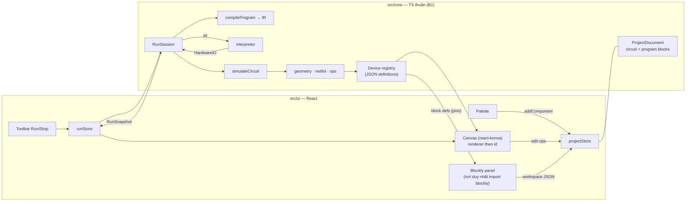
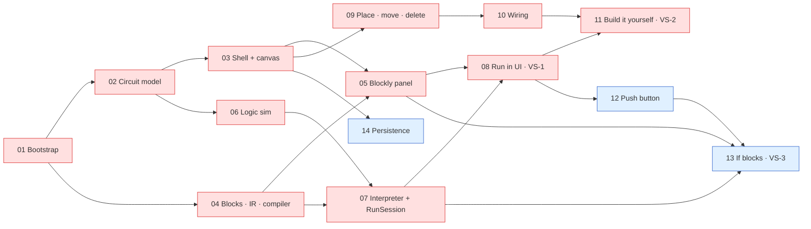

# STEM Demo — PoC Implementation Plan

> **Phiên bản:** 2.1 · **Cập nhật:** 2026-10-02 · **Trạng thái:** *current best implementation strategy*. Đây không phải spec bất biến (xem §15).
> **v2.1:** thêm checkpoint **MP** (minimum architecture proof) trước blink; Resistor không còn chặn MP; COOP/COEP chuyển thành tuỳ chọn; giảm robustness không cần thiết ở POC-02.
> **Phạm vi:** Proof of Concept nhỏ cho một STEM programming/simulation editor chạy hoàn toàn trên trình duyệt, gồm editor mạch 2D, lập trình Blockly, runtime và mô phỏng thiết bị ảo.
> **Thay thế:** plan v1.0 (commit `9c34b73`: 61 task, 7 milestone, nhắm tới một demo gần hoàn chỉnh). Thiết kế chi tiết của v1 vẫn xem được bằng `git show 9c34b73:docs/stem-demo-implementation-plan.md`. §13 trỏ về đúng section v1 cho từng hạng mục bị hoãn.
> **Tài liệu tham khảo:** `docs/ohstem-platform-investigation.md`, `docs/ohstem-demo-reconstruction-spec.md`, `docs/ohstem-reconstruction-assets/`. Đây là **reference**, không phải spec để clone. Phần PoC cần đã được tóm tắt ở §16, nên coding agent **không cần** đọc lại research khi làm task.

## 0. Đọc nhanh

| | |
|---|---|
| **PoC chứng minh gì** | Kiến trúc đã chọn đủ tốt để xây một STEM editor thực tế. Kiến trúc đó gồm: document độc lập renderer, simulation là hàm thuần, Blockly chỉ là view và program được compile sang IR, runtime chỉ chạm phần cứng ảo qua `HardwareIO`, canvas chỉ render document và snapshot (§2) |
| **Vertical slice** | **Checkpoint MP** (bằng chứng đầu tiên): Board + LED, block "on start: digital write D13 HIGH", bấm Run thì LED sáng trên canvas. **VS-1:** mở rộng MP thành mạch Board + Resistor + LED chạy program blink (`forever` + `wait`), Stop hoạt động đúng. **VS-2:** người dùng tự dựng mạch bằng chuột rồi chạy (§3) |
| **Task tiếp theo** | `POC-05` Blockly panel (§9.2). `POC-01`…`POC-04` đã xong |
| **Critical path** | `01 → 02 → 03 → 05 → 08 → 11`. Hai nhánh `02 → 06 → 07 → 08` và `03 → 09 → 10 → 11` dài bằng nhau (§10) |
| **PoC xong khi** | M1 và M2 (P0) đạt exit criteria, Learning log trả lời được L1–L4 (§8, §17). M3 và M4 (P1) làm PoC thuyết phục hơn |
| **Ràng buộc cứng** | Boundary B1–B8 (§5.1) và acceptance criteria của task. Mọi thứ còn lại (tên file, API helper, cấu trúc nội bộ, type chi tiết) là gợi ý |
| **Không làm trong PoC** | Python/Pyodide, Monaco, undo/redo, xoay, bendpoint, inspector, pan/zoom, multi-select, danh sách project, export/import, console, solver strong/weak, solver điện, backend (§2.6, §13) |
| **Trước mỗi task** | Đọc §0, §5.1, §15, task tương ứng ở §9.2 và các contract mà task trỏ tới (§6) |

### Thay đổi chính so với v1

1. **Mục tiêu.** v1 nhắm một demo hoàn chỉnh, gần như một OhStem thu nhỏ. v2 là PoC trả lời một câu hỏi kiến trúc, có hypothesis, learning questions và tín hiệu phản bác rõ ràng (§2).
2. **Cấu trúc.** 61 task / 7 milestone (51 task P0) được thay bằng **14 task theo outcome / 4 milestone theo learning progression** (11 P0, 3 P1), cộng một backlog P2 (§8, §9, §13).
3. **Runtime.** Giữ IR-first nhưng IR chỉ phủ đúng các block đang có. Toàn bộ track Python (Pyodide, protocol SAB, Monaco, differential test) chuyển sang backlog. Seam được giữ lại: runtime API, `HardwareIO` và IR (§6.3, §6.4).
4. **Simulation.** Solver switch-level hai pha (strong/weak) được thay bằng **logic mức net**: resistor coi như dẫn điện. Facade `simulateCircuit` giữ nguyên để nâng cấp sau (§6.5).
5. **Persistence.** Rời khỏi critical path, trở thành P1 sau slice, chỉ gồm autosave/restore qua Dexie. Pipeline migrate/normalize, contract suite, export/import và project browser vào backlog (§7).
6. **Editor.** Undo/redo, xoay, bendpoint, inspector, pan/zoom, multi-select và duplicate ra khỏi PoC (§3.4).
7. **Guardrails.** Ma trận import và `tsconfig.core.json` được thay bằng **một** lint rule. Header COOP/COEP là **tuỳ chọn**: chỉ giữ khi nó không gây friction, nếu có thì hoãn cùng track Pyodide. Bỏ network/console guard, `--repeat-each=3` và contract suite (§5.2, §11.5).
8. **Styling.** Bỏ Tailwind. Nó không nằm trong stack baseline mà là quyết định riêng của agent ở v1 (AD-02) (§4).
9. **Working agreement.** Plan là chiến lược tốt nhất hiện tại. Khi có evidence mới thì cập nhật plan, và ghi Learning log sau mỗi milestone (§15, §17).

---

## 1. Bối cảnh

### 1.1 Trạng thái repository (2026-10-02)

| Hạng mục | Trạng thái |
|---|---|
| Git | Branch `master`, 2 commit (`dd56bf0 initial`, `9c34b73 add plan docs`), working tree sạch |
| Source code | **Không có.** Không có `package.json`, `src/` hay file `.ts/.tsx`. Đây là dự án greenfield |
| Tài liệu | Plan này, cùng hai tài liệu nghiên cứu OhStem (tiếng Việt, giữ thuật ngữ tiếng Anh) |
| Tài sản nghiên cứu | `docs/ohstem-reconstruction-assets/`: ~164 ảnh PNG và `data/` gồm 18 file JSON đã sanitize |
| Cấu hình agent | `.claude/`, `.codex/`, `.agents/`: agent/skill dùng chung, không chứa convention riêng của dự án |
| Máy dev | Node **v20.20.2** (nvm-windows, `C:\nvm4w\nodejs`), npm 11.7.0, Corepack 0.34.6. Máy còn một bản Node v24.14.1 ở `C:\Program Files\nodejs`; `npm` và `corepack` trên PATH lấy từ bản này nhưng chạy bằng Node 20 đang active. Plan v1 ghi Node v24 là vì vậy. pnpm được bật ở POC-01 bằng `corepack enable pnpm --install-directory C:\nvm4w\nodejs`; `corepack enable` mặc định fail `EPERM` vì cố ghi vào `C:\Program Files\nodejs` |

### 1.2 Tài liệu đã review

| Tài liệu | PoC dùng gì |
|---|---|
| `ohstem-demo-reconstruction-spec.md` | Project model gọn với port suy ra từ catalog (§6.1); netlist union-find (§7.2); cấu hình Blockly zelos (§8); pipeline Blockly → Python → Pyodide → chân → mạch đã chạy end-to-end ở OhStem (§10), là bằng chứng track Python khả thi; cảnh báo runtime flag bị lẫn vào params (§20 #4) |
| `ohstem-platform-investigation.md` | Nguyên tắc dài hạn: `workspace → IR → generator → runtime adapter` (§11.1), board profile là first-class (§11.2), khai báo thay vì `eval` (§11.5). Các module robot/AI/IoT nằm ngoài phạm vi |
| `data/circuit-component-catalog.json` | Offset port của LED, resistor, button, board; ý tưởng `internalConnections` |
| Plan v1 | Toàn bộ quyết định và contract. Được đánh giá lại ở §1.3 và §5.2 |

### 1.3 Nguồn gốc của các assumption trong plan v1

Mỗi assumption quan trọng của v1 được truy về nguồn gốc rồi quyết định lại cho PoC. Nguồn gồm: **OhStem** (hành vi quan sát được), **Yêu cầu** (yêu cầu dự án cũ), **Agent** (quyết định kiến trúc của agent viết v1) và **Prod** (cân nhắc production).

| # | Assumption v1 | Nguồn | Quyết định v2 |
|---|---|---|---|
| A1 | Flow end-to-end: palette → nối dây → Blockly → Run → device phản ứng (G1) | Yêu cầu | **Giữ.** Đây là lõi của hypothesis |
| A2 | Core độc lập framework, **được máy enforce** bằng ma trận import `import-x` và `tsconfig.core.json` không có DOM (G2, AD-01) | Yêu cầu (nguyên tắc), Agent (cơ chế) | **Giữ nguyên tắc, đơn giản hoá cơ chế:** một lint rule (B1) |
| A3 | Registry data-driven, thay được bằng API/CMS: 3 registry, `DeviceCatalogSource`, `version`, `maxInstances`, `PropertySpec` (G3, AD-09) | Yêu cầu, investigation §11 | **Giữ data-driven** (B6). Bỏ phần khung chưa dùng tới |
| A4 | Project format có version, validate bằng Zod, đi qua `ProjectRepository`/Dexie, kèm pipeline migrate/normalize (G4, AD-08, AD-10) | Yêu cầu, Prod | **Thu nhỏ, chuyển sang P1** (§7) |
| A5 | IR → interpreter → Python printer → Pyodide, hai runtime cùng contract, có differential test (G5, AD-03) | Yêu cầu (Pyodide có trong stack), Agent (IR, differential) | **Giữ IR nhỏ và interpreter.** Python vào backlog (§6.3) |
| A6 | Không làm MNA; dùng solver switch-level strong/weak (AD-04) | Yêu cầu (tránh full solver), Agent (strength) | **Đơn giản hoá** thành logic mức net (§6.5) |
| A7 | Union-find trên `componentId/portId`; port suy ra từ catalog; dây tham chiếu port (F1, F3) | OhStem | **Giữ** |
| A8 | Canvas và code hiển thị cùng lúc (F6, AD-15) | Agent (chủ động khác OhStem) | **Giữ.** Chi phí 0 và rất quan trọng để thấy quan hệ nhân quả |
| A9 | Khoá thao tác thiết kế khi đang chạy (F7) | OhStem | **Giữ.** Nhờ vậy không phải định nghĩa ngữ nghĩa "sửa mạch khi đang chạy" |
| A10 | Chương trình kết thúc thì board vẫn được cấp nguồn (F13, AD-12) | Agent (khác OhStem) | **Giữ** (E6) |
| A11 | Dùng tên chân (`D13`) thay vì số GPIO (F16) | Agent | **Giữ** |
| A12 | COOP/COEP và self-host từ ngày đầu, có network guard (AD-17) | Prod, OhStem (SAB fallback, spec §20 #12) | **Header tuỳ chọn** (giữ nếu không gây friction; nếu có thì hoãn cùng track Pyodide). **Bỏ guard** |
| A13 | Tailwind v4 (AD-02) | Agent (skill có sẵn trong repo mặc định Tailwind) | **Bỏ** (§4) |
| A14 | Undo theo gesture, multi-select, duplicate, bendpoint, xoay theo độ (AD-06, AD-07, F8) | OhStem, phạm vi "editor đầy đủ" | **Hoãn** (§13) |
| A15 | Hằng số gesture: lưới 10, bán kính bắt port, giới hạn zoom (F8) | OhStem | **Giữ** lưới 10 và cách bắt port gần nhất ở dạng gợi ý. Zoom hoãn |
| A16 | Chỉ số đo: Pyodide cold start ≤ 5 s, 0 request ra ngoài, E2E xanh 3 lần liên tiếp (§3.3 v1) | Agent, Prod | **Chỉ giữ chỉ số độ trễ tương tác** (§2.5) |
| A17 | Persistence có contract test, export/import, project browser, dirty state, `beforeunload` (§12 v1) | Prod | **Backlog**, trừ autosave/restore (P1) |
| A18 | Pyodide: SAB control block, worker giữ ấm, protocol riêng (§10.9 v1) | Agent, dựa trên dữ liệu OhStem (F5, C3, C6) | **Backlog**, làm spike trước (BL-PY1) |
| A19 | 14 quy tắc thực thi tương thích Python (truthiness, `str()`, short-circuit) (E1–E14 v1) | Agent (phục vụ differential test) | **Rút còn E1–E7** (§6.4) |
| A20 | 6 device: board, R, LED, button, switch, ground (AD-18) | Agent, dựa trên MVP của spec §2 | **3 device + 1** (button ở M3) (§3.2) |

---

## 2. PoC hypothesis

### 2.1 Câu hỏi chính

> Liệu architecture mà chúng ta đang chọn có đủ tốt để xây một STEM programming/simulation editor thực tế hay không?

### 2.2 Hypothesis

**H.** Một kiến trúc chạy hoàn toàn trên trình duyệt, gồm:

1. **design document** độc lập renderer: component và dây, dây tham chiếu `{componentId, portId}`, vị trí port suy ra từ device definition dạng data;
2. **connection graph và logic simulation** là hàm TypeScript thuần, nhận document cùng runtime input;
3. **Blockly chỉ là view**: program lưu ở dạng Blockly JSON và được compile sang một IR nhỏ;
4. **runtime** chỉ chạm phần cứng ảo qua một interface mức chân (`HardwareIO`), không biết gì về mạch hay UI;
5. **canvas React-Konva** chỉ render document và run snapshot;

…là đủ để xây vòng lặp **dựng mạch → lập trình → Run → thiết bị phản ứng** sao cho vòng lặp đó **đúng**, **phản hồi nhanh tới mức cảm giác như thật**, và **mở rộng được**: thêm device, block hay runtime mà không phải viết lại core.

### 2.3 Learning questions

| ID | Câu hỏi | Kiểm chứng ở | Bằng chứng mong đợi |
|---|---|---|---|
| L1 | Mô hình editor/document (port từ data, dây tham chiếu port, operation thuần) có hỗ trợ tốt tương tác thật trên Konva không? | M2 | Dựng mạch bằng chuột mà renderer không giữ geometry hay state riêng |
| L2 | Connection graph (union-find) cộng với phần đóng góp của từng model có đủ để mô phỏng mạch do người dùng tự nối không? | M1, M2 | Scenario test xanh. Mạch tự dựng có netlist trùng với mạch mẫu |
| L3 | Blockly có tích hợp sạch dưới dạng view thuần không: JSON vào/ra, compile mà không cần Blockly? | M1, M3 | Test compiler chạy trên Node. Code Blockly chỉ nằm trong một thư mục. Block built-in có mutator (`controls_if`) compile được từ JSON |
| L4 | Runtime có điều khiển được phần cứng ảo qua `HardwareIO` không, trong khi Stop vẫn tức thì và UI vẫn mượt? | M1 | Đạt chỉ số ở §2.5. Không còn lệnh ghi chân nào sau Stop |
| L5 | Chiều ngược lại (device → program) và tương tác lúc đang chạy có vừa với các boundary hiện tại không? | M3 | Nút → `if` → LED. Không có runtime state nào lọt vào document |
| L6 | Thêm một device mới tốn bao nhiêu? (kiểm chứng claim data-driven) | M3 | Push button chỉ chạm tới definition, model và renderer (thêm block nếu cần). Ghi lại mọi file thay đổi ngoài các chỗ đó |
| L7 | Design document có tự đủ để persist/restore mà không kéo theo state của runtime hay UI không? | M4 | Save → reload cho ra document deep-equal. Không có field runtime |
| L8 | Flow có cảm giác giống một sản phẩm STEM thực tế không? | M2, M3 | Một người chạy thử demo script và ghi nhận xét vào Learning log |

### 2.4 Tiêu chí thành công và tín hiệu phản bác

**Thành công** khi M1 và M2 xong, cụ thể:
- E2E-1 và E2E-2 xanh;
- đạt các chỉ số ở §2.5;
- boundary B1–B8 được giữ mà không cần ngoại lệ (không có `eslint-disable` cho rule B1);
- Learning log ghi verdict cho L1–L4.

**Các tín hiệu làm yếu hoặc bác bỏ kiến trúc.** Gặp thì phải ghi vào Learning log, không được lặng lẽ lách qua:

| Tín hiệu | Nghĩa là |
|---|---|
| Canvas hoặc renderer cần biết chi tiết simulation/runtime ngoài snapshot (ví dụ tự tính LED sáng hay tắt) | Ranh giới render ↔ simulation sai |
| Compiler cần Blockly runtime, chứ không chỉ JSON, mới hiểu được program (ví dụ `extraState` không đủ thông tin) | Quyết định "Blockly là view" sai |
| Thêm push button phải sửa `RunSession`, canvas hoặc compiler theo kiểu đặc thù cho device | Abstraction của registry/model chưa đủ |
| Program đơn giản mà UI vẫn giật hoặc trễ quá chỉ số | Mô hình runtime chạy trên main thread không ổn, cần cân nhắc worker sớm hơn |
| Konva và core tính vị trí port lệch nhau, hoặc phải nhân đôi geometry | Phân công sở hữu geometry sai |
| UI chỉ chạy được nếu document chứa runtime state | Việc tách design state và runtime state sai |

### 2.5 Chỉ số đo (mục tiêu mềm, đo trên máy dev)

| Chỉ số | Mục tiêu |
|---|---|
| Run → LED sáng (program "on start: D13 HIGH") | ≤ 300 ms |
| Chân đổi giá trị → canvas cập nhật | ≤ 1 frame. Runtime gây ra tối đa 1 lần React commit mỗi frame |
| Nhấn nút → LED đổi (program `forever` + `if`) | ≤ 50 ms |
| Stop, kể cả khi đang `wait` | ≤ 100 ms; sau Stop không còn lệnh ghi chân nào |
| Blink 1 s | Chu kỳ sai lệch không quá ±50 ms |

### 2.6 Non-goals của PoC

- **Theo yêu cầu dự án:** backend, ASP.NET Core, MySQL/PostgreSQL, Redis, MinIO, auth, LMS, CMS, Kubernetes, HA, realtime collaboration.
- **Ngoài câu hỏi kiến trúc:** clone OhStem 1:1; Python/Pyodide; Monaco; mô phỏng điện (điện áp, dòng, độ sáng, linh kiện cháy); breadboard; nhiều board; robot/AI/IoT; i18n; mobile/touch; phần cứng thật.
- **Polish của editor:** undo/redo, xoay, lật, bendpoint, màu dây, inspector, pan/zoom, multi-select, duplicate, phím tắt ngoài Delete/Esc.
- **Hardening production:** CSP, telemetry, migration, đồng bộ offline, nhiều tab.

---

## 3. Vertical slice và scope

### 3.1 Slice được chọn

| Slice | Nội dung | Milestone |
|---|---|---|
| **MP — Minimum architecture proof** (checkpoint đầu tiên của M1) | Mạch mẫu chỉ có Board + LED (D13 → LED.anode, LED.cathode → GND), program "on start: digital write D13 HIGH" trong Blockly. Bấm **Run** → compile → runtime → simulation → **LED sáng trên canvas**. Bấm **Stop** → LED tắt | M1 |
| **VS-1 — Blink on canvas** (M1 hoàn chỉnh) | Mở rộng MP: mạch mẫu có thêm Resistor (D13 → R → LED → GND), program blink (`forever` + `wait`). Bấm **Run** thì LED nhấp nháy. Sửa block (HIGH/LOW, thời gian, chân) rồi Run lại thì hành vi đổi theo. Bấm **Stop**, kể cả khi đang `wait`, thì LED tắt và mọi thứ về trạng thái thiết kế | M1 |
| **VS-2 — Build it yourself** | Từ canvas trống: thêm Board, Resistor, LED từ palette, kéo sắp xếp, nối dây port → port, xoá chỗ nối sai, lập trình bằng Blockly, Run → LED phản ứng | M2 |
| **VS-3 — Closed loop** (P1) | Nút nhấn → program `if` đọc chân → LED. Giữ nút thì LED sáng, nhả thì tắt | M3 |

**Vì sao làm VS-1 trước, với mạch có sẵn:**
- VS-1 đi qua **mọi** subsystem: document, registry, geometry, render, Blockly, compiler, IR, interpreter, `HardwareIO`, netlist, simulation, snapshot, render lại. Nó không phải chờ phần tương tác editor, vốn chiếm phần lớn khối lượng UI.
- Có kết quả nhìn thấy được từ sớm.
- Hai tích hợp rủi ro nhất được thử đầu tiên: vòng đời Blockly trong React cùng contract Blockly JSON, và vòng lặp runtime ↔ React render.
- Editor (L1) là ẩn số lớn thứ hai và được làm ngay sau ở M2. **Hypothesis chỉ được coi là trả lời xong khi có VS-2.**

**Vì sao có MP trước blink:** MP là đường ngắn nhất đi qua mọi boundary (Blockly JSON → compiler → IR → interpreter → `HardwareIO` → simulation → snapshot → render). `wait`, `forever`, async sleep, Stop khi đang sleep và Resistor đều **không được chặn** việc chứng minh chuỗi cơ bản `Blockly → LED`. Vì vậy chúng là phần mở rộng sau MP, nằm trong cùng các task M1.

**Vì sao VS-1 vẫn là blink:** sau MP, blink kiểm tra thời gian (`wait`), vòng `forever`, Stop khi đang sleep và việc render lặp lại. "LED on" chỉ kiểm tra một lệnh ghi; nó vẫn được giữ làm sample và test case của MP.

**Các phương án bị loại:**

| Phương án | Lý do loại |
|---|---|
| Board + LED, bật/tắt chân bằng nút UI, không có Blockly | Không kiểm tra phần lập trình |
| Blockly → chỉ in chữ ra console | Không kiểm tra phần cứng ảo hay simulation |
| Làm "tự dựng mạch" trước | Phần tương tác editor rất lớn, làm trước sẽ làm chậm bằng chứng end-to-end đầu tiên |
| Nút + LED làm slice đầu | Thêm cả tương tác lúc chạy lẫn `if`/đọc chân trước khi chuỗi cơ bản được chứng minh |
| Python runtime ngay trong slice | Kéo theo rủi ro worker/SAB/COEP/hosting asset vốn không liên quan tới câu hỏi chính |

### 3.2 Device

| Device | Port (offset tính từ tâm, đơn vị world) | Model | Milestone | Vì sao cần |
|---|---|---|---|---|
| **Board** (Uno-like) | `d2`…`d13` (`gpio`, cùng một cạnh, cách nhau 20), `3v3` (`power`), `gnd` (`ground`) | `board` | M1 | Đích của program, đồng thời là nguồn |
| **LED** | `anode` (−10, 30), `cathode` (10, 30); thân khoảng 40×70 | `led` | M1 | Phản ứng nhìn thấy được. Có cực tính nên mạch thực tế |
| **Resistor** | `a` (−40, 0), `b` (40, 0) | `resistor` (dẫn điện) | M1, **sau MP** | Mạch STEM thật luôn có điện trở. Chứng minh một device passive nằm trong net graph. Chỉ là data, generic renderer và một model dẫn điện, nên rất rẻ. **Không phải dependency của MP** |
| **Push button** | `a`, `b` (2 chân) | `contact` (dẫn khi đang nhấn) | M3 | Input, tương tác lúc chạy, và dùng để đo chi phí thêm device (L6) |

**Reference behavior:** offset của LED và resistor lấy từ catalog OhStem. OhStem dùng nút 4 chân có internal connection để cắm breadboard; PoC không có breadboard nên chỉ dùng 2 chân. Chân board OhStem cách nhau 15 px, dễ bấm nhầm, nên PoC dùng 20.

**Hoãn:** switch (cùng model `contact`, rất rẻ để thêm sau), device ground (GND của board là đủ), battery (nguồn floating sẽ phá mô hình tham chiếu chung), mọi thứ analog.

### 3.3 Block

| Block | Dạng | Milestone |
|---|---|---|
| `stem_on_start` | hat, statement `DO` | M1 (MP) |
| `stem_digital_write` | statement. Field `PIN` (dropdown sinh từ board definition), field `LEVEL` (HIGH/LOW) | M1 (MP) |
| `stem_forever` | hat, statement `DO` | M1, sau MP |
| `stem_wait` | statement. Field số `SECONDS` | M1, sau MP |
| `stem_digital_read` | value (Boolean). Field `PIN` | M3 |
| `controls_if` | built-in, if/else qua mutator | M3 |
| `logic_negate` | built-in, tuỳ chọn | M3 |

**Quyết định:** block của M1 **chỉ dùng field**, không có value input. Nhờ vậy compiler và IR ở M1 không phải xử lý expression. Expression xuất hiện ở M3, cùng với đọc chân và `if`. Toolbox chỉ cần vài category đơn giản. Không có biến, toán, vòng lặp đếm hay hàm.

### 3.4 UI tối thiểu

- **Layout:** toolbar (Run/Stop và status); canvas và Blockly **hiển thị cùng lúc** (ràng buộc); một palette nhỏ (M2). Kích thước và vị trí cụ thể do implementer quyết định.
- **Canvas (M2):**
  - click-to-add (kéo từ palette là tuỳ chọn);
  - kéo để di chuyển, snap lưới 10;
  - click port rồi click port để nối dây;
  - chọn một đối tượng và nhấn Delete để xoá; Esc để huỷ thao tác nối dây.
- **Khi đang chạy:** khoá palette, kéo, nối dây và xoá. Blockly vẫn sửa được, thay đổi áp dụng ở lần Run sau (program được compile lúc Run).
- **Không có trong PoC:** xoay, bendpoint, inspector, undo/redo, pan/zoom, multi-select.

---

## 4. Tech stack trong PoC

Stack baseline **không thay đổi**. Chỉ thay đổi *thời điểm* đưa vào.

| Công nghệ | Trong PoC | Ghi chú |
|---|---|---|
| TypeScript (strict), React 19, Vite, pnpm | Dùng ngay (POC-01) | pnpm qua Corepack. Pin version. Vite phải hỗ trợ Node 20.19+ |
| Konva + react-konva | Dùng ngay (POC-03) | Chỉ trong canvas. react-konva 19 tương ứng React 19 |
| Google Blockly | Dùng ngay (POC-04/05) | npm, bản ổn định mới nhất, renderer zelos, block định nghĩa bằng JSON, serialization JSON. **Không dùng generator của Blockly** |
| Zustand | Dùng ngay (POC-03) | Store mỏng; logic nằm ở core |
| Zod | Dùng ngay, nhưng ít | Validate device definition (POC-02) và project document khi load từ storage (POC-14). Không parse trong từng operation |
| Vitest | Dùng ngay | Unit test cho core và integration test headless |
| Playwright | Dùng ngay | Chỉ Chromium. Mỗi slice một spec |
| Dexie / IndexedDB | **P1** (POC-14) | Một bảng, đặt sau một interface nhỏ |
| Monaco | **Không dùng trong PoC** | Đưa vào khi có Python sửa được (backlog). Nếu cần preview Python read-only thì dùng `<pre>` |
| Pyodide + Web Worker | **Không dùng trong PoC** | Track Python trong backlog. Seam giữ sẵn: runtime API, `HardwareIO`, IR |
| ESLint | Dev tooling | Dùng cho rule boundary B1. Prettier tuỳ chọn |
| Styling | CSS thuần, không thêm CSS framework | Tailwind (AD-02 v1) không nằm trong stack baseline. Bỏ vì phần chrome rất nhỏ và vì preflight có thể xung đột với Blockly (R4 v1). Có thể thêm khi làm UI thật |

**Version đã pin ở POC-01** (2026-10-02, Node 20.20.2): pnpm 12.8.1, React 19.3.0, Vite 8.3.2 cùng `@vitejs/plugin-react` 6.1.1, TypeScript 6.0.3, Vitest 4.1.11, Playwright 1.63.0 (Chromium 153), ESLint 10.11.0 cùng `typescript-eslint` 8.71.0, `@types/node` 20.19.43. Có hai lựa chọn có chủ đích:
- **Vitest 4, không dùng 5:** Vitest 5 yêu cầu Node ≥ 22.12.
- **TypeScript 6, không dùng 7:** `typescript-eslint` 8.71 chỉ hỗ trợ TypeScript `<6.1`.

Chỉ nâng các version này khi đã nâng Node hoặc khi `typescript-eslint` hỗ trợ TypeScript 7.

---

## 5. Architecture

### 5.1 Boundary giữ ngay từ đầu (ràng buộc)

Đây là các ràng buộc cứng. Mỗi boundary có chi phí thấp, và để muộn thì khó sửa.

| ID | Boundary | Vì sao giữ ngay | Cách giữ |
|---|---|---|---|
| **B1** | **Core thuần.** `src/core/**` không import React, Konva, Blockly, Zustand, Dexie, Monaco, Pyodide, cũng không import `src/ui/**` hay `src/storage/**` | Đây là claim trung tâm của hypothesis, và agent rất dễ làm trôi nó | Một rule ESLint `no-restricted-imports` áp cho `src/core/**` (file test cũng không được import framework UI) |
| **B2** | **Document không chứa runtime state.** Mức chân, LED sáng, nút đang nhấn chỉ tồn tại trong `RunSession`/snapshot. Stop là huỷ hết | Tránh lỗi F2 của OhStem (`_broken`, `pinStates` nằm trong `params`) | Review; test "document không đổi sau một lần chạy" (POC-07) |
| **B3** | **Simulation là hàm thuần** `(circuit, registry, inputs) → result`. Nó không nằm trong component Konva hay trong store | Test được, và thay được bằng solver khác | Đặt trong `src/core`; canvas chỉ đọc kết quả |
| **B4** | **Blockly là view.** Program lưu ở dạng Blockly serialization JSON. Compiler chỉ đọc JSON, không import Blockly. Định nghĩa block là data nằm ở core. Code dùng Blockly chỉ nằm trong một thư mục UI | Test compiler không cần DOM; nâng Blockly chỉ ảnh hưởng adapter | B1 cộng review |
| **B5** | **Runtime chỉ nói chuyện với phần cứng ảo qua `HardwareIO`** (cộng status event), không biết gì về mạch, simulation hay UI. `RunSession` là nơi duy nhất nối program với simulation | Đây là seam để sau này thêm Pyodide và phần cứng thật | Contract ở §6.4 |
| **B6** | **Device metadata là data.** Definition là file JSON, được validate bằng Zod khi tạo registry. Renderer và simulation model được tham chiếu bằng id dạng chuỗi; id lạ thì dùng generic renderer hoặc model inert, không crash. Không `eval`. Hàm core nhận registry qua tham số; chỉ bootstrap import catalog local | Đường lên API/CMS; tránh `eval` như OhStem | Definition để ở file `.json`; Zod schema |
| **B7** | **Geometry một nguồn.** Vị trí port trong toạ độ world do **một** hàm core tính. Renderer, wiring, hit-test và test hook đều dùng hàm đó. Mọi chuyển đổi pointer ↔ world đi qua một helper | Tránh Konva và core lệch nhau; thêm xoay/zoom sau chỉ là thay đổi cục bộ | Review; acceptance criteria của POC-03 và POC-10 |
| **B8** | **Persistence đặt sau interface** (P1). UI và store gọi interface; chỉ bootstrap biết tới Dexie | Đường lên API/backend mà không phải viết lại editor | POC-14 |

**Boundary không phải lý do để tạo thêm abstraction.** Giữ boundary chủ yếu bằng cách đặt code đúng chỗ (đúng thư mục, đúng hướng import). Chỉ thêm interface, registry hay layer mới khi đã có **consumer thực tế** thứ hai, hoặc khi task yêu cầu rõ ràng.

### 5.2 So với v1: giữ, đơn giản hoá, hoãn

| v1 | v2 | Lý do | Seam / khi nào xem lại |
|---|---|---|---|
| AD-01: ma trận import `import-x` và `tsconfig.core.json` không DOM | **Đơn giản hoá:** một lint rule (B1) | Bảo vệ đúng claim chính với ~15 dòng config. Ma trận giữa các tầng trong core và tsconfig thứ hai tốn công setup mà không làm PoC học thêm được gì | Thêm lại nếu Learning log ghi nhận kiến trúc bị trôi |
| AD-02: Tailwind v4 | **Bỏ:** dùng CSS thuần | Xem §4 | Khi làm UI thật |
| AD-03: IR, interpreter, printer Python, Pyodide, differential test | **Giữ IR nhỏ và interpreter.** Python vào backlog | §6.3 | Khi có runtime thứ hai |
| AD-04: solver switch-level hai pha strong/weak | **Đơn giản hoá:** logic mức net | §6.5 | Khi cần pull-up/pull-down hoặc gặp chập giả (BL-S1) |
| AD-05: renderer registry kèm fallback | **Giữ, ở mức tối thiểu:** viết **generic renderer trước**, chỉ device nào cần hiển thị state mới có renderer riêng | Generic renderer chính là bằng chứng cho B6 | — |
| AD-06: dây có bendpoint, vẽ polyline | **Hoãn:** dây thẳng | Không cần cho hypothesis | Thêm field tuỳ chọn có default (BL-E3) |
| AD-07: undo/redo bằng snapshot, API gesture | **Hoãn.** Mọi thay đổi document đi qua **một** action của store | Không phải ẩn số; operation thuần làm undo rẻ khi cần | BL-E1, cắm vào đúng action đó |
| AD-08: schema đầy đủ (`format`, rotation, properties, label, timestamp, `.strict()`) | **Thu nhỏ** (§6.1) | Field nào thêm sau dạng tuỳ chọn có default thì không cần migration | `schemaVersion` |
| AD-09: 3 registry, `DeviceCatalogSource`, `version`, `maxInstances`, `PropertySpec` → Zod | **Thu nhỏ:** definition dạng data cộng một bảng tra; registry truyền qua tham số | Chưa có consumer cho phần khung còn lại | CMS: chỉ cần đổi chỗ tạo registry |
| AD-10: port repository, 2 adapter, contract suite, pipeline parse → migrate → validate → normalize | **P1, thu nhỏ** (§7) | Dexie là công nghệ quen, ít giá trị học | Adapter API |
| AD-11: ranh giới Blockly | **Giữ** (B4) | Nằm trong hypothesis | — |
| AD-12: vòng đời runtime (mô hình cấp nguồn, khoá khi chạy, `runId`, worker giữ ấm) | **Giữ** mô hình cấp nguồn và khoá. **Bỏ** phần dành cho worker | Chưa có worker | Track Python |
| AD-13: ranh giới test (contract suite, differential) | **Test theo rủi ro** (§11) | Chỉ có một adapter và một runtime | — |
| AD-14: walking skeleton 7 milestone | **4 milestone theo learning** (§8) | — | — |
| AD-15: danh sách hành vi OhStem không clone | **Giữ** các mục liên quan (§16) | — | — |
| AD-16: vanilla store qua context, cấm singleton, batch theo rAF | **Đơn giản hoá:** store tạo bằng factory để test được; runtime gây ra tối đa 1 commit mỗi frame | Cách cung cấp store cho React do implementer quyết | — |
| AD-17: COOP/COEP, self-host mọi asset, network guard | **Header tuỳ chọn**, không phải acceptance của P0. **Bỏ guard** | Nếu header chỉ là vài dòng config và không gây vấn đề thì giữ, vì nó làm lộ sớm các phụ thuộc CDN vốn sẽ chặn SAB/Pyodide sau này. Nếu nó gây thêm việc (media Blockly, load asset, Playwright, dev server, package bên thứ ba, hành vi trình duyệt) thì **tắt và hoãn cùng track Pyodide**, không debug COEP trong PoC. Guard không cần vì PoC không có phụ thuộc ngoài | Track Python (BL-PY1) |
| AD-18: 6 device | **3 device + button** (§3.2) | — | BL-S3 |
| AD-19: Python kiểu MicroPython đồng bộ | **Backlog** (BL-PY2). Giữ làm ghi chú | — | — |
| AD-20: UI tiếng Anh, `strings.ts` | UI tiếng Anh. Không bắt buộc file strings | — | — |

### 5.3 Luồng dữ liệu



### 5.4 Bố cục module (gợi ý)

```text
src/
├─ core/                 ← TS thuần (B1)
│  ├─ devices/           definitions/*.json, schema (Zod), registry
│  ├─ circuit/           document types/schema, geometry, netlist, ops
│  ├─ simulation/        simulateCircuit, models
│  ├─ program/           blocks (data), ir, compiler, interpreter
│  └─ run/               RunSession, HardwareIO
├─ ui/                   ← React
│  ├─ app/               bootstrap (composition root), layout, test hooks
│  ├─ state/             Zustand stores
│  ├─ canvas/            Konva stage, renderers, interactions
│  └─ blockly/           nơi duy nhất import blockly
├─ storage/              ← Dexie (P1); chỉ bootstrap import
└─ samples/              project mẫu (JSON) dùng chung cho app và test
e2e/                     Playwright specs + helper
```

Tên thư mục chỉ là gợi ý. Ràng buộc thật sự là B1–B8.

---

## 6. Core contracts (tối thiểu)

Các type dưới đây là **phác thảo**. Implementer được phép tinh chỉnh tên hoặc hình dạng nếu vẫn giữ được ngữ nghĩa và boundary. Nếu đổi **ngữ nghĩa** (invariant, quy tắc compile, quy tắc thực thi, thuật toán simulation) thì phải cập nhật section này trong cùng PR.

### 6.1 Project document

```ts
type ProjectDocument = {
  schemaVersion: 1;
  id: string;
  name: string;
  circuit: Circuit;
  program: { blocks: unknown };   // Blockly serialization JSON; chỉ compiler và Blockly panel đọc
};
type Circuit = { components: ComponentInstance[]; wires: Wire[] };
type ComponentInstance = {
  id: string;            // duy nhất trong document
  deviceType: string;    // = DeviceDefinition.id
  position: Point;       // TÂM thân device, đơn vị world (1 unit = 1 px ở scale 1)
};
type Wire = { id: string; from: PortRef; to: PortRef };   // vô hướng về điện
type PortRef = { componentId: string; portId: string };
type Point = { x: number; y: number };
```

**Invariant.** Mọi operation phải giữ các invariant này, và dữ liệu load vào phải được kiểm tra theo chúng:
- **I1.** `id` không trùng giữa các component, và không trùng giữa các wire.
- **I2.** Đầu dây trỏ tới một component có thật, và tới một port có trong definition của component đó. `deviceType` lạ chỉ có thể xuất hiện khi load dữ liệu từ ngoài (POC-14, CMS); cách xử lý được quyết định khi có nguồn dữ liệu đó.
- **I3.** Không có dây nối một port với chính nó. Không có hai dây trùng nhau (kể cả khi đảo chiều). Một port được phép có nhiều dây.
- **I4.** Xoá component thì xoá luôn các dây nối vào nó.
- **I5.** Không có runtime state (B2).

**Cố ý chưa có:** rotation, label, properties, bendpoint, màu dây, timestamp. Chúng sẽ được thêm dưới dạng **field tuỳ chọn có default**, nên không cần tăng `schemaVersion`. Chỉ thay đổi phá vỡ tương thích mới tăng version và cần migration (PoC không có migration).

**Zod:** schema cho document chỉ bắt buộc ở POC-14 (load từ storage). Định nghĩa sớm cùng type (`z.infer`) là tuỳ chọn. Chỉ parse ở boundary, không parse trong từng operation.

### 6.2 Device definition

```ts
type DeviceDefinition = {
  id: string;                         // "led"
  name: string;                       // "LED"
  body: { width: number; height: number };   // căn giữa tại position
  ports: {
    id: string; label: string;
    x: number; y: number;             // offset tính từ tâm
    kind: 'gpio' | 'power' | 'ground' | 'passive';
  }[];
  internalConnections?: string[][];   // các port nối liền nhau bên trong device
  renderer: string;                   // id renderer; id lạ → generic renderer
  simulation: { model: string; config?: Record<string, unknown> };   // id model; id lạ → inert
  board?: { pins: { name: string; portId: string }[] };   // chỉ board có: tên chân mà program nhìn thấy
};
```

Ví dụ `led.json`:

```json
{
  "id": "led",
  "name": "LED",
  "body": { "width": 40, "height": 70 },
  "ports": [
    { "id": "anode", "label": "Anode (+)", "x": -10, "y": 30, "kind": "passive" },
    { "id": "cathode", "label": "Cathode (−)", "x": 10, "y": 30, "kind": "passive" }
  ],
  "renderer": "led",
  "simulation": { "model": "led" }
}
```

**Quy tắc:**
- Definition là file JSON, được parse bằng Zod schema khi tạo registry. Definition sai thì fail rõ ràng lúc khởi động hoặc trong test; không cần cơ chế báo lỗi cầu kỳ.
- Quy ước khi viết definition (không cần code kiểm tra riêng): `id` của port không trùng trong một device; offset port là bội số của 10, để khi component nằm trên lưới thì port cũng nằm trên lưới; `board.pins[*].name` không trùng và trỏ tới port `gpio`.
- `board.pins` là **board profile** của PoC. Nó dùng cho dropdown trong Blockly, cho việc compiler kiểm tra tên chân, và cho tên chân trong `HardwareIO`.
- *(Evidence POC-02)* `internalConnections` và `simulation.config` **chưa được implement** vì chưa device nào trong PoC cần (board chỉ có một GND, nút nhấn có 2 chân). Thêm vào schema và netlist khi có consumer, ví dụ breadboard, nút 4 chân, board nhiều GND, hoặc model cần config.

### 6.3 Program: block, IR, compiler

**Đánh giá lại IR-first.** Các phương án đã cân nhắc:

| Phương án | Ưu | Nhược | PoC |
|---|---|---|---|
| Interpret thẳng Blockly JSON | Ít type hơn | Runtime bị gắn với format serialization của Blockly. Mọi consumer sau này (printer Python, evaluator) phải parse lại. Lỗi chỉ lộ ra giữa lúc chạy | ✗ |
| Generator Blockly → JS → `eval`/`Function` | Nhanh có kết quả | Vi phạm nguyên tắc không `eval`. Stop/sleep phải sinh code async. Phải load Blockly mới test được | ✗ |
| Generator Blockly → Python → Pyodide | Giống OhStem | Đưa Pyodide vào critical path | ✗ |
| **Blockly JSON → compiler → IR nhỏ → interpreter** | Compiler là hàm thuần (~100–200 dòng), báo lỗi kèm `blockId` **trước khi Run**, interpreter nhỏ, runtime không biết Blockly, sau này printer Python chỉ là IR → text | Thêm một bước | **✓** |

**Kết luận:** giữ IR-first. Phần code parse Blockly JSON đằng nào cũng phải viết; tách nó ra thành compiler gần như không tốn thêm, đổi lại được boundary B4 và diagnostics có trước khi chạy. Có ba điểm khác v1:
- IR chỉ có node cho **các block đang tồn tại**, không định nghĩa sẵn toàn bộ;
- không có ngữ nghĩa kiểu Python cho tới khi có runtime thứ hai;
- **IR không được persist**, nên đổi tự do mà không cần versioning.

Nếu thực tế cho thấy compiler chỉ là ánh xạ 1:1 và không có giá trị, ghi điều đó vào Learning log. Dự kiến giá trị của nó sẽ tăng khi có Python.

**IR v0 (phác thảo):**

```ts
type ProgramIR = { onStart: Statement[]; forever: Statement[] | null };
type Statement =
  | { kind: 'digitalWrite'; pin: string; level: 0 | 1; blockId: string }
  | { kind: 'wait'; ms: number; blockId: string }
  // M3 (POC-13):
  | { kind: 'if'; condition: Expression; then: Statement[]; else: Statement[]; blockId: string };
type Expression =    // M3
  | { kind: 'digitalRead'; pin: string; blockId: string }
  | { kind: 'boolean'; value: boolean }
  | { kind: 'not'; value: Expression; blockId: string };
```

`level` là literal vì block M1 chỉ dùng field. Khi có value input, `level` có thể đổi thành `Expression`. Đây là thay đổi IR có chủ đích và được phép.

**Quy tắc của compiler** — `compileProgram(blocksJson, boardPins) → { ok: true; ir; diagnostics } | { ok: false; diagnostics }`:
- **C1.** Input là Blockly serialization JSON (`blocks.blocks[]`, `next.block`, `fields`, `inputs.X.block`/`shadow`, `extraState`) cùng danh sách tên chân của board.
- **C2.** Block top-level `stem_on_start` (tối đa 1) và `stem_forever` (tối đa 1) tạo ra hai section. Các block top-level khác bị bỏ qua kèm warning (Blockly cũng làm mờ chúng qua `disableOrphans`).
- **C3.** Lỗi: block type lạ, chân không có trên board, hat bị trùng. Lỗi luôn kèm `blockId`.
- **C4.** **Không bao giờ throw.** JSON sai cấu trúc sinh diagnostic lỗi. Cần phân biệt hai trường hợp:
  - phần **vắng mặt hợp lệ**: statement input không có, hay `next` không có, được hiểu là body rỗng hoặc hết chuỗi;
  - phần **có mặt nhưng sai shape**: input không phải object, hoặc field mà block bắt buộc phải có (`PIN`, `LEVEL`, `SECONDS`) bị thiếu hay sai kiểu. Trường hợp này là `malformed-program` trên block đó, không được âm thầm bỏ qua.
- **C5.** Mọi node IR mang `blockId`, để sau này highlight được block lỗi hoặc block đang chạy.
- **C6.** `wait` với giá trị âm hoặc không hữu hạn được coi là 0.
- **C7.** **Block disabled** (Blockly lưu là `disabledReasons` có ít nhất một reason; không cần phân biệt từng reason) là trạng thái hợp lệ, **không** sinh error hay warning:
  - statement disabled không sinh IR, nhưng chuỗi vẫn tiếp tục sang `next`;
  - hat disabled (`on start` / `forever`) bỏ cả stack bên dưới;
  - block rời rạc bị disabled (ví dụ do `disableOrphans`) được bỏ qua mà không có warning.

**Fixture:** compiler test phải dùng JSON có **đúng format Blockly thật**. Xem POC-04 và rủi ro R2.

### 6.4 Runtime và `RunSession`

**Runtime đơn giản nhất mà vẫn đủ dùng:** một interpreter async duyệt cây IR, chạy trên main thread, dùng hàm `sleep` được inject (có thể huỷ bằng `AbortSignal`). PoC chưa cần runtime registry hay cơ chế chọn runtime. Chỉ giữ hai seam:

```ts
interface HardwareIO {
  digitalWrite(pin: string, level: 0 | 1): void;   // chân trở thành output và drive mức này
  digitalRead(pin: string): 0 | 1;                 // mức hiện tại của net nối vào chân (floating → 0)
}
// API của interpreter: giữ nhỏ; một runtime Pyodide sau này sẽ implement cùng hình dạng
type RunOutcome =
  | { status: 'finished' | 'stopped' }
  | { status: 'error'; message: string; blockId?: string };
function runProgram(ir: ProgramIR, io: HardwareIO, opts: { sleep: (ms: number, signal: AbortSignal) => Promise<void> }):
  { done: Promise<RunOutcome>; stop(): void };
```

`HardwareIO` không có `configurePin`, vì chế độ của chân được suy ra ngầm (ghi thì là output; floating đọc ra 0). `configurePin` được thêm khi cần pull-up, PWM hoặc analog. Đó là thay đổi cộng thêm, không phá vỡ code cũ.

**Ngữ nghĩa thực thi:**

| # | Quy tắc |
|---|---|
| E1 | Run = **cấp nguồn** cho board: rail `power`/`ground` hoạt động; chân GPIO chưa drive cho tới khi được ghi |
| E2 | `onStart` chạy tuần tự một lần, sau đó `forever` lặp cho tới khi Stop |
| E3 | Cuối mỗi vòng `forever` luôn nhường ít nhất ~10 ms (bằng macrotask, không phải microtask), để UI không bị đóng băng và nhịp vòng lặp giống thật |
| E4 | `wait(ms)` sleep đúng `ms`, và bị ngắt ngay khi Stop |
| E5 | Stop ngắt **ngay lập tức**, kể cả khi đang `wait`. Sau Stop không còn lệnh ghi chân nào. Toàn bộ runtime state bị huỷ; design document không đổi |
| E6 | Chương trình kết thúc (không có `forever`) thì board **vẫn được cấp nguồn** và chân giữ nguyên trạng thái cho tới khi Stop. Đây là hành vi của MCU thật; OhStem thì reset chân |
| E7 | Lỗi runtime: program dừng, status `error` kèm `blockId`, trạng thái mạch giữ nguyên cho tới khi Stop |

**`RunSession` (core) — phác thảo:**

```ts
type RunStatus = 'idle' | 'running' | 'finished' | 'error';
type RunSnapshot = {
  status: RunStatus;
  diagnostics: Diagnostic[];
  error: { message: string; blockId?: string } | null;
  simulation: SimulationResult | null;      // null khi idle
};
interface RunSession {
  start(project: ProjectDocument): StartResult;   // { ok: true } | { ok: false; reason: 'no-board' | 'multiple-boards' | 'compile-error'; diagnostics }
  stop(): void;
  setContactInput(componentId: string, closed: boolean): void;   // POC-12
  getSnapshot(): RunSnapshot;
  subscribe(listener: (s: RunSnapshot) => void): () => void;
}
```

Luồng xử lý:
1. Kiểm tra có **đúng một** board.
2. Compile. Có lỗi thì không chạy.
3. Chụp snapshot của circuit (editor bị khoá trong lúc chạy).
4. Cấp nguồn và simulate lần đầu khi chưa có chân nào được drive, rồi phát snapshot.
5. Chạy interpreter với `HardwareIO`:
   - `digitalWrite` làm giá trị đổi → simulate lại → phát snapshot;
   - `digitalRead` → đọc từ kết quả simulate mới nhất.
6. Input của contact đổi → simulate lại → phát snapshot.
7. Stop → huỷ interpreter, huỷ state → `idle`.

Việc giới hạn tối đa một lần cập nhật UI mỗi frame thuộc về UI (run store), không thuộc về `RunSession`.

**Mở rộng sau này:** một runtime chạy ở thread khác (Pyodide) không đọc chân đồng bộ được. Khi đó `RunSession` sẽ phải đẩy các thay đổi giá trị đọc xuống runtime (v1 gọi là `notifyInputsChanged`). Đây là phần **cộng thêm** vào API, vì vậy cần giữ `RunSession` là nơi duy nhất biết khi nào giá trị đọc thay đổi.

### 6.5 Simulation

**Đánh giá các mức simulation:**

| Mức | Cho ra gì | Chi phí | PoC |
|---|---|---|---|
| Đặc thù từng device ("LED sáng nếu nối vào D13 đang HIGH") | Không có gì tổng quát | Rất nhỏ | ✗ Không kiểm chứng được connection model |
| **Logic mức net** | Net từ union-find; driver từ rail và chân; LED sáng/tắt; giá trị đọc của chân; phát hiện xung đột | ~100–150 dòng | **✓** Kiểm chứng connection graph và cách mỗi model đóng góp |
| Switch-level có strength (v1 §11.2) | Pull-up/pull-down; resistor là link yếu; không còn chập giả | Thêm ~150 dòng và các quy tắc tinh tế | Hoãn (BL-S1) |
| Electrical (MNA + Newton) | Điện áp, dòng, độ sáng, linh kiện cháy | Lớn (cỡ một dự án SPICE nhỏ) | Hoãn xa (BL-S4) |

**Thuật toán** — `simulateCircuit({ circuit, registry, inputs }) → SimulationResult`, hàm thuần, không bao giờ throw:

Input: `inputs = { powered: boolean; boardPins: Record<pinName, 0 | 1>; contacts: Record<componentId, boolean> }`. Chân không có trong `boardPins` là chân chưa được drive.

1. **Dẫn điện:** mỗi model có thể khai báo các cặp port đang dẫn: `resistor` luôn dẫn `a`–`b`; `contact` dẫn khi đang đóng.
2. **Net:** union-find trên khoá `componentId/portId`, gộp theo dây, `internalConnections` và các cặp dẫn điện ở bước 1.
3. **Driver** (chỉ khi `powered`): port `kind: 'power'` drive HIGH; port `kind: 'ground'` drive LOW; chân GPIO có trong `boardPins` drive theo giá trị của nó.
4. **Mức của net:** không có driver → `floating`; chỉ có HIGH → `high`; chỉ có LOW → `low`; có cả hai → `conflict`.
5. **Đánh giá model:**
   - LED `lit` ⇔ `net(anode) ≠ net(cathode)` ∧ `level(anode) = high` ∧ `level(cathode) = low`;
   - chân board đọc ra `1` ⇔ net của nó là `high`;
   - contact trả về `{closed}`.
6. **Kết quả** (JSON-serializable): mức của từng net, `netOfPort`, runtime state của từng component, trạng thái chân của board (`driven?`, `read`), và danh sách net `conflict`. Model lạ thì device inert. PoC không cần danh sách `issues`.

Mạch cỡ PoC đủ nhỏ để **mỗi lần có thay đổi thì tính lại toàn bộ**. Không cần tối ưu tăng dần.

**Giới hạn đã biết** (ghi trong code comment và trong Learning log nếu gây bối rối):
- Bỏ qua giá trị điện trở. Hệ quả: một chân HIGH nối qua resistor xuống GND sẽ bị báo `conflict`, trong khi mạch thật không có vấn đề gì.
- Không mô hình hoá pull-up/pull-down. Chân input floating đọc ra 0, tương đương có pull-down ngầm.
- Hai LED mắc nối tiếp: net ở giữa floating nên cả hai đều tắt.
- Không có điện áp, dòng, độ sáng, linh kiện cháy hay transient. Mọi rail dùng một tham chiếu chung.

**Extension point:** giữ facade `simulateCircuit` và phần đóng góp của model (`conducts`, `drives`, `evaluate`), có thể thêm `config` của model.
- Nâng lên mức strength: phần đóng góp của resistor đổi từ "dẫn điện" sang "resistive link", solver thêm pha weak (v1 §11.2). Code gọi solver không đổi.
- Nâng lên mức electrical: thêm `mode` vào facade, model có thêm `stamp()` (spec §7.3).

---

## 7. Persistence (P1)

**Có thuộc critical path không? Không.**
- Dexie/IndexedDB là công nghệ quen thuộc nên giá trị học thấp.
- Phần lớn claim "document tự đủ" (L7) đã được bảo đảm bởi B2 và kiểu dữ liệu.
- VS-1 và VS-2 demo được mà không cần giữ dữ liệu qua reload.

Tuy vậy persistence vẫn cần để flow "cảm giác như sản phẩm", và để kiểm chứng L7 và B8. Vì vậy nó là **P1, làm ngay sau các slice P0** (POC-14).

**Thiết kế tối thiểu:**
- **Interface** do UI/store gọi, chỉ có đúng những gì cần dùng: lưu project hiện tại và load project gần nhất (ví dụ `save(doc)`, `load(id)`, `loadLast()`). Bootstrap tạo implementation Dexie rồi truyền vào (B8).
- **Dexie:** một bảng `projects`, khoá `id`, mỗi record là `{ id, name, updatedAt, document }`. Document được lưu nguyên khối.
- **Validate khi load:** parse bằng Zod schema của `ProjectDocument`. Dữ liệu hỏng hoặc `schemaVersion` lạ thì **không crash**: tạo project mới và hiện một thông báo.
- **Autosave** (debounce) hoặc nút Save, tuỳ implementer. Khi khởi động thì khôi phục project gần nhất.

**Không làm:** migration framework, normalize kiểu "sửa và cảnh báo", contract suite, đồng bộ offline, danh sách project, export/import, dirty state, `beforeunload`, nhiều tab.

**Seam cho tương lai:** một `ApiProjectRepository` implement cùng interface (REST lưu document dạng JSON nguyên khối). Backend có thể validate bằng JSON Schema sinh từ Zod (`z.toJSONSchema`). Editor core không phải thay đổi gì.

---

## 8. Milestones

| M | Tên | Câu hỏi kiểm chứng | Outcome nhìn thấy / kiểm chứng được | Validate | Cố ý hoãn | Prio | Task |
|---|---|---|---|---|---|---|---|
| **M1** | Blink on canvas (walking skeleton) | Chuỗi Blockly → IR → runtime → phần cứng ảo → simulation → canvas có nối được qua các boundary đã chọn và chạy mượt không? | **Checkpoint MP trước:** Board + LED, "on start: D13 HIGH" → Run → LED sáng trên canvas (E2E-1a). **Sau đó** mở rộng thành mạch có Resistor, program blink, Run → LED nhấp nháy, sửa block → Run lại thì hành vi đổi theo, Stop → về trạng thái thiết kế (E2E-1b). **E2E-1 xanh** | L2 (với mạch mẫu), L3, L4; B1–B7 | Tự dựng mạch, input, persistence, Python | P0 | 01–08 |
| **M2** | Build it yourself | Mô hình editor/document có cho phép dựng mạch thật bằng chuột không, và mạch tự dựng có chạy giống mạch mẫu không? | Canvas trống → palette → đặt → kéo → nối dây → xoá → lập trình → Run → LED phản ứng. **E2E-2 xanh** | L1, L2, L8 | Undo, xoay, bendpoint, inspector, pan/zoom | P0 | 09–11 |
| **M3** | Closed loop: input | Chiều device → program và tương tác lúc chạy có vừa với boundary không? Thêm một device tốn bao nhiêu? | Giữ nút trên canvas → LED sáng (qua `if`); nhả → tắt. **E2E-3 xanh.** Có số liệu về chi phí thêm device | L5, L6, L3 (block built-in) | Switch, pull-up, solver strength | P1 | 12–13 |
| **M4** | Persistence | Design document có tự đủ không, và persistence có thực sự nằm sau seam không? | Reload trình duyệt, mạch và program còn nguyên. **E2E-4 xanh** | L7, B8 | Danh sách project, export/import, migration | P1 | 14 |

**PoC hoàn tất khi xong M1 và M2.** Sau M2 có một **go/no-go review** ghi trong Learning log: tiếp tục làm M3/M4 như kế hoạch, hay điều chỉnh kiến trúc trước.

### 8.1 Checkpoint MP trong M1

MP không phải milestone hay task riêng. Nó là **điểm dừng kiểm tra đầu tiên**, đạt được bằng phần "MP" của các task M1:
- POC-02: chỉ Board + LED;
- POC-03: render mạch đó;
- POC-04: `on start` + `digital write`;
- POC-05: Blockly panel;
- POC-06: quy tắc của board và LED;
- POC-07: chạy `on start`;
- POC-08: Run → LED sáng.

Các phần "sau MP" của cùng các task (Resistor, `forever`, `wait`, async sleep, Stop khi đang sleep, blink) chỉ bắt đầu, hoặc chỉ được hoàn thiện, **sau khi** MP đã chạy được. Nếu một agent làm tuần tự theo số task, nó được phép làm phần MP của 04 và 07 trước, nhảy sang phần MP của 08, rồi quay lại phần sau MP. Mục đích: không để thời gian, vòng lặp hay Resistor chặn bằng chứng `Blockly → LED`.

### 8.2 Exit criteria và demo script

**M1.**
- *Checkpoint MP:* mở app → Board + LED và block "on start: digital write D13 HIGH" → Run → LED sáng → Stop → LED tắt. E2E-1a xanh.
- *Demo cuối M1:* mạch mẫu có Resistor và program blink → Run → LED nhấp nháy ~1 Hz → Stop khi đang `wait` → đổi `LEVEL` của lệnh ghi đầu tiên sang LOW → Run → LED không còn sáng → Stop.
- *Exit:* E2E-1 (1a + 1b) xanh; headless core-loop test xanh; chỉ số Run → LED ≤ 300 ms đã được đo; Learning log M1 đã điền.

**M2.** *Demo:* New → thêm Board, Resistor, LED → kéo sắp xếp → nối D13 → R.a, R.b → LED.anode, LED.cathode → GND → kéo `digital write D13 HIGH` vào `on start` → Run → LED sáng → Stop → xoá một dây → Run → LED không sáng. *Exit:* E2E-2 xanh; khi đang chạy thì mọi thao tác chỉnh sửa bị khoá; Learning log M2 và go/no-go đã điền.

**M3.** *Demo:* load sample `button-led` → Run → giữ nút → LED sáng → nhả → tắt. Không cần program, mạch 3V3 → nút → R → LED → GND cũng sáng khi nhấn. *Exit:* E2E-3 xanh; đã ghi chi phí thêm device (L6).

**M4.** *Demo:* dựng hoặc sửa mạch → reload → mọi thứ còn nguyên. *Exit:* E2E-4 xanh; dữ liệu hỏng không làm app crash.

---

## 9. Tasks

### 9.0 Quy ước

- **Mã task:** `POC-XX`. Đánh số theo **thứ tự khuyến nghị khi một agent làm tuần tự**. Bảng ánh xạ từ ID v1 nằm ở Appendix A.
- **Size:**
  - **S**: một concern, vài file;
  - **M**: nhiều file, hoặc tích hợp/logic khó.
  - Không có task L. Nếu task phình to, dừng lại và đề xuất cách tách (§15).
- **Priority:**
  - **P0**: không có thì PoC không chứng minh được hypothesis;
  - **P1**: làm PoC thuyết phục hoặc dùng được hơn, nhưng không phải điều kiện tồn tại;
  - **P2**: tuỳ chọn, mở rộng, polish, khám phá tương lai. Toàn bộ P2 nằm trong backlog (§13), không có task chi tiết.
- **Mỗi task gồm:** Goal · Validates (learning question/boundary) · Dependencies · Scope · Out of scope · Acceptance · Notes. Scope mô tả **outcome và ràng buộc**, không mô tả cách viết code. Đường dẫn file chỉ là gợi ý.

### 9.1 Danh sách task

| ID | Task | M | Size | Prio | Phụ thuộc | Validates |
|---|---|---|---|---|---|---|
| POC-01 | Bootstrap toolchain | M1 | S | P0 | — | B1 |
| POC-02 | Circuit model & device catalog | M1 | M | P0 | 01 | L2, B6, B7 |
| POC-03 | App shell & canvas rendering | M1 | M | P0 | 02 | B6, B7 |
| POC-04 | Blocks, IR & compiler | M1 | M | P0 | 01 | L3, B4 |
| POC-05 | Blockly panel | M1 | M | P0 | 03, 04 | L3, B4 |
| POC-06 | Logic simulation | M1 | S | P0 | 02 | L2, B3 |
| POC-07 | Interpreter & RunSession (headless core loop) | M1 | M | P0 | 04, 06 | L4, B2, B5 |
| POC-08 | Run in the UI · **VS-1** | M1 | M | P0 | 05, 07 | L3, L4 |
| POC-09 | Place, move & delete components | M2 | M | P0 | 03 | L1 |
| POC-10 | Wire drawing | M2 | M | P0 | 09 | L1, L2 |
| POC-11 | Build it yourself · **VS-2** | M2 | S | P0 | 08, 10 | L1, L2, L8 |
| POC-12 | Push button end-to-end | M3 | M | P1 | 08 | L5, L6 |
| POC-13 | Conditional blocks · **VS-3** | M3 | M | P1 | 07, 05, 12 | L3, L5 |
| POC-14 | Local persistence | M4 | M | P1 | 03 (nên làm sau 11) | L7, B8 |

Tổng cộng **14 task: 11 P0, 3 P1.** 23 hạng mục P2 nằm trong backlog §13.

### 9.2 Chi tiết task

---

### POC-01 — Bootstrap toolchain

`M1 · S · P0 · Phụ thuộc: — · Contract: §4, B1`

**Goal.** Có một app Vite + React 19 + TypeScript strict chạy bằng pnpm, kèm đủ quality gate tối thiểu: `pnpm verify` (typecheck, lint, unit test) và `pnpm e2e` (Playwright smoke). App có rule boundary B1.

**Validates.** Nền móng. Giữ thật nhỏ.

**Scope**
- Bật pnpm qua Corepack (máy chưa có pnpm), khai báo field `packageManager`, pin version.
- Vite + React 19 + TS strict.
- Vitest (môi trường Node); Playwright (chỉ Chromium, dùng `webServer`) với một smoke spec.
- ESLint flat config với rule B1 (`no-restricted-imports` áp cho `src/core/**`).
- *(Tuỳ chọn)* Header COOP `same-origin` và COEP `require-corp` cho `server` và `preview` của Vite. Chỉ giữ nếu thêm vào là xong và mọi check vẫn xanh ngay. Nếu gây friction thì bỏ và ghi chú hoãn cùng track Pyodide (AD-17 ở §5.2).
- Script: `dev`, `build`, `preview`, `typecheck`, `lint`, `test`, `e2e`, `verify`.
- `.gitignore`; `.gitattributes` với `* text=auto eol=lf` (máy dev chạy Windows).
- README ngắn: yêu cầu môi trường, các lệnh, `pnpm exec playwright install chromium`.
- `AGENTS.md` và `CLAUDE.md` (ngắn, nội dung giống nhau): trỏ tới §0, §5.1 và §15 của plan này, kèm lệnh `pnpm verify`.

**Out of scope.** CSS framework, CI, tsconfig riêng cho từng tầng, scaffold thư mục chưa dùng tới.

**Acceptance**
- [x] Clone sạch → `pnpm install` → `pnpm dev` hiển thị trang "STEM Studio".
- [x] `pnpm verify` xanh và có ít nhất một unit test có ý nghĩa. `pnpm e2e` xanh; smoke spec mở app và thấy shell "STEM Studio".
- [x] `crossOriginIsolated` **không** phải acceptance. Nếu giữ header thì chỉ cần kiểm tra một lần và ghi lại kết quả.
- [x] Thêm thử `import 'react'` vào một file trong `src/core/**` thì `pnpm lint` fail. Kiểm tra cục bộ, ghi cách kiểm tra vào PR, không commit file thử.

**Notes.** Node của máy là v20.20.2, nên chọn version Vite/Vitest hỗ trợ Node 20.19+. Dùng React 19 vì react-konva 19 yêu cầu.

**Trạng thái: xong (2026-10-02).**
- Version đã pin: xem §4.
- `pnpm verify` gồm typecheck, lint và unit test. E2E chạy riêng bằng `pnpm e2e` để vòng feedback nhanh.
- Unit test duy nhất là `tests/core-boundary.test.ts`: dùng ESLint Node API để kiểm tra rule B1 (8 import bị chặn trong `src/core`, 2 trường hợp được phép). Như vậy rule boundary tự có regression test, không cần viết test giả.
- Đã thử thủ công: thêm file `src/core/*.ts` có `import 'react'` thì `pnpm lint` fail với `no-restricted-imports`, sau đó đã xoá file.
- **Header COOP/COEP được giữ** vì không gây friction: E2E xanh, `vite preview` trả đúng hai header, `crossOriginIsolated === true`, không có console error. Nếu sau này nó gây vấn đề thì tắt theo AD-17.
- Chưa tạo `src/core`. Thư mục được tạo khi task cần (từ POC-02).

---

### POC-02 — Circuit model & device catalog

`M1 · M · P0 · Phụ thuộc: 01 · Contract: §6.1, §6.2, §3.2`

**Goal.** Có model thuần cho một mạch, đủ để chứng minh project document, device definition, geometry của port, dây tham chiếu port và net graph hoạt động đúng cho PoC. Không làm robustness framework.

**Validates.** L2 (connection model), B6 (data-driven), B7 (geometry một nguồn).

**Scope**
- **MP:**
  - type của document theo §6.1 (Zod schema cho document là tuỳ chọn ở task này);
  - Zod schema của device definition, cùng `createDeviceRegistry(rawDefinitions)` trả về registry tra cứu được và board profile; definition sai thì throw lỗi của Zod;
  - `board.json` và `led.json` theo §3.2 và §6.2;
  - hàm tính vị trí world của port (B7);
  - `buildNetlist(circuit, registry, extraConnections?)`: union-find trên `componentId/portId`, gộp theo dây và `extraConnections` (simulation dùng cho các model dẫn điện). Giả định document hợp lệ, vì operation và sample đã bảo đảm điều đó;
  - `connectWire(circuit, registry, wire)`: operation thuần thêm dây, trả về lỗi `duplicate-wire-id` / `unknown-component` / `unknown-port` / `same-port` / `duplicate-wire` (I1, I2, I3). Phần này được chuyển từ POC-10 sang theo yêu cầu "core validate dây" của task; POC-10 dùng lại nó;
  - mạch mẫu `led-on` (JSON, dùng chung cho app và test): Board + LED nối D13 → LED.anode, LED.cathode → GND. Phần program được thêm ở POC-04.
- **Sau MP** (có thể làm cùng PR nếu rẻ, hoặc làm ở phần sau MP của POC-06): `resistor.json`, và mạch mẫu `blink` gồm Board + R + LED (D13 → R.a, R.b → LED.anode, LED.cathode → GND).

**Out of scope.** Edit operation (POC-09/10), simulation (POC-06), render. Các hạng mục robustness chỉ phục vụ production đều hoãn: id net ổn định khi đổi thứ tự input, báo lỗi registry chi tiết, từ chối function trong definition (definition đã là file JSON), xử lý dây treo hay device lạ trong netlist.

**Acceptance**
- [x] Registry tạo được từ các definition local. Một definition thiếu field bắt buộc làm việc tạo registry throw.
- [x] Vị trí port = position + offset. Ví dụ LED đặt tại (100, 100) có anode ở (90, 130).
- [x] Netlist: port không có dây tạo thành net riêng; chuỗi dây được gộp; `extraConnections` gộp net.
- [x] Mạch `led-on`: `{D13, LED.anode}` và `{LED.cathode, GND}` là hai net riêng.
- [x] `connectWire` thêm được dây hợp lệ mà không mutate input, và từ chối 5 trường hợp lỗi (gồm cả id dây bị trùng, I1).
- [ ] *(Sau MP, chuyển sang POC-06)* Mạch `blink`: `{D13, R.a}`, `{R.b, LED.anode}` và `{LED.cathode, GND}` là ba net riêng. Resistor không bị gộp ở mức netlist, vì việc dẫn điện là trách nhiệm của simulation.

**Notes.** Definition để dạng file JSON. Chỉ bootstrap import catalog local; các hàm core nhận registry qua tham số (seam cho API/CMS).

**Trạng thái: phần MP xong (2026-10-02).**
- **Device:** `src/core/devices/`: Zod schema cùng `findPort`, `createDeviceRegistry` (chỉ có `get`, throw khi device type lạ), và `board.json` / `led.json`. Board có `3v3` ở cạnh trái; `gnd` cùng `d13`…`d2` ở cạnh phải (GND đặt cạnh D13 như board thật, để dây của MP ngắn).
- **Board profile:** chính là `definition.board`; không cần API riêng.
- **Circuit:** `src/core/circuit/`:
  - Zod schema của document (bản tuỳ chọn ở task này; POC-14 dùng lại);
  - `portWorldPosition`;
  - `buildNetlist`, trả về `nets` và `netOf`;
  - `connectWire`.
- **Mạch mẫu:** `src/samples/led-on.project.json`, với `program.blocks = {}` cho tới POC-04.
- **Phần sau MP chuyển sang POC-06** (plan cho phép): `resistor.json` và mạch mẫu `blink`. Như vậy Resistor ra đời cùng model dẫn điện và program blink, không phải tồn tại ở dạng data chưa dùng.
- **Chủ động chưa tạo:** `internalConnections`, `simulation.config`, `list()` của registry, barrel `index.ts`, id generator, kiểu `Result` dùng chung. Lý do chung: chưa có consumer.

---

### POC-03 — App shell & canvas rendering

`M1 · M · P0 · Phụ thuộc: 02 · Contract: §3.4, B6, B7`

**Goal.** Mở app thấy mạch mẫu được vẽ trên canvas Konva từ document và registry. Layout có canvas và vùng program hiển thị cùng lúc. Đây là **kết quả trực quan đầu tiên**.

**Validates.** B6 (generic renderer từ data), B7. Đồng thời là nền cho L1.

**Scope**
- Layout gồm toolbar, vùng canvas và vùng program (placeholder cho tới POC-05). Dùng CSS thuần.
- Bootstrap (composition root): tạo registry, tạo store, load mạch mẫu.
- `projectStore` (Zustand, tạo bằng factory) giữ `ProjectDocument`. Mọi thay đổi document đi qua **một** action (dạng `apply(op)` hoặc tương tự), để sau này cắm được undo và autosave.
- Canvas:
  - Stage co giãn theo container;
  - component đặt theo `position`;
  - renderer chọn theo id; **generic renderer** vẽ thân, tên và port marker từ definition;
  - **LED renderer** có trạng thái `lit` (điều khiển bằng prop; được nối với run state ở POC-08);
  - dây là đường thẳng nối hai vị trí port lấy từ core.
- Renderer là hàm thuần của `(instance, definition, runtimeState?)` và không truy cập store.
- Viewport cố định (chưa có pan/zoom), nhưng mọi chuyển đổi pointer ↔ world đi qua một helper.

**Out of scope.** Chỉnh sửa, Blockly, nối với run state, pan/zoom, xoay, renderer đẹp cho board (generic kèm nhãn chân là đủ).

**Acceptance**
- [x] `pnpm dev` hiển thị mạch mẫu (MP: Board, LED và 2 dây; sau MP: có thêm Resistor), đầu dây trùng đúng port marker.
- [x] Đổi id renderer sang một giá trị lạ thì device vẫn hiển thị dạng generic với port đúng vị trí, không crash.
- [x] LED renderer có trạng thái sáng phân biệt rõ khi nhận `lit = true` (ảnh chụp đính kèm PR).
- [x] Renderer không tự tính vị trí port (review).

**Notes.** Tránh để một thứ vừa là state của Konva vừa là state của store. Document là nguồn sự thật.

**Trạng thái: phần MP xong (2026-10-02).**
- **Canvas** (`src/ui/canvas/CircuitCanvas.tsx`):
  - Stage co giãn theo container;
  - thân device là một `Group` đặt tại `position`, và renderer chỉ vẽ phần thân trong toạ độ local;
  - **port marker và dây được vẽ ở toạ độ world**, lấy từ `portWorldPosition` / `portRefPosition` của core (B7). Port marker không nằm trong `Group` của device, nên UI không tự cộng `position + offset`. Helper `portRefPosition` (tra component từ `PortRef`) được thêm vào core cùng unit test.
- **Renderer:** chỉ có một map `{ led: LedRenderer }`, fallback về `GenericRenderer`. Board hiện cố ý không có renderer riêng, nên chính board là bằng chứng của AC thứ hai: id `board` lạ → render generic, port đúng vị trí.
- **Store:** `projectStore` chỉ giữ `document` và **chưa có action**, vì chưa có thay đổi document nào. Đường cập nhật duy nhất (`apply`/tương tự) sẽ được thêm ở consumer đầu tiên (POC-05 ghi program, hoặc POC-09 chỉnh mạch).
- **Viewport:** cố định với world = toạ độ stage. Helper pointer ↔ world **hoãn tới POC-09**, vì chưa có tương tác chuột nào.
- **Test hook** (chỉ có ở dev build): có sớm ở task này, chỉ gồm `getCanvasState()`, đọc từ node Konva đã render (component, dây, port). E2E `e2e/canvas.spec.ts` dùng nó để kiểm vị trí port và đầu dây.
- **Kiểm tra trạng thái sáng:** đã chụp ảnh bằng một thay đổi tạm thời (truyền `lit = true`), rồi khôi phục; code đã commit không chứa thay đổi này.

---

### POC-04 — Blocks, IR & compiler

`M1 · M · P0 · Phụ thuộc: 01 · Contract: §3.3, §6.3`

**Goal.** Có định nghĩa block dạng data, toolbox, program mặc định, IR v0 và `compileProgram`. Tất cả là hàm thuần và không import Blockly (B4).

**Validates.** L3: compile được từ Blockly JSON mà không cần Blockly.

**Scope**
- **MP:**
  - `buildBlockDefinitions(boardPins)`: JSON cho `Blockly.common.defineBlocksWithJsonArray`, gồm `stem_on_start` và `stem_digital_write`; option của dropdown chân sinh từ board profile;
  - toolbox (JSON), program mặc định, IR v0 (`onStart`, `digitalWrite`), và compiler theo §6.3 (C1–C5);
  - program "on start: digital write D13 HIGH" cho mạch mẫu `led-on`.
- **Sau MP:** thêm `stem_forever` và `stem_wait` vào block definition, IR và compiler (C6), cùng program blink cho mạch mẫu `blink`.
- **Fixture có format Blockly thật** cho: led-on, block mồ côi, chân không hợp lệ, hat trùng (MP), và blink (sau MP).
  - Cách khuyến nghị: dựng program bằng **Blockly headless** (`new Blockly.Workspace()` chạy trên Node) với các block definition của core, rồi `serialization.workspaces.save`, và commit kết quả.
  - Test hoặc script tạo fixture nằm **ngoài** `src/core` (B1). Compiler test trong core chỉ đọc JSON đã commit.
  - Nếu Blockly headless trên Node không thực tế thì ghi lại, và lấy JSON từ trình duyệt ở POC-05.

**Out of scope.** Blockly UI, block M3, printer Python.

**Acceptance**
- [x] *(MP)* Fixture led-on cho ra `onStart: [write D13 1]`, `forever: null`. Mọi node mang `blockId`.
- [x] *(Sau MP)* Fixture blink cho ra `forever: [write D13 1, wait 1000, write D13 0, wait 1000]` hoặc tương đương.
- [x] Block type lạ → error kèm `blockId`. Chân không có trên board → error. Block mồ côi → bị bỏ qua (kèm warning). Hai `on start` → error.
- [x] Ít nhất 5 input sai cấu trúc (null, thiếu `type`, `inputs` sai kiểu…) đều cho diagnostic và không throw.
- [x] Định nghĩa block là JSON thuần (JSON round-trip cho ra deep-equal). Nếu đã làm conformance test headless: Blockly load được mọi fixture và serialize lại cho cùng kết quả.

**Notes.** Format cần biết: `blocks.blocks[]`, `next.block`, `fields`, `inputs.X.block`/`shadow`, `extraState`. Không dùng generator của Blockly.

**Trạng thái: xong (2026-10-02).**
- **Core** (`src/core/program/`, không import Blockly):
  - `ir.ts`: IR v0 đúng như phác thảo ở §6.3, gồm `digitalWrite` và `wait`;
  - `blocks.ts`: `buildBlockDefinitions(boardPins)`, `toolbox` và hằng `blockTypes`;
  - `compile-program.ts`: compiler theo C1–C7, với diagnostic code `malformed-program`, `unknown-block`, `unknown-pin`, `duplicate-hat`, `ignored-block`.
- **Đường MP:** `led-on.project.json` giờ chứa program "on start: digital write D13 HIGH", compile ra `onStart: [digitalWrite D13 1]`.
- **`forever` và `wait` đã có ở mức compile**, vì đây là code thuần, rất nhỏ và không thể chặn MP. Phần rủi ro thật của "sau MP" (async sleep, Stop khi đang sleep) vẫn nằm ở phần sau MP của POC-07.
- **Fixture Blockly thật:**
  - `tests/blockly-conformance.test.ts` (ngoài core) chạy Blockly 13 headless trên jsdom: đăng ký block definition của core, rồi load và save lại 4 program (led-on, blink, orphan-block, duplicate-on-start). Kết quả phải giống hệt fixture.
  - Fixture viết tay đều khớp ngay với output thật của Blockly. Thử sửa một fixture thành giá trị sai thì test fail.
  - Hai trường hợp `unknown-block` và `unknown-pin` được tạo bằng cách sửa JSON hợp lệ trong test. Blockly không thể load block type lạ hay giá trị dropdown sai, nên những trường hợp này chỉ xuất hiện từ dữ liệu lưu hoặc import.
- **Dependency mới:**
  - `blockly@13.3.0` (dependency, POC-05 sẽ dùng ở runtime). Hiện chưa có module nào trong `src` import nó, nên chưa nằm trong bundle.
  - `jsdom@29.1.1` (devDependency, peer của Blockly khi chạy trên Node).
- **Chuyển task:**
  - `createDefaultProgram` chuyển sang POC-11, vì chưa có consumer trước hành động "New".
  - Program blink hiện là fixture `src/core/program/__fixtures__/blink.json`. Mạch mẫu `blink` (có Resistor) được ghép ở POC-06 và dùng lại program này.

---

### POC-05 — Blockly panel

`M1 · M · P0 · Phụ thuộc: 03, 04 · Contract: B4, §3.3`

**Goal.** Có workspace Blockly (zelos) trong vùng program, dùng block và toolbox lấy từ core. JSON của workspace đồng bộ hai chiều với `projectStore`.

**Validates.** L3: vòng đời tích hợp Blockly trong React.

**Scope**
- Đăng ký block definition một lần.
- Inject với renderer zelos, toolbox từ core, `sounds: false`, và `media` trỏ tới đường dẫn local nếu làm được đơn giản (để không phụ thuộc CDN lúc chạy). Nếu header COEP đang bật mà gây lỗi load media hay asset của Blockly, **tắt header** (AD-17), không debug COEP.
- Load workspace từ `project.program.blocks` khi project đổi (không phải mỗi lần store cập nhật). Khi có event thay đổi không phải UI, debounce rồi lưu JSON qua action của store.
- `Blockly.Events.disableOrphans`; mỗi loại hat tối đa 1 instance.
- Mount/dispose an toàn khi StrictMode mount hai lần; resize theo panel.
- Chỉ thư mục này được import `blockly`.

**Out of scope.** Block M3, chế độ xem Python, highlight diagnostics.

**Acceptance**
- [ ] App hiển thị program của mạch mẫu (MP: led-on; sau MP: blink). Toolbox có các block hiện có, dropdown chân liệt kê D2–D13.
- [ ] Sửa block thì `project.program.blocks` cập nhật trong vòng ~500 ms, và JSON đó compile được bằng `compileProgram`.
- [ ] Không có workspace bị nhân đôi hay console error khi chạy StrictMode.

**Notes.** Nếu JSON do UI sinh ra khác fixture của POC-04, sửa fixture và ghi vào Learning log (bằng chứng cho L3).

---

### POC-06 — Logic simulation

`M1 · S · P0 · Phụ thuộc: 02 · Contract: §6.5`

**Goal.** Viết `simulateCircuit({ circuit, registry, inputs })` là hàm thuần, trả về mức của từng net và runtime state của từng component (LED sáng/tắt, giá trị đọc của chân board).

**Validates.** L2, B3.

**Scope**
- Tra model theo `simulation.model`:
  - **MP** — `board`: rail `power` drive HIGH, `ground` drive LOW khi có nguồn; GPIO drive theo giá trị đã ghi;
  - **MP** — `led`: quy tắc `lit`;
  - **sau MP** — `resistor`: dẫn `a`–`b`. Thêm `resistor.json` và mạch mẫu `blink` (chuyển từ POC-02; program lấy từ fixture `src/core/program/__fixtures__/blink.json` của POC-04), kèm test netlist ba net của mạch `blink`.
- Thuật toán §6.5. Model lạ thì device inert.
- Shape của input đã tính trước `contacts` (dùng ở POC-12).
- Scenario test.

**Out of scope.** Strength (weak/strong), pull-up, cảnh báo thiếu điện trở, UI hiển thị fault, giá trị điện.

**Acceptance** (mỗi dòng là một scenario test)
- [ ] *(MP)* Mạch `led-on` (D13 → LED → GND): D13 = 1 → LED sáng; D13 = 0 → tắt; D13 chưa ghi → tắt (net floating); LED cắm ngược → tắt.
- [ ] *(Sau MP)* Mạch `blink` (D13 → R → LED → GND): D13 = 1 → LED sáng.
- [ ] D13 = 1 nối thẳng GND → net `conflict`, không crash.
- [ ] D13 nối D2, D13 = 1 → D2 đọc 1. D2 không nối gì → đọc 0.
- [ ] Không có nguồn (`powered = false`) → không có driver nào, LED tắt.
- [ ] Kết quả JSON-serializable.

**Notes.** Ghi các giới hạn đã biết (§6.5) thành comment ngắn ở đầu module.

---

### POC-07 — Interpreter & RunSession (headless core loop)

`M1 · M · P0 · Phụ thuộc: 04, 06 · Contract: §6.4`

**Goal.** Viết interpreter async cho IR v0 và `RunSession` điều phối compile → simulation → runtime → snapshot. Chứng minh toàn bộ vòng lặp chạy headless (không cần UI).

**Validates.** L4 (runtime điều khiển phần cứng ảo qua `HardwareIO`), B2, B5.

**Scope**
- **MP:**
  - interpreter chạy `onStart` (E1, E2, E5, E6);
  - `HardwareIO` được bind vào trạng thái simulation của session;
  - `RunSession` theo §6.4: `start`, `stop`, `subscribe`, `getSnapshot` (`setContactInput` để tới POC-12);
  - simulate lại mỗi khi chân đổi giá trị; `digitalRead` đọc từ kết quả mới nhất.
- **Sau MP:**
  - `forever` và `wait` (E3, E4) với `sleep` được inject, huỷ được bằng `AbortSignal`; nhường event loop ở mỗi vòng `forever`;
  - integration test headless dùng thời gian giả (`vi.useFakeTimers` hoặc `sleep` giả được inject).

**Out of scope.** UI, worker, Python, console, `print`.

**Acceptance**
- [ ] *(MP)* `led-on`: `start` → LED sáng, status `finished`, board vẫn được cấp nguồn. `stop` → `idle`, `simulation = null`.
- [ ] *(Sau MP)* `blink` với thời gian giả: trong 5 s, trạng thái LED đổi ở các mốc ≈ 0, 1000, 2010, 3010… ms (sai lệch theo E3).
- [ ] *(Sau MP)* Stop khi đang `wait` → dừng ngay; sau đó không còn lệnh ghi chân nào.
- [ ] Lỗi compile → `{ok: false, reason: 'compile-error'}` và runtime không được tạo. Không có board → `no-board`. Có hai board → `multiple-boards`.
- [ ] `start → stop → start` chạy được. Snapshot JSON-serializable. **Document deep-equal trước và sau một lần chạy** (B2).

**Notes.** B1 không cấm timer, nhưng vẫn nên inject `sleep` để test tất định và để giữ cùng hình dạng với một runtime trong worker sau này.

---

### POC-08 — Run in the UI · VS-1

`M1 · M · P0 · Phụ thuộc: 05, 07 · Đóng M1`

**Goal.** Run/Stop trên toolbar điều khiển `RunSession`; canvas phản ánh snapshot (LED sáng/tắt); thao tác chỉnh sửa bị khoá khi đang chạy. E2E-1 chứng minh chuỗi **program → runtime → phần cứng ảo → trạng thái đã render**.

**Validates.** L3 và L4 end-to-end; các chỉ số ở §2.5.

**Scope**
- `runStore` bọc `RunSession` (tạo ở bootstrap). Cập nhật React tối đa một lần mỗi animation frame.
- Toolbar:
  - nút Run và Stop;
  - status: Idle / Running / Program finished — board powered / Error;
  - diagnostics compile hiển thị dạng text.
- Canvas truyền runtime state xuống renderer (LED `lit`). Chấm báo chân D13 đang HIGH là tuỳ chọn.
- Chỉ báo "Running". Expose cờ "đang chạy" để các task editor dùng.
- Test hook chỉ có ở dev/E2E (§11.4), không có trong build production.
- E2E-1 (§11.3).
- Ghi Learning log M1 (§17).

**Out of scope.** Console, tô màu dây, device input.

**Acceptance**
- [ ] *(MP — checkpoint, làm trước)* E2E-1a xanh: mạch `led-on` → Run → poll cho tới khi **LED đã render** ở trạng thái sáng → Stop → LED tắt, status Idle.
- [ ] *(Sau MP)* E2E-1b xanh: mạch `blink` → Run → thấy LED đổi trạng thái → Stop khi đang `wait` → LED tắt → dùng UI Blockly đổi `LEVEL` (hoặc thời gian) → Run → hành vi đổi theo.
- [ ] Đã đo Run → LED sáng (program led-on) ≤ 300 ms và ghi kết quả.
- [ ] Build production không chứa test hook.
- [ ] Learning log M1 đã điền: verdict cho L3/L4, những chỗ boundary gây khó, các số đo.

**Notes.** "Rendered state" phải đọc từ node Konva (attribute do renderer đặt), không đọc từ store. Như vậy E2E mới kiểm tra được đúng boundary render.

---

### POC-09 — Place, move & delete components

`M2 · M · P0 · Phụ thuộc: 03 · Contract: §6.1 (I1, I4), §3.4`

**Goal.** Người dùng thêm Board/Resistor/LED từ palette, kéo để sắp xếp (dây bám theo), chọn rồi xoá (xoá luôn các dây nối vào).

**Validates.** L1.

**Scope**
- Operation thuần trong core: `addComponent`, `moveComponent`, `deleteComponent` (kèm dây). Giữ invariant I1–I4. Có unit test.
- Palette liệt kê device lấy từ registry. Thêm một definition thì có thêm một mục mà không phải sửa code UI.
- Click-to-add vào một vị trí trống hoặc giữa canvas. Kéo từ palette (HTML5 DnD) là tuỳ chọn.
- Kéo bằng Konva để di chuyển, snap lưới 10. Dây bám theo ngay trong lúc kéo. Store cập nhật qua action duy nhất; preview trong lúc kéo có thể dùng state cục bộ, miễn chỉ có một nguồn sự thật.
- Chọn một đối tượng bằng click. Delete/Backspace xoá đối tượng đang chọn. Esc hoặc click vùng trống thì bỏ chọn.
- Tôn trọng cờ "đang chạy" (nếu POC-08 đã có; nếu chưa thì POC-11 bổ sung).

**Out of scope.** Xoay, multi-select, undo, pan/zoom, label/property.

**Acceptance**
- [ ] Unit test: xoá component thì dây nối vào nó cũng mất; `add` sinh id không trùng; input không bị mutate.
- [ ] Thêm LED → LED xuất hiện. Kéo → vị trí cuối nằm trên lưới, dây bám theo trong lúc kéo. Xoá → component và dây của nó biến mất.
- [ ] Test: thêm một definition giả vào registry thì palette model có thêm một mục.

**Notes.** Trong lúc kéo, tránh để Konva và store cùng giữ vị trí node, vì sẽ gây giật.

---

### POC-10 — Wire drawing

`M2 · M · P0 · Phụ thuộc: 09 · Contract: §6.1 (I2, I3), B7`

**Goal.** Vẽ dây từ port tới port, có đường preview, bắt port gần nhất và báo lỗi khi nối không hợp lệ; xoá được dây.

**Validates.** L1, L2 (kết nối do người dùng tạo đi thẳng vào netlist).

**Scope**
- Dùng lại `connectWire` đã có từ POC-02 (port phải tồn tại, không nối port với chính nó, không trùng dây kể cả đảo chiều). Thêm `deleteWire`, có unit test.
- Tương tác:
  - **bắt đầu:** bấm vào port, hoặc trong khoảng ~12 px màn hình quanh port (chọn port gần nhất);
  - **trong lúc nối:** đường preview đi theo chuột;
  - **hoàn tất:** click vào một port khác;
  - **huỷ:** Esc hoặc click vùng trống;
  - nối không hợp lệ thì hiện thông báo ngắn; port được highlight khi hover.
- Bắt đầu nối dây từ một port không được kích hoạt kéo component.
- Chọn dây rồi nhấn Delete để xoá.

**Out of scope.** Bendpoint, màu dây, tự định tuyến dây.

**Acceptance**
- [ ] Unit test cho các trường hợp `connectWire` từ chối.
- [ ] Các chân board cách nhau 20: click lệch 3 px khỏi D12 vẫn chọn D12 (E2E hoặc test dùng toạ độ từ hook).
- [ ] Nối trùng dây → có thông báo, document không đổi. Esc → document không đổi.
- [ ] Dựng lại mạch mẫu bằng các operation thì netlist trùng với netlist của mạch mẫu.

**Notes.** Event ở port phải dừng lan truyền, và phải tạm tắt `draggable` của component trong lúc nối dây (rủi ro R5).

---

### POC-11 — Build it yourself · VS-2

`M2 · S · P0 · Phụ thuộc: 08, 10 · Đóng M2 và hoàn tất phần P0`

**Goal.** Từ project trống, người dùng dựng và chạy được mạch. E2E-2 tự động hoá luồng này. Kiểm chứng việc khoá khi chạy. Ghi Learning log M2 cùng quyết định go/no-go.

**Validates.** L1, L2, L8.

**Scope**
- Hành động "New": circuit trống kèm program mặc định (`createDefaultProgram` với hat `on start` và `forever`, chuyển từ POC-04; dùng `blockTypes` của core và thêm vào conformance test).
- Khi đang chạy, palette, kéo, nối dây và xoá đều bị khoá.
- E2E-2 (§11.3).
- Demo script ngắn cho người chạy thử (đặt trong PR hoặc `docs/`), kèm nhận xét theo L8.
- Learning log M2 và go/no-go (§17).

**Out of scope.** Lưu project.

**Acceptance**
- [ ] E2E-2 xanh, không dùng sleep cố định.
- [ ] Khi đang chạy, palette, kéo, nối dây và xoá không có tác dụng.
- [ ] Learning log M2 đã điền: verdict cho L1/L2/L8, các điểm khó, số liệu (§17.1), và quyết định go/no-go cho M3/M4.

---

### POC-12 — Push button end-to-end

`M3 · M · P1 · Phụ thuộc: 08 · Contract: §3.2, §6.5`

**Goal.** Có device push button mà người dùng nhấn giữ trên canvas trong lúc chạy; simulation coi nó dẫn điện khi đang nhấn. Đo chi phí thêm một device.

**Validates.** L5, L6.

**Scope**
- Definition `push-button` (2 port); model `contact` (dẫn khi đóng); renderer có hình ảnh "đang nhấn" (hoặc generic kèm chỉ báo).
- `RunSession.setContactInput(componentId, closed)` → simulate lại → phát snapshot. Trạng thái nhấn chỉ là runtime state.
- Tương tác lúc chạy: `pointerdown` trên nút thì nhấn; `pointerup` ở bất cứ đâu (nghe trên `window`) hoặc `pointercancel` thì nhả. Lúc thiết kế, click vẫn là chọn như bình thường.
- Không cần program: mạch 3V3 → BTN → R → LED → GND sáng khi nhấn.
- **Ghi chi phí mở rộng (L6):** liệt kê các file phải sửa ngoài definition, model và renderer, kèm lý do.

**Out of scope.** Switch (dạng latching, có trong backlog), phím tắt, multi-touch.

**Acceptance**
- [ ] Integration headless: `setContactInput` làm simulation tính lại. D2 nối qua nút lên 3V3 đọc 1 khi nhấn, 0 khi nhả.
- [ ] Giữ nút thì LED sáng (mạch không cần program), nhả thì tắt. Nhả chuột bên ngoài canvas không làm nút bị kẹt.
- [ ] Document không đổi sau một lần chạy (trạng thái nhấn không được lưu).
- [ ] Bằng chứng cho L6 đã được ghi.

---

### POC-13 — Conditional blocks · VS-3

`M3 · M · P1 · Phụ thuộc: 07, 05, 12 · Contract: §3.3, §6.3`

**Goal.** Program đọc được chân và rẽ nhánh, dùng `stem_digital_read`, `controls_if` (if/else) và `logic_negate` (tuỳ chọn). E2E-3: nút điều khiển LED.

**Validates.** L3 (block built-in có mutator/`extraState`), L5.

**Scope**
- Block `stem_digital_read` (output Boolean, dropdown chân). Category Logic chứa `controls_if` (else qua mutator) và `logic_negate` (tuỳ chọn).
- IR thêm expression (`digitalRead`, `not`, `boolean`) và statement `if`. Compiler đọc `extraState` (`elseIfCount`, `hasElse`). **Lấy lại fixture từ Blockly thật.**
- Interpreter đánh giá expression; đọc chân qua `HardwareIO`.
- Sample `button-led`: 3V3 → BTN → D2; D13 → R → LED → GND; program "forever: if read D2 then write D13 HIGH else write D13 LOW".
- E2E-3 (§11.3). Ghi Learning log M3.

**Out of scope.** Biến, toán, `repeat`, so sánh số, sự kiện "khi nhấn nút".

**Acceptance**
- [ ] Fixture if/else (và else-if nếu hỗ trợ) compile ra IR đúng. Điều kiện bị bỏ trống → có diagnostic hoặc mặc định `false`; cách xử lý được ghi rõ.
- [ ] Integration headless: nhấn nút → trong vòng một lần lặp `forever` LED sáng (thời gian giả).
- [ ] E2E-3 xanh. Độ trễ nhấn nút → LED ≤ 50 ms (ghi chú đo thủ công).
- [ ] Learning log M3 đã điền.

**Notes.** Block built-in cần được đăng ký qua `blockly/blocks`. Tên input/field lấy theo đúng version Blockly đã cài.

---

### POC-14 — Local persistence

`M4 · M · P1 · Phụ thuộc: 03 (nên làm sau 11) · Contract: §7, B8`

**Goal.** Project hiện tại còn nguyên sau khi reload: autosave vào IndexedDB (Dexie) và khôi phục lúc khởi động, đặt sau một interface nhỏ, có validate bằng Zod khi load.

**Validates.** L7, B8.

**Scope**
- Thiết kế theo §7: interface tối thiểu; implementation Dexie với một bảng; bootstrap nối implementation vào.
- Load: parse bằng Zod. Dữ liệu hỏng hoặc version lạ → project mới kèm thông báo.
- Autosave (debounce) hoặc nút Save, tuỳ implementer. "New" tạo id mới.
- Test round-trip với `fake-indexeddb`. E2E-4.
- Ghi Learning log M4.

**Out of scope.** Danh sách project, export/import, migration, dirty state, `beforeunload`, nhiều tab.

**Acceptance**
- [ ] Reload khôi phục circuit và program (document deep-equal).
- [ ] Record được lưu không chứa runtime state.
- [ ] Dữ liệu lưu bị hỏng → app khởi động với project mới và có thông báo, không crash.
- [ ] `dexie` chỉ được import trong implementation storage; UI chỉ phụ thuộc interface.

---

## 10. Dependency và critical path



**Critical path (độ sâu phụ thuộc, 6 task):** `01 → 02 → 03 → 05 → 08 → 11`. Có hai chuỗi dài bằng: `01 → 02 → 06 → 07 → 08 → 11` và `01 → 02 → 03 → 09 → 10 → 11`. **POC-08** là điểm hội tụ của program, runtime và canvas. **POC-11** là điểm hội tụ của slice và editor.

**Critical path theo rủi ro:** `04 → 05` (Blockly: lifecycle và contract JSON, R1/R2) và `07 → 08` (vòng lặp runtime ↔ render, R3). Đây là lý do POC-04/05 được đánh số trước simulation.

**Làm song song (nhiều agent):**

| Sau | Các track song song |
|---|---|
| POC-01 | **A** circuit (02) · **B** program (04) |
| POC-02 | **A** canvas (03) · **C** simulation (06) |
| POC-03 | **A** editor (09 → 10) · **B** Blockly panel (05, khi 04 xong) · persistence (14, chỉ khi có dư người) |
| POC-04 + 06 | **C** runtime (07) |
| POC-08 | M3 (12 → 13) chạy song song với phần còn lại của M2 |

**Một agent làm tuần tự:** làm theo số ID, `01 → 14`. POC-14 có thể chen vào bất cứ lúc nào sau POC-03, nhưng P0 được ưu tiên.

---

## 11. Testing strategy

### 11.1 Nguyên tắc

- Test để giảm **rủi ro thật**, không nhằm đạt coverage. Không đặt mục tiêu coverage.
- Ưu tiên các boundary quan trọng: **program → runtime → phần cứng ảo → trạng thái đã render**. Tiếp theo là các domain operation dễ regress.
- Core và logic UI thuần: Vitest trên Node. Mặc định **không viết component test cho React**.
- E2E: mỗi slice một spec, đi xuyên qua mọi boundary. Không viết E2E riêng cho từng tính năng nhỏ.

### 11.2 Cái gì test ở đâu

| Khu vực | Vì sao | Test | Task |
|---|---|---|---|
| Netlist và simulation | Logic dễ regress, là nền cho mọi phản ứng của device | Scenario test (POC-06), netlist của mạch mẫu | 02, 06, 12 |
| Circuit operation | Invariant I1–I4 dễ vỡ khi thêm tương tác | Unit: xoá kéo theo dây, các trường hợp nối bị từ chối, không mutate input | 09, 10 |
| Compiler | Boundary Blockly JSON → IR | Fixture lấy từ Blockly thật (kèm conformance test nếu được); diagnostics; không throw | 04, 05, 13 |
| Interpreter và `RunSession` | Lỗi về thời gian, Stop và vòng đời rất khó thấy bằng mắt | Integration headless: led-on, blink (thời gian giả), Stop khi đang wait, lỗi compile, chạy lại, document không đổi | 07, 12, 13 |
| Program → render | Boundary chính của hypothesis | E2E-1 (trạng thái đã render đọc từ node Konva) | 08 |
| Tương tác editor | Thao tác chuột trên canvas dễ vỡ | E2E-2 | 11 |
| Vòng input | Chiều device → program | E2E-3 kèm integration headless | 12, 13 |
| Persistence | Round-trip, dữ liệu hỏng | `fake-indexeddb` round-trip; E2E-4 | 14 |

### 11.3 E2E (Playwright, chỉ Chromium)

| Spec | Task | Kịch bản |
|---|---|---|
| **E2E-1a** `mp-led-on` | 08 | *(Checkpoint MP)* Mạch `led-on` → Run → poll cho tới khi LED đã render sáng → Stop → tắt |
| **E2E-1b** `vs1-blink` | 08 | Mạch `blink` → Run → thấy đổi trạng thái → Stop khi đang `wait` → tắt → đổi field qua UI Blockly → Run → hành vi đổi |
| **E2E-2** `vs2-build` | 11 | New → thêm 3 device → đặt vị trí → nối 3 dây bằng chuột (toạ độ lấy từ hook) → program "on start: D13 HIGH" (ưu tiên kéo từ flyout; được dùng `setProgramBlocks` làm phương án dự phòng nếu ghi lý do trong PR) → Run → LED sáng → Stop |
| **E2E-3** `vs3-button` | 13 | Load `button-led` qua hook → Run → `mouse.down` tại tâm nút → LED sáng → `mouse.up` → tắt → Stop |
| **E2E-4** `persistence` | 14 | Sửa mạch → reload → document deep-equal |

**Quy ước:**
- Không dùng `waitForTimeout`; dùng `expect.poll` trên hook.
- Toạ độ trên canvas lấy từ hook, không dựa vào pixel.
- Mỗi test chạy với storage sạch.
- Spec chập chờn thì sửa nguyên nhân hoặc chuyển phần đó xuống integration test headless. **Không** thêm retry để che lỗi.

### 11.4 Test hooks

`window.__stem` chỉ có khi chạy dev hoặc E2E, và không có trong build production. Chỉ giữ đúng những gì E2E cần:
- `getProject()`;
- `getRunSnapshot()`;
- `getRenderedState(componentId)`: đọc từ node Konva, ví dụ `{ lit }`;
- `portClientPosition(componentId, portId)`;
- `componentClientCenter(componentId)`;
- `loadProject(doc)`;
- `setProgramBlocks(json)` (phương án dự phòng).

Hook không phải contract có version. Thêm hoặc bớt theo nhu cầu của spec.

### 11.5 Phần bỏ đi so với v1 (overkill cho PoC)

- Contract suite cho các adapter repository; differential test IR ↔ Python; golden Python.
- E2E riêng cho từng tính năng (palette, selection, move, rotate-delete, wiring, inspector), `hooks.spec`, `shell.spec`, và happy-path cuối trùng lặp với các slice.
- Network guard, console guard bắt buộc, `--repeat-each=3`, "xanh 3 lần liên tiếp".
- Các bộ S1–S14 / E1–E14 ở dạng contract chuẩn. Thay bằng scenario test nhỏ hơn và quy tắc E1–E7.
- Kiểm tra kiến trúc bằng `tsconfig.core.json` không có DOM.

---

## 12. Risks và spike

### 12.1 Rủi ro

| ID | Rủi ro | Ảnh hưởng | Giảm thiểu | Ở đâu |
|---|---|---|---|---|
| R1 | Vòng đời Blockly trong React 19 StrictMode (mount hai lần, dispose, resize trong panel) | TB | Một component sở hữu workspace; dispose đúng cách; kiểm tra dưới StrictMode | 05 |
| R2 | Fixture của compiler lệch với JSON Blockly thật, nhất là block built-in có `extraState` | TB | Lấy fixture từ Blockly thật; E2E compile JSON do UI sinh ra | 04, 05, 13 |
| R3 | Vòng lặp runtime trên main thread cộng re-render React-Konva gây giật khi chân đổi liên tục | TB | Tối đa 1 commit mỗi frame; E3; đo đạc | 07, 08 |
| R4 | Xung đột event trong Konva giữa kéo, nối dây và chọn | TB | Event ở port dừng lan truyền; tắt kéo trong lúc nối dây | 09, 10 |
| R5 | E2E chập chờn khi thao tác chuột trên canvas hoặc kéo block từ flyout Blockly | TB | Toạ độ từ hook; `expect.poll`; dự phòng bằng `setProgramBlocks` | 08, 11, 13 |
| R6 | Mô phỏng logic bị hiểu nhầm là mô phỏng điện (chập giả với R xuống GND, LED nối tiếp) | Thấp | Ghi rõ giới hạn (§6.5); solver strength nằm trong backlog | 06 |
| R7 | COEP (nếu đang bật) chặn asset, ví dụ media Blockly mặc định lấy từ CDN | Thấp | Tắt header và hoãn cùng track Pyodide (AD-17), không debug | 05 |
| R8 | Agent dùng API cũ (Zod 3, Blockly cũ, react-konva cũ) | Thấp | Đọc type của package đã cài; pin version | Tất cả |
| R9 | Scope creep: làm sẵn các hạng mục bị hoãn "để chuẩn bị" | TB | Quy tắc ở §15; reviewer kiểm tra | Tất cả |
| R10 | *(sau PoC)* Pyodide trong worker: sleep đồng bộ, đọc chân, interrupt, hosting asset, cold start (~3,5 s ở OhStem) | Cao cho track Python | Spike BL-PY1 trước khi cam kết | Backlog |

**Rủi ro kỹ thuật lớn nhất của PoC:** tích hợp Blockly (R1 + R2). Đây là framework bên ngoài có model, undo, event và lifecycle riêng, và cũng là nơi dễ phát sinh coupling ngầm nhất. Đứng thứ hai là mô hình tương tác Konva (R4). **Rủi ro lớn nhất của sản phẩm** là R10, nhưng nó nằm ngoài PoC.

### 12.2 Có cần spike trước khi implement không?

**Không có spike chặn trước.** Lý do:
- M1 về bản chất đã là spike kiến trúc. Các task rủi ro nhất (POC-04/05) được đặt sớm, và working agreement (§15) cho phép đổi hướng dựa trên evidence.
- Rủi ro lớn nhất về lâu dài (Pyodide) đã có bằng chứng khả thi từ research: OhStem chạy Pyodide 0.29 kèm JSPI, có fallback SAB, end-to-end trong production (spec §10). Vì vậy nó không chặn PoC.

**Micro-check nằm trong task** (time-box ≤ 2 giờ, kết luận ghi vào PR hoặc Learning log):
- Blockly headless trên Node để tạo fixture và chạy conformance test (POC-04).
- Media Blockly local (POC-05). Nếu COEP đang bật mà gây lỗi thì tắt header, không debug.
- Playwright kéo block từ flyout và thao tác chuột trên Konva (POC-08, POC-11).

**Spike Python (BL-PY1, P2):** tuỳ chọn. Có thể chạy song song **sau POC-07**, khi runtime API và `HardwareIO` đã có thật để spike kiểm chứng dựa vào. Bắt buộc phải xong spike trước khi làm bất kỳ task Python nào.

---

## 13. Backlog / future work (P2)

Các hạng mục dưới đây chỉ được làm khi Learning log cho thấy cần, hoặc sau khi PoC kết thúc. Mỗi mục ghi seam đã có sẵn và chỗ trong v1 để tham khảo (`git show 9c34b73:docs/stem-demo-implementation-plan.md`).

| ID | Hạng mục | Seam có sẵn | Tham khảo v1 |
|---|---|---|---|
| **Python track** | | | |
| BL-PY1 | **Spike** Pyodide trong module worker của Vite, self-host dưới COOP/COEP (bật header ở đây nếu PoC đã hoãn nó): `time.sleep` đồng bộ (SAB + Atomics hay JSPI), interrupt (`setInterruptBuffer`), đọc chân từ main sang worker, độ trễ cold/warm, chạy được trên Playwright. Đầu ra: ADR và quyết định go/no-go | Runtime API, `HardwareIO` | STEM-016, §10.9 |
| BL-PY2 | IR → Python printer (MicroPython đồng bộ, tên chân) kèm view read-only dạng `<pre>`; golden test | IR | STEM-049, §10.7, AD-19 |
| BL-PY3 | `PyodideRuntime` cùng hình dạng API; `RunSession` đẩy thay đổi input xuống runtime; chọn runtime và fallback về interpreter | Runtime API, §6.4 | STEM-051…053, §10.8–§10.10 |
| BL-PY4 | Python sửa được bằng Monaco | — | STEM-050, STEM-056 |
| BL-PY5 | Differential test IR ↔ Python | Hai runtime | STEM-054 |
| **Editor** | | | |
| BL-E1 | Undo/redo: snapshot của circuit, mỗi gesture một entry | Action duy nhất của store | AD-07, §8.6, STEM-026 |
| BL-E2 | Xoay 0/90/180/270 | Hàm geometry (B7) | §8.4, STEM-031 |
| BL-E3 | Bendpoint | Field tuỳ chọn trên `Wire` | AD-06, STEM-032, STEM-059 |
| BL-E4 | Inspector và `PropertySpec` (màu LED, giá trị điện trở) | Device definition | §9.2, STEM-033 |
| BL-E5 | Pan/zoom/fit | Helper pointer ↔ world | STEM-027 |
| BL-E6 | Multi-select, duplicate | — | STEM-057, STEM-058 |
| BL-E7 | Kéo thả từ palette (nếu POC-09 chưa làm) | — | STEM-028 |
| **Simulation và phản hồi** | | | |
| BL-S1 | Solver switch-level có strength (pull-up/down, resistor là link yếu, hết chập giả) | Facade `simulateCircuit` | AD-04, §11.2, S1–S14 |
| BL-S2 | Phản hồi hình ảnh: màu dây theo mức logic, banner báo chập, cảnh báo thiếu điện trở | `SimulationResult` | STEM-039, §11.8 |
| BL-S3 | Switch (contact dạng latching), device ground | Model `contact` | STEM-035, STEM-036 |
| BL-S4 | Chế độ electrical (MNA) kèm battery, biến trở, LDR | Facade kèm `mode` | §11.9; spec §7.3 |
| **Program** | | | |
| BL-P1 | `print` và console panel | `RuntimeEvent` | STEM-040 |
| BL-P2 | `repeat`, so sánh, biểu thức số; sau đó là biến | IR | §10.3–§10.6 |
| BL-P3 | Diagnostics ↔ highlight block; highlight block đang chạy | `blockId` trong IR | STEM-060 |
| **Persistence** | | | |
| BL-D1 | Danh sách project | Interface (§7) | STEM-046 |
| BL-D2 | Export/import JSON | Zod schema | STEM-047 |
| BL-D3 | Migration khi format thay đổi phá vỡ tương thích | `schemaVersion` | §12.2–§12.3 |
| **Platform** | | | |
| BL-X1 | CSP, hardening build production | Config header của Vite | §19 |

---

## 14. Production evolution (chỉ các seam)

PoC **không** thiết kế production. Nó chỉ bảo đảm các seam sau tồn tại, để nâng cấp chủ yếu là thêm adapter chứ không phải viết lại:

| Seam | PoC | Hướng nâng cấp |
|---|---|---|
| Persistence interface (B8) | Dexie | `ApiProjectRepository` → backend (ví dụ ASP.NET Core) → DB lưu document JSON nguyên khối. Validate bằng JSON Schema sinh từ Zod. Optimistic concurrency đặt ở envelope của API |
| Nơi tạo registry (B6) | JSON đóng gói cùng app | Catalog API/CMS publish đúng schema, chỉ được tham chiếu renderer/model id đã deploy. Lock version của device khi cần |
| `simulateCircuit` (B3) | Logic mức net | Strength → electrical, sau cùng một facade |
| Runtime API + `HardwareIO` (B5) | Interpreter IR | Pyodide worker, rồi phần cứng thật (Web Serial/BLE) dùng cùng `HardwareIO` |
| IR | Một consumer | Printer cho Python, Arduino C++; evaluator chấm bài trên IR hoặc simulation |
| `schemaVersion` | 1 | Migration khi có thay đổi phá vỡ; nhiều board (`programs[boardId]`) |
| Boundary B1 | Một app | Có thể tách package; việc này chỉ còn là cơ học vì core đã sạch |

Không làm trước khi thực sự cần: backend, auth, CMS, nhiều board, lock map, extension system.

---

## 15. Working agreement

1. **Plan là chiến lược tốt nhất hiện tại, không phải spec bất biến.**
   - Ràng buộc cứng: boundary B1–B8 (§5.1) và acceptance của task.
   - Gợi ý: mọi thứ còn lại (tên file, API helper, type chi tiết, cấu trúc nội bộ). Implementer được chọn cách tốt hơn.
2. **Evidence thắng plan.** Khi implementation cho thấy một assumption sai hoặc một abstraction không cần thiết:
   1. ghi evidence: quan sát được gì, ở đâu, đo được gì;
   2. cập nhật plan **trong cùng PR**: section liên quan và Learning log (§17);
   3. chọn hướng đơn giản hơn nếu hai hướng tương đương.
3. **Không thêm complexity chỉ vì plan có nhắc tới.** Không làm sẵn hạng mục bị hoãn "để chuẩn bị". Chỉ giữ đúng seam đã mô tả. Nếu một task cần thêm phạm vi, chọn cách nhỏ nhất và ghi vào PR.
4. **Review sau mỗi milestone.** Task đóng milestone phải điền Learning log (§17): câu hỏi → evidence → verdict → thay đổi plan. Sau đó sắp xếp lại priority của các task còn lại nếu cần. Sau M2 phải có quyết định go/no-go.
5. **Definition of Done:**
   - acceptance đã đạt;
   - `pnpm verify` xanh;
   - E2E liên quan xanh;
   - plan đã cập nhật nếu ngữ nghĩa hoặc contract thay đổi;
   - dependency mới có giải thích.
6. **Một task tương ứng một branch và một PR.** Branch `poc-XX-<short-name>`, PR `POC-XX: <title>`. Task phình quá size M thì dừng lại và đề xuất cách tách.
7. **Test:** logic core có unit test trong cùng PR. Hành vi UI được phủ bằng E2E của milestone, hoặc bằng các bước kiểm tra thủ công kèm ảnh chụp trong PR.
8. **Version:** đọc type của package đã cài trước khi dùng API (Zod 4, Blockly bản mới, react-konva 19, React 19). Không dựa vào API cũ trong trí nhớ.
9. **Ngôn ngữ:** UI, identifier và comment dùng tiếng Anh. Tài liệu dùng tiếng Việt, giữ thuật ngữ tiếng Anh.

---

## 16. Reference behavior từ OhStem còn liên quan tới PoC

Tóm tắt để agent không phải đọc lại research. Chi tiết nằm ở `docs/ohstem-demo-reconstruction-spec.md`.

| # | OhStem (reference) | Quyết định của PoC |
|---|---|---|
| 1 | Project gọn: `components{id,type,x,y,rotation,params}`, `wires{from,to,breakpoints,color}`. Port không được lưu mà suy ra từ catalog (spec §6.1) | Giữ ý: port lấy từ definition, dây tham chiếu port. Không có rotation/bendpoint/màu trong PoC |
| 2 | Runtime flag nằm lẫn trong `params` (`_broken`, `pinStates`) và bị copy khi duplicate (spec §6.1, §20 #4) | B2 |
| 3 | Netlist dùng union-find trên `componentId/portId`, có `internalConnections` (spec §7.2) | Giữ (POC-02) |
| 4 | MNA + Newton, solve cả lúc đang thiết kế, LED cháy khi > 30 mA (spec §7.3) | Không làm. Logic mức net, chỉ simulate khi Run |
| 5 | Blockly → Python async → Pyodide worker (JSPI/SAB) → `writePort` theo số GPIO; ~3,5 s tới lệnh đầu tiên; `portData` gửi ~60 message mỗi lần model đổi (spec §10) | PoC dùng IR và interpreter trên main thread. Track Python làm sau; khi đó chỉ gửi giá trị khi đổi |
| 6 | Tab Thiết kế và tab Lập trình thay chỗ nhau (spec §4.1) | Hiển thị cùng lúc |
| 7 | Khoá thao tác thiết kế khi đang chạy (spec §5) | Giữ |
| 8 | Lưới 10; bắt port trong 24 world px; chân board cách nhau 15 px (spec §5) | Lưới 10; port gần nhất trong ~12 px màn hình; chân cách nhau 20 |
| 9 | Code dùng số GPIO (`Pin(48)` ↔ D13) | Dùng tên chân (`D13`) |
| 10 | Chương trình kết thúc thì `pinStates` bị reset | Board vẫn được cấp nguồn tới khi Stop (E6) |
| 11 | Code extension chạy bằng `eval()`; catalog hardcode (investigation §6.3, §11.5) | Definition là data, không `eval` (B6) |
| 12 | Blockly 8 nạp dạng script global, hai cấu hình geras/zelos, toolbox XML (spec §8) | Blockly npm bản mới, một cấu hình zelos, toolbox JSON |
| 13 | Chế độ "ghost": bấm card rồi bấm canvas để đặt | Click-to-add (kéo thả là tuỳ chọn) |
| 14 | COOP/COEP bật để fallback SAB; Chrome dùng JSPI (spec §10, §20 #12) | Header là tuỳ chọn trong PoC; chọn SAB hay JSPI ở spike Python |
| 15 | Port của LED (−10, 30)/(10, 30), resistor (−40, 0)/(40, 0), nút 4 chân (`circuit-component-catalog.json`) | Dùng các offset này; nút 2 chân |

Chỉ cần quay lại research khi làm hạng mục backlog: track Python (spec §10), electrical (spec §7.3), board profile và CMS (investigation §11–§13).

---

## 17. Learning log

Điền khi đóng mỗi milestone (POC-08, 11, 13, 14) và **bất cứ khi nào** một assumption bị phá vỡ. Mỗi dòng ngắn gọn và có bằng chứng (link PR, số đo, file).

| Milestone | Ngày | Câu hỏi | Evidence | Verdict | Thay đổi plan |
|---|---|---|---|---|---|
| M1 | — | L2 (mạch mẫu), L3, L4 | *(điền ở POC-08)* | ✅ / ⚠️ / ❌ | |
| M2 | — | L1, L2, L8 + go/no-go | *(điền ở POC-11)* | | |
| M3 | — | L3 (built-in), L5, L6 | *(điền ở POC-13)* | | |
| M4 | — | L7 | *(điền ở POC-14)* | | |

### 17.1 Số liệu nên ghi

- Run → LED sáng (ms); số React commit mỗi giây khi đang blink và khi `forever` không có `wait`; độ trễ nhấn nút → LED.
- Số ngoại lệ boundary (`eslint-disable` cho B1, chỗ nào renderer phải biết thêm ngoài snapshot).
- Số file phải sửa ngoài definition, model và renderer khi thêm push button (L6).
- Các lần fixture Blockly lệch với JSON thật (L3).
- Số lần E2E chập chờn và nguyên nhân.

---

## Appendix A. Ánh xạ từ plan v1 sang v2

| v1 | v2 | Ghi chú |
|---|---|---|
| STEM-001, 002 | POC-01 | Một lint rule; bỏ `tsconfig.core.json`; `CLAUDE.md`/`AGENTS.md` làm luôn ở đây |
| STEM-003, 004, 005, 006, 007 | POC-02 | Schema và registry được thu nhỏ; không có rotation |
| STEM-015, 017, 018, 019 | POC-03 | Generic renderer làm trước |
| STEM-010, 011 | POC-04 | IR chỉ phủ block M1; fixture lấy từ Blockly thật |
| STEM-020 | POC-05 | — |
| STEM-008, 009 | POC-06 | Logic mức net; strength chuyển sang BL-S1 |
| STEM-012, 013, 014 | POC-07 | E1–E7 thay cho E1–E14; không có runtime registry |
| STEM-021, 022, 023 | POC-08 | Test hook gọn hơn |
| STEM-024, 028, 029, 030, 031 (chỉ phần xoá) | POC-09 | — |
| STEM-025, 032 | POC-10 | Không có bendpoint |
| STEM-034 | POC-11 | Thêm go/no-go |
| STEM-035 (chỉ button), 036, 037 | POC-12 | Switch và ground vào BL-S3 |
| STEM-038 (một phần), 041 | POC-13 | Chỉ `digital_read`, `if`, `not` |
| STEM-042…045 (một phần) | POC-14 | Autosave/restore; không migration hay contract suite |
| STEM-016, 049–056 | BL-PY1…5 | Track Python |
| STEM-026, 027, 031 (xoay), 033, 057–059 | BL-E1…7 | Polish editor |
| STEM-039, 040, 060 | BL-S2, BL-P1, BL-P3 | — |
| STEM-046, 047 | BL-D1, BL-D2 | — |
| STEM-048, 061 | Bỏ | Thay bằng E2E-4 và các E2E của từng slice |
