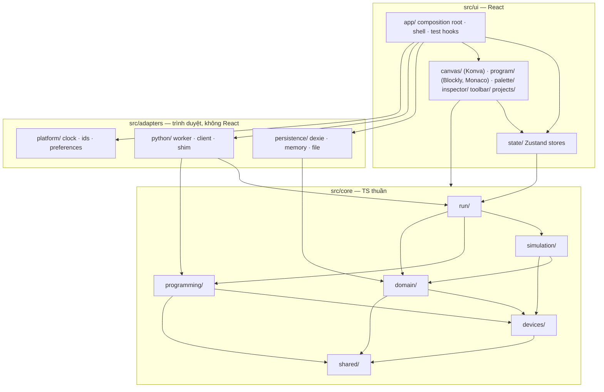
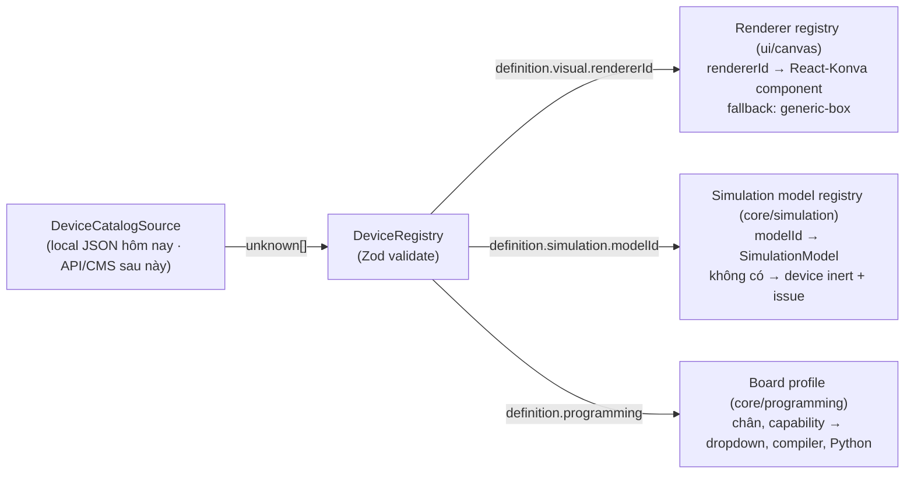
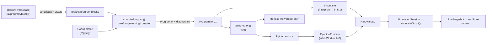

# STEM Demo Implementation Plan

> **Phiên bản:** 1.0 · **Ngày lập:** 2026-10-02 · **Trạng thái:** sẵn sàng để implement
> **Phạm vi:** demo "STEM Studio": editor mạch 2D, lập trình Blockly, runtime và mô phỏng thiết bị ảo. Toàn bộ chạy trên trình duyệt.
> **Nguồn tham khảo hành vi:** `docs/ohstem-platform-investigation.md`, `docs/ohstem-demo-reconstruction-spec.md`, `docs/ohstem-reconstruction-assets/`.

### Cách dùng tài liệu này

1. Tài liệu này là **source of truth** cho kiến trúc, contract và thứ tự implement. Mỗi task `STEM-XXX` ở §14 được viết để một coding agent mở phiên mới và làm độc lập.
2. Trước khi làm một task, agent cần đọc §6 (Architecture Decisions), §7 (Module Structure), §14.0 (Working agreement) và **các section contract mà task tham chiếu** (§8–§12).
3. Chỉ làm đúng phần **Scope**. **Out of scope** là ranh giới cứng. Nếu thấy cần làm thêm thì ghi vào PR, không tự mở rộng.
4. Nếu buộc phải đổi một contract đã mô tả (type, schema, protocol, semantics), hãy cập nhật section tương ứng của tài liệu này **trong cùng PR** và ghi rõ lý do.
5. Hai nhãn nguồn dùng trong tài liệu:
   - **Reference behavior**: hành vi hoặc thiết kế quan sát được ở OhStem, kèm vị trí trong tài liệu nghiên cứu. Chỉ dùng để tham khảo.
   - **Demo decision**: quyết định thiết kế cho hệ thống của chúng ta.

---

## 1. Repository State

Kết quả điều tra ngày 2026-10-02:

| Hạng mục | Trạng thái |
|---|---|
| Git | Branch `master`, 1 commit `dd56bf0 initial`, working tree sạch |
| Source code | **Không có.** Không có `package.json`, `src/`, file `.ts/.tsx`, `README` hay `.gitignore` |
| Tài liệu | `docs/ohstem-platform-investigation.md` (~82 KB), `docs/ohstem-demo-reconstruction-spec.md` (~77 KB). Viết bằng tiếng Việt, giữ thuật ngữ tiếng Anh |
| Tài sản nghiên cứu | `docs/ohstem-reconstruction-assets/` gồm 164 ảnh PNG và thư mục `data/` với 18 file JSON đã sanitize |
| Cấu hình agent | `.claude/agents/*.md`, `.codex/agents/*.toml`, `.codex/skills/*`, `.claude/skills/*`, `.agents/skills/*`. Đây là định nghĩa agent/skill **dùng chung** (frontend-developer, qa-expert, ui-designer…), không có convention riêng của dự án. Skill thiết kế frontend (`design-taste-frontend-v1`) mặc định dùng **Tailwind CSS** |
| `.claude/settings.local.json` | Không được git track. Chứa permission của một dự án khác, không liên quan |
| Môi trường máy dev | Node v24.14.0, npm 11.5.2. **pnpm chưa được cài**, STEM-001 sẽ bật qua Corepack |

**Kết luận:** đây là dự án **greenfield**. Không có code hay convention nào cần giữ, ngoại trừ ngôn ngữ tài liệu (tiếng Việt kèm thuật ngữ tiếng Anh) và việc các agent skill sẵn có trong repo thiên về Tailwind. Toàn bộ stack và kiến trúc được dựng từ STEM-001.

## 2. Documents Reviewed

| Tài liệu | Nội dung chính | Đóng góp cho plan |
|---|---|---|
| `docs/ohstem-platform-investigation.md` | Hệ sinh thái OhStem: các sản phẩm, lộ trình K12, mô hình lập trình, hệ extension, năng lực mô phỏng, tech stack, kiến trúc suy luận, so sánh với Wokwi, đề xuất kiến trúc và CMS | Các nguyên tắc dài hạn: tách program core khỏi runtime (`workspace → IR → generator → runtime adapter`, §11.1); board profile là first-class (§6.4, §11.2); HAL shim cho phép cùng một đoạn code chạy trên board thật lẫn board ảo (§9.3); khai báo thay vì `eval` (§11.5); version/lockfile (§11.6); các anti-pattern bảo mật (§1 #9). Được dùng ở §6 và §18 |
| `docs/ohstem-demo-reconstruction-spec.md` | Tái dựng chi tiết Circuit Builder (layout, gesture, schema, catalog, union-find, MNA solver, renderer), Blockly (inject config, toolbox, codegen), pipeline Python ↔ mạch, robot/map/AI/IoT, MVP backlog, kiến trúc React/TS đề xuất, CMS model, danh sách rủi ro | Tham chiếu hành vi chính xác nhất hiện có: gesture (§5), project model (§6.1), connection model (§7.2), worker protocol và timing (§10), MVP scope A+B (§2), tách lớp (§17.1), Zod + `schemaVersion` (§17.3), cảnh báo runtime flag bị lẫn vào params (§20 #4) |
| `data/circuit-component-catalog.json` | 41 linh kiện với `ports{id,dx,dy}`, `portOrder`, `internalConnections`, `defaultParams`, `paramSpec`, `groundPortId`. Palette chia 4 nhóm. `ground` nằm trong `notInPalette` | Cấu trúc `DeviceDefinition` (§9), cách tính port offset, property spec, lựa chọn device ban đầu |
| `data/circuit-project-idb-record.json`, `data/circuit-uno-export-bundle.json` | Bản ghi IndexedDB và file export thật | Tham chiếu project format (§8). Phát hiện linh kiện `battery` mang `voltage: 9` dù `paramSpec` của nó không có `voltage`, tức là params không được validate |
| `data/circuit-diff-sequence.json` | Diff của model sau từng gesture thật | Ngữ nghĩa các operation (§8.5). **Bằng chứng `_broken: true` bị copy sang bản duplicate** |
| `data/circuit-worker-protocol.json`, `data/circuit-uno-run-timeline.json` | Message worker thật (1 862 message `portData` trong ~30 s) và timeline khi chạy (~3,5 s tới lệnh `writePort` đầu tiên, blink chu kỳ ~1 s) | Thiết kế protocol riêng (§10.9), mục tiêu hiệu năng (§3.3) |
| `data/codegen-cases.json`, `data/blockly-toolbox-*.json`, `data/device-code-project-localstorage.json` | 6 case Blockly → Python thật; toolbox của 3 thiết bị (category, màu, workspace options); cách lưu code project | Tham chiếu cấu trúc codegen và toolbox. Dẫn tới quyết định **không** sao chép khung asyncio (§10.7) |
| `data/robot-*.json`, `data/map-*.json`, `data/ai-trainer-storage.json`, `data/iot-dashboard-state.json` | Schema robot 3D, sa bàn, AI trainer, IoT | Xác nhận các phần này nằm ngoài phạm vi. Chỉ dùng cho §18 |
| Ảnh chụp `circuit-01-default-full`, `circuit-04-inspector-resistor`, `circuit-23-wire-start`, `circuit-46-run-click-led`, `circuit-69-program-tab-no-board`, `uno-01-circuit-wired`, `uno-03-program-blink-blocks`, `uno-04-program-python-view`, `uno-05-running-33`, `uno-06-running-terminal` | Layout, panel phải đổi qua lại giữa palette và inspector, badge "Đang chạy giả lập", tab Lập trình thay chỗ canvas, terminal | Thiết kế layout (AD-15, STEM-015) |
| `.claude/`, `.codex/`, `.agents/` | Agent/skill dùng chung | Không có convention của dự án. Skill thiết kế mặc định Tailwind (dẫn tới AD-02) |

## 3. Goals and Non-Goals

### 3.1 Goals

- **G1.** Chứng minh luồng end-to-end: Device Palette → kéo device lên canvas → nối port bằng dây → lập trình Blockly → Run → trạng thái board ảo thay đổi → device được nối phản ứng.
- **G2.** Domain, simulation và programming **độc lập** với React, Konva, Blockly, Monaco, Dexie và Pyodide. Điều này được kiểm tra bằng tool chứ không chỉ dựa vào quy ước.
- **G3.** Device registry **data-driven**. Có thể thay nguồn local bằng API/CMS mà không phải viết lại editor.
- **G4.** Project format độc lập renderer, có version, được validate bằng Zod và lưu qua `ProjectRepository` (hôm nay dùng Dexie, sau này là API + MySQL).
- **G5.** Lộ trình runtime: Blockly → IR → interpreter (làm sớm) → Python → Pyodide Worker (làm cuối). Hai runtime dùng chung một contract và được đối chiếu tự động với nhau.
- **G6.** Mỗi milestone có outcome demo được. Test có từ task đầu tiên. Cuối dự án có E2E cho happy path.

### 3.2 Non-Goals

Theo yêu cầu: backend, ASP.NET Core, MySQL/PostgreSQL, Redis, MinIO, login/authorization, LMS, CMS, realtime collaboration, Kubernetes, robot 3D, AI Trainer, IoT Dashboard, full circuit solver (MNA/Newton, dòng điện, linh kiện cháy), phần cứng thật qua USB/Bluetooth.

Bổ sung: clone OhStem 1:1, catalog 41 linh kiện, breadboard, nhiều board trong một project, extension system, bài học và chấm điểm, i18n, mobile/touch, chuyển Python → Blocks.

### 3.3 Mục tiêu đo được

| Chỉ số | Mục tiêu |
|---|---|
| Run → LED sáng (runtime IR) | ≤ 300 ms |
| Run → LED sáng (Pyodide, cold start) | ≤ 5 s trên máy dev. **Reference behavior:** OhStem mất ~3,5 s tới lệnh đầu tiên (spec §10) |
| Run lần 2 (Pyodide, warm) | ≤ 1 s |
| Stop, kể cả khi chương trình đang `sleep` | ≤ 500 ms |
| Save → reload | Document sau reload **deep-equal** document đã lưu |
| Request ra origin ngoài | 0 (mọi asset đều self-host) |
| Gate chất lượng | `pnpm verify` xanh ở mọi task. E2E của các slice xanh 3 lần liên tiếp |

## 4. Technical Constraints

Stack đã chốt:

| Lớp | Công nghệ | Ghi chú triển khai |
|---|---|---|
| Ngôn ngữ / build | TypeScript (strict), React 19, Vite | Pin version chính xác trong lockfile ở STEM-001 |
| Canvas | Konva + react-konva | Chỉ được dùng trong `src/ui/canvas/**` |
| Block editor | Google Blockly (npm, bản ổn định mới nhất) | Renderer `zelos`, JSON serialization. Chỉ được dùng trong `src/ui/program/blockly/**` |
| State | Zustand (vanilla store + hook) | Store chỉ là lớp điều phối mỏng. Logic nằm ở core |
| Schema | Zod 4 | Dùng API v4: `z.iso.datetime()`, `z.prettifyError`, `z.toJSONSchema` |
| Persistence | IndexedDB qua Dexie 4 | Chỉ được dùng trong `src/adapters/persistence/dexie/**`. Test bằng `fake-indexeddb` |
| Code editor | Monaco (`monaco-editor` + `@monaco-editor/react`) | Load từ bundle local, không dùng CDN. Lazy-load |
| Python | Pyodide trong Web Worker | Self-host asset. Chỉ được dùng trong `src/adapters/python/**` |
| Test | Vitest, Playwright (Chromium) | Lệnh `pnpm verify`, `pnpm e2e` |
| Package manager | pnpm qua Corepack | Khai báo field `packageManager` trong `package.json` |
| Styling | Tailwind CSS v4 (`@tailwindcss/vite`) | Xem AD-02 |

Ràng buộc bổ sung (**Demo decision**):

- Không thêm framework hoặc library lớn ngoài danh sách trên. Được phép thêm dev tooling nhỏ: ESLint (`typescript-eslint`, `eslint-plugin-import-x`, `eslint-plugin-react-hooks`), Prettier, `fake-indexeddb`.
- Trình duyệt mục tiêu là Chromium mới nhất (cho demo và Playwright). Firefox ở mức best-effort. Không nhắm tới Safari.
- App phải **cross-origin isolated** (COOP `same-origin`, COEP `require-corp`) ngay từ STEM-001 (xem AD-17).
- Không có backend. Mọi thứ chạy ở client và không gửi request tới origin ngoài.
- Thiết kế cho desktop trước, viewport tối thiểu 1024×700.

## 5. Key Findings from Existing Research

### 5.1 Finding ảnh hưởng implementation

| # | Reference behavior (OhStem) | Nguồn | Demo decision |
|---|---|---|---|
| F1 | Project mạch rất gọn: `components{id,type,x,y,rotation(rad),flipX?,params}` và `wires{id,from,to,breakpoints,color}`. **Port không được lưu**, vị trí port tính từ catalog | spec §6.1; `circuit-project-idb-record.json` | Giữ hai ý: port được suy ra từ definition, dây tham chiếu `{componentId, portId}`. Thay đổi: rotation lưu bằng độ đã chuẩn hoá; tách properties khỏi runtime state; thêm `format` và `schemaVersion` (§8) |
| F2 | Runtime flag bị lẫn vào params (`_broken`, `pinStates`, `bootPressed`). `_broken` còn bị copy sang bản duplicate | spec §6.1, §20 #4; `circuit-diff-sequence.json` | Runtime state chỉ tồn tại trong `RunSession`. Schema strict, bước normalization loại bỏ property lạ, có regression test riêng (STEM-042) |
| F3 | Kết nối điện dùng union-find trên khoá `"<componentId>/<portId>"`, có `internalConnections`, và thứ tự chọn net ground | spec §7.2 | Giữ union-find và internal connections. Ground xác định bằng **port kind** (§11), không cần thứ tự ưu tiên |
| F4 | Solver MNA DC + Newton, giải lại ở **mọi** thay đổi kể cả lúc đang thiết kế. LED cháy khi I > 30 mA | spec §1 #4, §7.3 | Demo không clone. Dùng logical solver (AD-04) và **chỉ mô phỏng khi đang Run** |
| F5 | Pipeline Blockly → Python async → Pyodide worker (JSPI/SAB) → `writePort` theo số GPIO → `pinStates` → solve → render. Mất ~3,5 s tới lệnh đầu tiên. Có 1 862 message `portData` trong ~30 s | spec §10; `circuit-uno-run-timeline.json`, `circuit-worker-protocol.json` | Làm IR trước (AD-03). Pyodide ở M6 với protocol dùng tên chân, chỉ gửi khi giá trị đổi, input đọc qua SharedArrayBuffer, worker được giữ ấm giữa các lần chạy |
| F6 | Tab Thiết kế và tab Lập trình **thay chỗ nhau**: khi đang xem code thì không nhìn thấy LED | spec §4.1; ảnh `uno-03`, `uno-06` | Hiển thị **đồng thời** canvas và code (AD-15) |
| F7 | Khi chạy thì khoá thao tác thiết kế. Khi Stop thì phục hồi snapshot của switch/params | spec §5 #16–17 | Giữ cơ chế khoá. Thay snapshot/restore bằng runtime input tách hẳn khỏi design state |
| F8 | Gesture: snap lưới 10, bắt port trong 24 world px, zoom ×1,12 trong khoảng 0,25–4 quanh con trỏ, pan bằng kéo vùng trống, xoá linh kiện thì xoá luôn dây nối vào nó, chặn dây trùng và dây tự nối, cho phép nhiều dây trên một port, duplicate lệch +20 kèm dây nội bộ, undo tối đa 50 snapshot, gộp các lần move trong 500 ms | spec §5, §7.2 | Giữ phần lớn. Khác biệt: bắt port trong **12 screen px, chọn port gần nhất**; undo commit theo gesture thay cho gộp theo thời gian; history tối đa 100 |
| F9 | Generator gom code theo prefix của key trong `definitions_`, kèm khung chương trình theo board (asyncio cho Yolo UNO). Không hỗ trợ Python → Blocks | spec §9; investigation §6.4 | Có printer IR → Python với khung cố định (imports / pins / on start / forever), viết theo kiểu MicroPython đồng bộ. Không làm Python → Blocks (AD-19) |
| F10 | Blockly 8 nạp dạng script global. Tab code của thiết bị ảo dùng renderer zelos. Toolbox là XML có placeholder | spec §8 | Dùng Blockly npm bản mới, zelos, toolbox dạng JSON, serialization dạng JSON (AD-11) |
| F11 | Board profile quyết định khung chương trình. Extension chỉ đóng góp từng mảnh code. HAL shim (`machine.py`) giúp cùng một driver chạy được trên board thật và board ảo | investigation §6.4, §9.3, §11 | Board khai báo `programming` capability ngay trong device definition. Shim `machine` tương thích MicroPython, dùng tên chân (`Pin("D13")`) |
| F12 | Code extension chạy bằng `eval()` không sandbox; token nằm trong bundle; CSP lỏng; catalog hardcode; không pin version (`?updated=`) | investigation §1 #9, §6.3, §11 | Registry chỉ chứa data, được validate bằng Zod, không `eval`. Có `schemaVersion` và version cho definition. App chạy cross-origin isolated |
| F13 | Khi chương trình Python kết thúc thì `done`, `isRunning=false` và `pinStates` bị reset | spec §10 | Chương trình kết thúc **không** đồng nghĩa với tắt nguồn. Board vẫn "powered" và giữ trạng thái chân cho tới khi Stop, giống MCU thật (AD-12) |
| F14 | Solver không có transient. Chưa rõ công thức độ sáng LED | spec §7.3, §20 #2–3 | LED chỉ có hai trạng thái bật/tắt, kèm cờ cảnh báo |
| F15 | Catalog 41 loại linh kiện; `ground` không xuất hiện trên palette | `circuit-component-catalog.json` | Bắt đầu với 3 device, tăng lên 6 theo milestone. Ground **có** trên palette (AD-18) |
| F16 | Bảng ánh xạ GPIO → chân (`48 → d13`); code người dùng viết `Pin(48)` | spec §10 | Dùng tên chân trong code (`Pin("D13")`). Không còn số GPIO trong code của học sinh |

### 5.2 Mâu thuẫn giữa các tài liệu và cách xử lý

| # | Mâu thuẫn | Nguồn đáng tin hơn | Hướng cho demo |
|---|---|---|---|
| C1 | Spec §2 và §19 đưa **MNA DC + Newton** vào MVP (có acceptance bằng số liệu như 31,7 mA làm LED cháy). Yêu cầu của dự án lại muốn tránh full solver và ưu tiên logical | Cả hai đều đúng về OhStem nhưng khác mục tiêu. Mục tiêu demo do yêu cầu dự án quyết định | Dùng logical solver (AD-04). MNA được dời sang giai đoạn sau, đặt sau cùng facade `simulateCircuit` (§11.9) |
| C2 | Investigation §15 câu hỏi #2 nói **chưa biết** code Yolo UNO có tương tác thật với solver hay không. Spec §1 #5 và §10 đã **chạy end-to-end** và có timeline | Spec đáng tin hơn: ra đời sau, có bằng chứng runtime [RT] và file data đi kèm | Coi pipeline code → chân → mạch là khả thi đã được chứng minh |
| C3 | Investigation §7.2 nói `time.sleep` đồng bộ dùng SharedArrayBuffer + `Atomics.wait` và đó là lý do bật COOP/COEP. Spec §10 nói Chrome hiện dùng **JSPI**, SAB chỉ là fallback | Không hẳn mâu thuẫn: code có cả hai cơ chế, và spec quan sát được runtime chọn JSPI | Spike STEM-016 sẽ quyết định. Khuyến nghị dùng SAB + Atomics làm cơ chế chính vì demo cũng cần SAB cho input và interrupt (§10.9) |
| C4 | Spec §2 liệt kê Ground trong MVP, nhưng catalog thật xếp `ground` vào `notInPalette` | File data đáng tin hơn về UI của OhStem | Đây là quyết định thiết kế: demo đưa Ground lên palette ở M4 |
| C5 | Spec §5 #3 nói card "Pin" là `battery9V`, nhưng bản ghi IDB lại có `type:"battery"` (pin AA, mặc định 1,5 V, `paramSpec` không có `voltage`) với `voltage: 9` | Bản ghi IDB là dữ liệu thật. Nó cho thấy OhStem không validate params theo spec | Battery bị dời lại (AD-18). Phát hiện này củng cố quyết định validate properties theo `PropertySpec` |
| C6 | Spec §17.2 khuyên giữ worker protocol gần với OhStem. Chính spec §20 #9 và file data lại cho thấy protocol đó gửi quá nhiều message | Dữ liệu runtime | Dùng protocol riêng: tên chân, chỉ gửi khi đổi, input qua SAB (§10.9) |
| C7 | Spec §17.1 đề xuất tách nhiều package `@demo/*`; spec §16 gợi ý thư viện `idb`; investigation §8.1 cho biết OhStem dùng Ace | Đây là gợi ý, không phải sự thật về OhStem | Một app có enforce boundary (AD-01). Dùng Dexie và Monaco theo stack đã chốt |
| C8 | Spec §7.2 nói dây nối hai chân của **cùng một** linh kiện bị netlist bỏ qua (trừ khi có internal connection). Về vật lý, sợi dây đó làm chập linh kiện | Hành vi của OhStem ở đây khó giải thích về mặt vật lý | Demo xử lý mọi dây như nhau. Dây chập LED làm LED tắt (S7 trong §11.5) |

## 6. Architecture Decisions

Mỗi quyết định gồm: **Demo decision**, lý do, phương án bị loại. Chi tiết contract nằm ở §8–§12.

### AD-01 — Kiến trúc thư mục và module

**Demo decision:** dùng **một Vite app** (một `package.json`). Source chia ba tầng: `src/core` (TypeScript thuần), `src/adapters` (code cho trình duyệt, không dùng React) và `src/ui` (React). Ranh giới được enforce bằng hai cơ chế: (1) ESLint `import-x/no-restricted-paths` và `no-restricted-imports`; (2) file `tsconfig.core.json` cho `src/core/**` **không có lib DOM**, nên dùng `window`, `setTimeout` hay `localStorage` trong core sẽ fail typecheck. Chi tiết ở §7.

**Lý do:** nguyên tắc "domain không phụ thuộc React/Konva/Blockly/Dexie/Pyodide" cần được máy kiểm tra. Monorepo nhiều package (spec §17.1) đòi hỏi project references, thứ tự build và Vitest workspace, chi phí không tương xứng với một demo. Lint kết hợp tsconfig cho mức bảo đảm tương đương. Khi import đã sạch, việc tách package sau này chỉ còn là việc cơ học.

**Phương án bị loại:** pnpm workspace nhiều package (để dành cho production nếu cần); chia thư mục nhưng không enforce (kiến trúc dễ trôi khi nhiều agent cùng làm).

### AD-02 — Tailwind CSS hay CSS Modules

**Demo decision:** Tailwind CSS v4 qua `@tailwindcss/vite`. Design token đặt trong CSS variables. Không dùng component library.

**Lý do:**
1. Repo chưa có styling nên không có convention cần giữ.
2. Skill frontend sẵn có trong repo (`.claude/skills/design-taste-frontend-v1`) mặc định Tailwind, nên agent sẽ tự nhiên viết Tailwind.
3. Phần cần CSS chỉ là chrome (toolbar, palette, inspector, panel, dialog). Konva, Blockly và Monaco tự style bằng API riêng.
4. Tailwind v4 gần như không cần cấu hình khi dùng với Vite.

**Rủi ro:** preflight của Tailwind có thể làm hỏng DOM của Blockly hoặc Monaco. Nếu gặp lỗi hiển thị ở STEM-020/050, bỏ preflight (`@import "tailwindcss/theme.css" layer(theme); @import "tailwindcss/utilities.css" layer(utilities);`) hoặc giới hạn phạm vi của nó.

**Phương án bị loại:** CSS Modules. Cách ly tốt hơn nhưng sinh nhiều file và đi ngược skill có sẵn trong repo.

### AD-03 — IR trước, Pyodide sau

**Demo decision:** chuỗi xử lý là **Blockly JSON → compiler (TS thuần) → Program IR → `IrRuntime` (interpreter TS)** từ M1, đủ để vertical slice đầu tiên chạy được. Python được **sinh từ IR** (printer, M6) và chạy trong **Pyodide Worker** (M6) với cùng contract `ProgramRuntime`. Spike Pyodide (STEM-016) chạy **song song từ M1** để gỡ rủi ro sớm.

**Lý do:**
1. **Tách rủi ro.** Pyodide mang theo ít nhất năm ẩn số không liên quan tới câu hỏi kiến trúc chính: cách bundle trong Vite worker, self-host asset dưới COEP, `sleep` đồng bộ, stop/interrupt, và thời gian khởi động (~3,5 s ở OhStem). Nếu đặt chúng lên critical path của slice đầu tiên, việc chứng minh end-to-end sẽ bị trễ.
2. **Không phải code bỏ đi.** IR khớp với kiến trúc dài hạn mà investigation §11.1 đề xuất (`workspace → IR → generator(target) → runtime adapter`). IR cũng là nền cho các target khác (Arduino C++, JS) và cho việc chấm bài bằng AST (investigation §11.8).
3. **Interpreter là semantics tham chiếu.** STEM-054 so trace chân của interpreter với trace của Python chạy trên Pyodide (differential testing). Interpreter cũng là runtime dự phòng khi trình duyệt không chạy được Pyodide, và cho phản hồi tức thì.
4. **Một nguồn ngữ nghĩa.** Python được in ra từ IR chứ không sinh trực tiếp từ Blockly, nên hai runtime dùng chung một kết quả compile và cùng một bộ diagnostics.

**Chi phí và cách giảm:** phải duy trì hai runtime. Giữ IR nhỏ (chỉ phủ các block trong toolbox, không có biến/hàm ở demo) và có differential test.

**Phương án bị loại:** Pyodide-first, vì rủi ro dồn vào slice đầu. Sinh Python trực tiếp bằng generator của Blockly cũng bị loại vì tạo hai nguồn ngữ nghĩa và bắt buộc phải load Blockly mới test được codegen.

### AD-04 — Phạm vi mô phỏng logic

**Demo decision:** dùng **logical solver mức switch-level**, hai pha, có khái niệm độ mạnh (strong/weak) (§11). Solver xác định:
- mức logic HIGH/LOW/floating/conflict của từng net;
- trạng thái LED (sáng khi anode có thể cấp dòng và cathode có thể nhận dòng);
- chập nguồn (strong HIGH gặp strong LOW);
- cảnh báo "LED thiếu điện trở hạn dòng";
- giá trị đọc của chân input (hỗ trợ pull-up/pull-down).

Chỉ mô phỏng khi đang Run. Không mô phỏng điện áp, dòng điện, transient hay linh kiện cháy.

**Lý do:** mục tiêu của demo là chứng minh *editor + connection graph + programming + runtime + device reaction*, không phải dạy điện học. Mô hình switch-level nhỏ (cỡ vài trăm dòng), tất định, dễ test. Nó xử lý đúng các mạch tiêu biểu: LED điều khiển bằng GPIO, nút nhấn dùng pull-down, phát hiện chập. Nếu chỉ đơn giản xem điện trở như dây dẫn thì mạch nút nhấn có pull-down sẽ bị báo nhầm là chập, nên **bắt buộc phải có khái niệm weak**. Electrical solver sau này sẽ cắm vào cùng facade `simulateCircuit` (§11.9).

**Phương án bị loại:** MNA + Newton như OhStem (scope của một dự án SPICE nhỏ, xem C1); mô hình "đường đi tồn tại" (path-based) không có strength (sai với pull-up/pull-down và với chập).

### AD-05 — Abstraction cho việc render component

**Demo decision:** `DeviceDefinition.visual.rendererId` ánh xạ tới một **React component vẽ thân device** bằng Konva trong toạ độ local (gốc là tâm device, chưa xoay). Một `ComponentNode` dùng chung cho mọi device phụ trách transform (vị trí, góc xoay), kéo thả, selection, **port marker vẽ từ data**, và tương tác khi chạy. Renderer là hàm thuần của props `{instance, definition, runtimeState, selected}` và không đọc store. Id không có trong registry sẽ dùng `generic-box` (fallback).

**Lý do:** port và hit-test được sinh từ data, nên một device thêm từ CMS chỉ với `generic-box` vẫn nối dây được. CMS chỉ được chọn trong số renderer đã deploy (investigation §11.5, spec §18.3).

**Phương án bị loại:** mỗi device tự vẽ port (dễ lệch với geometry); mô tả renderer bằng data (SVG/JSON) trong demo (quá sớm).

### AD-06 — Mô hình dây

**Demo decision:**
- Một wire có **hai đầu `PortRef`** cộng với danh sách bendpoint trong toạ độ world. Hướng không có ý nghĩa về điện.
- Đường vẽ là polyline `[port A, ...bendpoints, port B]`.
- Một port có thể có nhiều dây. Chặn dây trùng (kể cả khi đảo chiều) và dây nối vào chính port xuất phát (**Reference behavior**, spec §7.2).
- Bendpoint đứng yên khi component di chuyển, chỉ đoạn đầu và đoạn cuối co giãn theo (**Reference behavior**).
- Netlist xử lý mọi dây như nhau (C8).
- Không lưu màu dây ở v1. Khi chạy, dây được tô màu theo mức logic của net (STEM-039).

**Lý do:** đây là mô hình nhỏ nhất đủ cho sơ đồ mạch, khớp với dữ liệu OhStem, và độc lập với renderer.

### AD-07 — Undo/redo

**Demo decision:**
- History là các **snapshot bất biến** của `circuit` (chia sẻ cấu trúc, nên chi phí bộ nhớ thấp). Tối đa 100 bước.
- Mỗi gesture (một lần kéo, một lần sửa property) commit **đúng một** entry. Trong lúc kéo dùng cập nhật tạm thời (`beginGesture → updateGesture → endGesture`).
- Program (Blockly) **không** nằm trong history này vì Blockly có undo riêng, hoạt động khi workspace đang focus.
- Selection, viewport và tên project không đi vào history.

**Lý do:** mọi operation đều là hàm thuần trả về document mới, nên snapshot là cách đơn giản và khó sai nhất. Command pattern phải viết thêm phép nghịch đảo cho từng lệnh, dễ sinh bug.

**Phương án bị loại:** command/inverse; immer patches (thêm dependency mà lợi ích không rõ).

### AD-08 — Project schema

**Demo decision:** contract đầy đủ ở §8.2. Các điểm chính:
- Có `format` + `schemaVersion: 1`.
- Port được suy ra từ definition, không lưu trong project.
- Rotation lưu bằng **độ** và chỉ nhận `{0, 90, 180, 270}`.
- `properties` chỉ chứa giá trị design-time và được validate theo `PropertySpec` của device.
- **Mỗi project có một program**. Workspace Blockly lưu dạng JSON, domain không đọc nội dung bên trong.
- Không lưu viewport. Timestamp dùng ISO-8601.
- Zod `.strict()` được áp tại các boundary.

**Lý do:** format nhỏ nhất đủ cho tất cả milestone, tránh hai lỗi của OhStem (F2: runtime flag lẫn vào params, F1: rotation radian không chuẩn hoá), và dùng làm payload API được ngay (§12.7).

**Không chọn:** lưu program theo từng board (`scripts[boardId]` như OhStem). Với demo chỉ có một board, cách đó làm mất program khi người dùng xoá rồi thêm lại board. Hướng nâng cấp: migration v2 đưa sang `programs[boardId]` (§18).

### AD-09 — Cấu trúc device registry

**Demo decision:** definition là **file JSON** (`src/core/devices/definitions/*.json`), được validate bằng Zod khi registry được tạo. Hệ thống có ba registry riêng:
1. **Device definitions**: data, đọc qua `DeviceCatalogSource`.
2. **Renderers**: code UI, khoá là `rendererId`.
3. **Simulation models**: code core, khoá là `simulation.modelId`.

Board khai báo thêm `programming` (profile, danh sách chân, capability). Mỗi definition có `version` và `constraints.maxInstances`.

**Lý do:** file JSON chứng minh trực quan rằng registry là data thuần, tức là có thể chuyển sang API/CMS. Code (renderer, model) chỉ được tham chiếu qua id, không bao giờ được nhúng vào definition.

### AD-10 — Abstraction cho persistence

**Demo decision:**
- Port `ProjectRepository` khai báo trong core (`list`, `get`, `save`, `delete`, tất cả async).
- Adapter: `DexieProjectRepository` (dùng thật) và `InMemoryProjectRepository` (dùng cho test).
- Một bộ **contract test** chung chạy cho mọi adapter.
- Bản ghi Dexie gồm `{id, name, updatedAt, schemaVersion, document}`.
- Mọi dữ liệu đọc ra đều đi qua pipeline `parse → migrate → validate → normalize`.
- Chỉ composition root được import adapter cụ thể. **Không** gọi `db.*` ở bất kỳ chỗ nào ngoài `src/adapters/persistence/dexie/**`, và điều này được enforce bằng lint.

**Lý do:** đây đúng là yêu cầu `ProjectRepository → Dexie | Api`. Tách các trường tóm tắt (summary) khỏi `document` mô phỏng sẵn bảng MySQL sau này.

### AD-11 — Ranh giới tích hợp Blockly

**Demo decision:**
- Blockly chỉ là **view/editor**. Model là **Blockly serialization JSON** nằm trong `project.program.blocks`.
- Định nghĩa block, toolbox và program mặc định là **data thuần trong core** (`core/programming/blocks`).
- Compiler đọc JSON và không import Blockly.
- Adapter UI (`ui/program/blockly`) đăng ký block, inject workspace, ghi JSON vào store khi có thay đổi (debounce), và chỉ load lại workspace khi đổi project.
- Undo của Blockly do Blockly tự quản.

**Lý do:** test compiler không cần DOM hay Blockly. Nâng version Blockly chỉ ảnh hưởng tới adapter. Hướng đi này khớp với "Khai báo thay vì eval" (investigation §11.5).

**Phương án bị loại:** dùng generator API của Blockly (`Blockly.Python`), vì bắt buộc load Blockly khi test và tạo nguồn ngữ nghĩa thứ hai.

### AD-12 — Vòng đời runtime

**Demo decision:** `RunSession` (core) điều phối toàn bộ (§10.8):
- Khi Run: compile → chụp snapshot circuit → "cấp nguồn" board (các rail bật, chân GPIO ở trạng thái chưa cấu hình) → start runtime.
- Mỗi khi runtime ghi hoặc cấu hình chân, hoặc người dùng nhấn nút: tính lại mô phỏng ngay (đồng bộ) và phát snapshot.
- Khi chương trình kết thúc hoặc lỗi: **board vẫn được cấp nguồn**, chân giữ nguyên trạng thái cho tới khi Stop.
- Stop: dừng runtime, huỷ toàn bộ runtime state; design document không đổi.
- Khi đang chạy: khoá thao tác thiết kế (**Reference behavior**, spec §5).
- Message từ worker mang `runId` để bỏ qua message cũ. Pyodide worker được giữ ấm giữa các lần chạy.

**Lý do:** mô hình "bật nguồn" khớp với phần cứng thật và tránh F13 (LED tắt ngay khi chương trình chỉ có "on start").

### AD-13 — Ranh giới test

**Demo decision:**
- Core: test đầy đủ bằng Vitest trên Node, không DOM.
- Adapter: contract test (Dexie qua `fake-indexeddb`, Pyodide chạy trên Node để differential test).
- UI: kiểm tra bằng Playwright E2E thông qua test hooks (`window.__stemDemo`) và `data-testid`.
- **Mặc định không viết component test.** Logic của UI được tách thành hàm thuần (ví dụ toán zoom, form model) rồi test bằng Vitest. Chi tiết ở §16.

### AD-14 — Thứ tự implement

**Demo decision:** đi theo **walking skeleton**. Dựng mỏng mọi tầng trước, sau đó mới làm dày từng tầng:
1. **M1:** core loop chạy headless (VS-0).
2. **M2:** slice có hình ảnh với project mẫu (VS-1).
3. **M3:** người dùng tự xây mạch (VS-2).
4. **M4:** input và logic (VS-3).
5. **M5:** persistence.
6. **M6:** Python/Pyodide.
7. **M7:** hoàn thiện, E2E happy path cuối.

**Lý do:** cách làm theo từng tầng (Foundation → Domain → Canvas → Wiring → Blockly → Simulation…) chỉ tích hợp được ở cuối. Walking skeleton tích hợp ngay ở M1–M2, sau đó công việc chia được thành các track song song (editor, programming, persistence, Python). Persistence đặt sau input vì đây là phần quen thuộc, ít rủi ro. Phần lõi của nó (STEM-042…044) vẫn có thể làm song song từ rất sớm.

### AD-15 — Những hành vi của OhStem không nên clone

| Hành vi của OhStem | Vì sao không clone | Demo làm gì |
|---|---|---|
| Runtime flag nằm trong `params` và bị copy khi duplicate (F2) | Làm hỏng dữ liệu thiết kế | Tách hoàn toàn design state và runtime state (§8.1) |
| Rotation radian cộng dồn, không chuẩn hoá (`−π/2`) | Sai số dấu phẩy động, khó so sánh | Độ, thuộc `{0, 90, 180, 270}` |
| Solve liên tục cả lúc thiết kế, LED "cháy" ngay khi đang nối dây | Gây bối rối, đòi hỏi solver điện | Chỉ mô phỏng khi Run |
| Tab Thiết kế/Lập trình thay chỗ nhau (F6) | Không thấy được quan hệ nhân quả code → LED | Canvas và code hiển thị cùng lúc |
| `eval()` extension, token trong bundle, CSP lỏng | Lỗ hổng bảo mật | Registry chỉ chứa data, không `eval`, app cross-origin isolated |
| `portData` gửi toàn bộ chân ở mỗi thay đổi (1 862 message / 30 s) | Tốn tài nguyên | Chỉ gửi khi đổi; input đọc qua SAB |
| Terminate worker mỗi lần Stop rồi cold start ~3,5 s | Trải nghiệm chậm | Giữ worker ấm; interrupt thay vì terminate |
| Code dùng số GPIO (`Pin(48)`) | Khó đọc với học sinh | Dùng tên chân `Pin("D13")` |
| Khung asyncio, đổi `def` thành `async def`, thêm `await` | Phức tạp, khác MicroPython phổ thông | Python đồng bộ in ra từ IR |
| Netlist bỏ qua dây nối hai chân của cùng linh kiện | Sai về vật lý | Xử lý mọi dây như nhau |
| Hai cấu hình Blockly khác nhau (geras/zelos) | Không nhất quán | Một cấu hình duy nhất (zelos) |
| Chế độ "ghost": bấm card rồi bấm canvas | Không phải thao tác kéo thả mà luồng demo yêu cầu | Kéo thả HTML5, kèm click-to-add vào giữa viewport |
| Copy/paste qua `localStorage`, catalog 41 linh kiện, breadboard, đồng hồ đo, hiệu ứng cháy/nổ | Ngoài phạm vi | Bị dời lại (§19) |

### AD-16 — Quản lý state

**Demo decision:**
- Dùng **vanilla Zustand store** (`createStore`) được tạo trong composition root, sau đó cung cấp qua React context: `projectStore`, `editorStore` (selection, viewport, tool), `runStore` (snapshot của `RunSession`), `preferencesStore`.
- Store không chứa business logic. Store gọi operation thuần của core rồi commit kết quả.
- Snapshot của lần chạy được đẩy vào store **tối đa 1 lần mỗi animation frame**.
- Không dùng singleton ở cấp module.

**Lý do:** test được ngoài React, cho phép test hooks truy cập store, và đúng với khuyến nghị "Zustand cho UI state + domain document riêng" (spec §17.3).

### AD-17 — Cross-origin isolation và self-host asset

**Demo decision:**
- Bật COOP `same-origin` và COEP `require-corp` trong dev, preview và production ngay từ STEM-001.
- Self-host mọi asset: Pyodide, Blockly media, Monaco worker, font hệ thống.
- E2E có cơ chế **network guard** để fail khi có request ra origin ngoài.

**Lý do:** SharedArrayBuffer cần cross-origin isolation (spec §20 #12: "Cấu hình header ngay từ đầu"). Nếu bật muộn, tích hợp Blockly/Monaco đã làm xong có thể hỏng vì CDN. **Reference behavior:** OhStem dùng COEP `credentialless`. Demo chọn `require-corp` vì được hỗ trợ rộng hơn, và mọi asset đã self-host nên không gặp vấn đề.

### AD-18 — Device theo milestone

**Demo decision:**
- **M1–M3:** Board (Uno-like), Resistor, LED.
- **M4:** thêm Push Button, Switch, Ground.
- **Dời lại:** Battery, cùng biến trở, LDR, còi, servo, motor, LED RGB và breadboard.

**Lý do:**
- Board đã có rail 3V3/5V/GND nên đủ làm nguồn cho mọi mạch của demo, kể cả mạch không cần chương trình (3V3 → nút → R → LED → GND).
- Battery là nguồn **floating**. Đặt vào mô hình logic dùng ground chung, nó gây báo sai, ví dụ hai pin nối tiếp bị coi là chập. Battery nên là device đầu tiên được thêm khi có electrical solver.
- Push Button và Switch dùng chung model `contact` với config khác nhau, qua đó chứng minh registry không cần ánh xạ 1:1 với code.

### AD-19 — Kiểu Python được sinh ra

**Demo decision:** sinh **MicroPython đồng bộ**, đúng kiểu học sinh viết trên board thật: `from machine import Pin`, `import time`, khai báo chân bằng tên (`Pin("D13", Pin.OUT)`), phần "on start" chạy tuần tự, sau đó là `while True:` có `time.sleep(0.01)` ở cuối mỗi vòng. Không chuyển Python → Blocks (giống OhStem). Ví dụ ở §10.7.

**Lý do:** dễ đọc, đúng với ý tưởng HAL shim (cùng code chạy được trên board thật). Phần `sleep` đồng bộ được xử lý trong worker bằng SAB/Atomics (§10.9).

### AD-20 — Ngôn ngữ UI

**Demo decision:** UI dùng tiếng Anh. Chuỗi hiển thị gom vào `src/ui/strings.ts`. Không dùng framework i18n. Tên device trong registry là chuỗi thường. Việc nâng cấp sang `{vi, en}` được ghi ở §19.

## 7. Proposed Module Structure

### 7.1 Cây thư mục

```text
stemdemo/
├─ docs/
│  ├─ stem-demo-implementation-plan.md     ← tài liệu này
│  ├─ adr/                                 ← ADR do spike/task tạo (vd. 0001-python-runtime.md)
│  └─ ohstem-*                             ← tài liệu nghiên cứu (chỉ đọc)
├─ e2e/
│  ├─ support/stem.ts                      ← helper gọi window.__stemDemo, network/console guard
│  └─ *.spec.ts
├─ vite-plugins/copy-vendor-assets.ts      ← copy blockly/media, pyodide vào public/vendor (gitignored)
├─ public/vendor/                          ← sinh lúc build/dev, KHÔNG commit
└─ src/
   ├─ main.tsx
   ├─ samples/                             ← project mẫu (JSON) dùng chung cho app, unit test, E2E
   ├─ core/                                ← THUẦN TS: không DOM, không React/Konva/Blockly/Monaco/Dexie/Pyodide/Zustand
   │  ├─ shared/                           result, ids (port + sequential), clock (port + fixed), assert
   │  ├─ devices/                          schema, registry, catalog-source, local-catalog, definitions/*.json
   │  ├─ domain/
   │  │  ├─ project/                       schema (Zod), factory, serialization/, project-repository (port)
   │  │  ├─ circuit/                       geometry, netlist, component-ops, wire-ops
   │  │  └─ history/                       History<T>
   │  ├─ simulation/                       levels (solver), models/, model-registry, simulate-circuit
   │  ├─ programming/
   │  │  ├─ ir/                            IR types
   │  │  ├─ blocks/                        catalog (Blockly JSON defs), toolbox, default-program
   │  │  ├─ compiler/                      Blockly JSON → IR
   │  │  ├─ interpreter/                   interpreter, runtime-clock, fake-runtime-clock
   │  │  └─ python/                        IR → Python printer (+ __golden__/)
   │  └─ run/                              runtime contract, ir-runtime, simulation-session, run-session
   ├─ adapters/                            ← code cho trình duyệt, KHÔNG React
   │  ├─ platform/                         browser clock, uuid id generator, local preferences
   │  ├─ persistence/                      memory/, dexie/, file/, testing/ (contract suite)
   │  └─ python/                           protocol, worker, pyodide-client, pyodide-runtime, bridge/, shim/*.py
   └─ ui/                                  ← React
      ├─ app/                              composition root (services), AppShell, test-hooks
      ├─ state/                            project-store, editor-store, run-store, preferences-store
      ├─ canvas/                           CircuitCanvas, ComponentNode, PortMarkers, WireLayer, renderers/, interactions/
      ├─ palette/  inspector/  toolbar/  projects/
      ├─ ui-kit/                           Toast, ConfirmDialog (<dialog>), Button… — không dùng component library
      ├─ program/                          blockly/, python-view/, console/
      └─ strings.ts
```

### 7.2 Sơ đồ phụ thuộc giữa các tầng



### 7.3 Quy tắc import (enforce ở STEM-002)

| Tầng | Được import | Cấm import |
|---|---|---|
| `core/shared` | (không gì) | mọi thứ khác |
| `core/devices` | `core/shared`, `zod` | tầng core khác, `adapters`, `ui`, mọi framework |
| `core/domain` | `core/shared`, `core/devices`, `zod` | `simulation`, `programming`, `run`, `adapters`, `ui` |
| `core/simulation` | `core/shared`, `core/devices`, `core/domain` | `programming`, `run`, `adapters`, `ui` |
| `core/programming` | `core/shared`, `core/devices`, `zod` | `domain`, `simulation`, `run`, `adapters`, `ui` |
| `core/run` | mọi tầng `core/*` | `adapters`, `ui` |
| `adapters/*` | `core/*` | `ui`. `dexie` chỉ trong `adapters/persistence/dexie/**`; `pyodide` chỉ trong `adapters/python/**` |
| `ui/*` (trừ `ui/app`) | `core/*`, `ui/*`, `zustand`, React | `adapters/*` (chỉ nhận qua services do `ui/app` cung cấp) |
| `ui/app` | mọi thứ | — |

Giới hạn library: `konva`/`react-konva` chỉ dùng trong `ui/canvas/**`; `blockly` chỉ dùng trong `ui/program/blockly/**`; `monaco-editor`/`@monaco-editor/react` chỉ dùng trong `ui/program/python-view/**`. Trong `src/core/**`, **các global của trình duyệt bị cấm** nhờ `tsconfig.core.json` (`lib: ["ES2023"]`, `types: []`).

### 7.4 Quy ước code

- File TS dùng `kebab-case.ts`. React component dùng `PascalCase.tsx`. Test đặt cạnh file nguồn, đặt tên `*.test.ts`. E2E nằm trong `e2e/*.spec.ts`.
- Dùng named export. Mỗi module core có `index.ts` làm public API; tầng khác chỉ import qua `index.ts` đó.
- Lỗi có thể dự đoán (input sai, kết nối không hợp lệ) trả về `Result<T, E>` (`core/shared/result.ts`). `throw` chỉ dành cho lỗi lập trình.
- Không dùng `any`. Không để `// eslint-disable` nếu không kèm lý do.
- Identifier và comment viết bằng tiếng Anh. Chuỗi UI viết bằng tiếng Anh và đặt trong `ui/strings.ts`.

## 8. Domain Model

### 8.1 Design state và runtime state

| | Design state | Runtime state |
|---|---|---|
| Là gì | Những gì người dùng **thiết kế**: component, vị trí, góc xoay, property, dây, program | Những gì xảy ra **khi chạy**: trạng thái chân, nút đang nhấn, công tắc đang đóng, LED sáng, mức logic của net, fault, console |
| Nằm ở đâu | `ProjectDocument` trong `projectStore` | `RunSession` → `RunSnapshot` trong `runStore` |
| Được lưu? | Có (Dexie, export JSON) | **Không bao giờ** |
| Undo/redo | Có (chỉ phần circuit) | Không |
| Khi Stop | Không thay đổi | Bị huỷ toàn bộ |

**Demo decision:** đây là bất biến quan trọng nhất của domain. Nó tránh lỗi F2 của OhStem (`_broken` và `pinStates` nằm trong `params`). STEM-042 có regression test cho bất biến này.

### 8.2 `ProjectDocument` v1 (contract)

Nguồn sự thật là Zod schema trong `src/core/domain/project/schema.ts`. Các type dưới đây tương đương `z.infer`.

```ts
type ProjectDocument = {
  format: 'stem-demo.project';
  schemaVersion: 1;
  id: string;                  // 1..64 ký tự, opaque, vd "prj_<uuid>"
  name: string;                // 1..120 ký tự
  description?: string;        // ≤ 2000 ký tự
  createdAt: string;           // ISO-8601 UTC
  updatedAt: string;           // ISO-8601 UTC, do app set khi Save
  circuit: Circuit;
  program: ProgramDocument;
};

type Circuit = { components: ComponentInstance[]; wires: Wire[] };

type ComponentInstance = {
  id: string;                  // "cmp_<uuid>"
  deviceType: string;          // = DeviceDefinition.id, vd "led"
  label: string;               // "LED1"; 1..40 ký tự; người dùng sửa được; không bắt buộc duy nhất
  position: Point;             // TÂM của component, đơn vị world
  rotation: 0 | 90 | 180 | 270;    // độ, chiều kim đồng hồ trên màn hình
  properties: Record<string, PropertyValue>;   // CHỈ giá trị design-time
};

type PropertyValue = number | boolean | string;
type Point = { x: number; y: number };   // số hữu hạn

type Wire = {
  id: string;                  // "wire_<uuid>"
  from: PortRef;
  to: PortRef;                 // dây vô hướng về điện; from/to chỉ là thứ tự lúc vẽ
  bendpoints: Point[];         // toạ độ world, tối đa 64 điểm
};
type PortRef = { componentId: string; portId: string };

type ProgramDocument = {
  language: 'blocks' | 'python';
  blocks: Record<string, unknown>;   // Blockly serialization JSON; domain không đọc nội dung bên trong
  pythonSource?: string;             // chỉ dùng khi language = 'python' (STEM-056)
};
```

Các thứ **cố ý không có** trong v1: viewport, màu dây, lật ngang (flip), runtime state, nhiều program hoặc nhiều board, lock version của device. Cách nâng cấp được mô tả ở §18.

### 8.3 Invariant

**Structural.** Zod kiểm tra và **từ chối** document không hợp lệ:
- Mọi object dùng `.strict()`: key lạ ở cấp document, component hay wire đều bị từ chối.
- Không có `id` trùng giữa các component, và không có `id` trùng giữa các wire.
- `wire.from.componentId` và `wire.to.componentId` phải trỏ tới component có thật.
- `rotation` chỉ thuộc `{0, 90, 180, 270}`. Mọi số đều phải hữu hạn.

**Semantic.** Cần tới registry, nên được kiểm tra bằng `normalizeProject` (STEM-042), theo kiểu **sửa và cảnh báo** chứ không từ chối:
- Property không có trong `PropertySpec` thì bị loại (ví dụ `_broken`).
- Property sai kiểu hoặc ngoài khoảng thì được đặt về giá trị default.
- Property còn thiếu thì được bổ sung giá trị default.
- Dây trỏ tới `portId` không tồn tại thì bị loại.
- `deviceType` lạ: **giữ nguyên** component, renderer hiển thị dạng fallback, simulation bỏ qua.

### 8.4 Quy ước hình học

- 1 đơn vị world bằng 1 px ở zoom 1. Trục y hướng xuống.
- `position` là tâm component. Offset của port tính từ tâm, khi **chưa xoay**, và khai báo trong definition.
- Xoay theo chiều kim đồng hồ trên màn hình, đơn vị độ. Công thức chính xác, chỉ dùng số nguyên:
  - `0°: (x, y)`
  - `90°: (−y, x)`
  - `180°: (−x, −y)`
  - `270°: (y, −x)`

  Công thức này khớp với Konva (`Group.rotation` tính bằng độ, chiều kim đồng hồ). Toạ độ world của port = `position + rotate(offset)`.
- Lưới 10. **UI** chịu trách nhiệm snap tâm component và bendpoint vào lưới. Domain chỉ yêu cầu số hữu hạn.
- Offset port trong definition local phải là bội số của 10. Khi đó, component nằm trên lưới thì port cũng nằm trên lưới.
- Bắt port khi vẽ dây: chọn port **gần nhất** trong bán kính 12 px màn hình (tức `12 / scale` world). **Reference behavior:** OhStem dùng 24 world px; khoảng cách giữa các chân board OhStem là 15 px.

### 8.5 Domain operations

Tất cả là hàm thuần với dạng `(circuit, ctx, args) → Result<Circuit, CircuitOpError>`, trong đó `ctx = { registry, ids }`. Input không bao giờ bị sửa (mutate).

| Operation | Ngữ nghĩa | Lỗi |
|---|---|---|
| `addComponent({deviceType, position})` | Property lấy từ default của spec. `label` = `labelPrefix` + số nguyên dương nhỏ nhất chưa dùng. `rotation` = 0 | `unknown-device`, `max-instances` |
| `moveComponents(ids, positions)` | Đặt vị trí mới (UI đã snap sẵn) | `unknown-component` |
| `rotateComponents(ids, 'cw' \| 'ccw')` | Mỗi component xoay quanh tâm của chính nó, kết quả được chuẩn hoá | `unknown-component` |
| `deleteComponents(ids)` | Xoá component **và mọi dây nối vào chúng** (**Reference behavior**) | `unknown-component` |
| `setComponentProperty(id, key, value)` | Validate theo spec của device | `unknown-component`, `invalid-property` |
| `setComponentLabel(id, label)` | Trim khoảng trắng, độ dài 1..40 | `invalid-label` |
| `connectWire(from, to, bendpoints)` | Port phải tồn tại theo definition; không được nối cùng một port; không trùng dây có sẵn (kể cả khi đảo chiều); một port được có nhiều dây | `invalid-endpoint`, `same-port`, `duplicate-wire` |
| `deleteWires(ids)` | Xoá dây | `unknown-wire` |
| `insertBendpoint(wireId, index, point)` / `moveBendpoint(...)` / `removeBendpoint(wireId, index)` | Có kiểm tra giới hạn của index | `unknown-wire`, `invalid-index` |
| `duplicateComponents(ids, offset = {20, 20})` (M7) | Copy design data với id và label mới; copy những dây có **cả hai đầu** nằm trong tập được chọn (**Reference behavior**) | `unknown-component` |

### 8.6 History

```ts
type History<T> = { past: readonly T[]; present: T; future: readonly T[]; limit: number };
// createHistory(initial, limit = 100), commit(h, next), undo(h), redo(h), canUndo(h), canRedo(h), reset(h, present)
```

`T = Circuit`. Store dùng một "gesture" để biến chuỗi cập nhật tạm thời thành **một** entry:
- `beginGesture()` ghi lại `origin`;
- `updateGesture(recipe)` thay `present` nhưng không đụng tới `past`;
- `endGesture(label)` đẩy `origin` vào `past`;
- `cancelGesture()` khôi phục `origin`.

### 8.7 ID, label và thời gian

- Port `IdGenerator { next(prefix: 'prj' | 'cmp' | 'wire'): string }`.
  - Adapter `uuid` sinh `"cmp_" + crypto.randomUUID()`, dùng trong app.
  - `createSequentialIdGenerator()` sinh `cmp_1, cmp_2…`, dùng trong test.
- Port `Clock { now(): number }` (ms). Đổi sang ISO bằng `new Date(ms).toISOString()`; `Date` là ES chuẩn nên được phép dùng trong core.
- Label: dùng `labelPrefix` của definition cộng với số nhỏ nhất chưa dùng, ví dụ `R1`, `R2`, `LED1`, `BOARD1`. Nếu xoá `R1` thì component thêm sau sẽ lại nhận `R1`.

## 9. Device Registry Design

### 9.1 Ba registry, một khoá



**Demo decision:** definition **chỉ chứa data** và tham chiếu tới code bằng id. CMS sau này chỉ được chọn trong số `rendererId` và `modelId` đã deploy. Mọi hình thức nhúng code vào definition đều bị cấm (investigation §11.5, spec §18.3).

### 9.2 `DeviceDefinition` (contract)

```ts
type DeviceDefinition = {
  id: string;                    // /^[a-z][a-z0-9-]*$/ — giá trị của ComponentInstance.deviceType
  version: number;               // số nguyên ≥ 1; tăng khi đổi port hoặc property (thông tin cho tương lai)
  name: string;                  // "LED"
  labelPrefix: string;           // /^[A-Z]+$/ — "LED", "R", "BTN", "SW", "GND", "BOARD"
  category: 'board' | 'output' | 'input' | 'passive' | 'power';
  description?: string;
  visual: { rendererId: string; width: number; height: number };   // kích thước thân, căn giữa tại gốc
  ports: PortDefinition[];       // ≥ 1
  internalConnections: string[][];   // mặc định []; mỗi nhóm có ≥ 2 port
  properties: PropertySpec[];    // mặc định []
  simulation: { modelId: string; config: Record<string, unknown> };
  programming?: BoardProgramming;    // chỉ dành cho board
  constraints: { maxInstances?: number };
};

type PortDefinition = {
  id: string;                    // /^[a-z0-9_]+$/
  label: string;
  x: number; y: number;          // offset tính từ tâm, khi chưa xoay
  kind: 'gpio' | 'power' | 'ground' | 'passive';
  voltage?: number;              // chỉ cho kind = 'power' (hiển thị; dành cho electrical sim sau này)
};

type PropertySpec =
  | { type: 'number'; key: string; label: string; default: number; min?: number; max?: number; step?: number; unit?: string }
  | { type: 'boolean'; key: string; label: string; default: boolean }
  | { type: 'enum'; key: string; label: string; default: string;
      options: { value: string; label: string; swatch?: string }[] };

type BoardProgramming = {
  boardProfileId: string;        // "uno-like"
  pins: { name: string /* /^[A-Z][A-Z0-9]*$/ */; portId: string; capabilities: ('digital-in' | 'digital-out')[] }[];
};
```

`DeviceRegistry`:
- `get(id)`, `require(id)`, `list()`;
- `listByCategory()` theo thứ tự category: board, output, input, passive, power;
- `defaultProperties(id)`;
- `buildPropertiesSchema(definition)` dựng một Zod object từ `PropertySpec[]`;
- `defaultBoardProfile()` trả về `programming` của definition board đầu tiên.

`createDeviceRegistry(raw: unknown[])` trả về `Result<DeviceRegistry, RegistryIssue[]>`.

### 9.3 Ví dụ: `led.json`

```json
{
  "id": "led",
  "version": 1,
  "name": "LED",
  "labelPrefix": "LED",
  "category": "output",
  "visual": { "rendererId": "led", "width": 40, "height": 70 },
  "ports": [
    { "id": "anode", "label": "Anode (+)", "x": -10, "y": 30, "kind": "passive" },
    { "id": "cathode", "label": "Cathode (−)", "x": 10, "y": 30, "kind": "passive" }
  ],
  "internalConnections": [],
  "properties": [
    {
      "type": "enum", "key": "color", "label": "Color", "default": "red",
      "options": [
        { "value": "red", "label": "Red", "swatch": "#ff3333" },
        { "value": "green", "label": "Green", "swatch": "#27ae60" },
        { "value": "blue", "label": "Blue", "swatch": "#3498db" },
        { "value": "yellow", "label": "Yellow", "swatch": "#f1c40f" }
      ]
    }
  ],
  "simulation": { "modelId": "led", "config": { "anode": "anode", "cathode": "cathode" } },
  "constraints": {}
}
```

**Reference behavior:** port LED (−10, 30) / (10, 30) và 4 màu lấy từ `circuit-component-catalog.json`. **Demo decision:** property lưu giá trị enum (`"red"`) thay vì mã hex; mã hex nằm trong `swatch` của spec.

### 9.4 Quy tắc validate

Kiểm tra bằng Zod khi tạo registry:
- `id` của device không trùng.
- `id` của port không trùng trong cùng một device.
- `internalConnections` chỉ tham chiếu port có thật.
- `programming.pins[*].portId` phải tồn tại và có `kind: 'gpio'`.
- `key` của property không trùng.
- `default` hợp lệ với `min`/`max`/`options`.
- Definition phải JSON-serializable, function bị từ chối.

**Design rule** cho các definition local, kiểm tra bằng unit test:
- Offset port là bội số của 10.
- Port nằm trong vùng thân ±20.
- Tên chân của board là duy nhất.

### 9.5 Danh sách device theo milestone

| `id` | Tên | Category | Port (`kind`) | Property | Simulation model | Milestone |
|---|---|---|---|---|---|---|
| `uno-board` | STEM Board (Uno-like) | board | `d2`…`d13` (gpio, cạnh phải, cách nhau 20); `3v3` (power, 3,3 V), `5v` (power, 5 V), `gnd1`, `gnd2` (ground, `internalConnections: [["gnd1","gnd2"]]`) ở cạnh trái | — | `mcu-board` | M1 |
| `resistor` | Resistor | passive | `a` (−40, 0), `b` (40, 0) | `resistance`: number, mặc định 220, khoảng 1–1 000 000, đơn vị Ω (chỉ để hiển thị trong logic mode) | `resistor` | M1 |
| `led` | LED | output | `anode` (−10, 30), `cathode` (10, 30) | `color`: enum | `led` | M1 |
| `push-button` | Push Button | input | `a` (−30, 0), `b` (30, 0) | — | `contact` `{mode: "momentary", terminals: [["a","b"]]}` | M4 |
| `switch` | Switch | input | `a` (−40, 0), `b` (40, 0) | `closed`: boolean, mặc định `false` (vị trí ban đầu) | `contact` `{mode: "latching", terminals: [["a","b"]], initialProperty: "closed"}` | M4 |
| `ground` | Ground | power | `g` (0, −20) (ground) | — | `none` (rail rule ở §11.2 đã kéo port về LOW) | M4 |

`uno-board`:
- `constraints.maxInstances = 1`.
- `programming = { boardProfileId: "uno-like", pins: D2…D13 → d2…d13, capabilities ["digital-in","digital-out"] }`.
- A0–A5, I2C và PWM bị dời lại (§19).

**Demo decision:** push button chỉ có 2 chân. **Reference behavior:** OhStem dùng nút 4 chân kèm internal connection, vốn hữu ích khi có breadboard, mà breadboard đã bị dời lại.

### 9.6 Nguồn catalog và hướng tương lai

```ts
interface DeviceCatalogSource { load(): Promise<unknown[]> }   // nằm trong core/devices
// Hôm nay:   StaticDeviceCatalogSource(localDeviceDefinitions)  — JSON được bundle
// Sau này:   HttpDeviceCatalogSource(url) — hệ thống CMS publish JSON đúng schema này
```

Registry được tạo **một lần** ở composition root và truyền qua `AppServices`. Các hàm thuần (geometry, simulation, compiler) nhận registry hoặc profile qua tham số, **không** import catalog trực tiếp. Nhờ vậy, khi chuyển sang API chỉ cần đổi cách khởi tạo ở composition root.

## 10. Programming Model

### 10.1 Pipeline



### 10.2 Ranh giới tích hợp Blockly (AD-11)

- **Core** (`core/programming/blocks`) cung cấp:
  - `buildBlockDefinitions(profile)`: mảng JSON block definition cho `Blockly.common.defineBlocksWithJsonArray`;
  - `buildToolbox(profile)`: JSON toolbox kiểu category;
  - `createDefaultProgramBlocks()`: workspace JSON mặc định gồm `stem_on_start` tại (40, 40) và `stem_forever` tại (40, 200).

  Tất cả là data thuần. Option của dropdown chân được sinh từ profile.
- **Adapter UI** (`ui/program/blockly`):
  - Đăng ký block một lần.
  - Gọi `Blockly.inject` với `{ renderer: 'zelos', toolbox, media: '/vendor/blockly-media/', sounds: false, trashcan: true, grid: { spacing: 25, length: 3, colour: '#d0d6dc', snap: true }, zoom: { controls: true, wheel: true, startScale: 0.9, minScale: 0.3, maxScale: 3 }, maxInstances: { stem_on_start: 1, stem_forever: 1 } }`. **Reference behavior:** grid và zoom lấy theo spec §8.1.
  - Thêm listener `Blockly.Events.disableOrphans`.
  - Khi có event không phải UI: debounce 250 ms rồi gọi `projectStore.setProgramBlocks(json)`.
  - Chỉ gọi `serialization.workspaces.load` khi `project.id` thay đổi.
  - Dispose workspace khi unmount (an toàn với StrictMode).
- **Profile dùng cho toolbox và compiler:** `programming` của board đang có trên canvas. Nếu canvas chưa có board thì dùng `registry.defaultBoardProfile()`.

### 10.3 Block catalog v1

| Block type | Dạng | Field / input | IR | Có từ task |
|---|---|---|---|---|
| `stem_on_start` | hat, statement `DO` | — | `onStart` | 010/011 |
| `stem_forever` | hat, statement `DO` | — | `forever` | 010/011 |
| `stem_digital_write` | statement | `PIN` (dropdown các chân có `digital-out`), `LEVEL` (`HIGH`/`LOW`) | `digitalWrite` | 010/011 |
| `stem_wait_seconds` | statement | value `SECONDS` (check `Number`, shadow `math_number` = 1) | `wait` | 010/011 |
| `stem_print` | statement | value `VALUE` (shadow `text` = "Hello") | `print` | 010/011 |
| `math_number` | value | `NUM` | `number` | 011 |
| `text` | value | `TEXT` | `text` | 011 |
| `stem_digital_read` | value (output `Boolean`) | `PIN` (dropdown các chân có `digital-in`) | `digitalRead` | 038 |
| `controls_if` | built-in | `IF0..n`, `DO0..n`, `ELSE`; `extraState: {elseIfCount, hasElse}` | `if` | 038 |
| `logic_compare` | built-in | `OP` ∈ EQ/NEQ/LT/LTE/GT/GTE, `A`, `B` | `compare` | 038 |
| `logic_operation` | built-in | `OP` ∈ AND/OR, `A`, `B` | `logic` | 038 |
| `logic_negate` | built-in | `BOOL` | `not` | 038 |
| `logic_boolean` | built-in | `BOOL` ∈ TRUE/FALSE | `boolean` | 038 |
| `controls_repeat_ext` | built-in | `TIMES`, `DO` | `repeat` | 038 |

Toolbox gồm các category: **Events**, **Pins**, **Time**, **Logic**, **Loops**, **Output**, **Values**. **Reference behavior:** màu tham khảo bảng màu Yolo UNO (spec §15). Biến, hàm, toán học, sự kiện "khi nhấn nút", PWM/analog bị dời lại (§19).

### 10.4 Program IR v1 (contract)

```ts
// src/core/programming/ir/types.ts — JSON-serializable, không chứa function
type ProgramIR = {
  irVersion: 1;
  pins: PinDeclaration[];               // suy ra khi compile, sắp xếp theo tên chân
  onStart: Statement[];
  forever: Statement[] | null;          // null khi không có block forever
};
type PinDeclaration = { pin: string; mode: 'output' | 'input-pulldown' };

type Statement =
  | { kind: 'digitalWrite'; pin: string; value: Expression; blockId?: string }
  | { kind: 'wait'; seconds: Expression; blockId?: string }
  | { kind: 'print'; value: Expression; blockId?: string }
  | { kind: 'if'; branches: { condition: Expression; body: Statement[] }[]; elseBody: Statement[] | null; blockId?: string }
  | { kind: 'repeat'; times: Expression; body: Statement[]; blockId?: string };

type Expression =
  | { kind: 'number'; value: number; blockId?: string }
  | { kind: 'boolean'; value: boolean; blockId?: string }
  | { kind: 'text'; value: string; blockId?: string }
  | { kind: 'digitalRead'; pin: string; blockId?: string }
  | { kind: 'compare'; op: 'EQ' | 'NEQ' | 'LT' | 'LTE' | 'GT' | 'GTE'; left: Expression; right: Expression; blockId?: string }
  | { kind: 'logic'; op: 'AND' | 'OR'; left: Expression; right: Expression; blockId?: string }
  | { kind: 'not'; value: Expression; blockId?: string };
```

IR v1 được **định nghĩa đầy đủ ngay ở STEM-010**, kể cả các node chỉ được compile từ STEM-038, để interpreter (012) và printer (049) có một contract ổn định.

### 10.5 Quy tắc của compiler

`compileProgram(blocksJson, profile)` trả về `{ ok: true, ir, diagnostics } | { ok: false, diagnostics }`, trong đó `Diagnostic = { severity: 'error' | 'warning'; code; message; blockId? }`.

1. Block top-level `stem_on_start` (≤ 1) và `stem_forever` (≤ 1) tạo ra hai section. Các block top-level khác bị bỏ qua và sinh warning `orphan-block`.
2. Chuỗi statement đi theo `next.block`. Với value input: ưu tiên `inputs.X.block`, nếu không có thì lấy `inputs.X.shadow`, nếu vẫn không có thì dùng giá trị mặc định (`0`, `false`, `""`) và sinh warning `empty-input`.
3. Block type lạ sinh lỗi `unknown-block`. Chân không có trong profile hoặc thiếu capability sinh lỗi `invalid-pin`. Có nhiều hơn một `on_start` hoặc `forever` sinh lỗi `duplicate-section`.
4. Với `controls_if`: đọc `extraState.elseIfCount` (mặc định 0) và `extraState.hasElse` (mặc định false).
5. Khai báo chân:
   - chân được ghi → `output`;
   - chân được đọc → `input-pulldown`;
   - vừa ghi vừa đọc → `output` kèm warning `pin-read-and-write`.
6. **Không bao giờ throw.** JSON sai cấu trúc sinh lỗi `malformed-program`. Mọi node IR mang theo `blockId`.

### 10.6 Ngữ nghĩa thực thi (chuẩn chung cho cả hai runtime)

| # | Quy tắc |
|---|---|
| E1 | Trước `onStart`, mọi chân trong `ir.pins` được cấu hình. Chân `output` khởi đầu ở mức LOW |
| E2 | `onStart` chạy tuần tự tới hết, sau đó `forever` lặp cho tới khi Stop |
| E3 | Cuối **mỗi** vòng `forever` luôn có `sleep(10 ms)`. Python in ra `time.sleep(0.01)` |
| E4 | `wait(s)`: nếu `s` âm hoặc không hữu hạn thì coi là 0. Ngủ `s × 1000` ms |
| E5 | `repeat(n)`: số vòng là `trunc(n)`; nếu ≤ 0 thì không chạy vòng nào |
| E6 | `digitalWrite(pin, v)`: `v` truthy thì ghi 1, ngược lại ghi 0 |
| E7 | `digitalRead(pin)` trả về số `0` hoặc `1`, lấy từ giá trị đọc hiện tại của mô phỏng |
| E8 | Truthiness: `false`, `0`, `""` là falsy, mọi giá trị khác là truthy |
| E9 | `compare`: boolean được ép về 0/1 rồi so sánh số; text so sánh theo thứ tự từ điển, giống Python |
| E10 | `logic`: đánh giá ngắn mạch (short-circuit) và trả về **toán hạng**, giống Python `and`/`or`. `not` trả về boolean |
| E11 | `print(v)` định dạng giống `str()` của Python: `True`/`False`; số nguyên không có `.0`; số thực dùng biểu diễn ngắn nhất; text giữ nguyên. Mỗi lệnh in kết thúc bằng xuống dòng |
| E12 | Stop ngắt **ngay lập tức**, kể cả khi đang `wait`. Sau khi Stop không còn lệnh ghi chân nào |
| E13 | Chương trình kết thúc hoặc lỗi: board **vẫn được cấp nguồn**, chân giữ nguyên trạng thái cho tới khi Stop |
| E14 | Chỉ áp dụng cho IR runtime: sau 1 000 statement liên tiếp không có `sleep`, chèn `sleep(0)` để nhường event loop |

### 10.7 Kiểu Python được sinh ra (AD-19)

Program "on start: print "Ready"; forever: nếu D2 HIGH thì D13 HIGH, ngược lại D13 LOW" sinh ra:

```python
# Generated by STEM Demo from blocks. Edits here are not saved.
from machine import Pin
import time

pin_d13 = Pin("D13", Pin.OUT)
pin_d2 = Pin("D2", Pin.IN, Pin.PULL_DOWN)

# on start
print("Ready")

# forever
while True:
    if pin_d2.value():
        pin_d13.value(1)
    else:
        pin_d13.value(0)
    time.sleep(0.01)
```

Quy tắc của printer:
- Thụt lề 4 space. Biến chân đặt tên `pin_<tên chân viết thường>`. Body rỗng in ra `pass`.
- String dùng nháy kép, escape `\\`, `\"`, `\n`, `\r`, `\t` và ký tự điều khiển (`\xNN`). Text từ block **không bao giờ** được thoát ra khỏi literal.
- Số nguyên in không có `.0`.
- `repeat` in ra `for _ in range(int(<n>)):`. Nếu `n` là literal nguyên thì in thẳng, ví dụ `range(5)`.
- `wait` với literal in thẳng giá trị đã clamp. Với biểu thức thì in `time.sleep(max(0, <expr>))`.
- Biểu thức con dạng nhị phân được bọc trong ngoặc khi lồng nhau.
- Output tất định: cùng một IR luôn cho ra cùng một chuỗi.

### 10.8 Contract của runtime và `RunSession`

```ts
// src/core/run/runtime.ts
type PinMode = 'output' | 'input' | 'input-pullup' | 'input-pulldown';
type RuntimeStatus = 'starting' | 'running' | 'finished' | 'error' | 'stopped';
type RunnableProgram = { kind: 'ir'; ir: ProgramIR } | { kind: 'python'; source: string };

interface HardwareIO {
  configurePin(pin: string, mode: PinMode): void;
  digitalWrite(pin: string, level: 0 | 1): void;
  digitalRead(pin: string): 0 | 1;
}

type RuntimeEvent =
  | { type: 'status'; status: RuntimeStatus }
  | { type: 'stdout'; text: string }
  | { type: 'stderr'; text: string }
  | { type: 'error'; message: string; blockId?: string; traceback?: string };

interface ProgramRuntime {
  readonly kind: 'ir' | 'python';
  supports(program: RunnableProgram): boolean;
  start(program: RunnableProgram, io: HardwareIO): void;   // không block; tiến trình báo qua event
  stop(): Promise<void>;                                   // idempotent; resolve khi đã dừng hẳn
  notifyInputsChanged?(readings: Record<string, 0 | 1>): void;  // dùng cho runtime chạy ở thread khác (Pyodide)
  onEvent(listener: (event: RuntimeEvent) => void): () => void;
  dispose(): void;
}
```

```ts
// src/core/run/run-session.ts
type RunStatus = 'idle' | 'starting' | 'running' | 'finished' | 'error';
type RunSnapshot = {
  status: RunStatus;
  powered: boolean;                       // = status !== 'idle'
  runtimeKind: 'ir' | 'python' | null;
  simulation: SimulationResult | null;    // null khi không có nguồn
  console: ConsoleLine[];                 // tối đa 1 000 dòng, xoá khi Run
  diagnostics: Diagnostic[];
  error: { message: string; blockId?: string } | null;
};
type ConsoleLine = { kind: 'system' | 'stdout' | 'stderr'; text: string; at: number };
type StartResult =
  | { ok: true }
  | { ok: false; reason: 'no-board' | 'compile-error' | 'runtime-unavailable'; diagnostics: Diagnostic[] };

interface RunSessionApi {
  start(input: { project: ProjectDocument; runtime: 'ir' | 'python' }): Promise<StartResult>;
  stop(): Promise<void>;
  setComponentInput(componentId: string, input: { closed: boolean }): void;
  getSnapshot(): RunSnapshot;
  subscribe(listener: (snapshot: RunSnapshot) => void): () => void;
}
```

Luồng `start`:
1. Tìm board. Phải có đúng 1 board, nếu không thì trả `no-board`.
2. `compileProgram`. Có lỗi thì trả `compile-error`.
3. Tạo `RunnableProgram`: runtime `ir` dùng IR; runtime `python` dùng `printPython(ir)`, hoặc `pythonSource` nếu `language = 'python'`.
4. Tạo `SimulationSession` từ snapshot của circuit, gồm board id, profile và các input ban đầu (công tắc lấy giá trị property `closed`).
5. Solve lần đầu: board có nguồn, chân chưa cấu hình. Phát snapshot.
6. `runtime.start(program, simulationSession.io)`.
7. Mỗi khi `configurePin` hoặc `digitalWrite` làm giá trị thay đổi, hoặc `setComponentInput` được gọi: solve lại → nếu giá trị đọc thay đổi thì gọi `notifyInputsChanged` → phát snapshot.

`stop`: `runtime.stop()` → dispose → `status = 'idle'`, `simulation = null`.

### 10.9 Thiết kế Pyodide runtime (mục tiêu; ADR-0001 của spike STEM-016 sẽ xác nhận)

| Thành phần | Thiết kế |
|---|---|
| Worker | Module worker `src/adapters/python/worker.ts`. Pyodide được self-host tại `/vendor/pyodide/` (copy từ npm `pyodide` bằng `vite-plugins/copy-vendor-assets.ts`) |
| Control block dùng chung | Một `SharedArrayBuffer` chứa: interrupt buffer (`pyodide.setInterruptBuffer`, giá trị 2 = SIGINT); ô `wake` (Int32) cho `Atomics.wait`/`notify`; mức input của từng chân (Int32, thứ tự theo profile) |
| Main → worker | `init {protocolVersion: 1, indexURL, control, pins: string[]}`, `run {runId, source}`, `stop {runId}` (chỉ để bookkeeping; tín hiệu dừng thật đi qua SAB) |
| Worker → main | `ready`; `started {runId}`; `pinMode {runId, pin, mode}`; `pinWrite {runId, pin, value}` (**chỉ khi giá trị đổi**); `stdout`/`stderr {runId, text}` (gom theo dòng); `finished {runId}`; `stopped {runId}`; `error {runId, message, traceback}` |
| Shim | `machine.py`: `Pin(name, mode=-1, pull=-1)`, các hằng `IN`/`OUT`/`PULL_UP`/`PULL_DOWN`, `value([v])`, `on()`, `off()`, `__call__`. Shim gọi JS module `_stem_bridge` (đăng ký bằng `registerJsModule`). `value()` khi đọc lấy từ SAB. Tên chân lạ ném `ValueError` |
| `time` | Patch `time.sleep`, `sleep_ms`, `sleep_us` để gọi `Atomics.wait(wake, 0, 0, ms)`. Khi bị đánh thức, interrupt buffer làm Python ném `KeyboardInterrupt` ở bytecode kế tiếp |
| Stop | Main đặt interrupt = 2, `Atomics.store(wake, 1)` rồi `notify`. Worker bắt `KeyboardInterrupt` và gửi `stopped`. Nếu sau 1 000 ms vẫn chưa có phản hồi: `terminate()` và đánh dấu worker đã chết; lần Run sau sẽ tạo lại |
| Giữ ấm | Sau mỗi lần chạy: reset trạng thái shim và các ô SAB, nhưng giữ Pyodide đã load. Khởi tạo worker từ lần Run đầu tiên, hoặc khi mở tab Python |
| `runId` | Client bỏ qua mọi message có `runId` khác run hiện tại (chống race khi Stop rồi Run liên tiếp) |
| Bridge cho test | `_stem_bridge` có thêm một biến thể "virtual time" chạy trên Node (sleep làm tăng đồng hồ ảo ngay lập tức), dùng cho differential test (STEM-054) |

### 10.10 Chọn runtime và cơ chế dự phòng

- Preference `runtime: 'python' | 'ir'` lưu trong `localStorage`. Mặc định là `'ir'` cho tới khi STEM-053 xong, sau đó đổi thành `'python'`.
- Toolbar có dropdown: **Python (Pyodide)** / **Instant (TypeScript)**.
- Nếu `!crossOriginIsolated` hoặc Pyodide load lỗi: program dạng blocks **tự động** chuyển sang IR và in một dòng system vào console. Program dạng python báo lỗi `runtime-unavailable`.

## 11. Simulation Strategy

### 11.1 Định hướng

Dùng **logical switch-level simulation** (AD-04). Mô phỏng chỉ trả lời các câu hỏi demo cần: *net này đang HIGH hay LOW? LED có sáng không? Chân input đọc được gì? Có chập không?* Mô phỏng chỉ chạy khi board **được cấp nguồn**, tức là trong `RunSession`.

### 11.2 Thuật toán (chuẩn)

Input:
- snapshot của circuit, registry, model registry;
- `SimulationInputs = { boards: Record<componentId, { pins: Record<PinName, BoardPinState> }>; components: Record<componentId, { closed: boolean }> }`;
- `BoardPinState = { mode: PinMode | 'unconfigured'; level?: 0 | 1 }`.

1. **Contacts:** các model `contact` đang đóng sinh ra các cặp port cần nối (extra connection).
2. **Netlist:** `buildNetlist(circuit, registry, contacts)` dùng union-find trên khoá `PortKey = "<componentId>/<portId>"`, gộp các port nối nhau qua dây, `internalConnections` và contact. Id của net tất định (`n0…`, xếp theo port key nhỏ nhất của net).
3. **Driver:**
   - *Rail rule:* mọi port có `kind: 'power'` là strong HIGH; mọi port có `kind: 'ground'` là strong LOW.
   - *Model `mcu-board`:*
     - `output` → strong theo `level`;
     - `input-pullup` → weak HIGH;
     - `input-pulldown` → weak LOW;
     - `input` hoặc `unconfigured` → không drive.
4. **Link:** model `resistor` thêm một resistive link `a`–`b` giữa hai net.
5. **`solveLevels`** (thuần, không biết gì về project):
   - **Pha A (strong):** net có cả strong HIGH và strong LOW thì là `conflict` (`short`). Net chỉ có một mức strong thì nhận mức đó, độ mạnh `strong`.
   - **Pha B (weak):** xét đồ thị gồm các net *không* strong, nối với nhau bằng resistive link. Với mỗi thành phần liên thông, tập nguồn gồm các weak driver bên trong nó, cộng thêm `weak(level)` cho mỗi link nối ra một net strong có mức xác định:
     - chỉ có HIGH → `high/weak`;
     - chỉ có LOW → `low/weak`;
     - có cả hai → `conflict` (`contention`);
     - không có nguồn → `floating`.
6. **Đánh giá model:**
   - **LED:** `lit ⇔ net(anode) ≠ net(cathode) ∧ level(anode) = high ∧ level(cathode) = low`. Đặt `warning = 'no-current-limit' ⇔ lit ∧ strength(anode) = strong ∧ strength(cathode) = strong`.
   - **Contact:** `{closed}`.
   - **Board:** mỗi chân có `{mode, drive?, read, floating, conflict}`, với `read = level(net) === 'high' ? 1 : 0`.
7. **Fault:** mỗi net `conflict/short` sinh một fault `{kind: 'short-circuit', netId, ports}`.
8. **Issue:** device type, model hoặc port lạ được ghi vào `issues[]`. Đây không phải fault, và mô phỏng không bao giờ throw.

Độ phức tạp gần tuyến tính theo số port và số link. Với mạch cỡ demo, mỗi lần tính dưới 1 ms.

### 11.3 Simulation model

```ts
// src/core/simulation/model-registry.ts
interface SimulationModel {
  id: string;
  contacts?(ctx: ModelContext): [portId: string, portId: string][];        // nối khi đang đóng
  drivers?(ctx: ModelContext): { portId: string; level: 'high' | 'low'; strength: 'strong' | 'weak' }[];
  resistiveLinks?(ctx: ModelContext): [portId: string, portId: string][];
  evaluate?(ctx: ModelContext, levelOf: (portId: string) => NetLevel, netOf: (portId: string) => string): ComponentRuntimeState | undefined;
}
type ModelContext = { instance: ComponentInstance; definition: DeviceDefinition; inputs: SimulationInputs };
```

| `modelId` | Đóng góp | Runtime state | Config |
|---|---|---|---|
| `none` | — | — | — |
| `resistor` | link `a`–`b` | — | `{a?, b?}`, mặc định `"a"`/`"b"` |
| `led` | — | `{kind:'led', lit, warning?}` | `{anode, cathode}` |
| `contact` | contact theo `terminals` khi đang đóng | `{kind:'contact', closed}` | `{terminals, mode: 'momentary' \| 'latching', initialProperty?}` |
| `mcu-board` | driver lấy từ `inputs.boards[id].pins` (qua `programming.pins`) | `{kind:'board'}` (chi tiết chân nằm ở `boards`) | — |

### 11.4 Kết quả (contract)

```ts
type NetLevel = { value: 'high' | 'low' | 'floating' | 'conflict'; strength: 'strong' | 'weak' | null; conflict?: 'short' | 'contention' };
type SimulationResult = {          // JSON-serializable: dùng Record, không dùng Map
  nets: Record<string, { ports: string[]; level: NetLevel }>;
  netOfPort: Record<string, string>;
  components: Record<string, ComponentRuntimeState>;
  boards: Record<string, { pins: Record<string, PinRuntimeState> }>;
  faults: { kind: 'short-circuit'; netId: string; ports: string[] }[];
  issues: { code: string; message: string; componentId?: string }[];
};
type ComponentRuntimeState =
  | { kind: 'led'; lit: boolean; warning?: 'no-current-limit' }
  | { kind: 'contact'; closed: boolean }
  | { kind: 'board' };
type PinRuntimeState = { mode: PinMode | 'unconfigured'; drive?: 0 | 1; read: 0 | 1; floating: boolean; conflict: boolean };
```

### 11.5 Bảng kịch bản chuẩn (normative test)

| ID | Mạch | Input | Kỳ vọng | Task |
|---|---|---|---|---|
| S1 | D13 → R.a, R.b → LED.anode, LED.cathode → GND1 | D13 `output` = 1 | LED sáng, không warning. Net của D13 `high/strong`, net anode `high/weak` | 009 |
| S2 | như S1 | D13 = 0 | LED tắt | 009 |
| S3 | như S1 | D13 `unconfigured` | LED tắt; net D13 `floating` | 009 |
| S4 | như S1 nhưng LED đảo chiều | D13 = 1 | LED tắt | 009 |
| S5 | D13 → LED → R → GND1 | D13 = 1 | LED sáng | 009 |
| S6 | D13 → LED → GND1 (không có R) | D13 = 1 | LED sáng, kèm `no-current-limit` | 009 |
| S7 | S1 cộng thêm dây nối anode ↔ cathode | D13 = 1 | LED tắt (C8) | 009 |
| S8 | D13 nối thẳng GND1 | D13 = 1 | Fault `short-circuit` có ports chứa `d13` và `gnd1`; không crash | 009 |
| S9 | D13 nối D2 | D13 out = 1, D2 `input-pulldown` | D2 đọc 1 | 009 |
| S10 | 3V3 → BTN → D2 | D2 `input-pulldown`; nút nhả / nhấn | đọc 0 / 1 | 035 |
| S11 | D2 → BTN → GND1 | D2 `input-pullup`; nút nhả / nhấn | đọc 1 / 0 | 035 |
| S12 | 3V3 → BTN → R → LED → GND1, không có program | nút nhả / nhấn | LED tắt / sáng | 035 |
| S13 | 3V3 → SW (`closed = true`) → R → LED → GND1 | không có input | LED sáng khi bắt đầu; toggle → tắt | 035 |
| S14 | D13 → R → LED → Ground device | D13 = 1 | LED sáng | 035 |

### 11.6 Giới hạn đã biết

Các giới hạn này được ghi trong tooltip "Logic simulation" trên UI:
- LED mắc nối tiếp: net nằm giữa hai LED bị coi là floating nên cả hai tắt, vì solver không xét điện áp.
- Không có điện áp và dòng điện, nên giá trị điện trở chỉ để hiển thị.
- Mọi rail và ground là một tham chiếu chung toàn cục, nên chưa hỗ trợ nguồn floating (pin).
- Cầu phân áp cho ra `contention`, chân đọc ra 0.
- Pull-up nội kèm LED nối xuống GND được coi là sáng; ngoài thực tế LED chỉ sáng rất mờ.
- Không có transient. Mỗi lần tính là một trạng thái tức thời.

### 11.7 Khi nào tính lại và khi nào phát

- Tính lại **đồng bộ** khi: chân được cấu hình hoặc ghi (nếu giá trị đổi), input của contact đổi, hoặc lúc bắt đầu chạy. Không tính khi đang thiết kế (board chưa có nguồn).
- Mỗi lần tính lại, `RunSession` phát một snapshot. `runStore` gộp lại để cập nhật **tối đa một lần mỗi animation frame**.
- `notifyInputsChanged` chỉ gửi các chân có giá trị đọc thay đổi. **Reference behavior:** OhStem gửi lại toàn bộ chân ở mỗi lần đổi.

### 11.8 Ánh xạ hiển thị

| Trạng thái | Hiển thị |
|---|---|
| LED `lit` | Thân sáng theo `color`, có glow (Konva `shadowBlur`) |
| LED `warning` | Badge ⚠ kèm tooltip "No current-limiting resistor" |
| Chân board `output` 1 / 0 | Chấm đỏ / xám đậm cạnh chân |
| Chân board input đọc 1 | Chấm xanh sáng |
| Net `high` / `low` / `floating` / `conflict` (khi chạy, STEM-039) | Dây màu đỏ cam / xanh đậm / xám nét đứt / đỏ nét dày |
| Fault `short-circuit` | Banner trên canvas liệt kê component, highlight các dây liên quan |

### 11.9 Hướng tới electrical simulator

- Giữ nguyên facade `simulateCircuit` và thêm tham số `mode: 'logic' | 'electrical'`.
- Engine MNA dùng lại `buildNetlist`. Model được bổ sung `stamp()` (spec §7.3, §17.2).
- Kết quả là superset: thêm `voltages` và `currents`; độ sáng LED tính theo dòng; fault `burn`/`overload` là runtime state và không bao giờ được lưu.
- Battery, biến trở và LDR được mở ở giai đoạn này.
- Logic mode vẫn được giữ cho phản hồi nhanh và cho các bài nhập môn.

## 12. Persistence Strategy

### 12.1 Port và adapter

```ts
// src/core/domain/project/project-repository.ts  (port, thuần)
type ProjectSummary = { id: string; name: string; updatedAt: string };
type LoadedProject = { project: ProjectDocument; warnings: string[] };
interface ProjectRepository {
  list(): Promise<ProjectSummary[]>;              // sắp xếp updatedAt giảm dần
  get(id: string): Promise<LoadedProject | null>; // throw ProjectLoadError nếu dữ liệu đã lưu bị hỏng
  save(project: ProjectDocument): Promise<void>;  // upsert; KHÔNG tự đổi updatedAt
  delete(id: string): Promise<void>;
}
```

```text
ProjectRepository (port, core)
   ├── InMemoryProjectRepository   (adapters/persistence/memory — test)
   ├── DexieProjectRepository      (adapters/persistence/dexie — demo)
   └── ApiProjectRepository        (tương lai — REST → backend → MySQL)
PreferencesStore (port, core/shared/preferences.ts) → LocalStoragePreferences (adapters/platform): lastProjectId, runtime
```

### 12.2 Pipeline serialize và deserialize

```text
dữ liệu thô (từ IndexedDB hoặc file)
  → [1] JSON.parse (khi là file)                  → lỗi: invalid-json
  → [2] format === 'stem-demo.project' ?          → lỗi: not-a-project
  → [3] schemaVersion > CURRENT                   → lỗi: unsupported-version
        schemaVersion < CURRENT                   → migrate qua từng bước vN→vN+1 (JSON → JSON, thuần)
  → [4] ProjectDocumentSchema.safeParse (strict)  → lỗi: validation-failed (danh sách path + message dễ đọc)
  → [5] normalizeProject(doc, registry)           → { project, warnings }  (§8.3 semantic)
Save: ProjectDocumentSchema.parse (assert) → JSON.stringify(project, null, 2)
```

**Zod đặt ở đâu:** chỉ ở boundary, cụ thể là (a) load từ repository, (b) import file, (c) tạo device registry, (d) assert trước khi save. Operation nội bộ tin vào type của chính nó và không parse lại.

### 12.3 Chính sách version

- Có hai loại version **độc lập**:
  - `schemaVersion`: format của document, số nguyên;
  - `db.version(n)` của Dexie: cấu trúc IndexedDB.
- Mọi thay đổi format được lưu đều phải: tăng `schemaVersion`, thêm hàm `serialization/migrations/vN-to-vN+1.ts` (thuần) và thêm test với fixture của version trước.
- File do app mới hơn tạo ra sẽ bị từ chối kèm thông điệp rõ ràng. Không hỗ trợ forward-compat.
- `DeviceDefinition.version` hiện chỉ mang tính thông tin. Lock map được ghi ở §18.

### 12.4 Schema Dexie

```ts
// src/adapters/persistence/dexie/stem-db.ts
const db = new Dexie('stem-demo');
db.version(1).stores({ projects: 'id, updatedAt' });
// Mỗi record: { id, name, updatedAt, schemaVersion, document }   — document = ProjectDocument (plain object)
```

`list()` chỉ đọc các trường summary, không parse document. `get()` cho `document` đi qua pipeline §12.2.

### 12.5 Các luồng

| Luồng | Các bước |
|---|---|
| Khởi động | Đọc `preferences.lastProjectId`, gọi `repository.get`. Nếu có thì mở. Nếu không có hoặc DB rỗng: tạo project mới (program mặc định), chưa lưu, `dirty = false` |
| New | Hỏi xác nhận nếu đang dirty → `createEmptyProject` → mở (chưa lưu cho tới khi Save) |
| Save (nút 💾 / Ctrl+S) | `updatedAt = clock` → assert → `repository.save` → `dirty = false` → ghi `preferences.lastProjectId` |
| Open | Hỏi xác nhận nếu đang dirty → `repository.get` → `loadProject` → hiển thị các warning |
| Load sample | Tạo project mới từ JSON mẫu với id mới, tên "… (sample)", `dirty = true` |
| Delete | Hỏi xác nhận → `repository.delete`. Nếu xoá project đang mở thì mở project mới nhất, hoặc tạo project mới |
| Thoát khi đang dirty | Chặn bằng `beforeunload` |

### 12.6 Export và import

- **Export:** `serializeProject(current)` → `Blob(application/json)` → tải file `<slug(name)>.stem.json`.
- **Import:** đọc text → pipeline §12.2 → gán **id mới**, tên thêm hậu tố " (imported)", đặt lại `createdAt`/`updatedAt` → save → mở. Nếu có lỗi: hiển thị danh sách lỗi và **không thay đổi** state.

### 12.7 Hướng tới API và MySQL

- `ApiProjectRepository` implement đúng port ở §12.1:
  - `GET /api/projects` → summary;
  - `GET /api/projects/{id}` → document;
  - `PUT /api/projects/{id}` với body là `ProjectDocument`;
  - `DELETE /api/projects/{id}`.
- Bảng MySQL gợi ý: `projects(id VARCHAR(64) PK, owner_id, name VARCHAR(120), schema_version INT, document JSON, revision INT, created_at, updated_at)`, index `(owner_id, updated_at)`. Không chuẩn hoá component/dây thành bảng riêng, vì document luôn được đọc và ghi nguyên khối.
- Backend validate bằng JSON Schema sinh từ Zod (`z.toJSONSchema(ProjectDocumentSchema)`). Cách này dùng được với backend .NET mà không cần chia sẻ code TypeScript.
- Optimistic concurrency: `revision`/ETag nằm ở **envelope của API**, không nằm trong document, để format document ổn định. Port bổ sung `save(project, { expectedRevision })`.
- Offline: Dexie trở thành cache cục bộ kèm outbox đồng bộ (giai đoạn sau).

## 13. Milestones

Lộ trình đi theo walking skeleton (AD-14): **dựng mỏng tất cả các tầng trước, sau đó làm dày từng tầng.**

| Milestone | Tên | Demoable outcome | Task | Vertical slice |
|---|---|---|---|---|
| **M1** | Headless Core Loop | Chạy `pnpm test` thấy bộ test "core loop" xanh. Project mẫu (Board + R + LED, nối D13 → R → LED → GND, program "on start: D13 HIGH") đi qua compile → IR runtime → logical simulation và cho ra **LED lit**. Program blink cho ra timeline đúng khi dùng đồng hồ giả. `pnpm typecheck` chứng minh core không dùng DOM. App mở ra layout studio còn trống | STEM-001…016 | **VS-0** (headless), xong ở STEM-014 |
| **M2** | First Vertical Slice: Walking Skeleton | Mở app thì thấy mạch mẫu trên canvas và program trong Blockly. Bấm **Run** → LED sáng, chấm D13 trên board chuyển đỏ. Bấm **Stop** → LED tắt. Đổi block sang `LOW` rồi Run → LED không sáng | STEM-017…023 | **VS-1**, xong ở **STEM-023** |
| **M3** | Build It Yourself | Bắt đầu từ project trống: kéo Board, Resistor, LED từ palette; di chuyển, xoay, xoá; nối dây có bendpoint; sửa property trong inspector; undo/redo; kéo block vào workspace → Run → LED sáng | STEM-024…034 | **VS-2**, xong ở STEM-034 |
| **M4** | Inputs & Logic | Nối nút nhấn giữa 3V3 và D2, viết program "forever: nếu D2 thì D13 HIGH, ngược lại LOW", bấm Run. Giữ nút → LED sáng, nhả → LED tắt. Có thêm switch và ground. Dây đổi màu theo mức logic. Có cảnh báo thiếu điện trở và banner báo chập | STEM-035…041 | **VS-3**, xong ở STEM-041 |
| **M5** | Persistence | Save rồi reload trình duyệt, project còn nguyên. Có danh sách project. Export/import file `.stem.json`. File hỏng hiển thị lỗi dễ hiểu | STEM-042…048 | — |
| **M6** | Python Runtime | Tab Python hiển thị MicroPython sinh từ blocks. Chọn runtime "Python (Pyodide)", bấm Run → console in output của Python, LED nhấp nháy do Python điều khiển trong Web Worker. Stop ngắt ngay cả khi đang sleep. Program dùng nút nhấn chạy được trên Python | STEM-049…056 | — |
| **M7** | Polish & Final Happy Path | E2E happy path đầy đủ theo yêu cầu chạy xanh. Có multi-select, duplicate, sửa bendpoint, và liên kết diagnostics ↔ block | STEM-057…061 | **Final**, xong ở STEM-061 |

### 13.1 Kịch bản demo và tiêu chí hoàn thành

**M1 — Headless Core Loop**
- *Demo:* `pnpm test` cho thấy bộ test `simulate-circuit` (S1–S9) và `core-loop.test.ts` xanh, trong đó có kiểm tra "LED1 lit after Run", "blink toggles at 0/1000/2010/3010 ms" và "compile error blocks start". Thêm một vi phạm import vào core → `pnpm lint` fail. `pnpm dev` hiển thị layout 4 vùng.
- *Exit:* STEM-001…015 đã merge. ADR-0001 của STEM-016 đã viết (có thể xong muộn hơn, nhưng phải trước khi bắt đầu M6).

**M2 — First Vertical Slice (VS-1)**
- *Demo:* như cột outcome ở bảng trên.
- *Exit:* `e2e/vs1-walking-skeleton.spec.ts` xanh 3 lần liên tiếp, không có request ra ngoài, không có console error.

**M3 — Build It Yourself (VS-2)**
- *Demo:* New → kéo board, R và LED → nối D13 → R.a, R.b → LED.anode (có một bendpoint), LED.cathode → GND1 → đổi LED sang màu xanh lá → Ctrl+Z, Ctrl+Shift+Z → kéo block `digital write D13 HIGH` vào `on start` → Run → LED sáng → Stop.
- *Exit:* `e2e/vs2-build-it-yourself.spec.ts` xanh.

**M4 — Inputs & Logic (VS-3)**
- *Demo:* như cột outcome. Thêm một lần nối D13 thẳng vào GND để thấy banner chập.
- *Exit:* `e2e/vs3-button-led.spec.ts` xanh. Unit test S10–S14 xanh.

**M5 — Persistence**
- *Demo:* như cột outcome.
- *Exit:* `e2e/persistence.spec.ts` xanh. Contract test của repository xanh cho cả adapter memory và Dexie.

**M6 — Python Runtime**
- *Demo:* như cột outcome.
- *Exit:* `e2e/python-runtime.spec.ts` xanh. `pnpm test:python` (differential) xanh. Đạt các số đo ở §3.3.

**M7 — Final**
- *Demo:* chạy `docs/demo-script.md`.
- *Exit:* `e2e/final-happy-path.spec.ts` xanh 3 lần liên tiếp trên profile sạch.

## 14. Task Breakdown

### 14.0 Working agreement cho coding agent

- **Một task tương ứng một branch và một PR.** Branch đặt tên `stem-0XX-<short-name>`. PR đặt tên `STEM-0XX: <title>`.
- **Definition of Done** (áp dụng cho mọi task):
  1. Tất cả acceptance criteria đã được tick.
  2. `pnpm verify` xanh (typecheck, lint, unit test).
  3. Các spec E2E liên quan xanh.
  4. Không có thay đổi nằm ngoài Scope.
  5. Nếu đổi contract thì cập nhật §8–§12 trong cùng PR.
  6. Dependency mới phải được giải thích trong PR.
- **Size:**
  - **S**: một concern, vài file, logic không phức tạp;
  - **M**: nhiều file, hoặc logic/tích hợp khó.
  - Không có task L. Nếu một task phình to, hãy dừng lại và đề xuất cách tách.
- **Priority:**
  - **P0**: bắt buộc cho demo;
  - **P1**: nên có;
  - **P2**: nice-to-have, có thể bỏ.
- **Test:**
  - Code trong core phải có unit test trong cùng PR.
  - Code UI cần một spec E2E, hoặc các bước kiểm tra thủ công ghi trong PR (kèm ảnh chụp nếu là thay đổi giao diện).
- **Khi đang chạy** (selector `isPowered` của `runStore` trả `true`), mọi thao tác chỉnh sửa thiết kế phải bị vô hiệu hoá. Mọi task UI chỉnh sửa đều phải tôn trọng quy tắc này.

### 14.1 Danh sách task

| ID | Task | M | Size | Prio | Dependencies |
|---|---|---|---|---|---|
| STEM-001 | Bootstrap toolchain & quality gates | M1 | M | P0 | — |
| STEM-002 | Enforce layer boundaries | M1 | S | P0 | 001 |
| STEM-003 | Project document schema v1 | M1 | M | P0 | 002 |
| STEM-004 | Device definition schema & registry | M1 | S | P0 | 002 |
| STEM-005 | Core device definitions: board, resistor, LED | M1 | S | P0 | 004 |
| STEM-006 | Circuit geometry | M1 | S | P0 | 003, 004 |
| STEM-007 | Netlist builder | M1 | S | P0 | 003, 004 |
| STEM-008 | Logical level solver | M1 | M | P0 | 002 |
| STEM-009 | Simulation models & `simulateCircuit` | M1 | M | P0 | 005, 007, 008 |
| STEM-010 | Program IR v1 & block catalog | M1 | S | P0 | 002 |
| STEM-011 | Blockly JSON → IR compiler | M1 | M | P0 | 004, 010 |
| STEM-012 | IR interpreter | M1 | M | P0 | 010 |
| STEM-013 | Runtime contract & IR runtime | M1 | S | P0 | 012 |
| STEM-014 | Run session & headless core-loop tests (**VS-0**) | M1 | M | P0 | 003, 005, 009, 011, 013 |
| STEM-015 | Studio shell layout | M1 | S | P0 | 002 |
| STEM-016 | [SPIKE] Python runtime feasibility | M1 | M | P0 | 001 |
| STEM-017 | Composition root & project store | M2 | S | P0 | 003, 005, 015 |
| STEM-018 | Canvas: render project (read-only) | M2 | M | P0 | 006, 017 |
| STEM-019 | Device renderers: board, resistor, LED | M2 | M | P0 | 018 |
| STEM-020 | Blockly program panel | M2 | M | P0 | 010, 017 |
| STEM-021 | Run store & Run/Stop controls | M2 | S | P0 | 014, 017 |
| STEM-022 | Sample bootstrap & E2E test hooks | M2 | S | P0 | 014, 018, 021 |
| STEM-023 | Runtime visuals & VS-1 E2E (**VS-1**) | M2 | S | P0 | 019, 020, 022 |
| STEM-024 | Component editing operations | M3 | S | P0 | 003, 005 |
| STEM-025 | Wire editing operations | M3 | S | P0 | 003, 005 |
| STEM-026 | Undo/redo | M3 | M | P1 | 017, 024 |
| STEM-027 | Viewport pan & zoom | M3 | S | P0 | 018 |
| STEM-028 | Device palette: click-to-add & drag-and-drop | M3 | M | P0 | 024, 027 |
| STEM-029 | Selection | M3 | S | P0 | 018 |
| STEM-030 | Move components by dragging | M3 | S | P0 | 024, 029 |
| STEM-031 | Rotate & delete | M3 | S | P0 | 024, 025, 029 |
| STEM-032 | Wire drawing interaction | M3 | M | P0 | 025, 027, 029 |
| STEM-033 | Inspector panel | M3 | M | P0 | 024, 025, 029 |
| STEM-034 | New project & VS-2 E2E (**VS-2**) | M3 | S | P0 | 023, 028, 030, 032, 033 |
| STEM-035 | Input devices: push button, switch, ground | M4 | S | P0 | 005, 009 |
| STEM-036 | Input device renderers | M4 | S | P0 | 019, 035 |
| STEM-037 | Run-mode input interaction | M4 | S | P0 | 023, 036 |
| STEM-038 | Logic & input blocks end-to-end | M4 | M | P0 | 011, 012, 020 |
| STEM-039 | Simulation feedback visuals | M4 | M | P1 | 023 |
| STEM-040 | Console panel | M4 | S | P1 | 021 |
| STEM-041 | VS-3 E2E: button controls LED (**VS-3**) | M4 | S | P0 | 037, 038 |
| STEM-042 | Project serialization pipeline | M5 | M | P0 | 003, 005 |
| STEM-043 | ProjectRepository port & in-memory adapter | M5 | S | P0 | 042 |
| STEM-044 | Dexie repository adapter | M5 | S | P0 | 043 |
| STEM-045 | Save, dirty state & session restore | M5 | M | P0 | 017, 044 |
| STEM-046 | Project browser | M5 | S | P1 | 045 |
| STEM-047 | JSON export & import | M5 | S | P0 | 045 |
| STEM-048 | Persistence E2E | M5 | S | P0 | 045, 047 |
| STEM-049 | IR → Python printer | M6 | M | P0 | 038 |
| STEM-050 | Python code view (Monaco) | M6 | S | P0 | 020, 049 |
| STEM-051 | Pyodide worker host & protocol | M6 | M | P0 | 016 |
| STEM-052 | Python hardware shim | M6 | M | P0 | 051 |
| STEM-053 | PyodideRuntime & runtime selection | M6 | M | P0 | 013, 021, 049, 052 |
| STEM-054 | Differential runtime tests | M6 | M | P1 | 049, 052 |
| STEM-055 | Python runtime E2E | M6 | S | P0 | 053 |
| STEM-056 | [STRETCH] Editable Python mode | M6 | M | P2 | 050, 053 |
| STEM-057 | Multi-select & group operations | M7 | M | P2 | 030, 031 |
| STEM-058 | Duplicate selection | M7 | S | P2 | 025, 057 |
| STEM-059 | Edit bendpoints on existing wires | M7 | S | P2 | 032 |
| STEM-060 | Diagnostics ↔ blocks | M7 | S | P2 | 020, 040 |
| STEM-061 | Final happy-path E2E & demo script (**Final**) | M7 | S | P0 | 034, 041, 048, 055 |

Tổng cộng **61 task**: 51 P0, 5 P1, 5 P2. Trong đó có 1 spike (STEM-016) và 1 stretch (STEM-056).

---

### M1 — Headless Core Loop

### STEM-001 — Bootstrap toolchain & quality gates

`M1 · Size M · P0`

**Goal**

Tạo app Vite + React 19 + TypeScript strict chạy bằng pnpm. App phải có đủ quality gate (typecheck, lint, format, unit test, E2E smoke) và chạy ở chế độ cross-origin isolated ngay từ đầu.

**Why**

Mọi task khác đều phụ thuộc vào task này. COOP/COEP được bật ngay từ đầu (AD-17) để Blockly, Monaco và Pyodide đều được tích hợp dưới cùng một ràng buộc. Nếu bật muộn, các phần đã tích hợp có thể hỏng vì phụ thuộc CDN.

**Dependencies**

- None

**Scope**

- Bật pnpm qua Corepack và ghi `packageManager` vào `package.json`. Máy dev hiện chưa có pnpm, nên README phải nêu cách bật.
- Vite + React 19 + TS strict (`strict`, `noUncheckedIndexedAccess`). Path alias `@/` trỏ tới `src/`.
- Tailwind v4 qua `@tailwindcss/vite`. File `src/ui/styles.css` chứa `@import "tailwindcss";` và các token màu (CSS variables) cho chrome.
- ESLint flat config (`typescript-eslint`, `eslint-plugin-react-hooks`) và Prettier.
- Vitest, môi trường mặc định `node`, glob `src/**/*.test.ts`.
- Playwright chỉ dùng Chromium, `webServer: pnpm dev`. Spec `e2e/smoke.spec.ts`.
- `server.headers` và `preview.headers` của Vite: `Cross-Origin-Opener-Policy: same-origin`, `Cross-Origin-Embedder-Policy: require-corp`.
- Script: `dev`, `build`, `preview`, `typecheck`, `lint`, `format`, `test`, `test:watch`, `e2e`, `verify` (= `typecheck && lint && test`).
- `.gitignore` (node_modules, dist, coverage, playwright-report, test-results, `public/vendor`). `.gitattributes` với `* text=auto eol=lf` (máy dev chạy Windows).
- `README.md`: yêu cầu môi trường, cách cài đặt, các lệnh.
- `App` tối thiểu hiển thị tiêu đề "STEM Studio".

**Out of scope**

Cấu trúc các tầng và luật boundary (STEM-002). Layout (STEM-015). Mọi code domain. Cấu hình CI cho dịch vụ bên ngoài.

**Likely areas/files**

`package.json`, `pnpm-lock.yaml`, `vite.config.ts`, `tsconfig*.json`, `eslint.config.js`, `.prettierrc`, `playwright.config.ts`, `index.html`, `src/main.tsx`, `src/ui/app/App.tsx`, `src/ui/styles.css`, `e2e/smoke.spec.ts`, `README.md`, `.gitignore`, `.gitattributes`.

**Acceptance criteria**

- [ ] Clone sạch về, chạy `pnpm install` thành công. Version của pnpm được pin.
- [ ] `pnpm dev` hiển thị trang "STEM Studio".
- [ ] Response ở cả dev và preview đều có COOP `same-origin` và COEP `require-corp`.
- [ ] `pnpm verify` xanh và có ít nhất một unit test.
- [ ] `pnpm e2e` xanh. Smoke spec kiểm tra tiêu đề và `window.crossOriginIsolated === true`.
- [ ] Có class Tailwind được áp dụng nhìn thấy được (smoke kiểm tra một style cụ thể).

**Tests / Verification**

Unit test đơn giản. E2E smoke. Kiểm tra header bằng `curl -I` hoặc qua Playwright `response.headers()`.

**Risks / Notes**

- Pin version chính xác. Dùng React 19, vì sau này react-konva 19 cần React 19.
- Ghi lệnh `pnpm exec playwright install chromium` vào README.
- Tailwind v4 cấu hình bằng CSS, không cần `tailwind.config.js`.

### STEM-002 — Enforce layer boundaries

`M1 · Size S · P0 · Contract: §7`

**Goal**

Tạo cấu trúc tầng theo §7 và cơ chế enforce tự động: core không thể import React, Konva, Blockly, Monaco, Dexie, Pyodide, Zustand và không thể dùng global của trình duyệt.

**Why**

Đây là nguyên tắc kiến trúc bắt buộc. Cơ chế enforce phải có trước khi viết code, để không phải refactor về sau và để nhiều agent cùng làm mà không làm trôi kiến trúc.

**Dependencies**

- STEM-001

**Scope**

- Tạo các thư mục theo §7.1. Thêm module đầu tiên: `src/core/shared/result.ts` (`Result<T, E>`, `ok`, `err`) và `src/core/shared/assert.ts`.
- ESLint:
  - `eslint-plugin-import-x` với `no-restricted-paths` theo bảng §7.3, kèm `eslint-import-resolver-typescript` để hiểu alias `@/`;
  - `no-restricted-imports` cho package: giới hạn `dexie`, `pyodide`, `blockly`, `konva`/`react-konva`, `monaco-editor`, `@monaco-editor/react`, `zustand`, `react` vào đúng thư mục được phép.
- `tsconfig.core.json`: include `src/core/**/*.ts`, exclude `**/*.test.ts`, `lib: ["ES2023"]`, `types: []`. `pnpm typecheck` chạy cả tsconfig của app lẫn tsconfig core.
- Tạo `CLAUDE.md` và `AGENTS.md` (nội dung giống nhau, ngắn): trỏ tới tài liệu này, tóm tắt Working agreement (§14.0), quy tắc tầng và lệnh `pnpm verify`.

**Out of scope**

Domain code. Kiểm tra kiến trúc lúc runtime.

**Likely areas/files**

`eslint.config.js`, `tsconfig.core.json`, `tsconfig.json`, `src/core/shared/*`, `CLAUDE.md`, `AGENTS.md`, README (thêm mục "Architecture rules").

**Acceptance criteria**

- [ ] Viết thử `import 'react'` trong `src/core/domain/tmp.ts` → `pnpm lint` fail. Kiểm tra cục bộ, không commit file thử; ghi cách kiểm tra vào PR.
- [ ] Dùng thử `window`, `document` hoặc `setTimeout` trong một file thuộc `src/core/**` → `pnpm typecheck` fail.
- [ ] Viết thử `import ... from '@/adapters/...'` trong `src/ui/canvas/...` → `pnpm lint` fail. Trong `src/ui/app/...` thì hợp lệ.
- [ ] `result.ts` có unit test.
- [ ] `pnpm verify` xanh.

**Tests / Verification**

Unit test cho `Result`. Kiểm tra thủ công các vi phạm (ghi vào PR).

**Risks / Notes**

File test của core có thể dùng Node API (`fs` cho golden file). Vì vậy file test được loại khỏi `tsconfig.core.json` và được typecheck bằng tsconfig của app (có types `node`).

### STEM-003 — Project document schema v1

`M1 · Size M · P0 · Contract: §8.2, §8.3 (structural), §8.7`

**Goal**

Định nghĩa `ProjectDocument` v1 bằng Zod làm nguồn sự thật, kèm type, factory `createEmptyProject`, cùng hai port `IdGenerator` và `Clock`.

**Why**

Đây là data model cần ổn định sớm nhất. Canvas, simulation, persistence và fixture E2E đều dựa vào nó. Mọi thay đổi về sau phải đi qua migration.

**Dependencies**

- STEM-002

**Scope**

- `src/core/domain/project/schema.ts`:
  - `PROJECT_FORMAT = 'stem-demo.project'` và `CURRENT_SCHEMA_VERSION = 1`;
  - schema cho `ProjectDocument`, `Circuit`, `ComponentInstance`, `Wire`, `PortRef`, `Point`, `ProgramDocument` đúng như §8.2, mọi object dùng `.strict()`;
  - refinement: id không trùng, wire trỏ tới component có thật, rotation thuộc tập cho phép.
- Export type qua `z.infer`.
- `src/core/shared/ids.ts`: `IdGenerator` và `createSequentialIdGenerator()`.
- `src/core/shared/clock.ts`: `Clock { now(): number }` và `createFixedClock(ms)`.
- `src/core/domain/project/factory.ts`: `createEmptyProject({ ids, clock, name?, programBlocks? })`. Nếu không truyền `programBlocks` thì dùng `{}`. Program mặc định được tầng UI/state truyền vào từ `core/programming` (AD-11). Domain **không** import `programming`.
- Hàm `formatSchemaIssues(error)` trả về danh sách `{path, message}` dễ đọc (dùng lại ở STEM-042).

**Out of scope**

Validate theo registry (normalization, STEM-042). Migration. Operation.

**Likely areas/files**

`src/core/domain/project/{schema,factory,index}.ts`, `src/core/shared/{ids,clock}.ts`, và các file `*.test.ts` tương ứng.

**Acceptance criteria**

- [ ] Field, type và ràng buộc khớp **chính xác** với §8.2.
- [ ] Output của `createEmptyProject` pass schema. `createdAt === updatedAt` và cả hai đều là ISO.
- [ ] Bị từ chối, kèm path trong thông điệp lỗi: component id trùng, wire trỏ tới component không có, rotation 45, key lạ ở cấp document/component/wire, `NaN` trong position.
- [ ] `JSON.parse(JSON.stringify(doc))` sau khi parse lại bằng schema cho kết quả deep-equal với `doc`.
- [ ] Chỉ import từ `core/shared` và `zod`.

**Tests / Verification**

Unit test với fixture hợp lệ và các fixture sai, mỗi fixture vi phạm đúng một ràng buộc.

**Risks / Notes**

- Dùng API Zod 4: `z.iso.datetime()`, `z.record(z.string(), …)` cần đủ hai tham số.
- Không ràng buộc định dạng id quá chặt (chỉ yêu cầu 1..64 ký tự) để import được dữ liệu từ nguồn khác.

### STEM-004 — Device definition schema & registry

`M1 · Size S · P0 · Contract: §9.2, §9.4, §9.6`

**Goal**

Tạo `DeviceDefinitionSchema` (Zod), hàm `createDeviceRegistry`, port `DeviceCatalogSource` và `StaticDeviceCatalogSource`.

**Why**

Registry là nền của mọi thứ data-driven: render, port, simulation, toolbox. Nó phải tách khỏi dữ liệu device cụ thể để sau này thay được bằng API.

**Dependencies**

- STEM-002

**Scope**

- `src/core/devices/schema.ts`: schema theo §9.2, refinement theo §9.4.
- `src/core/devices/registry.ts`: các hàm `get`, `require`, `list`, `listByCategory`, `defaultProperties`, `buildPropertiesSchema(definition)` (dựng Zod object strict từ `PropertySpec[]`), `defaultBoardProfile()`. Hàm `createDeviceRegistry(raw)` trả về `Result<DeviceRegistry, RegistryIssue[]>`.
- `src/core/devices/catalog-source.ts`: interface `DeviceCatalogSource` và `StaticDeviceCatalogSource`.
- `BoardProgramProfile` (type, dùng ở `core/programming`), suy ra từ `programming`.

**Out of scope**

JSON của device thật (STEM-005). Renderer registry. Simulation model registry.

**Likely areas/files**

`src/core/devices/{schema,registry,catalog-source,index}.ts` và test.

**Acceptance criteria**

- [ ] Definition hợp lệ (dữ liệu tổng hợp trong test) được chấp nhận. Mỗi vi phạm trong §9.4 sinh ra một issue có path và message.
- [ ] Device id trùng bị từ chối.
- [ ] `defaultProperties` trả về giá trị mặc định đúng theo spec.
- [ ] `buildPropertiesSchema`: nhận giá trị hợp lệ; từ chối số ngoài khoảng, giá trị enum lạ và key lạ.
- [ ] Definition chứa function bị từ chối (bằng chứng registry chỉ chứa data).
- [ ] `listByCategory` trả về thứ tự board → output → input → passive → power.

**Tests / Verification**

Unit test dùng definition tổng hợp.

**Risks / Notes**

Đừng nhét logic render hay simulation vào schema. Định nghĩa chỉ chứa id tham chiếu tới chúng.

### STEM-005 — Core device definitions: board, resistor, LED

`M1 · Size S · P0 · Contract: §9.3, §9.5`

**Goal**

Viết ba file JSON definition đầu tiên, nối vào local catalog, và thêm test cho các design rule.

**Why**

Đây là dữ liệu thật cho cả vertical slice. Phải có data trước thì mới có geometry, simulation và render.

**Dependencies**

- STEM-004

**Scope**

- `src/core/devices/definitions/uno-board.json`, `resistor.json`, `led.json` theo §9.5. LED theo §9.3.
- Board:
  - thân khoảng 240×300;
  - chân `d2`…`d13` nằm ở cạnh phải, cách nhau 20 (D13 ở trên cùng);
  - `5v`, `3v3`, `gnd1`, `gnd2` ở cạnh trái;
  - `programming` khai báo D2…D13;
  - `maxInstances: 1`.
- `src/core/devices/local-catalog.ts` export `localDeviceDefinitions`.
- Test design rule (§9.4): offset là bội số của 10; port nằm trong thân ±20; tên chân của board là duy nhất và khớp `D2`…`D13`.

**Out of scope**

Renderer. Simulation model. Các device thuộc M4.

**Likely areas/files**

`src/core/devices/definitions/*.json`, `src/core/devices/local-catalog.ts`, `src/core/devices/local-catalog.test.ts`.

**Acceptance criteria**

- [ ] Registry tạo từ local catalog có 0 issue.
- [ ] Board có 12 GPIO, mỗi chân có capability `digital-in` và `digital-out`; có `3v3` và `5v` với kind `power`; có `gnd1` và `gnd2` với kind `ground` và được nối nội bộ.
- [ ] Resistor có `resistance` mặc định 220, khoảng 1–1 000 000, đơn vị Ω.
- [ ] LED có `color` mặc định `red` và 4 option, mỗi option có `swatch`.
- [ ] Test design rule xanh.

**Tests / Verification**

Unit test.

**Risks / Notes**

Giữ khoảng cách 20 giữa các chân board để dễ click. **Reference behavior:** OhStem dùng 15 px nên dễ bấm nhầm chân bên cạnh.

### STEM-006 — Circuit geometry

`M1 · Size S · P0 · Contract: §8.4`

**Goal**

Viết các hàm thuần cho: vị trí world của port, bounds của component, snap lưới và tìm port gần nhất.

**Why**

Đây là nguồn sự thật duy nhất về hình học, dùng chung cho canvas, wiring, test hooks và (gián tiếp) netlist. Konva phải khớp với nó, không được ngược lại.

**Dependencies**

- STEM-003
- STEM-004

**Scope**

- Trong `src/core/domain/circuit/geometry.ts`:
  - `rotateOffset(offset, rotation)` dùng công thức số nguyên ở §8.4;
  - `portWorldPosition(instance, definition, portId)`;
  - `allPortPositions(circuit, registry)` trả về `Record<PortKey, Point>`, bỏ qua device type lạ;
  - `componentBounds(instance, definition)` trả về AABB;
  - `snapToGrid(point, grid = 10)`;
  - `findNearestPort(point, positions, maxDistance)`: chọn port gần nhất; nếu bằng nhau thì theo thứ tự ổn định.
- Type `PortKey`, cùng hai hàm `portKey(componentId, portId)` và `parsePortKey`.

**Out of scope**

Chuyển đổi toạ độ màn hình ↔ world (nằm trong UI, STEM-018). Hit-test cho dây.

**Likely areas/files**

`src/core/domain/circuit/{geometry,port-key,index}.ts` và test.

**Acceptance criteria**

- [ ] Rotation 90/180/270 cho đúng các vector trong §8.4.
- [ ] LED đặt tại (100, 100), xoay 90° → anode ở (70, 90), cathode ở (70, 110).
- [ ] Ở 90° và 270°, width và height của bounds được đổi chỗ cho nhau.
- [ ] `findNearestPort`: khi có hai ứng viên trong bán kính thì chọn port gần hơn; không có ứng viên thì trả về `null`.
- [ ] Input nguyên cho ra output nguyên (không có sai số dấu phẩy động).

**Tests / Verification**

Unit test dạng bảng.

**Risks / Notes**

Chiều xoay phải khớp với Konva. STEM-018 có một bước kiểm tra E2E/hook để xác nhận port marker trùng với geometry.

### STEM-007 — Netlist builder

`M1 · Size S · P0 · Contract: §11.2 bước 2`

**Goal**

Viết `buildNetlist(circuit, registry, extraConnections?)` bằng union-find.

**Why**

Connection graph là cầu nối giữa editor và simulation. Logic này phải thuần và dễ test.

**Dependencies**

- STEM-003
- STEM-004

**Scope**

- Mọi port của các component có type đã biết đều thuộc một net (port không nối dây thì net chỉ có một port).
- Gộp net qua: dây, `internalConnections`, và `extraConnections` (dùng cho contact ở M4).
- Id của net tất định: `n0, n1…`, sắp theo port key nhỏ nhất của net.
- Kết quả: `{ nets: Record<NetId, PortKey[]>, netOfPort: Record<PortKey, NetId>, issues }`.
- Dây trỏ tới device type, component hoặc port lạ: bỏ qua và ghi issue, không throw.

**Out of scope**

Driver, mức logic.

**Likely areas/files**

`src/core/domain/circuit/netlist.ts` và test.

**Acceptance criteria**

- [ ] Port không có dây tạo thành net riêng.
- [ ] Chuỗi dây A–B, B–C cho ra một net.
- [ ] `gnd1`–`gnd2` của board thuộc cùng một net dù không có dây.
- [ ] `extraConnections` gộp net.
- [ ] Dây nối hai chân của cùng một component sẽ gộp hai chân đó (**Demo decision**, C8).
- [ ] Device type lạ: dây liên quan bị bỏ qua, có issue, không throw.
- [ ] Hoán vị thứ tự component/dây trong input vẫn cho ra cùng id net.

**Tests / Verification**

Unit test, có test hoán vị.

**Risks / Notes**

Dùng union-find có path compression. Không tối ưu sớm.

### STEM-008 — Logical level solver

`M1 · Size M · P0 · Contract: §11.2 bước 5`

**Goal**

Viết `solveLevels({ netIds, drivers, resistiveLinks })` là solver switch-level hai pha, generic: chỉ biết net, driver và link, không biết gì về project.

**Why**

Đây là trái tim của simulation, nhưng không phụ thuộc gì nên có thể làm song song ngay sau STEM-002.

**Dependencies**

- STEM-002

**Scope**

- Type `Driver {net, level, strength, source}`, `ResistiveLink {a, b, source}`, `NetLevel` (§11.4).
- Pha A (strong) và pha B (weak, theo thành phần liên thông của các net không strong) theo §11.2.
- Trả về `Record<NetId, NetLevel & { sources: string[] }>`. `sources` được sắp xếp tất định để dễ debug.

**Out of scope**

LED, board, contact (STEM-009).

**Likely areas/files**

`src/core/simulation/{levels,types,index}.ts` và test.

**Acceptance criteria**

Test dạng bảng, mỗi dòng một case:
- [ ] Chỉ có strong HIGH → `high/strong`.
- [ ] Strong HIGH và strong LOW cùng net → `conflict/short`.
- [ ] Chỉ có weak LOW → `low/weak`.
- [ ] Net nối qua link tới một net strong HIGH → `high/weak`.
- [ ] Net có strong LOW và có link tới strong HIGH → `low/strong`.
- [ ] Thành phần không strong có cả nguồn weak HIGH và weak LOW → `conflict/contention`.
- [ ] Chuỗi strong HIGH –R– n1 –R– n2 → n1 và n2 đều `high/weak`.
- [ ] Không có driver → `floating`.
- [ ] Link giữa hai net strong không làm đổi net nào.
- [ ] Link tới một net đang `conflict` không đóng góp gì.

**Tests / Verification**

Unit test dạng bảng.

**Risks / Notes**

Không dùng vòng lặp fixpoint lan truyền giá trị đã resolve, vì nó không đơn điệu và có thể dao động. Phải làm đúng hai pha như §11.2.

### STEM-009 — Simulation models & `simulateCircuit`

`M1 · Size M · P0 · Contract: §11.2–§11.5`

**Goal**

Tạo simulation model registry, các model `none`, `resistor`, `led`, `mcu-board`, rail rule theo port kind, và facade `simulateCircuit()` trả về `SimulationResult`.

**Why**

Hoàn thiện phần "device phản ứng" của slice. Chuẩn hoá các kịch bản S1–S9 thành test.

**Dependencies**

- STEM-005
- STEM-007
- STEM-008

**Scope**

- `SimulationModel`, `createSimulationModelRegistry()` và các model ở §11.3, trừ `contact` (làm ở STEM-035).
- `simulateCircuit({ circuit, registry, models, inputs })` theo các bước 1–8 ở §11.2.
- Type `SimulationInputs`, `BoardPinState`, `SimulationResult`, `ComponentRuntimeState`, `PinRuntimeState` (§11.4).
- Helper cho test: `buildCircuit()` dựng circuit fixture ngắn gọn (dùng chung cho STEM-014 và STEM-035).

**Out of scope**

Contact, ground device (STEM-035). Bất kỳ phần nào về thời gian hay runtime.

**Likely areas/files**

`src/core/simulation/{model-registry,simulate-circuit,models/*.ts,testing/build-circuit.ts}` và test.

**Acceptance criteria**

- [ ] Các kịch bản S1–S9 (§11.5) là test và đều xanh.
- [ ] Model id không có trong registry: device không hoạt động (inert) và có issue `unknown-model`.
- [ ] `SimulationResult` JSON-serializable (test bằng `structuredClone` hoặc round-trip JSON).
- [ ] Không throw với circuit rỗng hoặc chỉ có board.

**Tests / Verification**

Unit test theo kịch bản.

**Risks / Notes**

Chân board được tra qua `programming.pins` (tên ↔ portId). Không được hardcode `d13`.

### STEM-010 — Program IR v1 & block catalog

`M1 · Size S · P0 · Contract: §10.2–§10.4`

**Goal**

Định nghĩa contract IR v1, block catalog (Blockly JSON dạng data), toolbox và program mặc định.

**Why**

IR là hợp đồng mà ba task sau đó dựa vào: compiler (011), interpreter (012) và printer (049). Catalog thì được cả adapter Blockly (020) lẫn compiler dùng. Có contract sớm thì các task này làm song song được.

**Dependencies**

- STEM-002

**Scope**

- `src/core/programming/ir/types.ts`: **toàn bộ** IR v1 theo §10.4.
- `src/core/programming/blocks/catalog.ts`: `buildBlockDefinitions(profile)` cho các block `stem_*` có ở M1 (`stem_on_start`, `stem_forever`, `stem_digital_write`, `stem_wait_seconds`, `stem_print`). Option của dropdown sinh từ profile.
- `src/core/programming/blocks/toolbox.ts`: `buildToolbox(profile)` gồm các category Events, Pins, Time, Output, Values (có `math_number`, `text`).
- `src/core/programming/blocks/default-program.ts`: `createDefaultProgramBlocks()`.
- `src/core/programming/README.md` (ngắn): trỏ tới §10.4 và §10.6.

**Out of scope**

Compiler. Interpreter. Đăng ký vào Blockly. Các block của M4.

**Likely areas/files**

`src/core/programming/{ir,blocks}/**`.

**Acceptance criteria**

- [ ] Type IR khớp với §10.4, bao gồm cả các node dùng ở M4.
- [ ] `buildBlockDefinitions` và `buildToolbox` trả về data thuần (JSON round-trip cho ra deep-equal).
- [ ] Dropdown `PIN` của `stem_digital_write` chỉ chứa các chân có `digital-out`.
- [ ] Program mặc định có đúng 1 `stem_on_start` và 1 `stem_forever`.

**Tests / Verification**

Unit test với profile tổng hợp.

**Risks / Notes**

Không import `blockly`. Định nghĩa block phải theo đúng định dạng JSON mà `defineBlocksWithJsonArray` chấp nhận (`type`, `message0`, `args0`, `previousStatement`, `nextStatement`, `output`, `colour`, `tooltip`).

### STEM-011 — Blockly JSON → IR compiler

`M1 · Size M · P0 · Contract: §10.5`

**Goal**

Viết `compileProgram(blocksJson, profile)` trả về `CompileResult`. Đây là hàm thuần và không import Blockly.

**Why**

Đây là ranh giới để programming không phụ thuộc Blockly (AD-11). Diagnostics ở đây dùng chung cho cả hai runtime.

**Dependencies**

- STEM-004
- STEM-010

**Scope**

- Duyệt định dạng serialization JSON của Blockly: `blocks.blocks[]`, `inputs.X.block` / `inputs.X.shadow`, `next.block`, `fields`, `extraState`.
- Ở M1 chỉ hỗ trợ các block type: `stem_on_start`, `stem_forever`, `stem_digital_write`, `stem_wait_seconds`, `stem_print`, `math_number`, `text`. Các block khác sinh lỗi `unknown-block` (sẽ được mở rộng ở STEM-038).
- Áp dụng đầy đủ các quy tắc 1–6 ở §10.5, gồm cả suy luận khai báo chân cho mọi loại node IR.

**Out of scope**

Block logic/input (STEM-038). Sinh Python.

**Likely areas/files**

`src/core/programming/compiler/{compile-program,diagnostics,index}.ts`, `src/core/programming/compiler/__fixtures__/*.json`, và test.

**Acceptance criteria**

- [ ] Fixture `on_start{digital_write D13 HIGH}` → IR `onStart: [digitalWrite(D13, 1)]`, `pins: [{D13, output}]`.
- [ ] Fixture blink (`forever{write HIGH; wait 1; write LOW; wait 1}`) cho ra IR đúng.
- [ ] Khi có cả `block` và `shadow` trên một input, `block` được ưu tiên.
- [ ] Block type lạ → error có `blockId`. Block mồ côi → warning, không đưa vào IR. Chân không có trong profile → error.
- [ ] Ít nhất 6 input sai cấu trúc (null, thiếu `type`, `inputs` sai kiểu…) đều không làm compiler throw.
- [ ] Mọi node IR đều mang `blockId`.

**Tests / Verification**

Unit test dùng fixture JSON (viết tay theo đúng format Blockly).

**Risks / Notes**

Fixture viết tay phải đúng định dạng Blockly. STEM-023 sẽ xác nhận Blockly load được sample.

### STEM-012 — IR interpreter

`M1 · Size M · P0 · Contract: §10.6`

**Goal**

Viết interpreter async `runProgram(ir, host, signal, options)` cho **mọi** node của IR v1, cùng `RuntimeClock` và `FakeRuntimeClock` tất định.

**Why**

Đây là runtime đầu tiên của slice và là semantics tham chiếu cho runtime Python (AD-03). Phải cài đủ mọi node ngay bây giờ (việc này nhỏ), để STEM-038 chỉ còn phần compiler và catalog.

**Dependencies**

- STEM-010

**Scope**

- `InterpreterHost { configurePin, digitalWrite, digitalRead, print, sleep(ms, signal) }`.
- Ngữ nghĩa E1–E14 (§10.6).
- Kết quả trả về `'finished' | 'stopped'`. Lỗi runtime ném `ProgramRuntimeError { message, blockId }`.
- `src/core/programming/interpreter/runtime-clock.ts`: `RuntimeClock extends Clock { sleep(ms, signal): Promise<void> }`.
- `FakeRuntimeClock`: có `advance(ms)` (resolve các sleep theo thứ tự thời gian) và helper `runFor(ms)`.

**Out of scope**

Đồng hồ thật dùng cho runtime (adapter `browser-runtime-clock`, STEM-021). Contract `ProgramRuntime` (STEM-013).

**Likely areas/files**

`src/core/programming/interpreter/{interpreter,runtime-clock,fake-runtime-clock,format-value,index}.ts` và test.

**Acceptance criteria**

- [ ] Blink chạy với `FakeRuntimeClock` ghi chân tại các mốc t = 0 (1), 1000 (0), 2010 (1), 3010 (0), 4020 (1)…
- [ ] Program chỉ có on-start → `finished`, không reset chân.
- [ ] Abort khi đang `wait` → `stopped` ngay, sau đó không còn lệnh ghi nào.
- [ ] `repeat 100000 { write }` có nhường event loop (`sleep(0)` được gọi ít nhất 100 lần) và chạy xong.
- [ ] Bảng test cho `if`/else-if/else, `compare` (có ép boolean), `logic` trả về toán hạng, `not`, `print` (`True`, `1`, `1.5`, text), `repeat` (2.9 → 2, −3 → 0), `wait(−1)` → 0.
- [ ] Đọc hoặc ghi chân không được khai báo → `ProgramRuntimeError` có `blockId`.

**Tests / Verification**

Unit test với IR viết tay và `FakeRuntimeClock`.

**Risks / Notes**

Interpreter không được dùng `setTimeout` (core không có DOM). Mọi thời gian phải đi qua `host.sleep`.

### STEM-013 — Runtime contract & IR runtime

`M1 · Size S · P0 · Contract: §10.8`

**Goal**

Định nghĩa contract `ProgramRuntime`, `HardwareIO`, `RuntimeEvent` và viết `IrRuntime` bọc interpreter.

**Why**

Contract chung cho phép thay runtime IR bằng Pyodide (STEM-053) mà không phải sửa `RunSession`.

**Dependencies**

- STEM-012

**Scope**

- `src/core/run/runtime.ts`: contract §10.8, bao gồm `notifyInputsChanged?`.
- `src/core/run/ir-runtime.ts`:
  - chuyển trạng thái `starting → running → finished | stopped | error`;
  - `stop()` idempotent;
  - phát event `stdout` cho `print`;
  - lỗi runtime phát event `error` kèm `blockId`;
  - `supports()` chỉ chấp nhận `kind: 'ir'`;
  - nhận `RuntimeClock` qua constructor.

**Out of scope**

`RunSession`. Pyodide.

**Likely areas/files**

`src/core/run/{runtime,ir-runtime,index}.ts` và test.

**Acceptance criteria**

- [ ] Thứ tự status với program chỉ có on-start: `starting`, `running`, `finished`.
- [ ] `stop()` khi đang ở `forever` → `stopped`; sau đó không còn event nào.
- [ ] `print` phát `stdout`. Lỗi runtime phát `error` kèm `blockId` và status `error`.
- [ ] Gọi `start` với `{kind: 'python'}` → `supports` trả về false, `start` throw lỗi lập trình.
- [ ] Doc-comment của contract mô tả semantics để PyodideRuntime implement theo.

**Tests / Verification**

Unit test với `FakeRuntimeClock`.

**Risks / Notes**

Giữ contract nhỏ. Không thêm method "phòng khi cần".

### STEM-014 — Run session & headless core-loop tests (VS-0)

`M1 · Size M · P0 · Contract: §10.8, §11.7, AD-12`

**Goal**

Viết `SimulationSession` và `RunSession` để điều phối compile → runtime → simulation. Thêm project mẫu và các integration test headless chứng minh core loop chạy được. **Task này hoàn tất VS-0.**

**Why**

Đây là điểm hội tụ của ba track (domain/sim, programming, runtime). Nó chứng minh kiến trúc chạy end-to-end mà không cần UI, tức là cũng chứng minh nguyên tắc "domain độc lập".

**Dependencies**

- STEM-003
- STEM-005
- STEM-009
- STEM-011
- STEM-013

**Scope**

- `src/core/run/simulation-session.ts`: giữ pin state và component input; implement `HardwareIO`; tính lại mỗi khi có thay đổi (§11.7); lưu `SimulationResult` mới nhất.
- `src/core/run/run-session.ts`: theo `RunSessionApi` (§10.8):
  - `runtimeFactory` được inject;
  - cấp nguồn khi start (bảo đảm E13);
  - giữ console là ring buffer 1 000 dòng;
  - dòng system cho các mốc Run/finished/error.
- Project mẫu:
  - `src/samples/led-on.project.json`: board, R, LED; nối D13 → R.a, R.b → LED.anode, LED.cathode → GND1; program `on start: digital write D13 HIGH`;
  - `src/samples/blink.project.json`.
- `src/core/run/core-loop.test.ts`.

**Out of scope**

Store, UI. Pyodide. Input của contact (model ở STEM-035; trong task này test `setComponentInput` bằng một model giả đăng ký riêng trong test).

**Likely areas/files**

`src/core/run/{simulation-session,run-session}.ts`, `src/samples/*.project.json`, các file test.

**Acceptance criteria**

- [ ] `led-on`: sau `start`, status đi qua `running` rồi tới `finished`, `powered === true`, `simulation.components[LED].lit === true`, chân D13 có `drive` = 1.
- [ ] `blink` với đồng hồ giả: trạng thái LED lit đổi đúng ở các mốc của STEM-012 trong 5 s.
- [ ] `stop()` → `status = 'idle'`, `simulation = null`. Gọi `start()` lần nữa vẫn chạy được.
- [ ] Program có chân không hợp lệ → `{ok: false, reason: 'compile-error'}` và runtime không được tạo.
- [ ] Circuit không có board → `reason: 'no-board'`.
- [ ] `setComponentInput` làm mô phỏng tính lại và phát snapshot (kiểm tra bằng model giả).
- [ ] Snapshot JSON-serializable. Các file sample pass `ProjectDocumentSchema`.

**Tests / Verification**

Integration test headless (Vitest, Node).

**Risks / Notes**

Sample phải được viết đúng định dạng Blockly JSON (§10.5) vì nó sẽ được load vào Blockly thật ở STEM-023.

### STEM-015 — Studio shell layout

`M1 · Size S · P0`

**Goal**

Dựng layout bốn vùng: toolbar; canvas; panel phải gồm palette và inspector; panel dưới có tab Blocks/Python và console.

**Why**

Đây là khung để các task UI sau gắn vào. Có thể làm song song với toàn bộ phần core.

**Dependencies**

- STEM-002

**Scope**

- `src/ui/app/AppShell.tsx`, dùng CSS grid:

  ```text
  ┌──────────────────────────────────────────────────────────────┐
  │ Toolbar (48px): project · edit · Run/Stop · runtime · status │
  ├────────────────────────────────────────────┬─────────────────┤
  │ Canvas (1fr)                               │ Palette (top)   │ 300px
  │                                            │ Inspector (bot) │
  ├────────────────────────────────────────────┴─────────────────┤
  │ [Blocks] [Python]                          │ Console (320px) │ 38vh, thu gọn được
  └──────────────────────────────────────────────────────────────┘
  ```
- Mỗi vùng có component placeholder và `data-testid`: `toolbar`, `canvas-region`, `palette-region`, `inspector-region`, `program-region`, `console-region`.
- Nút thu gọn/mở rộng panel dưới.
- `src/ui/strings.ts`.

**Out of scope**

Nội dung thật của các vùng. Panel resize bằng kéo (dời lại).

**Likely areas/files**

`src/ui/app/{AppShell,App}.tsx`, `src/ui/strings.ts`, `e2e/shell.spec.ts`.

**Acceptance criteria**

- [ ] Ở 1440×900 các vùng đúng vị trí như sơ đồ. Canvas chiếm phần còn lại.
- [ ] Thu gọn panel dưới thì canvas cao lên. Mở lại thì trở về như cũ.
- [ ] Ở 1024×700 không có thanh cuộn ngang.
- [ ] E2E thấy đủ 6 `data-testid`.

**Tests / Verification**

E2E và ảnh chụp đính kèm PR.

**Risks / Notes**

**Demo decision:** canvas và code hiển thị **cùng lúc** (AD-15). Không làm theo kiểu tab thay chỗ nhau của OhStem.

### STEM-016 — [SPIKE] Python runtime feasibility

`M1 · Size M (time-box 1–2 ngày) · P0 · Contract: §10.9`

**Goal**

Xác nhận hướng Pyodide-in-Worker cho M6 và viết `docs/adr/0001-python-runtime.md`.

**Why**

Đây là rủi ro kỹ thuật lớn nhất của demo (§17). Spike chạy song song từ M1, nên M6 không gặp bất ngờ, đồng thời xác nhận cấu hình COOP/COEP của STEM-001.

**Dependencies**

- STEM-001

**Scope**

Làm trên branch `spike/pyodide`, hoặc trong thư mục `spikes/` được loại khỏi build/lint. Cần trả lời:
1. Self-host asset Pyodide và load được trong module worker của Vite (dev và preview) dưới COEP `require-corp`.
2. Thời gian cold start và warm re-run.
3. `time.sleep` đồng bộ bằng SAB + `Atomics.wait`. Đồng thời ghi nhận JSPI có dùng được không.
4. Stop qua `setInterruptBuffer` ngắt được cả `while True: pass` lẫn `time.sleep(5)`.
5. Ghi chân từ Python qua `registerJsModule`, đọc chân từ SAB.
6. Chạy được trong Playwright Chromium. Ghi nhận khi thử thủ công trên Firefox.
7. Load Pyodide trong Node (Vitest) để làm differential test.
8. Kích thước asset.

**Out of scope**

Code ở chất lượng production. UI.

**Likely areas/files**

`docs/adr/0001-python-runtime.md`, branch spike.

**Acceptance criteria**

- [ ] ADR ghi rõ: chiến lược sleep được chọn (SAB/Atomics hay JSPI), cách host asset, số đo (cold ms, warm ms, độ trễ stop ms), ma trận trình duyệt, rủi ro, quyết định go/no-go và phương án dự phòng.
- [ ] Prototype chứng minh được ba điều: main thread nhận được message từ `Pin("D13").value(1)`; `time.sleep(5)` bị ngắt trong vòng 200 ms; `while True: pass` bị ngắt.
- [ ] Code của prototype **không** được merge vào `src/`.

**Tests / Verification**

Một Playwright spec tạm trên branch spike. Số đo ghi trong ADR.

**Risks / Notes**

Nếu SAB không dùng được thì phương án dự phòng (ghi vào ADR) là: (a) chỉ dùng JSPI trên Chromium, hoặc (b) sinh Python dạng async (`await sleep`). Kết luận của ADR có thể làm thay đổi §10.9; cập nhật plan nếu cần.

---

### M2 — First Vertical Slice: Walking Skeleton

### STEM-017 — Composition root & project store

`M2 · Size S · P0 · Contract: AD-16, §8.6 (gesture API)`

**Goal**

Viết composition root để khởi tạo services, và vanilla Zustand `projectStore` có edit API (chưa có history), cung cấp cho UI qua React context.

**Why**

Đây là nơi duy nhất nối adapter với UI. Edit API được định nghĩa ngay từ đầu, để undo (STEM-026) chỉ cần cắm vào sau mà các task UI không phải sửa lại.

**Dependencies**

- STEM-003
- STEM-005
- STEM-015

**Scope**

- `src/adapters/platform/{browser-clock,uuid-id-generator}.ts`.
- `src/ui/app/services.ts`: `AppServices = { registry, ids, clock }`. Các task sau sẽ bổ sung: `simulationModels`, `runtimeClock` và `runtimeFactory` ở STEM-021; `repository` và `preferences` ở STEM-045.
- `ServicesProvider` và `useServices()`.
- `src/ui/state/project-store.ts`:
  - state `{ project, dirty }`;
  - action `loadProject(doc)`, `edit(label, recipe)`, `beginGesture()`, `updateGesture(recipe)`, `endGesture(label)`, `cancelGesture()`, `setProgramBlocks(json)`, `rename(name)`;
  - `recipe: (circuit, ctx) => Result<Circuit, CircuitOpError>`. Nếu recipe trả lỗi thì state giữ nguyên và lỗi được trả về cho caller.
- Hook `useProjectStore(selector)`.
- State ban đầu: `createEmptyProject` với `createDefaultProgramBlocks()`.

**Out of scope**

History (STEM-026). Persistence (STEM-045). Run store (STEM-021).

**Likely areas/files**

`src/ui/app/{services,ServicesProvider}.tsx`, `src/ui/state/project-store.ts`, `src/adapters/platform/*`, và test của store.

**Acceptance criteria**

- [ ] Store test chạy trên Node: `edit` áp recipe theo kiểu bất biến và đặt `dirty = true`; chuỗi `begin/update×N/end` cho ra document cuối đúng; `cancelGesture` khôi phục `origin`.
- [ ] Recipe trả lỗi → state giữ nguyên.
- [ ] Không có singleton ở cấp module: store được tạo trong composition root.
- [ ] `setProgramBlocks` cập nhật `program.blocks` và đặt `dirty = true`.

**Tests / Verification**

Unit test store (Node, không render React). Kiểm tra thủ công rằng app vẫn render.

**Risks / Notes**

Store không chứa business logic. Mọi thay đổi circuit đều đi qua operation của core (STEM-024/025).

### STEM-018 — Canvas: render project (read-only)

`M2 · Size M · P0 · Contract: AD-05, §8.4`

**Goal**

Dùng Konva render document: lưới, component (qua renderer registry, có fallback), port marker và dây. Ở bước này canvas chỉ đọc, chưa cho chỉnh sửa.

**Why**

Đây là nửa "nhìn thấy" của slice. Phải dựng đúng abstraction render từ đầu.

**Dependencies**

- STEM-006
- STEM-017

**Scope**

- `src/ui/canvas/CircuitCanvas.tsx`:
  - Stage lấy kích thước theo container qua ResizeObserver;
  - layer **grid**: vẽ bằng một `Shape` với `sceneFunc`, chỉ vẽ phần đang hiển thị;
  - layer **main**: dây nằm dưới component, port nằm trên;
  - layer **overlay**.
- `src/ui/state/editor-store.ts`: `viewport {x, y, scale}`, mặc định căn khung vừa nội dung.
- `ComponentNode`: Konva `Group` có `x`, `y`, `rotation`; render theo `rendererId`; nếu không có thì dùng `FallbackRenderer`.
- `PortMarkers`: vị trí lấy từ definition, màu theo `kind`.
- `WireLayer`: `Line` đi qua toạ độ port và các bendpoint, `hitStrokeWidth` 12.
- Kiểu `DeviceRenderer` và renderer registry.
- `src/ui/canvas/coords.ts`: `worldToStage`, `stageToWorld`, `clientToWorld`.

**Out of scope**

Renderer chi tiết cho từng device (STEM-019). Pan/zoom bằng tương tác (STEM-027). Mọi kiểu chỉnh sửa.

**Likely areas/files**

`src/ui/canvas/{CircuitCanvas,ComponentNode,PortMarkers,WireLayer,FallbackRenderer,renderer-registry,coords}.tsx/.ts`, `src/ui/state/editor-store.ts`.

**Acceptance criteria**

- [ ] Load project `led-on` → có 3 component (renderer fallback vẫn chấp nhận được ở bước này) và 3 dây nối vào đúng port marker.
- [ ] Ở rotation 0/90/180/270, port marker trùng với đầu dây (sai lệch < 0,5 px, kiểm tra bằng script/hook so toạ độ Konva với core geometry).
- [ ] `deviceType` lạ → hiện hộp "Unknown device", không crash.
- [ ] Canvas co giãn theo container.
- [ ] Renderer không tự tính vị trí. Vị trí lấy từ core geometry.

**Tests / Verification**

Kiểm tra thủ công kèm ảnh chụp. Một spec E2E nhỏ kiểm tra stage được tạo. Test hooks đầy đủ có ở STEM-022.

**Risks / Notes**

Port marker được vẽ **bên trong** Group đã xoay nên tự xoay theo thân. Dây và hit-test dùng core geometry. Hai cách tính này phải khớp nhau, xem AC thứ hai.

### STEM-019 — Device renderers: board, resistor, LED

`M2 · Size M · P0 · Contract: AD-05, §11.8`

**Goal**

Viết renderer hình ảnh cho board, resistor và LED. LED và board phản ánh runtime state.

**Why**

"Device phản ứng" phải nhìn thấy được.

**Dependencies**

- STEM-018

**Scope**

- `src/ui/canvas/renderers/{BoardRenderer,ResistorRenderer,LedRenderer}.tsx`. Đăng ký `board-uno`, `resistor`, `led`.
- Props `{ instance, definition, runtimeState?, selected }`.
- Board: nhãn của từng chân; chấm trạng thái cho mỗi GPIO (§11.8). Prop `pinStates` lấy từ `simulation.boards[id]`.
- Resistor: nhãn giá trị, dùng hàm thuần `formatResistance`.
- LED: màu lấy từ `swatch` của option đang chọn. Khi `lit`: tô sáng và thêm glow. Có badge ⚠ nếu có `warning`.
- Hit area của thân bằng `visual.width × height`.

**Out of scope**

Animation dòng điện. Device thuộc M4.

**Likely areas/files**

`src/ui/canvas/renderers/*`, `src/ui/canvas/format-resistance.ts` và test.

**Acceptance criteria**

- [ ] Ảnh chụp đính kèm PR cho cả ba device ở trạng thái nghỉ và trạng thái lit/high.
- [ ] `formatResistance`: 220 → "220 Ω", 4700 → "4.7 kΩ", 1 000 000 → "1 MΩ".
- [ ] Renderer là hàm thuần của props, không truy cập store.
- [ ] Đổi `color` của LED thì màu hiển thị đổi theo.

**Tests / Verification**

Unit test cho `formatResistance`. Kiểm tra hình ảnh thủ công.

**Risks / Notes**

Không dùng ảnh bitmap của OhStem, vì bản quyền (spec §15). Vẽ bằng shape của Konva.

### STEM-020 — Blockly program panel

`M2 · Size M · P0 · Contract: AD-11, §10.2–§10.3`

**Goal**

Mount Blockly (zelos) vào panel dưới, đăng ký block và toolbox của catalog, đồng bộ JSON hai chiều với `projectStore`.

**Why**

Đây là nửa "lập trình" của slice. Ranh giới Blockly ↔ core được dựng ở đây.

**Dependencies**

- STEM-010
- STEM-017

**Scope**

- `src/ui/program/blockly/BlocklyWorkspace.tsx` và `blockly-adapter.ts`: làm đúng §10.2 (đăng ký block một lần, các option khi inject, `disableOrphans`, debounce 250 ms, load lại khi `project.id` đổi, dispose, gọi `svgResize` khi panel đổi kích thước).
- `vite-plugins/copy-vendor-assets.ts`: copy `node_modules/blockly/media` vào `public/vendor/blockly-media/` (cả khi dev lẫn build).
- Profile lấy theo §10.2: board đang có trên canvas, nếu không có thì dùng `defaultBoardProfile()`.

**Out of scope**

Block của M4. Tab Python. Console.

**Likely areas/files**

`src/ui/program/blockly/*`, `src/ui/program/ProgramPanel.tsx`, `vite-plugins/copy-vendor-assets.ts`, `vite.config.ts`.

**Acceptance criteria**

- [ ] Program mặc định hiển thị hai hat `on start` và `forever`. Toolbox có các category của M1.
- [ ] Kéo thêm một block thì `project.program.blocks` cập nhật trong vòng 500 ms và `dirty = true`.
- [ ] `loadProject` một project khác thì workspace load lại theo.
- [ ] Không thêm được `on start` hoặc `forever` thứ hai.
- [ ] Không có workspace bị nhân đôi hay console error khi StrictMode mount hai lần.
- [ ] Blockly không gửi request ra origin ngoài (xem Network tab hoặc network guard ở STEM-023).
- [ ] `blockly` chỉ được import trong `src/ui/program/blockly/**` (lint xanh).

**Tests / Verification**

Kiểm tra thủ công, ảnh chụp. Phần E2E được kiểm ở STEM-023.

**Risks / Notes**

- Nếu preflight của Tailwind làm lệch giao diện toolbox/flyout thì xem AD-02.
- Nếu workspace đang nằm trong panel bị thu gọn thì phải gọi `svgResize` khi mở lại.

### STEM-021 — Run store & Run/Stop controls

`M2 · Size S · P0 · Contract: §10.8, AD-16`

**Goal**

Viết `runStore` bọc `RunSession`; thêm nút Run/Stop, status pill và vùng hiển thị diagnostics trong toolbar.

**Why**

Nối core runtime với UI.

**Dependencies**

- STEM-014
- STEM-017

**Scope**

- `src/ui/state/run-store.ts`:
  - action `run()` (dùng `projectStore.project` hiện tại và runtime đang chọn; lúc này chỉ có `ir`), `stop()`, `setComponentInput()`;
  - snapshot được đẩy vào store **tối đa một lần mỗi animation frame**;
  - selector `isPowered`.
- Thêm `runtimeFactory` vào services: hiện chỉ trả về `IrRuntime` với `browserRuntimeClock`.
- `src/ui/toolbar/RunControls.tsx`:
  - nút ▶ Run / ■ Stop;
  - status: "Idle", "Running", "Program finished — board powered", "Error";
  - diagnostics hiển thị trong popover.
- Run bị disable khi chưa có board, kèm tooltip "Add a board to run".

**Out of scope**

Console panel (STEM-040). Chọn runtime (STEM-053). Hiển thị trên canvas (STEM-023).

**Likely areas/files**

`src/ui/state/run-store.ts`, `src/ui/toolbar/RunControls.tsx`, `src/ui/app/services.ts`, `src/adapters/platform/browser-runtime-clock.ts`.

**Acceptance criteria**

- [ ] Với sample `led-on`: bấm Run → status "Program finished — board powered". Bấm Stop → "Idle".
- [ ] Lỗi compile → hiện diagnostics, status vẫn là Idle.
- [ ] Không có board → nút Run bị disable và có tooltip.
- [ ] Unit test `runStore` dùng `RunSession` giả và rAF giả: nhiều snapshot đến trong một frame chỉ tạo **một** lần cập nhật store.

**Tests / Verification**

Unit test. Kiểm tra thủ công.

**Risks / Notes**

`browserRuntimeClock` là adapter (có `setTimeout`) và nằm trong `src/adapters/platform`.

### STEM-022 — Sample bootstrap & E2E test hooks

`M2 · Size S · P0 · Contract: §16.5`

**Goal**

App khởi động với project mẫu (tạm thời, cho tới khi có persistence). Expose `window.__stemDemo` và viết helper Playwright.

**Why**

E2E trên canvas cần cách đọc state và quy đổi toạ độ mà không phụ thuộc vào pixel.

**Dependencies**

- STEM-014
- STEM-018
- STEM-021

**Scope**

- Khi khởi động: load `led-on`. Thêm menu "Load sample" với hai mục LED on và Blink (lúc này hành động là thay project hiện tại).
- `src/ui/app/test-hooks.ts`: chỉ bật khi `import.meta.env.DEV || import.meta.env.VITE_E2E === 'true'`, theo contract §16.5.
- `e2e/support/stem.ts`:
  - wrapper gọi các hook;
  - **network guard**: fail khi có request tới origin không phải localhost;
  - **console guard**: fail khi có `console.error`.

**Out of scope**

Persistence. Thêm hook ngoài contract.

**Likely areas/files**

`src/ui/app/{bootstrap,test-hooks}.ts`, `e2e/support/stem.ts`, `e2e/hooks.spec.ts`.

**Acceptance criteria**

- [ ] Mở app thì thấy mạch mẫu.
- [ ] Build production không có `window.__stemDemo` (kiểm tra qua `pnpm build && pnpm preview` trong một spec, hoặc grep bundle).
- [ ] `portClientPosition(boardId, 'd13')` trả về một điểm nằm trong bounding box của `canvas-region`, và khớp với vị trí port marker tương ứng của Konva (sai lệch < 1 px).
- [ ] Hook chỉ đọc state, trừ `loadProject` và `setProgramBlocks`. Hai hook này đi qua action thông thường của store (có validate).

**Tests / Verification**

`e2e/hooks.spec.ts`.

**Risks / Notes**

Không để test logic phụ thuộc vào cấu trúc bên trong store. Mọi truy cập đi qua contract của hook.

### STEM-023 — Runtime visuals & VS-1 E2E (VS-1)

`M2 · Size S · P0 · Contract: §11.8, AD-12`

**Goal**

Nối run snapshot vào canvas (LED sáng, chấm trạng thái chân board, badge Running) và viết E2E cho VS-1. **Task này hoàn tất vertical slice đầu tiên.**

**Why**

Chứng minh toàn bộ chuỗi Blockly → IR → runtime → board state → LED với UI thật.

**Dependencies**

- STEM-019
- STEM-020
- STEM-022

**Scope**

- Canvas đọc `runStore.snapshot.simulation` rồi truyền `runtimeState` và pin state xuống renderer.
- Badge "Running" ở góc canvas khi `powered`.
- `e2e/vs1-walking-skeleton.spec.ts`:
  1. Mở app → sample `led-on` → Run → chờ (`expect.poll`) LED `lit` → chân D13 có `drive` 1 → Stop → LED tắt.
  2. Dùng UI Blockly mở dropdown `LEVEL` và chọn `LOW` → Run → LED không sáng.
  3. Network guard và console guard được bật.

**Out of scope**

Màu dây theo mức logic (STEM-039). Tương tác khi đang chạy (STEM-037).

**Likely areas/files**

`src/ui/canvas/CircuitCanvas.tsx` (bind state), `e2e/vs1-walking-skeleton.spec.ts`.

**Acceptance criteria**

- [ ] LED sáng trong vòng ≤ 300 ms sau khi bấm Run (IR).
- [ ] Chấm D13 hiện HIGH khi đang chạy. Sau Stop thì mọi chỉ báo trở về trạng thái ban đầu.
- [ ] Spec xanh 3 lần liên tiếp.
- [ ] Trong suốt spec có 0 request ra ngoài và 0 console error.

**Tests / Verification**

E2E.

**Risks / Notes**

Dùng `expect.poll` theo hook, không dùng `waitForTimeout`.

---

### M3 — Build It Yourself

### STEM-024 — Component editing operations

`M3 · Size S · P0 · Contract: §8.5, §8.7`

**Goal**

Viết các operation thuần: `addComponent`, `moveComponents`, `rotateComponents`, `deleteComponents` (xoá luôn dây liên quan), `setComponentProperty`, `setComponentLabel`.

**Why**

Mọi tương tác chỉnh sửa trên UI đều gọi qua các hàm này. Chúng là pure function nên test được dễ dàng và undo được miễn phí.

**Dependencies**

- STEM-003
- STEM-005

**Scope**

- `src/core/domain/circuit/component-ops.ts` theo §8.5.
- Lỗi được định kiểu (`CircuitOpError`).
- Gán label theo §8.7.

**Out of scope**

Wire ops (STEM-025). Duplicate (STEM-058). Snap (thuộc UI).

**Likely areas/files**

`src/core/domain/circuit/{component-ops,errors}.ts` và test.

**Acceptance criteria**

- [ ] `add` dùng giá trị property mặc định và gán label `R1`, `R2`, `LED1`. Thêm board thứ hai → `max-instances`.
- [ ] `delete` xoá luôn các dây nối vào component bị xoá.
- [ ] `rotate` cw/ccw cho kết quả thuộc `{0, 90, 180, 270}`.
- [ ] `setProperty` từ chối `resistance: -5` và `color: "pink"`.
- [ ] Input bị deep-freeze trong test và không bị thay đổi.
- [ ] Xoá `R1` rồi thêm resistor mới → label lại là `R1`.

**Tests / Verification**

Unit test.

**Risks / Notes**

Dùng `registry.buildPropertiesSchema` để validate. Không tự viết validator riêng.

### STEM-025 — Wire editing operations

`M3 · Size S · P0 · Contract: §8.5, AD-06`

**Goal**

Viết các operation thuần: `connectWire`, `deleteWires`, `insertBendpoint`, `moveBendpoint`, `removeBendpoint`.

**Why**

Đây là logic kết nối của editor, tách khỏi tương tác chuột để test riêng.

**Dependencies**

- STEM-003
- STEM-005

**Scope**

- `src/core/domain/circuit/wire-ops.ts`, validate theo §8.5: port tồn tại trong definition; không nối cùng port; không trùng dây (kể cả khi đảo chiều); cho phép nhiều dây trên một port.

**Out of scope**

Tương tác vẽ dây (STEM-032). Tính đoạn dây khi click (STEM-059).

**Likely areas/files**

`src/core/domain/circuit/wire-ops.ts` và test.

**Acceptance criteria**

- [ ] `connect` hợp lệ → thêm dây với id và bendpoint đúng.
- [ ] Nối cùng port → `same-port`. Trùng dây theo chiều ngược → `duplicate-wire`. Port lạ → `invalid-endpoint`.
- [ ] Các operation trên bendpoint kiểm tra giới hạn index.
- [ ] Không thay đổi input.

**Tests / Verification**

Unit test.

**Risks / Notes**

Không giới hạn số dây trên một port (**Reference behavior**).

### STEM-026 — Undo/redo

`M3 · Size M · P1 · Contract: AD-07, §8.6`

**Goal**

Viết `History<T>` thuần và gắn vào edit API của `projectStore`. Thêm phím tắt và nút trên toolbar.

**Why**

Đây là tính năng cơ bản của editor. Vì operation thuần và document bất biến đã có sẵn, chi phí làm thêm thấp.

**Dependencies**

- STEM-017
- STEM-024

**Scope**

- `src/core/domain/history/history.ts` (§8.6, tối đa 100 bước).
- `projectStore`:
  - mỗi `edit` commit một bước; mỗi gesture commit một bước;
  - `undo()` và `redo()` chỉ tác động lên `circuit`;
  - `loadProject` reset history;
  - sau undo/redo, gọi hook để loại khỏi selection những id không còn tồn tại.
- Nút Undo/Redo trên toolbar, disable đúng lúc. Phím Ctrl/Cmd+Z, Ctrl/Cmd+Shift+Z, Ctrl/Cmd+Y **chỉ khi canvas đang focus**.
- Bị disable khi đang chạy.

**Out of scope**

Undo cho program (Blockly có undo riêng). Undo cho tên project.

**Likely areas/files**

`src/core/domain/history/*`, `src/ui/state/project-store.ts`, `src/ui/toolbar/EditControls.tsx`.

**Acceptance criteria**

- [ ] Test `History`: commit, undo, redo, giới hạn bước, commit mới thì xoá future.
- [ ] Store test: add → kéo (gesture với 10 lần update) → undo một lần về vị trí trước khi kéo → undo thêm một lần thì component biến mất → redo hai lần khôi phục lại.
- [ ] Undo/redo không làm thay đổi `program.blocks`.
- [ ] Phím tắt không có tác dụng khi focus đang ở Blockly hoặc ô input.

**Tests / Verification**

Unit test. Kiểm tra thủ công.

**Risks / Notes**

Khi focus ở Blockly, Ctrl+Z thuộc về Blockly. Hai phạm vi undo phải tách biệt.

### STEM-027 — Viewport pan & zoom

`M3 · Size S · P0 · Contract: §8.4, F8`

**Goal**

Zoom bằng wheel quanh con trỏ (0,25–4), pan bằng kéo vùng trống, thêm nút "Fit".

**Why**

Board khá lớn (~240×300) nên cần zoom và pan để làm việc thoải mái.

**Dependencies**

- STEM-018

**Scope**

- Viết các hàm thuần `zoomAt(viewport, pointer, deltaY)` (hệ số 1,1 mỗi nấc, clamp 0,25–4) và `panBy`, đặt trong `src/ui/canvas/viewport-math.ts`.
- Handler wheel, hỗ trợ cử chỉ pinch trên trackpad qua `ctrlKey`.
- Kéo stage ở vùng trống, ngưỡng 4 px để click thường vẫn dùng được cho bỏ chọn.
- Nút Fit/Reset trong toolbar canvas.

**Out of scope**

Minimap. Thanh cuộn.

**Likely areas/files**

`src/ui/canvas/{viewport-math,use-viewport-gestures}.ts` và test.

**Acceptance criteria**

- [ ] Unit test: sau khi zoom, điểm world nằm dưới con trỏ vẫn giữ nguyên; giá trị bị clamp đúng.
- [ ] Kéo vùng trống thì pan. Click không kéo thì không pan.
- [ ] Fit đưa tất cả component vào khung nhìn, có lề.
- [ ] Sau khi pan/zoom, `worldToClient` (hook) vẫn đúng (E2E).

**Tests / Verification**

Unit test và E2E nhỏ.

**Risks / Notes**

**Reference behavior:** OhStem dùng hệ số ×1,12 trong khoảng 0,25–4. Demo dùng ×1,1 cho mượt hơn; đây là khác biệt nhỏ, có chủ ý.

### STEM-028 — Device palette: click-to-add & drag-and-drop

`M3 · Size M · P0 · Contract: AD-15 (không dùng chế độ ghost), §9`

**Goal**

Palette liệt kê device theo category, lấy từ registry. Click vào card thì thêm device vào giữa viewport. Kéo thả HTML5 lên canvas thì thêm device tại vị trí thả (có snap).

**Why**

Đây là bước đầu tiên trong luồng mà demo yêu cầu: "Device Palette → kéo device lên canvas".

**Dependencies**

- STEM-024
- STEM-027

**Scope**

- Hàm thuần `buildPaletteModel(registry, project)` trả về danh sách nhóm và card, với `disabled` khi đã đạt `maxInstances`. Đặt tại `src/ui/palette/palette-model.ts`.
- `DevicePalette.tsx`: card gồm tên và preview nhỏ (có thể dùng renderer thu nhỏ hoặc icon đơn giản).
- `dragstart` đặt `application/x-stem-device = deviceType`. Container của canvas xử lý `dragover`/`drop`, gọi `clientToWorld`, rồi `snapToGrid`, rồi `edit('add-component')`.
- Device vừa thêm được chọn ngay nếu STEM-029 đã có.
- Toàn bộ palette disable khi đang chạy.

**Out of scope**

Chế độ ghost của OhStem. Tìm kiếm device.

**Likely areas/files**

`src/ui/palette/*`, `src/ui/canvas/use-device-drop.ts`, `e2e/palette.spec.ts`.

**Acceptance criteria**

- [ ] Click "LED" → `LED1` xuất hiện ở giữa viewport, toạ độ đã snap.
- [ ] Kéo "Resistor" vào một điểm → tâm của `R1` cách điểm thả ≤ 10 đơn vị (E2E dùng `page.dragAndDrop` và hook).
- [ ] Card Board bị disable sau khi đã có một board.
- [ ] Palette bị disable khi đang chạy.
- [ ] Unit test `buildPaletteModel`: thêm một definition giả vào registry thì có card mới mà không cần sửa code UI.

**Tests / Verification**

Unit test và E2E.

**Risks / Notes**

HTML5 DnD từ DOM vào canvas: tính toạ độ từ `event.clientX/Y` cùng với `getBoundingClientRect` của container. Playwright Chromium hỗ trợ `dragAndDrop` cho DnD kiểu HTML5. Nếu E2E chập chờn thì dùng `dispatchEvent` cho `drop` (ghi rõ trong PR).

### STEM-029 — Selection

`M3 · Size S · P0`

**Goal**

Click để chọn component hoặc dây, có highlight. Click vào vùng trống hoặc nhấn Esc để bỏ chọn.

**Why**

Xoay, xoá, inspector và vẽ dây đều cần selection.

**Dependencies**

- STEM-018

**Scope**

- Trong `editor-store`: `selection: { kind: 'component' | 'wire'; ids: string[] } | null`. Hiện chỉ chọn một đối tượng, nhưng dùng mảng để mở rộng ở STEM-057.
- Viền chọn bao quanh bounds của component. Dây được chọn thì dày hơn và đổi màu.
- Nhấn Esc thì bỏ chọn.
- Selection tự loại id không còn tồn tại khi document thay đổi.
- Bắt đầu Run thì xoá selection. Khi đang chạy, click không tạo selection.

**Out of scope**

Chọn nhiều (STEM-057).

**Likely areas/files**

`src/ui/state/editor-store.ts`, `src/ui/canvas/{ComponentNode,WireLayer,SelectionOutline}.tsx`, `e2e/selection.spec.ts`.

**Acceptance criteria**

- [ ] Click component → được chọn và có viền. Click dây → dây được chọn. Click vùng trống → bỏ chọn.
- [ ] Esc bỏ chọn.
- [ ] Đối tượng đang chọn bị xoá (qua hook hoặc edit) → selection bị xoá.
- [ ] Khi Run → selection bị xoá. Click lúc đang chạy không tạo selection.

**Tests / Verification**

E2E.

**Risks / Notes**

Event click trên port phải dừng lan truyền để không vô tình chọn component (STEM-032 phụ thuộc vào điều này).

### STEM-030 — Move components by dragging

`M3 · Size S · P0 · Contract: §8.6 (gesture)`

**Goal**

Kéo component để di chuyển, snap lưới 10. Dây bám theo ngay trong lúc kéo. Mỗi lần kéo tạo đúng một entry history.

**Why**

Đây là thao tác cơ bản nhất của editor.

**Dependencies**

- STEM-024
- STEM-029

**Scope**

- Konva `draggable` trên `ComponentNode`, không áp dụng khi đang chạy hoặc đang vẽ dây.
- `dragstart` gọi `beginGesture` và chọn component.
- `dragmove` snap vị trí rồi gọi `updateGesture(moveComponents)`.
- `dragend` gọi `endGesture('move')`.

**Out of scope**

Kéo nhiều component cùng lúc (STEM-057). Đường gióng căn chỉnh.

**Likely areas/files**

`src/ui/canvas/ComponentNode.tsx`, `src/ui/canvas/interactions/use-component-drag.ts`, `e2e/move.spec.ts`.

**Acceptance criteria**

- [ ] Kéo thì component di chuyển. Vị trí cuối là bội số của 10.
- [ ] Dây nối vào component bám theo ngay trong lúc kéo.
- [ ] Mỗi lần kéo chỉ tạo một bước undo (kiểm tra sau khi có STEM-026; trước đó thì xác nhận gesture API được gọi đúng thứ tự).
- [ ] Không kéo được khi đang chạy.

**Tests / Verification**

E2E.

**Risks / Notes**

Để Konva tự cập nhật vị trí node khi kéo, rồi đồng bộ về store. Tránh để vị trí bị render lại hai lần từ hai nguồn gây giật.

### STEM-031 — Rotate & delete

`M3 · Size S · P0`

**Goal**

Xoay ±90° và xoá đối tượng đang chọn, qua toolbar và phím tắt.

**Why**

Hoàn thiện bộ thao tác chỉnh sửa tối thiểu.

**Dependencies**

- STEM-024
- STEM-025
- STEM-029

**Scope**

- Toolbar có các nút Rotate CCW, Rotate CW, Delete, bật/tắt theo selection.
- Phím tắt khi canvas đang focus: `R` (xoay cw), `Shift+R` (xoay ccw), `Delete`/`Backspace`.
- Đang chọn dây thì Delete gọi `deleteWires`.
- Tất cả bị disable khi đang chạy.

**Out of scope**

Lật ngang (dời lại).

**Likely areas/files**

`src/ui/toolbar/EditControls.tsx`, `src/ui/canvas/use-canvas-shortcuts.ts`, `e2e/rotate-delete.spec.ts`.

**Acceptance criteria**

- [ ] Xoay thì rotation và vị trí port cập nhật, đầu dây đi theo.
- [ ] Xoá component thì các dây liên quan cũng mất.
- [ ] Xoá dây thì chỉ dây đó mất.
- [ ] Phím tắt không có tác dụng khi đang gõ trong inspector hoặc khi focus ở Blockly.

**Tests / Verification**

E2E.

**Risks / Notes**

Canvas container cần có `tabIndex=0` và nhận focus khi được click.

### STEM-032 — Wire drawing interaction

`M3 · Size M · P0 · Contract: AD-06, §8.4`

**Goal**

Vẽ dây từ port tới port, có dây "rubber band" đi theo chuột, có bendpoint, bắt port gần nhất, nhấn Esc để huỷ.

**Why**

Đây là bước "connect ports/wires" trong luồng demo.

**Dependencies**

- STEM-025
- STEM-027
- STEM-029

**Scope**

- State machine trong `editor-store`: `idle → wiring{from, bendpoints[], pointer}`.
- **Bắt đầu:** `pointerdown` lên port, hoặc trong vòng 12 px màn hình quanh port (dùng `findNearestPort`).
- **Trong lúc vẽ:** di chuột cập nhật dây ma ở layer overlay. Click vào vùng trống thêm một bendpoint (đã snap).
- **Hoàn tất:** click lên một port khác → `connectWire`. Nếu operation trả lỗi thì hiện toast ngắn (ví dụ "Wire already exists").
- **Huỷ:** Esc hoặc chuột phải.
- Port được highlight khi hover.
- Không vẽ được khi đang chạy.

**Out of scope**

Sửa bendpoint của dây đã có (STEM-059). Màu dây.

**Likely areas/files**

`src/ui/canvas/interactions/use-wiring.ts`, `src/ui/canvas/{DraftWire,PortMarkers}.tsx`, `src/ui/ui-kit/Toast.tsx`, `e2e/wiring.spec.ts`.

**Acceptance criteria**

- [ ] Click D13 rồi click R.a → tạo dây với hai đầu đúng.
- [ ] Hai lần click vùng trống trong lúc vẽ → dây có 2 bendpoint đã snap.
- [ ] Esc huỷ, document không thay đổi.
- [ ] Vẽ dây trùng → hiện thông báo, document không thay đổi.
- [ ] Các chân board cách nhau 20 ở zoom 1: click lệch 3 px khỏi chân D12 vẫn chọn đúng D12 (E2E dùng hook toạ độ).
- [ ] Bắt đầu vẽ dây từ một port không kích hoạt kéo component.

**Tests / Verification**

Unit test cho reducer của state machine (thuần). E2E.

**Risks / Notes**

Port nằm trên component đang `draggable`, nên event ở port phải `cancelBubble` và tạm tắt draggable trong lúc vẽ.

### STEM-033 — Inspector panel

`M3 · Size M · P0 · Contract: §9.2 (PropertySpec)`

**Goal**

Inspector render form từ `PropertySpec` của component đang chọn; có chế độ xem dây, cho sửa label và nút xoá.

**Why**

Đây là bằng chứng UI được sinh từ registry. Property mới chỉ cần khai báo trong data là có form.

**Dependencies**

- STEM-024
- STEM-025
- STEM-029

**Scope**

- Hàm thuần `toFormModel(spec[], values)` trả về danh sách field kèm lỗi validate. Đặt tại `src/ui/inspector/form-model.ts`.
- `Inspector.tsx`:
  - phần đầu: label (sửa được, commit khi blur hoặc Enter) và tên device;
  - các loại field: number (min/max/step/unit, commit khi blur hoặc Enter), boolean, enum (select, riêng màu thì dùng ô swatch);
  - lỗi hiển thị ngay dưới field.
- Khi chọn dây: hiển thị "BOARD1 · D13 → R1 · a" và nút Delete.
- Không chọn gì: hiển thị gợi ý.
- Khi đang chạy: form ở chế độ chỉ đọc, kèm dòng "Running — editing locked".

**Out of scope**

Hiển thị runtime state trong inspector (dời lại). Inspector cho nhiều đối tượng.

**Likely areas/files**

`src/ui/inspector/*`, `e2e/inspector.spec.ts`.

**Acceptance criteria**

- [ ] Chọn resistor → ô `resistance` hiện 220. Nhập 1000 rồi Enter → document cập nhật (một bước history) và nhãn trên canvas thành "1 kΩ".
- [ ] Nhập −5 → hiện lỗi, không commit.
- [ ] Đổi màu LED → hình hiển thị đổi ngay.
- [ ] Chọn dây → hiển thị đúng hai đầu dây. Delete hoạt động.
- [ ] Unit test `toFormModel`.

**Tests / Verification**

Unit test và E2E.

**Risks / Notes**

Không gắn cứng tên property nào trong UI. Mọi thứ phải lấy từ spec.

### STEM-034 — New project & VS-2 E2E (VS-2)

`M3 · Size S · P0`

**Goal**

Thêm hành động "New project" và viết E2E cho VS-2 theo đúng luồng demo. **Task này hoàn tất VS-2.**

**Why**

Chứng minh người dùng tự xây được toàn bộ luồng: Palette → kéo → nối → Blockly → Run → LED.

**Dependencies**

- STEM-023
- STEM-028
- STEM-030
- STEM-032
- STEM-033

**Scope**

- Nút "New" trên toolbar. Nếu đang dirty thì hỏi xác nhận bằng dialog (`<dialog>`). Project mới là `createEmptyProject` với program mặc định. Chưa có persistence.
- `e2e/vs2-build-it-yourself.spec.ts`:
  1. New.
  2. Kéo Board, Resistor, LED từ palette.
  3. Nối D13 → R.a, R.b → LED.anode (có một bendpoint), LED.cathode → GND1.
  4. Kéo block `digital write D13 HIGH` từ flyout vào `on start`. Dùng chuột thật. Được dùng hook `setProgramBlocks` làm phương án dự phòng nếu thao tác kéo chập chờn; khi đó ghi lý do trong PR.
  5. Run → LED sáng → Stop.

**Out of scope**

Lưu project.

**Likely areas/files**

`src/ui/toolbar/ProjectControls.tsx`, `src/ui/ui-kit/ConfirmDialog.tsx`, `e2e/vs2-build-it-yourself.spec.ts`, cùng hook `programBlockClientRect(blockType)` (đã có trong contract §16.5, implement ở task này).

**Acceptance criteria**

- [ ] E2E xanh 3 lần liên tiếp.
- [ ] `getProject()` sau khi dựng xong có 3 component, 3 dây, đúng 1 bendpoint, và program có `stem_digital_write` nằm trong `stem_on_start`.
- [ ] Kịch bản demo M3 (§13.1) chạy được bằng tay.

**Tests / Verification**

E2E.

**Risks / Notes**

Kéo block Blockly trong Playwright là thao tác rủi ro nhất (§17 R5). Tìm block trong flyout theo text, dùng `page.mouse` và toạ độ đích lấy từ hook.

---

### M4 — Inputs & Logic

### STEM-035 — Input devices: push button, switch, ground

`M4 · Size S · P0 · Contract: §9.5, §11.2–§11.5`

**Goal**

Thêm definition cho `push-button`, `switch` và `ground`, cùng model `contact` để chương trình có input và phần mạch có thêm điểm tham chiếu GND.

**Why**

Vertical slice thứ ba cần chiều input: nút nhấn → chân → chương trình. Push button và switch dùng chung một model, qua đó chứng minh registry không cần ánh xạ 1:1 sang code (AD-18).

**Dependencies**

- STEM-005
- STEM-009

**Scope**

- Thêm `definitions/push-button.json`, `switch.json`, `ground.json` theo §9.5.
- Model `contact` (§11.3):
  - `mode: momentary`: lúc bắt đầu chạy là hở mạch;
  - `mode: latching`: trạng thái ban đầu lấy từ property `initialProperty`;
  - runtime input có dạng `{closed}`.
- `RunSession` khởi tạo input của các contact khi start: latching lấy theo property, momentary lấy `false`.
- Các kịch bản S10–S14 (§11.5) được viết thành test.

**Out of scope**

Renderer (STEM-036). Tương tác chuột (STEM-037).

**Likely areas/files**

`src/core/devices/definitions/*.json`, `src/core/simulation/models/contact.ts`, `src/core/run/run-session.ts`, cùng các file test.

**Acceptance criteria**

- [ ] S10–S14 xanh.
- [ ] Toggle switch trong lúc chạy **không** làm thay đổi property `closed` của design document.
- [ ] Registry có 6 device và 0 issue.

**Tests / Verification**

Unit test và integration test (headless, dùng `RunSession` với input giả lập).

**Risks / Notes**

Không lưu "đang nhấn" vào project (AD-15, §8.1).

### STEM-036 — Input device renderers

`M4 · Size S · P0 · Contract: AD-05`

**Goal**

Viết renderer cho push button (nắp nút có trạng thái đang nhấn), switch (cần gạt mở/đóng) và ground (ký hiệu GND).

**Why**

Device input cần có hình ảnh và vùng bấm rõ ràng thì người dùng mới tương tác được khi đang chạy.

**Dependencies**

- STEM-019
- STEM-035

**Scope**

- `PushButtonRenderer`, `SwitchRenderer`, `GroundRenderer`.
- Trạng thái hiển thị lấy từ `runtimeState.closed`. Nếu chưa chạy thì switch hiển thị theo property `closed`.

**Out of scope**

Tương tác chuột.

**Likely areas/files**

`src/ui/canvas/renderers/*`.

**Acceptance criteria**

- [ ] PR có ảnh chụp các trạng thái: nhả và nhấn; mở và đóng.
- [ ] Ở design mode, switch hiển thị đúng theo property `closed`.

**Tests / Verification**

Kiểm tra hình ảnh thủ công.

**Risks / Notes**

Vùng hit của nút nhấn phải đủ lớn, tối thiểu 40×40 world.

### STEM-037 — Run-mode input interaction

`M4 · Size S · P0 · Contract: AD-12`

**Goal**

Trong lúc chạy, người dùng nhấn giữ được push button và click được để đảo switch. Mọi thay đổi đi qua `runStore.setComponentInput`.

**Why**

Đây là bước "connected device reacts" theo chiều ngược lại: người dùng tác động vào device, chương trình phản ứng.

**Dependencies**

- STEM-023
- STEM-036

**Scope**

- `ComponentNode` khi đang chạy:
  - nếu `simulation.modelId === 'contact'` thì đọc `config.mode`;
  - `momentary`: `pointerdown` đặt `closed = true`; `pointerup` (bắt trên `window`) hoặc `pointercancel` đặt `closed = false`;
  - `latching`: click thì đảo trạng thái.
- Đổi con trỏ chuột thành pointer.
- Ở design mode, click vẫn là chọn component như bình thường.

**Out of scope**

Phím tắt cho nút. Hỗ trợ multi-touch.

**Likely areas/files**

`src/ui/canvas/interactions/use-run-mode-input.ts`, `src/ui/canvas/ComponentNode.tsx`.

**Acceptance criteria**

- [ ] Giữ nút thì hình hiển thị "đang nhấn" và kết quả mô phỏng cập nhật trong 1 frame.
- [ ] Nhả chuột ở ngoài component thì nút vẫn được nhả, không bị kẹt.
- [ ] Click switch thì đảo trạng thái. Stop thì switch quay về trạng thái design.
- [ ] Ở design mode, click chọn component chứ không tác động lên nút.

**Tests / Verification**

E2E (nằm trong STEM-041) và kiểm tra thủ công.

**Risks / Notes**

Nghe `pointerup` trên `window` để tránh nút bị kẹt khi người dùng nhả chuột bên ngoài canvas.

### STEM-038 — Logic & input blocks end-to-end

`M4 · Size M · P0 · Contract: §10.3, §10.5`

**Goal**

Thêm vào catalog, toolbox và compiler các block: `stem_digital_read`, `controls_if`, `logic_compare`, `logic_operation`, `logic_negate`, `logic_boolean`, `controls_repeat_ext`.

**Why**

Chương trình phản ứng với input cần có điều kiện và phép đọc chân. Interpreter đã hỗ trợ đủ các node IR từ STEM-012, nên task này chỉ còn phần compiler, catalog và toolbox.

**Dependencies**

- STEM-011
- STEM-012
- STEM-020

**Scope**

- Catalog: thêm `stem_digital_read`, với dropdown liệt kê các chân có capability `digital-in`.
- Toolbox: thêm category Logic và Loops.
- Compiler: ánh xạ block sang IR theo §10.3, đọc `extraState` của `controls_if`, áp diagnostics và khai báo chân (`input-pulldown`).
- Fixture `button-led` trong `src/samples/button-led.project.json`: 3V3 → BTN → D2, D13 → R → LED → GND1, program "forever: nếu D2 thì D13 HIGH, ngược lại D13 LOW".
- Integration test headless: nhấn nút qua `setComponentInput`, chạy `FakeRuntimeClock` thêm 20 ms → LED sáng.

**Out of scope**

Biến, toán học, sự kiện "khi nhấn nút" (§19).

**Likely areas/files**

`src/core/programming/{blocks,compiler}/**`, `src/samples/button-led.project.json`, `src/core/run/core-loop.test.ts`.

**Acceptance criteria**

- [ ] Fixture "forever { if read D2 then write D13 HIGH else LOW }" compile ra đúng IR. Khai báo chân: D2 là `input-pulldown`, D13 là `output`.
- [ ] Chuỗi else-if (`elseIfCount = 2`, `hasElse = true`) compile đúng.
- [ ] Integration test của `button-led` xanh.
- [ ] Kiểm tra thủ công: các block mới xuất hiện trong toolbox và dùng được.

**Tests / Verification**

Unit test compiler. Integration test headless.

**Risks / Notes**

Block built-in của Blockly cần đăng ký đúng theo package `blockly/blocks`. Đối chiếu tên input/field với version Blockly đã pin.

### STEM-039 — Simulation feedback visuals

`M4 · Size M · P1 · Contract: §11.8`

**Goal**

Trong lúc chạy: tô màu dây theo mức logic của net, hiển thị cảnh báo khi LED thiếu điện trở, và hiển thị fault khi có chập.

**Why**

Giúp người dùng *nhìn thấy* mô phỏng hoạt động. Đây cũng là công cụ debug ("vì sao LED không sáng? dây đang màu xám nghĩa là floating"). Ngoài ra nó giới thiệu khái niệm fault để làm nền cho electrical sim sau này.

**Dependencies**

- STEM-023

**Scope**

- Hàm thuần `wireVisualState(wire, simulation)` trả về `'high' | 'low' | 'floating' | 'conflict'`, dựa trên `netOfPort` của đầu `from`. Đặt tại `src/ui/canvas/wire-visual.ts`.
- Bảng màu theo §11.8, có chú thích (legend) nhỏ.
- Badge ⚠ trên LED kèm tooltip.
- Banner "Short circuit" liệt kê label các component trên net bị chập; các dây thuộc net đó được highlight.
- Tooltip "Logic simulation" mô tả các giới hạn ở §11.6.

**Out of scope**

Animation dòng điện chạy.

**Likely areas/files**

`src/ui/canvas/{wire-visual,FaultBanner,LogicLegend}.tsx`.

**Acceptance criteria**

- [ ] Chạy kịch bản S1: dây D13 → R màu HIGH, dây LED.cathode → GND màu LOW.
- [ ] Kịch bản S6: LED có badge ⚠.
- [ ] Kịch bản S8: banner hiện ra và các dây liên quan được highlight.
- [ ] Unit test cho `wireVisualState`.

**Tests / Verification**

Unit test. Kiểm tra thủ công kèm ảnh chụp.

**Risks / Notes**

Khi không chạy, dây giữ màu thiết kế trung tính.

### STEM-040 — Console panel

`M4 · Size S · P1 · Contract: §10.8 (ConsoleLine)`

**Goal**

Console hiển thị dòng system, stdout, stderr và diagnostics. Console được xoá mỗi lần Run.

**Why**

Cần chỗ cho output của `print` và lỗi runtime, đặc biệt là traceback của Python ở M6.

**Dependencies**

- STEM-021

**Scope**

- `src/ui/program/console/ConsolePanel.tsx` đọc `snapshot.console`.
- Mỗi loại dòng có style riêng. Tự cuộn xuống cuối, trừ khi người dùng đã cuộn lên.
- Nút Clear.
- Dòng diagnostics có `blockId` hiển thị kèm label của block (phần click để nhảy tới block làm ở STEM-060).

**Out of scope**

Nhập input từ console (REPL). Vẽ biểu đồ.

**Likely areas/files**

`src/ui/program/console/*`.

**Acceptance criteria**

- [ ] Output của block `print` hiện đúng thứ tự.
- [ ] Lỗi runtime hiện thành dòng stderr.
- [ ] Mỗi lần Run, console được xoá.
- [ ] Ring buffer giới hạn 1 000 dòng (unit test ở `RunSession` đã có; ở đây kiểm tra UI không bị lag khi có 1 000 dòng).

**Tests / Verification**

Kiểm tra thủ công. Một bước E2E trong STEM-041 (in "Ready").

**Risks / Notes**

Dùng `<pre>` đơn giản. Không thêm xterm.js.

### STEM-041 — VS-3 E2E: button controls LED (VS-3)

`M4 · Size S · P0`

**Goal**

Viết E2E cho slice input → program → output. **Task này hoàn tất VS-3.**

**Why**

Chứng minh vòng phản hồi đủ hai chiều: người dùng → device → chương trình → device.

**Dependencies**

- STEM-037
- STEM-038

**Scope**

`e2e/vs3-button-led.spec.ts`:
1. Load fixture `button-led` qua hook.
2. Run.
3. Nhấn giữ chuột tại tâm BTN1 (toạ độ lấy từ hook) → LED sáng.
4. Nhả → LED tắt.
5. Stop.
Biến thể phụ (tuỳ chọn): đổi BTN sang switch, click để đảo trạng thái.

**Out of scope**

Dựng mạch bằng UI, vì phần đó đã được kiểm ở VS-2.

**Likely areas/files**

`e2e/vs3-button-led.spec.ts`.

**Acceptance criteria**

- [ ] Spec xanh 3 lần liên tiếp.
- [ ] Network guard và console guard được bật.

**Tests / Verification**

E2E.

**Risks / Notes**

Dùng `page.mouse.down()` / `up()` tại toạ độ lấy từ hook. Không click qua locator, vì nút nằm trong canvas.

---

### M5 — Persistence

### STEM-042 — Project serialization pipeline

`M5 · Size M · P0 · Contract: §8.3 (semantic), §12.2, §12.3`

**Goal**

Viết `parseProjectJson`, `deserializeProject`, `serializeProject`, `migrate` và `normalizeProject`, kèm các lỗi có kiểu rõ ràng.

**Why**

Đây là đường duy nhất để dữ liệu từ ngoài (IndexedDB, file) đi vào app. Nó bảo vệ bất biến design/runtime và cho phép đổi format về sau.

**Dependencies**

- STEM-003
- STEM-005

**Scope**

- `src/core/domain/project/serialization/{parse,migrate,normalize,serialize,errors}.ts` theo pipeline §12.2.
- Registry migration theo thứ tự. Với v1 thì registry rỗng, nhưng cơ chế phải chạy được (test với một bước giả lập).
- Lỗi: `invalid-json`, `not-a-project`, `unsupported-version`, `validation-failed` (kèm danh sách `{path, message}`).
- `normalizeProject` thực hiện đủ các phần semantic ở §8.3 và trả về `warnings: string[]`.

**Out of scope**

Repository. UI.

**Likely areas/files**

`src/core/domain/project/serialization/**`, `__fixtures__/` (gồm một file hỏng và một file "v0" giả lập).

**Acceptance criteria**

- [ ] Với mọi file trong `src/samples`, serialize rồi parse lại cho ra kết quả bằng bản gốc.
- [ ] `schemaVersion: 2` → `unsupported-version` (không crash).
- [ ] Bước migration giả v0 → v1 (chỉ đăng ký trong test) được áp dụng đúng thứ tự.
- [ ] **Regression anti-F2:** LED có property `_broken: true` → property bị loại và có warning. Resistor `resistance: -5` → về 220 và có warning.
- [ ] Dây trỏ tới port không tồn tại bị loại và có warning.
- [ ] `deviceType` lạ được giữ nguyên và có warning.
- [ ] Thông điệp lỗi dễ đọc (snapshot test cho danh sách issue).

**Tests / Verification**

Unit test với fixture.

**Risks / Notes**

Migration nhận và trả JSON thô (`unknown`), không dùng type Zod của version hiện tại, để không bị gãy khi schema thay đổi.

### STEM-043 — ProjectRepository port & in-memory adapter

`M5 · Size S · P0 · Contract: §12.1`

**Goal**

Định nghĩa port `ProjectRepository`, viết adapter in-memory, và viết **bộ contract test dùng chung** cho mọi adapter.

**Why**

Có port thì UI có thể phát triển song song với Dexie. Contract test bảo đảm mọi adapter sau này, kể cả adapter gọi API, đều hành xử giống nhau.

**Dependencies**

- STEM-042

**Scope**

- `src/core/domain/project/project-repository.ts`: interface và `ProjectLoadError`.
- `src/adapters/persistence/memory/in-memory-project-repository.ts`: lưu dạng JSON string, để mô phỏng việc dữ liệu đi qua serialize và `get` chạy qua pipeline.
- `src/adapters/persistence/testing/project-repository-contract.ts` export hàm `describeProjectRepositoryContract(makeRepo)`.

**Out of scope**

Dexie.

**Likely areas/files**

Như trên.

**Acceptance criteria**

- [ ] Contract test bao gồm:
  - `list` trả về theo `updatedAt` giảm dần;
  - `get` với id không có → `null`;
  - `save` là upsert;
  - `delete`;
  - dữ liệu hỏng → `ProjectLoadError`;
  - đọc ra cho kết quả bằng đúng bản đã lưu.
- [ ] Adapter in-memory pass toàn bộ contract.

**Tests / Verification**

Unit test.

**Risks / Notes**

Đặt helper contract trong `adapters/persistence/testing`, vì nó được dùng lại cho Dexie.

### STEM-044 — Dexie repository adapter

`M5 · Size S · P0 · Contract: §12.4`

**Goal**

Viết `DexieProjectRepository` và schema DB v1. Adapter phải pass bộ contract test với `fake-indexeddb`.

**Why**

Đây là persistence thật của demo. Cũng là ví dụ minh hoạ rằng truy cập DB chỉ nằm trong adapter.

**Dependencies**

- STEM-043

**Scope**

- `src/adapters/persistence/dexie/{stem-db,dexie-project-repository}.ts` theo §12.4.
- Thêm dev dependency `fake-indexeddb` (`import 'fake-indexeddb/auto'` trong setup của test Dexie).

**Out of scope**

Đồng bộ dữ liệu, nhiều tab, quota.

**Likely areas/files**

Như trên.

**Acceptance criteria**

- [ ] Contract suite xanh với Dexie.
- [ ] `dexie` chỉ được import trong `src/adapters/persistence/dexie/**` (lint).
- [ ] Bản ghi trong IDB có đủ các trường `{id, name, updatedAt, schemaVersion, document}`.

**Tests / Verification**

Unit test (Node với `fake-indexeddb`).

**Risks / Notes**

`db.version(1)` của Dexie và `schemaVersion` của document là **hai thứ khác nhau** (§12.3). Không trộn hai khái niệm này.

### STEM-045 — Save, dirty state & session restore

`M5 · Size M · P0 · Contract: §12.5`

**Goal**

Làm chức năng Save (nút và phím Ctrl/Cmd+S), hiển thị trạng thái dirty, khôi phục project mở gần nhất khi khởi động, và chặn rời trang khi còn thay đổi chưa lưu.

**Why**

Đây là luồng "save → reload → project còn nguyên" trong E2E cuối.

**Dependencies**

- STEM-017
- STEM-044

**Scope**

- Bổ sung services:
  - `repository` (Dexie);
  - `preferences`: port `PreferencesStore` đặt trong `src/core/shared/preferences.ts`, adapter `src/adapters/platform/local-preferences.ts`, lưu `lastProjectId` và `runtime`.
- `projectStore.save()` theo §12.5.
- Khởi động theo §12.5. Phần bootstrap bằng sample của STEM-022 bị thay thế; "Load sample" chuyển sang tạo project mới từ sample.
- Nút Save có chấm báo dirty và hiện chữ "Saved" trong 1,5 s sau khi lưu. Ctrl/Cmd+S hoạt động ở mọi nơi (`preventDefault`).
- Chặn `beforeunload` khi đang dirty.
- Nếu Save lỗi thì hiện banner lỗi và vẫn giữ trạng thái dirty.

**Out of scope**

Autosave. Danh sách project (STEM-046).

**Likely areas/files**

`src/ui/state/{project-store,preferences-store}.ts`, `src/ui/toolbar/ProjectControls.tsx`, `src/ui/app/{services,bootstrap}.ts`, `src/adapters/platform/local-preferences.ts`.

**Acceptance criteria**

- [ ] Sửa → hiện dirty. Save → hết dirty.
- [ ] Đổi program blocks cũng đánh dấu dirty.
- [ ] Khởi động với DB rỗng → tạo project mới. Khởi động khi có `lastProjectId` → mở đúng project đó.
- [ ] Save lỗi (dùng repository giả ném lỗi) → banner lỗi, vẫn dirty.
- [ ] Store test dùng in-memory repository cho các luồng trên.

**Tests / Verification**

Unit test của store. E2E nằm ở STEM-048.

**Risks / Notes**

`updatedAt` do clock của app đặt, không phải repository, để test tất định.

### STEM-046 — Project browser

`M5 · Size S · P1 · Contract: §12.5`

**Goal**

Dialog liệt kê project để mở hoặc xoá. "New" dùng chung luồng persistence. Đổi tên project ngay trên toolbar.

**Why**

Quản lý nhiều project. Không bắt buộc cho E2E cuối nên đặt P1.

**Dependencies**

- STEM-045

**Scope**

- `src/ui/projects/ProjectBrowserDialog.tsx`: tên, thời gian cập nhật, Open, Delete (có xác nhận).
- Toolbar: ô tên project, commit khi blur hoặc Enter.
- Xoá project đang mở → mở project mới nhất, hoặc tạo project mới nếu không còn.

**Out of scope**

Tìm kiếm, ảnh thumbnail, thư mục.

**Likely areas/files**

`src/ui/projects/*`, `src/ui/toolbar/ProjectControls.tsx`.

**Acceptance criteria**

- [ ] Open chuyển sang project khác và Blockly load lại theo.
- [ ] Delete có xác nhận. Xoá project đang mở thì xử lý đúng như mô tả.
- [ ] Danh sách xếp theo `updatedAt` giảm dần.

**Tests / Verification**

E2E nhỏ hoặc kiểm tra thủ công.

**Risks / Notes**

Nếu project hiện tại đang dirty thì phải hỏi xác nhận trước khi Open hoặc New.

### STEM-047 — JSON export & import

`M5 · Size S · P0 · Contract: §12.6`

**Goal**

Export project hiện tại ra file `.stem.json`. Import file thành một project mới, có thông báo lỗi và cảnh báo rõ ràng.

**Why**

Có thể chia sẻ project, và format được kiểm chứng ở ngoài app.

**Dependencies**

- STEM-045

**Scope**

- `src/adapters/persistence/file/{download,read-file}.ts`.
- Nút Export và Import (input file ẩn).
- Import theo §12.6: id mới, tên thêm hậu tố " (imported)". Có lỗi thì hiện danh sách issue và không đổi state. Có warning thì hiển thị.

**Out of scope**

Chia sẻ qua link. Định dạng zip.

**Likely areas/files**

`src/adapters/persistence/file/*`, `src/ui/projects/ImportExportControls.tsx`.

**Acceptance criteria**

- [ ] Nội dung file export đúng bằng `serializeProject(current)`.
- [ ] Import lại file vừa export → project mới giống hệt, trừ `id`, `name`, `createdAt`, `updatedAt`.
- [ ] File hỏng hoặc sai format → thông báo lỗi dễ đọc, state không đổi.

**Tests / Verification**

E2E ở STEM-048.

**Risks / Notes**

Tên file: slug của tên project, chỉ gồm `[a-z0-9-]`.

### STEM-048 — Persistence E2E

`M5 · Size S · P0`

**Goal**

Viết E2E cho save → reload, export → import và import file hỏng.

**Why**

Chốt chất lượng của M5 trước khi đưa vào happy path cuối.

**Dependencies**

- STEM-045
- STEM-047

**Scope**

`e2e/persistence.spec.ts`:
1. Dựng project (qua hook và UI), có một bendpoint và một property đã đổi.
2. Save.
3. `page.reload()`.
4. `getProject()` deep-equal với bản đã lưu.
5. Export (bắt event download của Playwright).
6. Import file vừa export → bằng nhau, trừ các field đổi theo §12.6.
7. Import một file hỏng → thấy thông báo lỗi.

**Out of scope**

Project browser.

**Likely areas/files**

`e2e/persistence.spec.ts`, `e2e/fixtures/corrupted.stem.json`.

**Acceptance criteria**

- [ ] Spec xanh 3 lần liên tiếp. Mỗi lần dùng storage sạch.

**Tests / Verification**

E2E.

**Risks / Notes**

Mỗi test dùng một context mới để IndexedDB sạch.

---

### M6 — Python Runtime

### STEM-049 — IR → Python printer

`M6 · Size M · P0 · Contract: §10.7, AD-19`

**Goal**

Viết `printPython(ir)` sinh MicroPython đồng bộ, dễ đọc và tất định. Kiểm tra bằng golden test.

**Why**

Đây là cầu nối giữa Blocks và Python, phục vụ cả màn hình xem code (050) lẫn runtime Pyodide (053).

**Dependencies**

- STEM-038

**Scope**

- `src/core/programming/python/print-python.ts` theo đúng quy tắc §10.7, bao phủ **mọi** node của IR v1.
- Golden file trong `__golden__/` cho: `led-on`, `blink`, `button-led`, `repeat`, `print`, if/else-if lồng nhau.

**Out of scope**

Chạy Python. Monaco.

**Likely areas/files**

`src/core/programming/python/**`.

**Acceptance criteria**

- [ ] Golden test xanh cho 6 chương trình.
- [ ] Test chống injection: text `"); import os #` vẫn được in an toàn trong một string literal.
- [ ] Cùng một IR luôn cho ra cùng một chuỗi.
- [ ] Body rỗng in `pass`. `repeat` với literal in ra `range(5)`.

**Tests / Verification**

Golden test. Việc Python thực sự chạy được kiểm ở STEM-054.

**Risks / Notes**

Khi cập nhật golden file, phải review diff có chủ ý, không ghi đè mù quáng.

### STEM-050 — Python code view (Monaco)

`M6 · Size S · P0 · Contract: AD-17, §10.1`

**Goal**

Thêm tab "Python" trong panel dưới, dùng Monaco (read-only, lazy-load) hiển thị code sinh từ blocks.

**Why**

Cho người dùng thấy trực quan "Blockly → Python", ngay cả khi đang chạy bằng IR runtime.

**Dependencies**

- STEM-020
- STEM-049

**Scope**

- Tab Blocks | Python. `src/ui/program/python-view/PythonView.tsx` được load bằng `React.lazy`.
- Monaco lấy từ package local: `loader.config({ monaco })`. Editor worker tạo qua Vite `?worker`. Chỉ cần ngôn ngữ cơ bản Python.
- Nội dung là `printPython(compileProgram(blocks).ir)`, có debounce. Nếu compile lỗi thì hiển thị diagnostics thay cho code.
- Có nút Copy.

**Out of scope**

Chế độ sửa code (STEM-056).

**Likely areas/files**

`src/ui/program/python-view/*`, `src/ui/program/ProgramPanel.tsx`.

**Acceptance criteria**

- [ ] Chuyển qua lại giữa hai tab không làm mất state của Blockly.
- [ ] Code cập nhật trong vòng 500 ms sau khi đổi block.
- [ ] Không có request tới CDN (network guard).
- [ ] Bundle ban đầu không chứa Monaco: Monaco nằm ở chunk riêng (kiểm tra output của build).

**Tests / Verification**

Kiểm tra thủ công. Thêm một bước E2E nhỏ: mở tab Python, thấy dòng `pin_d13 = Pin("D13", Pin.OUT)`.

**Risks / Notes**

Theo mặc định `@monaco-editor/react` load từ CDN. Phải cấu hình loader để dùng bản local.

### STEM-051 — Pyodide worker host & protocol

`M6 · Size M · P0 · Contract: §10.9, ADR-0001`

**Goal**

Viết worker chạy Pyodide (self-host), protocol v1 và client ở main thread. Client có vòng đời đầy đủ: ensureReady, run, stop và chạy lại khi worker còn ấm.

**Why**

Đây là hạ tầng runtime Python. Task này tách khỏi shim phần cứng để test riêng được.

**Dependencies**

- STEM-016

**Scope**

- Mở rộng `vite-plugins/copy-vendor-assets.ts` để copy Pyodide vào `public/vendor/pyodide/`.
- `src/adapters/python/protocol.ts`: type message v1 (§10.9).
- `src/adapters/python/worker.ts`:
  - load Pyodide, nhận control SAB ở bước `init`, gọi `setInterruptBuffer`;
  - chạy code theo `runId`;
  - gom stdout/stderr theo dòng;
  - phát `finished` / `stopped` / `error`.
- `src/adapters/python/pyodide-client.ts`:
  - `ensureReady(timeout 30 s)`, `run`, `stop` (interrupt và đánh thức; nếu quá 1 000 ms thì terminate);
  - bỏ qua message có `runId` cũ;
  - nếu worker chết thì tạo lại ở lần dùng tiếp theo.
- Trang harness chỉ có ở dev (ví dụ `?harness=python`) để chạy Python tuỳ ý.

**Out of scope**

`machine` shim (052). Contract `ProgramRuntime` (053).

**Likely areas/files**

`src/adapters/python/{protocol,worker,pyodide-client}.ts`, `vite-plugins/copy-vendor-assets.ts`, `e2e/python-host.spec.ts`.

**Acceptance criteria**

- [ ] Harness chạy `print("hi")` → nhận event `stdout`.
- [ ] Stop ngắt được `while True: pass` trong ≤ 500 ms mà **không** terminate worker. Lần chạy kế tiếp (worker ấm) gửi `started` trong < 300 ms.
- [ ] Unit test của client với `Worker` giả: message cũ (khác `runId`) bị bỏ qua; timeout dẫn tới terminate; worker được tạo lại.
- [ ] `pyodide` chỉ được import trong `src/adapters/python/**`.

**Tests / Verification**

Unit test (với worker giả) và E2E cho harness.

**Risks / Notes**

Làm theo ADR-0001. Nếu ADR chọn JSPI thay cho SAB thì cập nhật §10.9 trước khi code.

### STEM-052 — Python hardware shim

`M6 · Size M · P0 · Contract: §10.9 (Shim, `time`), AD-19`

**Goal**

Viết `machine.Pin` và patch `time` tương thích MicroPython. Shim nói chuyện với main thread qua `_stem_bridge`: SAB dùng cho input và sleep, message dùng cho output.

**Why**

Đây chính là ý tưởng HAL shim (F11): code Python của học sinh chạy trên mô phỏng mà không cần sửa gì.

**Dependencies**

- STEM-051

**Scope**

- `src/adapters/python/shim/machine.py` và `bootstrap.py` (patch `time`). Hai file được ghi vào FS của Pyodide khi init.
- `src/adapters/python/bridge/`:
  - `config_pin`, `write_pin` (bỏ qua nếu giá trị không đổi), `read_pin` (đọc SAB), `sleep_ms`, `now_ms`;
  - biến thể `virtual` cho Node (đồng hồ ảo) để phục vụ STEM-054.
- Danh sách chân hợp lệ nhận khi `init` (lấy từ board profile).

**Out of scope**

PWM, ADC, I2C, `neopixel`, network (§19).

**Likely areas/files**

`src/adapters/python/{shim,bridge}/**`.

**Acceptance criteria**

- [ ] `Pin("D13", Pin.OUT).value(1)` → main nhận `pinMode` và `pinWrite`. Gọi `.value(1)` thêm lần nữa thì không gửi lại.
- [ ] `Pin("D2", Pin.IN, Pin.PULL_DOWN).value()` trả về giá trị main thread đã ghi vào SAB.
- [ ] `Pin("D99")` → `ValueError` với thông điệp dễ hiểu.
- [ ] `time.sleep(1)` chặn khoảng 1 s (±50 ms) và có thể bị Stop ngắt.

**Tests / Verification**

E2E trên harness. Unit test bridge cho chế độ virtual.

**Risks / Notes**

Hằng số `Pin.*` chỉ cần tương thích **về tên**, không cần trùng giá trị số với firmware thật.

### STEM-053 — PyodideRuntime & runtime selection

`M6 · Size M · P0 · Contract: §10.8, §10.10`

**Goal**

Viết `PyodideRuntime` implement `ProgramRuntime`, cho phép chọn runtime trên toolbar, và có cơ chế fallback sang IR.

**Why**

Hoàn tất pipeline cuối của demo: Blockly → Python → Pyodide Worker → phần cứng ảo.

**Dependencies**

- STEM-013
- STEM-021
- STEM-049
- STEM-052

**Scope**

- `src/adapters/python/pyodide-runtime.ts`:
  - `pinMode` / `pinWrite` ánh xạ sang `HardwareIO`;
  - `notifyInputsChanged` ghi vào SAB;
  - ánh xạ status: `started` → `running`, `finished` → `finished`, `stopped` → `stopped`, `error` → `error` (kèm traceback lên console).
- `RunSession` dựng `RunnableProgram` theo runtime (§10.8 bước 3). `runtimeFactory` của services hỗ trợ cả `python`.
- Preference `runtime`, dropdown trên toolbar, mặc định `python` (§10.10). Fallback như §10.10.
- Console in tiến trình "Starting Python…".

**Out of scope**

Chế độ sửa Python (STEM-056).

**Likely areas/files**

`src/adapters/python/pyodide-runtime.ts`, `src/ui/app/services.ts`, `src/ui/toolbar/RuntimeSelect.tsx`, `src/ui/state/preferences-store.ts`.

**Acceptance criteria**

- [ ] Runtime Python: `led-on` → LED sáng. `blink` → LED đổi trạng thái khoảng mỗi 1 s. Stop khi đang sleep ≤ 500 ms.
- [ ] `button-led` chạy được với Python (input được đẩy qua SAB).
- [ ] Giả lập `crossOriginIsolated = false` (bằng flag dành cho test) → tự fallback sang IR và có dòng system trên console.
- [ ] Traceback Python hiện trên console.
- [ ] Đổi runtime không cần reload trang.

**Tests / Verification**

E2E ở STEM-055. Kiểm tra thủ công.

**Risks / Notes**

`RunSession` không được biết gì về Pyodide. Mọi chi tiết Pyodide nằm sau contract `ProgramRuntime`.

### STEM-054 — Differential runtime tests

`M6 · Size M · P1 · Contract: §10.6, AD-03`

**Goal**

So sánh tự động trace (thời điểm, chân, giá trị) và output `print` giữa IR interpreter và Python chạy trên Pyodide (Node, đồng hồ ảo), dùng cùng một bộ chương trình.

**Why**

Giữ hai runtime luôn khớp ngữ nghĩa (rủi ro R6). Interpreter đóng vai trò oracle.

**Dependencies**

- STEM-049
- STEM-052

**Scope**

- Vitest project riêng, chạy bằng `pnpm test:python` trên Node:
  - load `pyodide` từ npm;
  - dùng bridge `virtual`;
  - với mỗi chương trình (kèm kịch bản input theo thời gian, ví dụ D2 lên HIGH trong khoảng [1000, 2000) ms): lấy trace của interpreter (`FakeRuntimeClock`) và trace của Python (printer + shim); so sánh tới mốc cắt 5 000 ms.
- Ít nhất 6 chương trình: `led-on`, `blink`, `button-led`, `repeat`, `print`, if/else-if.
- Thêm `pnpm verify:full`.

**Out of scope**

Chạy trên trình duyệt.

**Likely areas/files**

`vitest.python.config.ts`, `src/adapters/python/differential.test.ts`.

**Acceptance criteria**

- [ ] 6 chương trình có trace và output khớp nhau.
- [ ] Bộ test chạy xong trong < 60 s.
- [ ] Lệnh được ghi trong README.

**Tests / Verification**

Chính task này là test.

**Risks / Notes**

Nếu có khác biệt, sửa phía đi lệch khỏi §10.6. Nếu chính spec còn mơ hồ thì cập nhật §10.6.

### STEM-055 — Python runtime E2E

`M6 · Size S · P0`

**Goal**

Viết E2E cho runtime Python: cold start, blink, Stop và warm start.

**Why**

Chốt chất lượng của M6, đồng thời đo các mục tiêu ở §3.3.

**Dependencies**

- STEM-053

**Scope**

`e2e/python-runtime.spec.ts` (tag `@slow`):
1. Chọn runtime Python.
2. Load `blink`.
3. Run → chờ LED sáng (≤ 30 s, ghi lại thời gian).
4. Quan sát được ít nhất một lần LED đổi trạng thái.
5. Stop (≤ 1 s).
6. Run lần nữa (worker ấm) → LED sáng trong ≤ 2 s.

**Out of scope**

Sửa code Python.

**Likely areas/files**

`e2e/python-runtime.spec.ts`.

**Acceptance criteria**

- [ ] Spec xanh 3 lần liên tiếp. Thời gian đo được in ra output của test.
- [ ] Network guard xanh: Pyodide được tải từ localhost.

**Tests / Verification**

E2E.

**Risks / Notes**

Lần chạy đầu trên CI hoặc máy chậm có thể lâu. Timeout của spec đặt 60 s.

### STEM-056 — [STRETCH] Editable Python mode

`M6 · Size M · P2 · Contract: §8.2 (`language`, `pythonSource`), §10.10`

**Goal**

Cho phép chuyển program sang Python để tự sửa trong Monaco, và cho phép quay về blocks (có xác nhận, bỏ phần Python).

**Why**

Hoàn thiện câu chuyện "Blocks → Python → tự viết Python". Không bắt buộc cho demo.

**Dependencies**

- STEM-050
- STEM-053

**Scope**

- Nút "Edit as Python": `language = 'python'`, `pythonSource` lấy bằng code đang được sinh ra.
- Monaco cho phép sửa. Tab Blocks hiển thị banner kèm nút "Discard Python & return to blocks".
- Run luôn dùng Pyodide.
- Lưu theo project.

**Out of scope**

Chuyển Python → Blocks.

**Likely areas/files**

`src/ui/program/python-view/*`, `src/ui/state/project-store.ts`.

**Acceptance criteria**

- [ ] Sửa Python, Save, reload → nội dung còn nguyên.
- [ ] Quay về blocks thì khôi phục được blocks cũ.
- [ ] Đang chọn runtime IR thì bị bỏ qua, kèm thông báo.

**Tests / Verification**

Kiểm tra thủ công.

**Risks / Notes**

Program đang ở chế độ Python thì Blockly chuyển sang read-only, tránh hai nguồn sự thật cùng lúc.

---

### M7 — Polish & Final Happy Path

### STEM-057 — Multi-select & group operations

`M7 · Size M · P2`

**Goal**

Chọn nhiều đối tượng bằng Shift/Ctrl/Cmd+click và Ctrl/Cmd+A. Kéo, xoay và xoá cả nhóm.

**Why**

Tăng năng suất khi chỉnh sửa. Không bắt buộc cho demo kiến trúc.

**Dependencies**

- STEM-030
- STEM-031

**Scope**

- Selection dạng mảng (đã có từ STEM-029).
- Gesture kéo nhóm dùng `moveComponents` cho nhiều id.
- Xoay: mỗi component xoay quanh tâm của nó.
- Inspector hiển thị "N items selected" cùng nút xoá.

**Out of scope**

Chọn bằng khung kéo (marquee), vì kéo vùng trống đang dùng để pan.

**Likely areas/files**

`src/ui/state/editor-store.ts`, `src/ui/canvas/interactions/*`.

**Acceptance criteria**

- [ ] Shift+click thêm hoặc bớt khỏi selection. Ctrl+A chọn tất cả component.
- [ ] Kéo nhóm tạo đúng 1 bước undo.
- [ ] Xoá nhóm thì xoá luôn dây liên quan.

**Tests / Verification**

E2E nhỏ.

**Risks / Notes**

Cần thống nhất quy tắc hit-test khi click lên một component đã nằm trong selection.

### STEM-058 — Duplicate selection

`M7 · Size S · P2 · Contract: §8.5 (`duplicateComponents`)`

**Goal**

Viết operation thuần `duplicateComponents` và gán phím Ctrl/Cmd+D.

**Why**

Đây là minh chứng rằng design state sạch: bản sao **không bao giờ** mang theo runtime state, khác với OhStem (F2).

**Dependencies**

- STEM-025
- STEM-057

**Scope**

- Operation trong `component-ops.ts`:
  - copy component với id và label mới, lệch vị trí (20, 20);
  - copy các dây có cả hai đầu nằm trong tập được chọn, bendpoint lệch theo.
- Phím tắt. Selection chuyển sang các bản sao.

**Out of scope**

Copy/paste giữa các project.

**Likely areas/files**

`src/core/domain/circuit/component-ops.ts`, `src/ui/canvas/use-canvas-shortcuts.ts`.

**Acceptance criteria**

- [ ] Selection là `{R1, LED1}`, giữa chúng có dây R1.b → LED1.anode, ngoài ra có dây D13 → R1.a đi ra ngoài selection. Kết quả: thêm `R2` và `LED2`, cùng **1** dây R2.b → LED2.anode. Dây D13 → R1.a **không** được copy.
- [ ] Nếu selection có board → lỗi `max-instances` hiển thị thành toast, document không đổi.
- [ ] Bản sao chỉ chứa property có trong spec.
- [ ] Tạo đúng 1 bước undo.

**Tests / Verification**

Unit test và kiểm tra thủ công.

**Risks / Notes**

**Reference behavior:** lệch +20 và copy dây nội bộ.

### STEM-059 — Edit bendpoints on existing wires

`M7 · Size S · P2`

**Goal**

Khi một dây đang được chọn: hiển thị handle ở các bendpoint, kéo được handle, double-click lên đoạn dây để chèn bendpoint, double-click lên handle để xoá bendpoint đó.

**Why**

Hoàn thiện mô hình dây. **Reference behavior:** double-click lên dây để thêm điểm uốn (spec §5 #9).

**Dependencies**

- STEM-032

**Scope**

- Hàm thuần `segmentIndexAt(points, point, tolerance)`.
- Kéo handle là một gesture, có snap.
- Gọi các op `insertBendpoint`, `moveBendpoint`, `removeBendpoint`.

**Out of scope**

Tự động định tuyến dây.

**Likely areas/files**

`src/ui/canvas/{WireHandles,wire-geometry}.ts(x)`.

**Acceptance criteria**

- [ ] Unit test cho `segmentIndexAt`.
- [ ] Chèn, di chuyển và xoá bendpoint đều hoạt động, mỗi thao tác là 1 bước undo.

**Tests / Verification**

Unit test và kiểm tra thủ công.

**Risks / Notes**

Ngưỡng double-click khoảng 350 ms và 8 px (**Reference behavior**).

### STEM-060 — Diagnostics ↔ blocks

`M7 · Size S · P2`

**Goal**

Click vào diagnostics hoặc dòng lỗi trên console thì chọn, cuộn tới và nháy sáng block tương ứng. Block có lỗi compile hiển thị icon cảnh báo.

**Why**

Kết nối thông tin lỗi với block gây lỗi nhờ `blockId` có trong IR.

**Dependencies**

- STEM-020
- STEM-040

**Scope**

- Adapter Blockly expose `focusBlock(blockId)`.
- Gọi `block.setWarningText` cho diagnostics.
- Thêm hook `getSelectedBlockId()` vào §16.5.

**Out of scope**

Highlight block đang chạy theo từng bước (dời lại).

**Likely areas/files**

`src/ui/program/blockly/*`, `src/ui/program/console/*`.

**Acceptance criteria**

- [ ] Click diagnostic → `getSelectedBlockId()` trả về đúng `blockId` của diagnostic đó.
- [ ] Block lỗi có icon cảnh báo. Lỗi được sửa thì icon mất.

**Tests / Verification**

E2E nhỏ.

**Risks / Notes**

Gọi các API này **chỉ** qua adapter. Không import Blockly ở chỗ khác.

### STEM-061 — Final happy-path E2E & demo script (Final)

`M7 · Size S · P0`

**Goal**

Viết E2E cho happy path đầy đủ theo yêu cầu, viết `docs/demo-script.md` và cập nhật README.

**Why**

Đây là tiêu chí nghiệm thu cuối của demo.

**Dependencies**

- STEM-034
- STEM-041
- STEM-048
- STEM-055

**Scope**

`e2e/final-happy-path.spec.ts`, runtime mặc định (Python), storage sạch:
1. Mở demo.
2. New project.
3. Kéo Board.
4. Kéo Resistor và LED.
5. Nối D13 → R.a, R.b → LED.anode, LED.cathode → GND1.
6. Kéo block `digital write D13 HIGH` vào `on start` (dùng UI thật; hook dự phòng chỉ dùng khi bắt buộc và phải ghi lý do).
7. Run.
8. LED sáng.
9. Stop, LED tắt.
10. Save.
11. Reload.
12. `getProject()` deep-equal bản đã lưu.
13. Run lần nữa → LED sáng (chứng minh program cũng được khôi phục).

Đồng thời viết `docs/demo-script.md` (các bước cho người trình bày, mỗi bước có kết quả mong đợi) và cập nhật README.

**Out of scope**

Tính năng mới.

**Likely areas/files**

`e2e/final-happy-path.spec.ts`, `docs/demo-script.md`, `README.md`.

**Acceptance criteria**

- [ ] Spec xanh 3 lần liên tiếp trên profile sạch, tổng thời gian < 2 phút.
- [ ] `pnpm verify:full` xanh.
- [ ] Đi qua demo script bằng tay khớp với kết quả mong đợi.

**Tests / Verification**

E2E và chạy thử thủ công.

**Risks / Notes**

Đây là spec dài nhất. Viết helper dùng chung trong `e2e/support` thay vì copy code từ các spec slice.

## 15. Dependency Graph

### 15.1 Sơ đồ

```mermaid
flowchart TB
  subgraph M1["M1 · Headless Core Loop"]
    T001["001 Toolchain"]
    T002["002 Boundaries"]
    T003["003 Project schema"]
    T004["004 Device schema+registry"]
    T005["005 Board/R/LED defs"]
    T006["006 Geometry"]
    T007["007 Netlist"]
    T008["008 Level solver"]
    T009["009 Sim models"]
    T010["010 IR + block catalog"]
    T011["011 Compiler"]
    T012["012 Interpreter"]
    T013["013 Runtime contract"]
    T014["014 RunSession · VS-0"]
    T015["015 Shell layout"]
    T016["016 SPIKE Pyodide"]
  end
  subgraph M2["M2 · First Vertical Slice"]
    T017["017 Composition root"]
    T018["018 Canvas render"]
    T019["019 Renderers"]
    T020["020 Blockly panel"]
    T021["021 Run store"]
    T022["022 Sample + hooks"]
    T023["023 Visuals · VS-1"]
  end
  subgraph M3["M3 · Build It Yourself"]
    T024["024 Component ops"]
    T025["025 Wire ops"]
    T026["026 Undo/redo"]
    T027["027 Pan/zoom"]
    T028["028 Palette DnD"]
    T029["029 Selection"]
    T030["030 Move"]
    T031["031 Rotate/delete"]
    T032["032 Wiring"]
    T033["033 Inspector"]
    T034["034 New + VS-2"]
  end
  subgraph M4["M4 · Inputs & Logic"]
    T035["035 Input devices"]
    T036["036 Input renderers"]
    T037["037 Run-mode input"]
    T038["038 Logic blocks"]
    T039["039 Sim visuals"]
    T040["040 Console"]
    T041["041 VS-3 E2E"]
  end
  subgraph M5["M5 · Persistence"]
    T042["042 Serialization"]
    T043["043 Repo port"]
    T044["044 Dexie"]
    T045["045 Save/restore"]
    T046["046 Browser"]
    T047["047 Export/import"]
    T048["048 Persistence E2E"]
  end
  subgraph M6["M6 · Python Runtime"]
    T049["049 Python printer"]
    T050["050 Monaco view"]
    T051["051 Worker host"]
    T052["052 HW shim"]
    T053["053 PyodideRuntime"]
    T054["054 Differential"]
    T055["055 Python E2E"]
    T056["056 STRETCH edit Python"]
  end
  subgraph M7["M7 · Polish & Final"]
    T057["057 Multi-select"]
    T058["058 Duplicate"]
    T059["059 Bendpoint edit"]
    T060["060 Diagnostics↔blocks"]
    T061["061 Final E2E"]
  end

  T001 --> T002 & T016
  T002 --> T003 & T004 & T008 & T010 & T015
  T003 --> T006 & T007 & T014 & T017 & T024 & T025 & T042
  T004 --> T005 & T006 & T007 & T011
  T005 --> T009 & T014 & T017 & T024 & T025 & T035 & T042
  T006 --> T018
  T007 --> T009
  T008 --> T009
  T009 --> T014 & T035
  T010 --> T011 & T012 & T020
  T011 --> T014 & T038
  T012 --> T013 & T038
  T013 --> T014 & T053
  T014 --> T021 & T022
  T015 --> T017
  T016 --> T051
  T017 --> T018 & T020 & T021 & T026 & T045
  T018 --> T019 & T022 & T027 & T029
  T019 --> T023 & T036
  T020 --> T023 & T038 & T050 & T060
  T021 --> T022 & T040 & T053
  T022 --> T023
  T023 --> T034 & T037 & T039
  T024 --> T026 & T028 & T030 & T031 & T033
  T025 --> T031 & T032 & T033 & T058
  T027 --> T028 & T032
  T028 --> T034
  T029 --> T030 & T031 & T032 & T033
  T030 --> T034 & T057
  T031 --> T057
  T032 --> T034 & T059
  T033 --> T034
  T034 --> T061
  T035 --> T036
  T036 --> T037
  T037 --> T041
  T038 --> T041 & T049
  T040 --> T060
  T041 --> T061
  T042 --> T043
  T043 --> T044
  T044 --> T045
  T045 --> T046 & T047 & T048
  T047 --> T048
  T048 --> T061
  T049 --> T050 & T053 & T054
  T050 --> T056
  T051 --> T052
  T052 --> T053 & T054
  T053 --> T055 & T056
  T055 --> T061
  T057 --> T058

  classDef critical fill:#ffe0e0,stroke:#d33,stroke-width:2px;
  classDef slice fill:#e0f0ff,stroke:#36c,stroke-width:2px;
  classDef spike fill:#fff4d6,stroke:#c90,stroke-dasharray:4 3;
  class T001,T002,T004,T005,T009,T014,T021,T022,T037,T041 critical;
  class T023,T034,T061 slice;
  class T016 spike;
```



Chú thích: đỏ là critical path theo độ sâu phụ thuộc; xanh là task chốt slice (T023 cũng nằm trên critical path); vàng nét đứt là spike.

### 15.2 Critical path

- **Tới VS-1 (slice đầu tiên), sâu 9 task:**
  `STEM-001 → 002 → 004 → 005 → 009 → 014 → 021 → 022 → 023`.
  Có hai chuỗi khác dài bằng nhau và cùng hội tụ ở STEM-014: `… 002 → 003 → 007 → 009 → 014 …` và `… 002 → 010 → 012 → 013 → 014 …`. **STEM-014 (RunSession)** là nút hội tụ quan trọng nhất.
- **Tới bản demo cuối (STEM-061), sâu 12 task:**
  `STEM-001 → 002 → 004 → 005 → 009 → 014 → 021 → 022 → 023 → 037 → 041 → 061`.
- **Critical path khi tính theo rủi ro và khối lượng** (dài 11 task nhưng gồm nhiều task size M và phụ thuộc Pyodide):
  `001 → 002 → 004 → 005 → 017 → 020 → 038 → 049 → 053 → 055 → 061`, nhập với nhánh `001 → 016 → 051 → 052 → 053`. Spike STEM-016 được làm sớm chính là để chuỗi này không bị tắc.
- Các chuỗi gần critical (dài 11 task): đi qua `034` (editor) và qua `048` (persistence). Chúng có slack 1–2 bước.

### 15.3 Task blocker (nhiều task phụ thuộc vào)

| Task | Task phụ thuộc trực tiếp | Ghi chú |
|---|---|---|
| STEM-002 | 003, 004, 008, 010, 015 | Cửa ngõ của toàn bộ code |
| STEM-003 | 006, 007, 014, 017, 024, 025, 042 | Data model, ổn định càng sớm càng tốt |
| STEM-005 | 009, 014, 017, 024, 025, 035, 042 | Data thật của device |
| STEM-014 | 021, 022 (và gián tiếp mọi phần UI liên quan tới chạy) | Nút hội tụ của các track |
| STEM-017 | 018, 020, 021, 026, 045 | Cửa ngõ của toàn bộ UI |
| STEM-018 / 020 | 019, 022, 027, 029 / 023, 038, 050, 060 | Canvas và Blockly |
| STEM-024 / 029 | 026, 028, 030, 031, 033 / 030, 031, 032, 033 | Nền của M3 |

### 15.4 Task làm song song được

| Thời điểm | Các track chạy song song |
|---|---|
| Sau STEM-001 | **Python spike 016** (độc lập tới tận M6) |
| Sau STEM-002 | **A** domain/sim (003 → 006/007, 004 → 005, 008) · **B** programming (010 → 011, 012 → 013) · **C** UI shell (015) |
| Sau 003 + 005 | **E** persistence core (042 → 043 → 044); pure ops (024, 025); input devices (035, sau 009) — đều có thể làm sớm hơn thứ tự milestone |
| Sau 016 | **D** Python host (051 → 052) |
| Sau 017 | Canvas (018 → 019/027/029) ∥ Blockly (020) ∥ run store (021, cần thêm 014) |
| Trong M3 | 027 ∥ 029; sau đó 028 ∥ 030 ∥ 031 ∥ 032 ∥ 033. Các task này đều sửa `editor-store` nên phải rebase thường xuyên (R10) |
| Trong M4 | 038 ∥ 039 ∥ 040 ∥ (035 → 036 → 037) |
| Trong M6 | 049 → (050 ∥ 054); 053 sau khi có 049 và 052 |

Với **một** agent làm tuần tự, thứ tự khuyến nghị là theo số ID trong từng milestone. Riêng **STEM-016 nên làm ngay sau STEM-002**, và **STEM-042…044** có thể chèn vào bất kỳ lúc nào sau STEM-005.

## 16. Testing Strategy

### 16.1 Kim tự tháp test

| Tầng | Công cụ | Phạm vi | Tỷ trọng |
|---|---|---|---|
| Unit (core) | Vitest trên Node | schema, registry, geometry, netlist, solver, models, ops, history, compiler, interpreter, printer, serializer, migration, `RunSession` | Phần lớn |
| Integration (core) | Vitest trên Node | core loop headless (014, 038), các kịch bản `RunSession` | Vừa |
| Contract (adapter) | Vitest + `fake-indexeddb`; Vitest + Pyodide trên Node (`test:python`) | các repository adapter; differential IR ↔ Python | Vừa |
| E2E | Playwright (Chromium) | các slice, tính năng UI, persistence, Python, happy path | Ít, nhưng phủ các luồng chính |
| Component test | — | **Mặc định không viết** (AD-13). Logic UI được tách thành hàm thuần (`viewport-math`, `palette-model`, `form-model`, `wire-visual`, `segmentIndexAt`) | — |

### 16.2 Test nào nằm ở đâu

| Khu vực | Test | Task |
|---|---|---|
| Schema / serialization / migration | fixture hợp lệ, fixture sai, round-trip, regression anti-F2, version guard | 003, 042 |
| Connection graph | union-find, internal connection, hoán vị, dây lỗi | 007 |
| Simulation logic | bảng `solveLevels`; kịch bản S1–S14 | 008, 009, 035 |
| Code generator | compiler: fixture JSON → IR; printer: golden `.py`; differential: trace | 011, 038, 049, 054 |
| Runtime | interpreter dùng `FakeRuntimeClock` (E1–E14); vòng đời `IrRuntime`; worker client với worker giả | 012, 013, 051 |
| Editor (logic) | operation thuần, history, các hàm thuần của UI | 024–027, 033, 039, 059 |
| Editor (tương tác) | E2E theo từng tính năng | 027–033 |
| Persistence | contract suite (memory, Dexie); E2E save → reload | 043, 044, 048 |
| End-to-end | VS-1, VS-2, VS-3, Python, happy path | 023, 034, 041, 055, 061 |

### 16.3 Bộ test chuẩn (normative)

- **S1–S14** (§11.5): hành vi của simulation.
- **E1–E14** (§10.6): ngữ nghĩa thực thi, chung cho cả hai runtime.
- **Golden Python** (§10.7): format code được sinh ra.
- **Core loop** (STEM-014): toàn bộ kiến trúc chạy không cần UI.

Khi muốn đổi các bộ này, phải sửa section tương ứng của tài liệu trong cùng PR.

### 16.4 Fixture và golden

- `src/samples/*.project.json` (`led-on`, `blink`, `button-led`): dùng chung cho app (menu "Load sample"), unit test và E2E.
- `src/core/programming/compiler/__fixtures__/*.json`: Blockly JSON viết tay.
- `src/core/programming/python/__golden__/*.py`.
- `src/core/domain/project/serialization/__fixtures__/`: file hỏng, file v0 giả, file có `_broken`.
- `e2e/fixtures/corrupted.stem.json`.

### 16.5 Contract của test hooks (`window.__stemDemo`)

Chỉ bật khi `import.meta.env.DEV || import.meta.env.VITE_E2E === 'true'`. Build production không được chứa hook này.

```ts
interface StemDemoTestHooks {
  version: 1;
  getProject(): ProjectDocument;
  getRunSnapshot(): RunSnapshot;
  getSelection(): { kind: 'component' | 'wire'; ids: string[] } | null;
  findComponentIds(deviceType: string): string[];
  worldToClient(point: Point): Point;                              // toạ độ trang, dùng với page.mouse
  portClientPosition(componentId: string, portId: string): Point;
  componentClientCenter(componentId: string): Point;
  programBlockClientRect(blockType: string): { x: number; y: number; width: number; height: number } | null; // STEM-034
  getSelectedBlockId(): string | null;                             // STEM-060
  loadProject(doc: unknown): { ok: boolean; errors?: string[] };   // đi qua pipeline load thông thường
  setProgramBlocks(json: unknown): void;                           // dự phòng khi kéo block bị chập chờn
}
```

### 16.6 Quy ước E2E

- Không dùng `waitForTimeout`. Dùng `expect.poll(() => hooks…)` hoặc locator của Playwright.
- Mỗi spec chạy trên storage sạch (context mới).
- Fixture `test` chung luôn bật **network guard** (fail khi có request tới origin không phải localhost) và **console guard** (fail khi có `console.error`).
- Selector: `data-testid` cho phần chrome; hook cho canvas; text cho block trong flyout của Blockly.
- Chống flaky: retry = 0. Spec của slice phải pass `--repeat-each=3` trước khi merge.
- Spec Python gắn tag `@slow`, timeout 60 s.

### 16.7 Lệnh và gate

| Lệnh | Nội dung | Khi nào chạy |
|---|---|---|
| `pnpm verify` | typecheck (app + core), lint, unit/integration | Mọi task |
| `pnpm e2e` | toàn bộ Playwright | Task UI, cuối milestone |
| `pnpm test:python` | differential trên Node với Pyodide | Từ STEM-054 |
| `pnpm verify:full` | `verify` + `e2e` + `test:python` | Trước khi đóng mỗi milestone |

### 16.8 Test bàn giao theo milestone

| Milestone | Test bắt buộc |
|---|---|
| M1 | Unit test cho mọi module core; `core-loop.test.ts`; S1–S9; E1–E14; E2E smoke và shell |
| M2 | `hooks.spec`, `vs1-walking-skeleton.spec` |
| M3 | Unit test cho ops/history; E2E cho palette, selection, move, rotate-delete, wiring, inspector; `vs2-build-it-yourself.spec` |
| M4 | S10–S14; compiler cho các block logic; integration `button-led`; `vs3-button-led.spec` |
| M5 | Serialization (bao gồm anti-F2); contract suite ×2; `persistence.spec` |
| M6 | Golden Python; worker client với worker giả; harness E2E; `python-runtime.spec`; differential |
| M7 | `final-happy-path.spec` |

## 17. Risks and Technical Spikes

### 17.1 Rủi ro

| ID | Rủi ro | Khả năng | Ảnh hưởng | Giảm thiểu | Task |
|---|---|---|---|---|---|
| R1 | Pyodide trong module worker của Vite, khi self-host và có COEP, không chạy được hoặc quá chậm | Trung bình | Cao | Làm spike STEM-016 sớm; IR runtime luôn là phương án dự phòng; ghi ADR | 016, 051 |
| R2 | `sleep` đồng bộ và interrupt (SAB/Atomics hay JSPI) không ổn định | Trung bình | Cao | Spike; dự phòng bằng JSPI hoặc Python async (ghi trong ADR) | 016, 052 |
| R3 | Cross-origin isolation làm hỏng Blockly media, Monaco hoặc font khi chúng load từ CDN | Trung bình | Trung bình | Self-host mọi thứ; network guard trong E2E | 001, 020, 050 |
| R4 | Preflight của Tailwind phá style của Blockly hoặc Monaco | Thấp–TB | Thấp | Bỏ preflight hoặc giới hạn phạm vi (AD-02) | 020, 050 |
| R5 | E2E kéo block Blockly, hoặc DnD từ palette vào Konva, chạy chập chờn | Trung bình | Trung bình | Hook toạ độ; hook dự phòng `setProgramBlocks`; `--repeat-each=3` | 028, 034, 061 |
| R6 | Ngữ nghĩa của interpreter và Python shim lệch nhau | Trung bình | Trung bình | Bộ ngữ nghĩa chuẩn §10.6; differential test | 054 |
| R7 | Mô phỏng logic bị hiểu nhầm là mô phỏng điện | Thấp | Trung bình | Tooltip "Logic simulation", §11.6; giữ bộ device nhỏ | 039 |
| R8 | React StrictMode mount hai lần làm Blockly lỗi; format JSON của Blockly đổi giữa các version | Trung bình | Trung bình | Dispose đúng cách; pin version; test bằng fixture | 020 |
| R9 | Bundle quá lớn (Monaco, Blockly, Pyodide) | Trung bình | Thấp | Lazy-load Monaco; Pyodide chỉ nằm trong worker; theo dõi kích thước bundle | 050, 051 |
| R10 | Nhiều agent làm song song gây conflict ở `editor-store` và toolbar | Trung bình | Trung bình | Chia task nhỏ; mỗi tính năng một file riêng; rebase thường xuyên | M3 |
| R11 | Agent dùng API cũ (Zod 3, Blockly 8, react-konva cũ) theo dữ liệu huấn luyện | Trung bình | Thấp | Ghi chú version ở §4 và trong từng task; luôn đọc type của package đã cài | Tất cả |
| R12 | Kiến trúc bị trôi (domain import UI) | Thấp | Cao | Lint cộng `tsconfig.core.json` (STEM-002) | 002 |
| R13 | Re-render nặng khi chương trình ghi chân liên tục | Thấp | Trung bình | Batch theo rAF; dùng selector; mạch nhỏ | 021 |
| R14 | Xoay trong Konva lệch với core geometry | Thấp | Trung bình | Công thức chuẩn §8.4; AC kiểm tra trong STEM-018 | 006, 018 |

### 17.2 Spike

- **STEM-016 — Python runtime feasibility.** Đây là **spike duy nhất có thể làm thay đổi kiến trúc** (chiến lược sleep/interrupt, cách host asset, có khi cả kiểu Python được sinh ra). Phải xong và có ADR trước khi bắt đầu STEM-051. Nên làm ngay sau STEM-002, song song với M1.
- **Micro-spike nằm trong task.** Mỗi cái time-box ≤ 2 giờ, kết luận ghi vào PR. Không làm thay đổi kiến trúc:
  - Kéo block từ flyout Blockly bằng Playwright (STEM-034).
  - DnD HTML5 từ palette vào Konva bằng Playwright (STEM-028).
  - Tailwind preflight với Blockly và Monaco (STEM-020, STEM-050).
  - Monaco loader local và worker dưới COEP (STEM-050).

## 18. Production Evolution

Demo được thiết kế để các **seam** (ranh giới thay thế) có sẵn ngay từ đầu. Đi lên production là thay adapter hoặc mở rộng contract, không phải viết lại.

```text
Persistence   DexieProjectRepository ──later──▶ ApiProjectRepository ──▶ Backend (ASP.NET Core hoặc khác) ──▶ MySQL
                     │                                     (document JSON + metadata; validate bằng JSON Schema sinh từ Zod)
                     └──later──▶ Dexie làm cache cục bộ + outbox đồng bộ offline

Registry      StaticDeviceCatalogSource (JSON bundle) ──later──▶ HttpDeviceCatalogSource ◀── Device Catalog API / CMS
                                                          (publish đúng DeviceDefinitionSchema; chỉ tham chiếu rendererId/modelId đã deploy)

Simulation    simulateCircuit(mode: 'logic') ──later──▶ simulateCircuit(mode: 'electrical')
                                                          (MNA + Newton, model.stamp(); battery/biến trở/LDR; fault chỉ là runtime state)

Runtime       IrRuntime + PyodideRuntime ──later──▶ + HardwareRuntime (Web Serial/BLE, MicroPython raw REPL, cùng code Python và machine API)
              printPython(IR) ──later──▶ + printArduinoCpp(IR), printJs(IR)

Program       1 program/project ──schema v2──▶ programs[boardComponentId] (nhiều board) + lock map devices{id: version}

Blocks        block catalog trong code ──later──▶ block template khai báo trong CMS (Blockly JSON + codegen template theo section)

Platform      (không có) ──later──▶ Auth, lớp học, iframe bridge với LMS (LOAD_PROJECT…), evaluator chấm bài trên IR/simulation
```

| Seam (có sẵn ở demo) | Demo | Production | Cần thay đổi gì |
|---|---|---|---|
| `ProjectRepository` | Dexie | REST API → MySQL | Thêm adapter mới; thêm `expectedRevision` ở envelope của API |
| `DeviceCatalogSource` | JSON được bundle | Catalog API / CMS | Thêm adapter mới; thêm lock map vào project (migration v2) |
| `simulateCircuit` + `SimulationModel` | Logic | Logic + Electrical | Thêm engine; model có thêm `stamp`; kết quả là superset |
| `ProgramRuntime` | IR, Pyodide | + phần cứng thật | Thêm adapter mới; contract giữ nguyên |
| `ProgramIR` | 1 target là Python | Nhiều target | Thêm printer cho mỗi target |
| `schemaVersion` + migrations | v1 | vN | Mỗi thay đổi format có một migration kèm fixture |
| Ranh giới tầng (lint + tsconfig) | Một app | Có thể tách package | Việc cơ học vì import đã sạch |

Những thứ **không nên** làm trước khi thực sự cần (YAGNI): backend, auth, CMS, nhiều board, lock map, electrical solver, extension system.

## 19. Explicitly Deferred Features

| Tính năng | Lý do dời | Điểm cắm (seam) khi làm sau |
|---|---|---|
| Battery, biến trở, LDR, còi, servo, motor, LED RGB, transistor, tụ, đồng hồ đo | Cần điện áp hoặc dòng điện, hoặc mô hình riêng. Battery là nguồn floating (AD-18) | Thêm definition và model; electrical mode (§11.9) |
| Breadboard (420 lỗ) | Hiệu năng, UX và hit-test cho nhiều port | Chỉ cần data (`internalConnections`), netlist đã hỗ trợ sẵn |
| Mô phỏng điện (MNA/Newton), animation dòng chạy, cháy/quá tải | Nằm ngoài mục tiêu kiến trúc (C1) | `simulateCircuit(mode: 'electrical')` |
| Lật ngang (flip), chọn màu dây, đường gióng căn chỉnh, chọn bằng khung kéo | Polish | Thêm field vào schema (cần migration) hoặc chỉ là UI |
| Nhiều board, program theo từng board | Single-board là đủ cho demo (AD-08) | Migration v2 sang `programs[boardId]` |
| Biến, hàm, toán học, list, text, sự kiện "khi nhấn nút", PWM/analog/servo block | Giữ IR nhỏ để hai runtime không lệch nhau (AD-03) | Thêm node IR, compiler, printer, interpreter và differential test |
| Python → Blocks | Không khả thi một cách tổng quát (OhStem cũng không có) | — |
| Highlight block đang chạy, debug từng bước | Polish | `blockId` đã có sẵn trong IR |
| Autosave, đồng bộ cloud, share link, thumbnail | Cần backend hoặc phức tạp | `ProjectRepository` |
| i18n (vi/en), dark mode, responsive/touch | Không phục vụ mục tiêu kiến trúc (AD-20) | `strings.ts` → i18next; name dạng `{vi, en}` trong registry |
| Backend, auth, LMS, CMS, realtime collab, K8s, MySQL/PostgreSQL, Redis, MinIO | Non-goal (§3.2) | §18 |
| Phần cứng thật (USB/BLE), nạp firmware | Non-goal | `ProgramRuntime` + `HardwareRuntime` |
| Robot 3D, AI Trainer, IoT Dashboard, Science Lab | Non-goal | Ứng dụng hoặc module riêng (investigation §12) |
| CSP chặt, telemetry | Production hardening | Header khi deploy (lưu ý Pyodide cần `wasm-unsafe-eval`) |
| Bài học, chấm bài | Ngoài phạm vi | Evaluator trên IR/simulation (investigation §11.8) |

## 20. Recommended First Task

**Bắt đầu bằng STEM-001 (Bootstrap toolchain & quality gates), ngay sau đó là STEM-002 (Enforce layer boundaries).**

Lý do:
1. Repo đang trống. Mọi task khác đều cần toolchain, lệnh `pnpm verify` và Playwright.
2. STEM-001 bật **cross-origin isolation** từ ngày đầu (AD-17). Đây là ràng buộc ảnh hưởng tới Blockly, Monaco và Pyodide; bật muộn sẽ phải làm lại phần tích hợp.
3. STEM-002 khoá **nguyên tắc kiến trúc bắt buộc** (domain không phụ thuộc framework) *trước khi* dòng code domain đầu tiên được viết, kèm `CLAUDE.md`/`AGENTS.md`, để mọi agent sau đó tự động làm theo.

Sau STEM-002, mở **song song**:
- **STEM-016 (spike Pyodide)**: gỡ rủi ro lớn nhất của dự án sớm, khi còn rẻ để đổi hướng;
- **STEM-003 / 004 / 008 / 010 / 015**: năm task độc lập mở đầu các track domain, simulation, programming và UI.

Câu lệnh mẫu để giao việc cho coding agent:

> Implement `STEM-001` exactly according to `docs/stem-demo-implementation-plan.md`. Đọc §4, §6 (AD-01, AD-02, AD-17), §7 và §14.0 trước khi bắt đầu. Kết thúc khi mọi acceptance criteria đã đạt và `pnpm verify` cùng `pnpm e2e` đều xanh.
